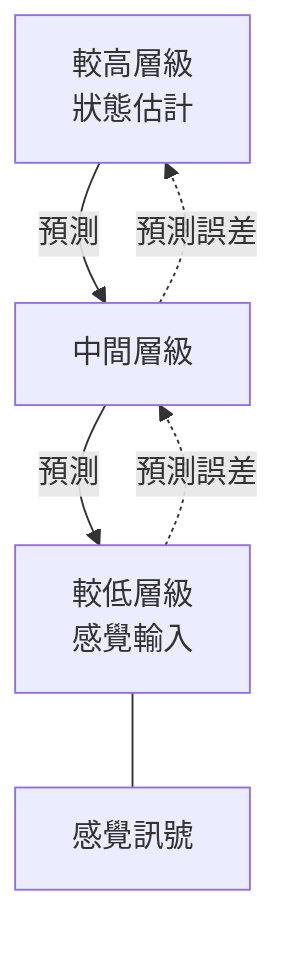

# 預測編碼與自由能原理

預測編碼主張大腦是一台預測機器。皮質的每一層不是把原始感覺資料往上傳，而是把自己最好的猜測送到下一層，真正往上傳的只有失配，也就是預測誤差。這個想法是理論神經科學中最有影響力的框架之一，在機器學習中也有一個近親。

## 概述

大腦接收的是一串沒有標籤的輸入訊號，必須從中理解世界。一種做法是建立訊號成因的模型，並用它預測接下來會發生什麼。預測編碼認為皮質正是這樣運作，而且是分層進行：較高的區域預測較低區域的活動，殘差誤差才向前傳遞。[認知科學](../cognitive-science/index.md)摘要了這個想法的心理學面向，本頁則說明機制、關鍵論文，以及與 AI 的連結。

## 核心概念

- **預測誤差（prediction error）**：某一層接收到的訊號，與它所預測的訊號之間的差。誤差是把資訊往上傳遞的載體。
- **階層式生成模型（hierarchical generative model）**：一疊層級，每一層為其下一層產生預測。知覺就是在這個模型上進行的推論。
- **自由能（free energy）**：統計學中的一個量，為驚訝程度提供上界。將其最小化可近似貝氏推論。自由能原理（Friston）主張，包括大腦在內的自我組織系統會透過最小化它來行動。
- **精確度（precision）**：指派給某個預測誤差的信心程度。依精確度為誤差加權，決定哪些訊號能通過，這是注意力的一種提出解釋。
- **主動推論（active inference）**：當模型對世界採取行動時，會改變感覺輸入，使預測成真。於是行動與知覺服務於同一目標。

## 運作方式

皮質被建模為數個層級，彼此交換兩種訊號。回饋連接向下傳遞預測，前饋連接向上傳遞殘差誤差。學習會調整模型，使未來的誤差縮小。

這個結構導出三個想法：

1. **知覺即解釋**：知覺是在當前模型下，對輸入最佳的解釋，而非輸入的複製。
2. **從失配中學習**：預測失敗時，模型會改變。學得很好的輸入應該只產生很小的誤差，這是對重複抑制（repetition suppression）的一種提出解讀。
3. **注意力即加權**：提高某個誤差訊號的精確度，會讓它主導更新，這為為何意外事件會吸引注意力提供了自然的解釋。

同樣的邏輯也出現在強化學習中。多巴胺神經元會對獎勵預測誤差作出反應，見[神經科學基礎](../neuroscience/index.md)，因此在一個神經調節系統中，預測誤差訊號早已為人所知。

## 關鍵方法

每種方法都有自己的頁面。下表只用來比較。

| 方法 | 它回答的問題 | 頁面 |
|---|---|---|
| 視覺皮質的預測編碼（Rao 與 Ballard，1999） | 攜帶預測的回饋與攜帶誤差的前饋訊號，能否解釋超古典感受野效應？ | [Rao 與 Ballard 1999](rao-ballard-1999/index.md) |
| 以局部學習近似反向傳播（Whittington 與 Bogacz，2017） | 具局部赫柏式可塑性的預測編碼網路，能否達到反向傳播的權重更新？ | [Whittington 與 Bogacz 2017](whittington-bogacz-2017/index.md) |

## 與其他主題的關聯

- **認知科學**：預測處理的心理學，包括自由能與貝氏框架，見[認知科學](../cognitive-science/index.md)。
- **神經科學**：多巴胺的獎勵預測誤差是另一個系統中的預測誤差訊號，見[神經科學基礎](../neuroscience/index.md)。
- **NeuroAI**：預測編碼網路是反向傳播的一個候選、具生物合理性的替代方案；AI 中的自監督預測目標也與同一想法相似。見 [NeuroAI](../neuroai/index.md)。
- **知覺**：視覺區域的階層結構見[知覺與視覺系統](../visual-perception/index.md)。
- **語言**：語言網路中逐詞預測的內容見[大腦中的語言](../language-in-brain/index.md)。

## 應用

- **異常偵測**：標記預測誤差很大的輸入的系統，用於在感測器資料中找出異常事件，例如設備故障與詐欺。原理與大腦的解釋相同，不過這些系統是工程化的，並非以皮質為模型。
- **機器學習研究**：預測編碼網路被當作區域性、具生物合理性的學習規則來研究。它們在大規模下的實際效益仍是開放的研究問題。
- **計算精神醫學**：有些研究者把症狀建模為預測誤差被異常加權。這些是待檢驗的假說，並非已確立的診斷。

## 開放問題

- **皮質是否實作預測編碼？** 階層式預測與許多資料相符，但具有獨立誤差與預測群體的特定電路實作，仍在檢驗中。
- **預測編碼網路能否在大規模下與反向傳播相當？** 在小型基準上的結果令人鼓舞，但在大型深度網路上的結果尚未確立。
- **自由能原理可否被證偽？** 批評者認為它太過一般而難以檢驗，支持者則視之為統一框架。爭論的焦點在於什麼才是可檢驗的預測。
- **精確度與注意力的關係為何？** 精確度加權提供了注意力的一種解釋，但需要直接的神經證據，才能與其他機制區分。

## 參考文獻

### 開創性論文

- Rao, R. P. N. & Ballard, D. H.（1999）。Predictive coding in the visual cortex: a functional interpretation of some extra-classical receptive-field effects. *Nature Neuroscience*。https://doi.org/10.1038/4580 — 提出回饋攜帶預測、前饋連接攜帶誤差，並顯示在自然影像上訓練的階層式網路會重現數種周邊效應。
- Friston, K.（2010）。The free-energy principle: a unified brain theory? *Nature Reviews Neuroscience*。https://doi.org/10.1038/nrn2787 — 提出大腦會最小化預測誤差，作為知覺、行動與學習的統一框架。（此參考文獻沿用自神經科學基礎頁面，本頁未重新檢驗。）
- Whittington, J. C. R. & Bogacz, R.（2017）。An Approximation of the Error Backpropagation Algorithm in a Predictive Coding Network with Local Hebbian Synaptic Plasticity. *Neural Computation*。https://doi.org/10.1162/NECO_a_00949 — 顯示在適當參數下，具局部可塑性的預測編碼可近似反向傳播。

### 綜述與回顧

- Clark, A.（2013）。Whatever next? Predictive brains, situated agents, and the future of cognitive science. *Behavioral and Brain Sciences*。https://doi.org/10.1017/S0140525X12000477 — 將預測處理視為知覺、行動與認知的統一框架的回顧。（此參考文獻沿用自認知科學頁面，本頁未重新檢驗。）
- Keller, G. B. & Mrsic-Flogel, T. D.（2018）。Predictive Processing: A Canonical Cortical Computation. *Neuron*。https://doi.org/10.1016/j.neuron.2018.10.003 — 主張預測處理是皮質各處重複出現的電路層級計算，並討論如何檢驗它。
