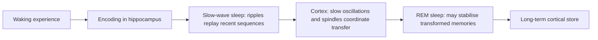

# Sleep, Replay and Memory Consolidation

Memory consolidation is the process that turns a fresh experience into a durable memory. During sleep, the brain appears to replay recent experience, most clearly in the hippocampus during slow-wave sleep, and this replay helps move memories into neocortical stores. The same idea, replaying stored experience so that earlier learning is protected, is now a standard tool in artificial intelligence.

## Overview

People often remember material better after a night's sleep than after the same interval spent awake (Diekelmann & Born, 2010). Sleep is therefore more than rest for memory. Early studies of amnesia showed that the hippocampus is needed to form new episodic memories, as described in [Memory & Learning in the Brain](../memory-learning/index.md). Later lesion and recording studies showed that many memories become independent of the hippocampus with time, a process called systems consolidation (Squire & Alvarez, 1995; Frankland & Bontempi, 2005).

The open question is what moves a memory from one store to the other. A leading proposal is that recent experience is reactivated offline, during sleep, and that the reactivation trains the neocortex. Wilson and McNaughton (1994) gave this idea a physiological form: patterns of hippocampal place-cell firing that occurred during a waking task reappeared in the sleep that followed. The theory that explains why two stores are needed, in which fast hippocampal learning feeds slow cortical learning through replay, is the [complementary learning systems](../memory-learning/complementary-learning-systems/index.md) account.

The page closes with the AI analogue, experience replay.

## Key concepts

- **Consolidation**: the stabilisation of a memory over time after it has been encoded.
- **Systems consolidation**: the gradual change in which a memory depends less on the hippocampus and more on distributed neocortical circuits.
- **Replay**: the re-expression of a neural sequence that occurred during waking experience, during rest or sleep.
- **Sharp-wave ripple**: a brief burst of high-frequency activity in the hippocampus, seen during quiet rest and slow-wave sleep, in which replay is expressed.
- **Slow-wave sleep (SWS)**: the deepest non-REM sleep, marked by large, slow cortical oscillations.
- **REM sleep**: the stage of rapid eye movements and dream-like activity. Its role in memory is less well established than that of SWS.

## How it works

Sleep cycles between non-REM stages, including slow-wave sleep, and REM sleep. Slow-wave sleep is concentrated early in the night. A widely discussed two-stage account holds that reactivation during slow-wave sleep transforms and integrates recent memories, and that REM sleep may then stabilise the transformed memories (Rasch & Born, 2013).

During slow-wave sleep, the hippocampus produces sharp-wave ripples. These are the setting for replay. In humans, ripples recorded in the hippocampus during sleep are nested within sleep spindles, which are themselves nested within slow cortical oscillations (Staresina et al., 2015). This nesting is one proposal for how the hippocampus and cortex are coordinated during consolidation.

Replay is compressed in time: a behavioural sequence can reappear in a condensed form (Buzsáki, 2015). Replay can also run in reverse order (Foster & Wilson, 2006). Some replay runs forward and some in reverse within the same ripples (Diba & Buzsáki, 2007).

Not every account of sleep gives replay the central role. The synaptic homeostasis hypothesis proposes that sleep reduces overall synaptic strength, which keeps learning from saturating the network.[^1] The two ideas are not necessarily exclusive, but the field has not settled how they fit together.

## Key methods

Each method has its own page. This table is only a comparison.

| Method | What separates it | Page |
|---|---|---|
| Hippocampal replay (Wilson & McNaughton, 1994) | Ensembles of place cells are recorded during tasks and sleep, and their waking co-firing is seen to recur in sleep | [Hippocampal Replay](hippocampal-replay/index.md) |
| Targeted memory reactivation (Rasch et al., 2007) | A cue presented during learning is presented again during sleep, to test whether reactivation causes consolidation | [Targeted Memory Reactivation](targeted-memory-reactivation/index.md) |

## Connections

- **Memory and learning**: the lesion evidence, synaptic plasticity and the hippocampal-cortical division of labour are covered in [Memory & Learning in the Brain](../memory-learning/index.md), and the systems-level theory in [Complementary Learning Systems](../memory-learning/complementary-learning-systems/index.md). This page builds on both and does not repeat them.
- **Planning and decisions**: Mattar and Daw (2018) link replay to planning, so replay is also part of decision making. See [Decision Making, Dopamine & Reward](../decision-reward/index.md).
- **Experience replay**: in deep reinforcement learning, a buffer of past transitions is replayed to train the agent. This is the AI counterpart described in [Experience Replay](../../theory/paradigms/reinforcement-learning/experience-replay/index.md), and the continual-learning view is in [Replay and Memory-based Continual Learning](../../theory/paradigms/continual/replay-and-memory/index.md).

## Applications

- **Reinforcement learning**: replaying stored transitions stabilises the training of value-based agents. Mnih et al. (2015) trained deep Q-networks on Atari games with a replay memory, and Fedus et al. (2020) study how the replay capacity and the replay ratio affect performance.
- **Continual learning**: catastrophic interference (McCloskey & Cohen, 1989) is the artificial version of the problem that replay addresses. Shin et al. (2017) draw on the hippocampus to propose generative replay, in which a generative model supplies samples of earlier tasks. Kirkpatrick et al. (2016) instead slow learning on weights that matter for earlier tasks, a regularisation approach inspired by synaptic consolidation. See [Continual Learning](../../theory/paradigms/continual/index.md).
- **Research tools**: targeted memory reactivation lets experimenters test whether a particular memory is reactivated during sleep, which is a causal test (Rasch et al., 2007).
- **Clinical neuroscience**: Buzsáki (2015) notes that pathological ripples, known as p-ripples, are discussed as a marker of epileptic tissue.

## Open questions

- **Is replay causal?** Cueing studies and ripple disruption both suggest that replay matters for memory, but the link between a particular replayed pattern and a particular stored memory is still being tested.
- **What decides which experiences are replayed?** Mattar and Daw (2018) argue that prioritised memory access, tied to planning, can explain the pattern of hippocampal replay. The rules for priority are still an open matter.
- **What is the role of synaptic downscaling?** The synaptic homeostasis hypothesis and the consolidation account make different predictions, and it is not clear whether both describe functions of sleep.
- **How far does the AI analogy go?** Kumaran et al. (2016) argue that replay and complementary systems are useful ideas for agents. Deep RL replay usually uses a fixed schedule, without the sleep-like structure of the brain.
- **How much evidence comes from humans?** Most detailed replay evidence comes from rodents, and human recordings are rarer. See Staresina et al. (2015).

## References

### Seminal papers

- Wilson, M. A. & McNaughton, B. L. (1994). Reactivation of Hippocampal Ensemble Memories During Sleep. *Science*. https://doi.org/10.1126/science.8036517 — Records place-cell ensembles during spatial tasks and in sleep, and shows that waking co-firing patterns recur in later sleep.
- Foster, D. J. & Wilson, M. A. (2006). Reverse replay of behavioural sequences in hippocampal place cells during the awake state. *Nature*. https://doi.org/10.1038/nature04587 — Reports that place-cell sequences from running are replayed in reverse order during the awake state, extending replay beyond sleep.
- Diba, K. & Buzsáki, G. (2007). Forward and reverse hippocampal place-cell sequences during ripples. *Nature Neuroscience*. https://doi.org/10.1038/nn1961 — Reports that place-cell sequences replayed during sharp-wave ripples run both forward and in reverse.
- Ji, D. & Wilson, M. A. (2006). Coordinated memory replay in the visual cortex and hippocampus during sleep. *Nature Neuroscience*. https://doi.org/10.1038/nn1825 — Reports that replay during sleep is coordinated between visual cortex and hippocampus.
- Rasch, B., Büchel, C., Gais, S. & Born, J. (2007). Odor Cues During Slow-Wave Sleep Prompt Declarative Memory Consolidation. *Science*. https://doi.org/10.1126/science.1138581 — Shows that re-presenting a learning odour during slow-wave sleep improves retention of declarative memories.
- McCloskey, M. & Cohen, N. J. (1989). Catastrophic Interference in Connectionist Networks: The Sequential Learning Problem. *Psychology of Learning and Motivation*. https://doi.org/10.1016/S0079-7421(08)60536-8 — Identifies catastrophic interference, in which learning new items overwrites earlier learning in connectionist networks.
- Lin, L.-J. (1992). Self-improving reactive agents based on reinforcement learning, planning and teaching. *Machine Learning*. https://doi.org/10.1007/BF00992699 — Early work combining reinforcement learning with replay of stored experience, a precursor of experience replay.
- Mnih, V. et al. (2015). Human-level control through deep reinforcement learning. *Nature*. https://doi.org/10.1038/nature14236 — Introduces the deep Q-network, which learns Atari games from pixels using a replay memory of past transitions.
- Staresina, B. P. et al. (2015). Hierarchical nesting of slow oscillations, spindles and ripples in the human hippocampus during sleep. *Nature Neuroscience*. https://doi.org/10.1038/nn.4119 — Reports that hippocampal ripples recorded in humans during sleep are nested within spindles and slow oscillations.
- Mattar, M. G. & Daw, N. D. (2018). Prioritized memory access explains planning and hippocampal replay. *Nature Neuroscience*. https://doi.org/10.1038/s41593-018-0232-z — Proposes that prioritised memory access, linked to planning, can explain the pattern of hippocampal replay.
- Shin, H. et al. (2017). Continual Learning with Deep Generative Replay. arXiv. https://arxiv.org/abs/1705.08690 — Proposes generative replay, in which a generative model supplies samples of earlier tasks to be interleaved with new training.
- Kirkpatrick, J. et al. (2016). Overcoming catastrophic forgetting in neural networks. arXiv. https://arxiv.org/abs/1612.00796 — Proposes elastic weight consolidation, which slows learning on weights important to earlier tasks.
- Fedus, W. et al. (2020). Revisiting Fundamentals of Experience Replay. arXiv. https://arxiv.org/abs/2007.06700 — Studies how replay capacity and the replay ratio affect Q-learning methods.

### Surveys and textbooks

- Diekelmann, S. & Born, J. (2010). The memory function of sleep. *Nature Reviews Neuroscience*. https://doi.org/10.1038/nrn2762 — Reviews the evidence that sleep contributes to memory processing, and how different sleep stages do so.
- Walker, M. P. & Stickgold, R. (2004). Sleep-Dependent Learning and Memory Consolidation. *Neuron*. https://doi.org/10.1016/j.neuron.2004.08.031 — Reviews how sleep after learning supports memory consolidation in humans.
- Born, J. & Wilhelm, I. (2011). System consolidation of memory during sleep. *Psychological Research*. https://doi.org/10.1007/s00426-011-0335-6 — Reviews how sleep drives system consolidation, the gradual transfer of memories between brain systems.
- Rasch, B. & Born, J. (2013). About Sleep's Role in Memory. *Physiological Reviews*. https://doi.org/10.1152/physrev.00032.2012 — Reviews how slow-wave sleep reactivation drives consolidation, and how REM sleep may stabilise memories.
- Buzsáki, G. (2015). Hippocampal sharp wave-ripple: A cognitive biomarker for episodic memory and planning. *Hippocampus*. https://doi.org/10.1002/hipo.22488 — Reviews sharp-wave ripples as the setting for compressed replay, and the evidence that disrupting them impairs memory.
- Kumaran, D., Hassabis, D. & McClelland, J. L. (2016). What learning systems do intelligent agents need? Complementary learning systems theory updated. *Trends in Cognitive Sciences*. https://doi.org/10.1016/j.tics.2016.05.004 — Revisits complementary learning systems theory in light of deep learning and replay.
- Squire, L. R. & Alvarez, P. (1995). Retrograde amnesia and memory consolidation: a neurobiological perspective. *Current Opinion in Neurobiology*. https://doi.org/10.1016/0959-4388(95)80023-9 — Reviews retrograde amnesia as evidence that memories undergo a gradual, time-dependent consolidation in the brain.
- Frankland, P. W. & Bontempi, B. (2005). The organization of recent and remote memories. *Nature Reviews Neuroscience*. https://doi.org/10.1038/nrn1607 — Reviews how recent and remote memories are organised in the brain, and how their storage changes over time.
- Tononi, G. & Cirelli, C. (2006). Sleep function and synaptic homeostasis. *Sleep Medicine Reviews*. https://doi.org/10.1016/j.smrv.2005.05.002 — Proposes that sleep reduces overall synaptic strength, a hypothesis about sleep's function that remains debated.

[^1]: Tononi and Cirelli (2006) propose that synaptic strength rises on average during waking and is reduced during sleep. The hypothesis is one of several accounts of sleep's function, and its evidence is debated.
