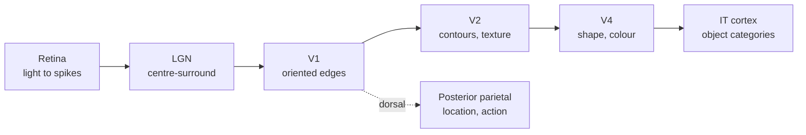

# Perception and the Visual System

Vision is the best-studied sense in the brain, and it is the sense where deep learning and neuroscience have most visibly converged. Computer vision systems that classify images are built from layers that look a lot like the visual cortex, and comparing the two has become a research method in its own right.

## Overview

When you look at a scene, your eyes give the brain a stream of light intensities. From that, the brain must recover objects, their positions, their motion and their identities, quickly and despite changes in lighting, viewpoint and occlusion. Perception is the process of turning raw sensory signals into this kind of usable description. [Cognitive Science](../cognitive-science/index.md) treats perception as inference under uncertainty; this page covers the machinery that carries it out.

## Key concepts

- **Receptive field**: the region of the visual field, and the pattern of light that drives a given neuron. Receptive fields grow larger at each stage of the hierarchy.
- **Hierarchy**: a sequence of processing stages in which each stage builds on the one before it. In primates, the ventral stream runs from the retina and lateral geniculate nucleus to primary visual cortex (V1), then to V2, V4 and inferior temporal (IT) cortex.
- **Ventral and dorsal streams**: the ventral "what" pathway supports object recognition, and the dorsal "where/how" pathway supports location and action. Goodale and Milner (1992) argued that the two streams serve perception and action respectively.
- **Invariance**: the ability to recognise an object across changes in position, size, viewpoint and lighting. Invariance grows along the ventral stream.
- **Feature selectivity**: a neuron responds strongly to some patterns and weakly to others. Early cells respond to oriented edges, while later cells respond to faces, bodies and object categories.

## How it works

The classic picture comes from single-neuron recordings in cat and monkey visual cortex. Hubel and Wiesel (1962) found that neurons in V1 respond to oriented edges in specific locations, and that complex cells combine simple cells with a similar orientation over a wider region. See [Neuroscience Basics](../neuroscience/index.md) for the recording method and the cell types.

Three principles recur across the hierarchy:

1. **Local to global**: small receptive fields detect local features, and their combinations cover larger regions.
2. **Feature learning**: the selectivity of each stage is shaped by experience, most clearly in early life, when deprived vision leaves lasting deficits.
3. **Feedback**: higher areas send signals back to lower ones. Feedback likely supports attention, expectation and filling in, although its exact role is still debated.

Convolutional neural networks ([CNN](../../theory/models/cnn/index.md)) implement the first principle directly. Each layer applies the same local filters across the image, and deeper layers combine them into larger and more invariant features. This architectural resemblance is why the two fields keep meeting.

## Key methods

### Performance-optimised networks predict IT cortex (Yamins et al. 2014)

- **Problem:** Do models that are good at object recognition also explain the neural responses of higher visual cortex, or is the match a coincidence of architecture?
- **Core idea:** Search a large family of hierarchical convolutional networks for those whose object-categorisation performance is highest, then test how well each model predicts the responses of individual sites in IT and V4 to natural images. The authors report that categorisation performance is strongly correlated with how well a network predicts IT responses, without the network being fitted to neural data.
- **Equation or algorithm:**
  1. Define a family of hierarchical networks that differ in depth, filter sizes and connectivity.
  2. Train each network on an object-recognition task, and score its performance.
  3. Select the networks with high recognition performance; the selected model matches human performance on several recognition tests.
  4. Use linear regression from the model's layers to recorded IT and V4 responses on held-out images, and measure how well the model predicts each site.
- **Results:** The paper reports that the top layer of the selected network predicts IT spiking responses to natural images at both single-site and population levels, and that intermediate layers predict V4 responses. The abstract gives no numerical correlation values, so check the full paper for them.
- **Limitations:** The comparison uses a limited set of images and recorded sites, and a good linear fit does not show that the model uses the same computation as the brain. Later benchmark work compares many more models against neural data, and whether this predictive power transfers to new stimuli and species remains open.

### Shape bias in CNNs (Geirhos et al. 2019)

- **Problem:** Do ImageNet-trained CNNs recognise objects by shape, as people do, or by texture?
- **Core idea:** Build a "Stylized-ImageNet" dataset in which each image keeps its object shape but has the texture of a different image. Compare how networks and people classify these images, and then train the same architecture on the stylised data.
- **Equation or algorithm:**
  1. Apply style transfer to ImageNet images, so that object shape and texture conflict.
  2. Test standard ImageNet-trained networks and human observers on the conflict images.
  3. Train the same architecture (ResNet-50) on a mixture of standard and stylised images.
  4. Measure shape-based classification, object detection and robustness to distortions.
- **Results:** Standard networks relied mainly on texture, unlike humans. Training on stylised images shifted the networks toward shape, which matched human behaviour more closely and improved object detection and robustness to image distortions.
- **Limitations:** The style-transfer data is an intervention on one kind of shortcut, not a full account of human vision. Shape bias does not remove other failures, such as adversarial vulnerability.

## Connections

- **Neuroscience**: the cortical hierarchy and receptive-field work behind this page is in [Neuroscience Basics](../neuroscience/index.md). The architecture families used as models are on the [CNN](../../theory/models/cnn/index.md) and [Computer Vision](../../theory/models/computer-vision/index.md) pages.
- **Cognitive science**: perception as inference, the two-stream account and the predictive view of perception are summarised in [Cognitive Science](../cognitive-science/index.md).
- **NeuroAI**: using networks as models of the visual cortex is covered in [NeuroAI](../neuroai/index.md).
- **Applications**: vision systems run in [Autonomous Driving & Transport](../../applications/autonomous-driving/index.md) and [Healthcare](../../applications/healthcare/index.md), where errors have real costs.

## Applications

- **Medical imaging**: detecting tumours and other findings in radiographs and pathology slides, where CNNs now match or exceed specialist performance on several narrow tasks.
- **Autonomous driving**: detecting pedestrians and lanes from camera input, combined with other sensors. See [Autonomous Driving & Transport](../../applications/autonomous-driving/index.md).
- **Biometric recognition**: face and iris recognition, which raises the privacy and fairness questions that the [Ethics](../../society/ethics/index.md) pages cover.

## Open questions

- **How much do deep networks share with the brain?** Architectural and predictive similarity is clear, but whether the same internal computations are used is not. Results depend on the stimuli and the benchmark.
- **Why do humans rely on shape while networks rely on texture?** Shape bias emerges with training data and objectives, but the link to human development is not understood.
- **What is the role of feedback?** Most deep vision models are purely feedforward, while the cortex has rich feedback. Whether feedback is needed for robust perception is an active question.
- **Adversarial fragility**: networks can be fooled by small changes that humans ignore, which suggests the features used differ from the brain's.

## References

### Seminal papers

- Hubel, D. H. & Wiesel, T. N. (1962). Receptive fields, binocular interaction and functional architecture in the cat's visual cortex. *The Journal of Physiology*. https://doi.org/10.1113/jphysiol.1962.sp006837 — Discovers orientation-selective simple and complex cells, the biological inspiration for hierarchical vision models.
- Goodale, M. A. & Milner, A. D. (1992). Separate visual pathways for perception and action. *Trends in Neurosciences*. https://pubmed.ncbi.nlm.nih.gov/1374953/ — Proposes the ventral "what" and dorsal "how" pathways, a framework still used in vision research.
- Krizhevsky, A., Sutskever, I. & Hinton, G. E. (2012). ImageNet Classification with Deep Convolutional Neural Networks. *NeurIPS*. https://papers.nips.cc/paper/2012/hash/c399862d3b9d6b76c8436e924a68c45b-Abstract.html — The AlexNet paper that made deep convolutional networks the standard model for image recognition.
- Yamins, D. L. K., Hong, H., Cadieu, C. F., Solomon, E. A., Seibert, D. & DiCarlo, J. J. (2014). Performance-optimized hierarchical models predict neural responses in higher visual cortex. *PNAS*. https://doi.org/10.1073/pnas.1403112111 — Shows that object-recognition performance predicts how well networks explain IT responses.
- Geirhos, R., Rubisch, P., Michaelis, C., Bethge, M., Wichmann, F. A. & Brendel, W. (2019). ImageNet-trained CNNs are biased towards texture. *ICLR*. https://arxiv.org/abs/1811.12231 — Shows that standard CNNs rely on texture, and that stylised training shifts them toward shape.

### Surveys and textbooks

- Lindsay, G. W. (2021). Convolutional Neural Networks as a Model of the Visual System: Past, Present, and Future. *Journal of Cognitive Neuroscience*. https://doi.org/10.1162/jocn_a_01544 — A review of how CNNs have been used as models of the visual system, and what they explain and miss.
- Kriegeskorte, N. (2015). Deep neural networks: a new framework for modelling biological vision and brain information processing. bioRxiv preprint. https://doi.org/10.1101/029876 — Argues for using deep networks as candidate models of the brain's information processing, with the evaluation issues this raises.

### Lectures and videos

- Yamins, D., *Predictive Models of Neurons in Sensory Cortex*, Stanford University course materials. https://web.stanford.edu/~yamins/computational-models-of-sensory-cortex.html — Course materials on using optimised networks to model sensory cortex, written by the author of the 2014 paper.
