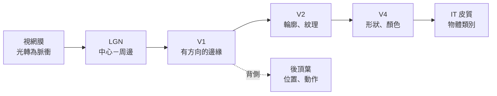

# 知覺與視覺系統

視覺是腦科學研究最深入的感覺，也是深度學習與神經科學最明顯交會的領域。能夠辨識影像的電腦視覺系統，其分層結構與視覺皮層十分相似，比較兩者已成為一種獨立的研究方法。

## 概述

當你看著一個場景時，眼睛送入大腦的是一串光強度的訊號。大腦必須從中還原出物體、位置、動作與身分，而且要快速完成，並且能應付光線、視角與遮擋的變化。知覺就是把原始感覺訊號轉換成可用描述的過程。[認知科學](../cognitive-science/index.md)把知覺視為不確定條件下的推論；本頁則說明負責執行這件事的機制。

## 核心概念

- **感受野（receptive field）**：某個神經元會被反應的視野區域，以及驅動它的光線圖案。感受野在階層中逐層變大。
- **階層（hierarchy）**：一連串處理階段，每一階段建立在前一階段之上。在靈長類中，腹側路徑從視網膜與外側膝狀體走到初級視覺皮層（V1），再到 V2、V4 與下顳葉（IT）皮質。
- **腹側與背側路徑**：腹側「什麼」路徑負責物體辨識，背側「在哪裡／如何」路徑負責位置與動作。Goodale 與 Milner（1992）主張這兩條路徑分別服務知覺與動作。
- **不變性（invariance）**：在位置、大小、視角與光線改變時仍能辨認同一物體的能力。沿著腹側路徑，不變性會逐步增強。
- **特徵選擇性（feature selectivity）**：神經元對某些圖案強烈反應，對其他圖案反應微弱。早期細胞對有方向的邊緣反應，後期細胞則對臉孔、身體與物體類別反應。

## 運作方式

古典圖像來自貓與猴子視覺皮層的單神經元記錄。Hubel 與 Wiesel（1962）發現 V1 的神經元會對特定位置、特定方向的邊緣反應，而複雜細胞會把方向相近的簡單細胞在較大區域內加總起來。記錄方法與細胞類型可參閱[神經科學基礎](../neuroscience/index.md)。

有三項原則貫穿整個階層：

1. **由局部到整體**：小的感受野偵測局部特徵，這些特徵再組合成覆蓋更大區域的表徵。
2. **特徵學習**：每一階段的選擇性都受經驗塑造，最明顯的例子是幼年期：若視覺被剝奪，會留下持久的缺陷。
3. **回饋**：較高的區域會把訊號送回較低的區域。回饋可能支持注意力、預期與補全，但確切作用仍有爭議。

卷積神經網路（[CNN](../../theory/models/cnn/index.md)）直接實現了第一項原則。每一層把同一組局部濾波器套用到整張影像上，較深的層再把它們組合成更大、更具不變性的特徵。這種架構上的相似，正是兩個領域不斷交會的原因。

## 關鍵方法

每種方法都有自己的頁面。下表只用來比較。

| 方法 | 它回答的問題 | 頁面 |
|---|---|---|
| 效能最佳化的網路（Yamins 等人，2014） | 為辨識效能而選出的網路，是否也能預測 IT 皮質的神經反應？ | [Yamins 等人 2014](yamins-2014/index.md) |
| CNN 的形狀偏好（Geirhos 等人，2019） | 在 ImageNet 上訓練的網路，是像人一樣依形狀辨識物體，還是依紋理？ | [Geirhos 等人 2019](geirhos-2019/index.md) |

## 與其他主題的關聯

- **神經科學**：本頁背後的皮質階層與感受野研究，見[神經科學基礎](../neuroscience/index.md)。作為模型的架構家族，見 [CNN](../../theory/models/cnn/index.md) 與[電腦視覺](../../theory/models/computer-vision/index.md)兩頁。
- **認知科學**：知覺作為推論、注意力與預測觀點，摘要於[認知科學](../cognitive-science/index.md)。
- **NeuroAI**：以網路作為視覺皮層模型的做法，見 [NeuroAI](../neuroai/index.md)。
- **應用**：視覺系統應用於[自動駕駛與交通](../../applications/autonomous-driving/index.md)及[醫療保健](../../applications/healthcare/index.md)，錯誤的代價都很實際。

## 應用

- **醫學影像**：在 X 光片與病理切片中偵測腫瘤與其他發現。在若干狹窄任務上，CNN 的表現已能達到或超過專科醫師。
- **自動駕駛**：從攝影機輸入偵測行人與車道，並與其他感測器結合。見[自動駕駛與交通](../../applications/autonomous-driving/index.md)。
- **生物辨識**：臉部與虹膜辨識，這也引出[倫理](../../society/ethics/index.md)各頁所討論的隱私與公平性問題。

## 開放問題

- **深度網路與大腦有多少共通之處？** 架構與預測上的相似很清楚，但它們是否使用相同的內部運算仍不確定。結果取決於刺激與基準。
- **為何人類依賴形狀，而網路依賴紋理？** 形狀偏好隨訓練資料與目標而出現，但與人類發展的關係尚不清楚。
- **回饋的作用是什麼？** 多數深度視覺模型是純前饋的，而皮質有豐富的回饋連接。回饋是否為穩健知覺所必需，仍是活躍的問題。
- **對抗性脆弱**：網路會被人類忽略的微小變化欺騙，這顯示它們使用的特徵與大腦不同。

## 參考文獻

### 開創性論文

- Hubel, D. H. & Wiesel, T. N.（1962）。Receptive fields, binocular interaction and functional architecture in the cat's visual cortex. *The Journal of Physiology*。https://doi.org/10.1113/jphysiol.1962.sp006837 — 發現有方向選擇性的簡單與複雜細胞，是階層式視覺模型的生物學靈感。
- Goodale, M. A. & Milner, A. D.（1992）。Separate visual pathways for perception and action. *Trends in Neurosciences*。https://pubmed.ncbi.nlm.nih.gov/1374953/ — 提出腹側「什麼」與背側「如何」路徑，至今仍是視覺研究的主要架構。
- Krizhevsky, A., Sutskever, I. & Hinton, G. E.（2012）。ImageNet Classification with Deep Convolutional Neural Networks. *NeurIPS*。https://papers.nips.cc/paper/2012/hash/c399862d3b9d6b76c8436e924a68c45b-Abstract.html — AlexNet 論文，使深度卷積網路成為影像辨識的標準模型。
- Yamins, D. L. K., Hong, H., Cadieu, C. F., Solomon, E. A., Seibert, D. & DiCarlo, J. J.（2014）。Performance-optimized hierarchical models predict neural responses in higher visual cortex. *PNAS*。https://doi.org/10.1073/pnas.1403112111 — 顯示物體辨識效能能預測網路對 IT 反應的解釋力。
- Geirhos, R., Rubisch, P., Michaelis, C., Bethge, M., Wichmann, F. A. & Brendel, W.（2019）。ImageNet-trained CNNs are biased towards texture. *ICLR*。https://arxiv.org/abs/1811.12231 — 顯示一般 CNN 依賴紋理，風格化訓練可使其轉向形狀。

### 綜述與教科書

- Lindsay, G. W.（2021）。Convolutional Neural Networks as a Model of the Visual System: Past, Present, and Future. *Journal of Cognitive Neuroscience*。https://doi.org/10.1162/jocn_a_01544 — 回顧 CNN 作為視覺系統模型的用法，以及它能解釋與無法解釋的部分。
- Kriegeskorte, N.（2015）。Deep neural networks: a new framework for modelling biological vision and brain information processing. bioRxiv 預印本。https://doi.org/10.1101/029876 — 主張以深度網路作為大腦資訊處理的候選模型，並討論由此產生的評估問題。

### 講座與影片

- Yamins, D., *Predictive Models of Neurons in Sensory Cortex*，史丹佛大學課程資料。https://web.stanford.edu/~yamins/computational-models-of-sensory-cortex.html — 由 2014 年論文作者撰寫的課程資料，說明如何以最佳化網路模擬感覺皮質。
