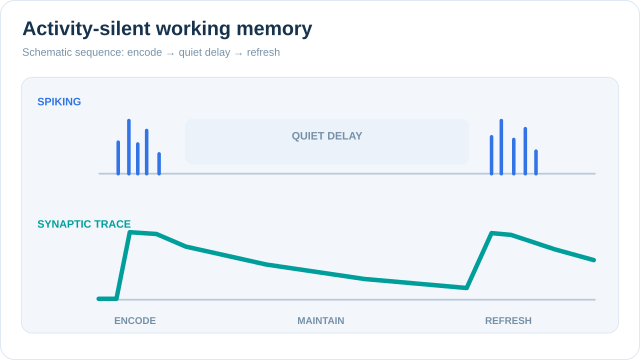

# Activity-silent working memory (Mongillo et al., 2008; Stokes, 2015)

Activity-silent working memory is the idea that information can be held across a delay without neurons firing continuously. The memory is carried by transient changes in synaptic strength or other hidden states, and a brief reactivation can bring it back into spiking when needed. Mongillo, Barak and Tsodyks (2008) gave an explicit synaptic model, and Stokes (2015) reviews the evidence and sets out a dynamic coding framework.

This page is one method within [Working Memory and Executive Function](../index.md). The competing account, in which memory is kept by sustained firing, is summarised there.

## Overview

For a long time, working memory was assumed to be persistent. Neurons were thought to keep firing through a delay, and that firing was the memory. Population-level analyses show that brain activity is highly dynamic, and Stokes (2015) reviews accumulating evidence that memory is carried by activity-silent neural states.

Activity-silent accounts answer that the stable part of the memory need not be in spiking at all. It can be stored in synapses or other hidden states, so that spiking may fall silent during the delay.

## Problem

If memory depended only on ongoing spiking, maintaining it would be costly and fragile, and the spiking patterns would need to be stable throughout the delay. Two observations challenged this view. Persistent delay activity does not always accompany maintenance, and population activity is highly dynamic. The problem is to explain how information survives a delay in which the visible activity does not hold it steady.

## Core idea

Two linked ideas describe the account.

1. **Synaptic storage.** Mongillo et al. (2008) propose that working memory is sustained by calcium-mediated synaptic facilitation in the recurrent connections of neocortical networks. Residual calcium in presynaptic terminals acts as a buffer. Spiking loads, refreshes and reads out this buffer. Because calcium decays slowly, the refresh can be infrequent.
2. **Dynamic hidden states.** Stokes (2015) reviews evidence for activity-silent neural states and proposes a dynamic coding framework, in which memory is encoded in patterns of connectivity. Wolff et al. (2017) report evidence for hidden states in working-memory-guided behaviour.

## Equation or algorithm

No single equation summarises the framework, and the mechanism is written here as numbered steps for the synaptic version.

1. A brief burst of spiking in a population loads residual calcium into its recurrent synapses, which strengthens the connections within that population.
2. Between refreshes the calcium decays slowly, so the synaptic facilitation, and the memory it encodes, persists without sustained spiking.
3. A refresh by spiking reads out the memory and reloads the calcium.

The steps describe a simplified model. Other hidden-state mechanisms are possible, and Stokes (2015) discusses activity-silent states more generally.

### Teaching animation: spiking, silent delay and synaptic refresh

The top track displays **brief spiking bursts**, separated by a **quiet delay**. The lower track shows a **hidden, decaying synaptic facilitation trace** that remains above its initial level during that delay, before a later burst refreshes it. The moving cursor reveals the two signals along a shared illustrative timeline. The key distinction is *maintenance without continuous visible spiking*, not complete absence of neural activity. The waveform, decay profile and times are **schematic and not measured calcium, synaptic efficacy or firing data**, nor a numerical reproduction of Mongillo et al. (2008). Activity-silent memory is one account, not a claim that all working-memory tasks suppress persistent firing (see Stokes, 2015).

On the MkDocs site, use **Play/Pause** or **Enter/Space** when the button is focused; reduced-motion preferences show the still figure. The diagram region can be focused and scrolled on narrow screens. GitHub displays the complete static sequence. Both visuals are original **CC BY-SA 4.0** teaching illustrations.

## Results

- **Synaptic model.** Mongillo et al. (2008) propose that a memory can be sustained by calcium-mediated synaptic facilitation, refreshed by spiking. This page does not summarise the paper's quantitative results, which should be read from the paper.

## Limitations

- **Indirect evidence.** Hidden states are inferred from decoding and perturbation, not seen directly. A perturbation is itself an intervention, so reading a hidden state this way needs careful controls.
- **Persistent firing still occurs.** Sustained delay activity has been reported in many prefrontal studies (Curtis & D'Esposito, 2003). Activity-silent accounts probably describe some conditions better than others, and the boundary is not settled.
- **Model specificity.** The synaptic model is one specific mechanism, and the framework is a dynamic account rather than a single experiment.

## Connections

- **Persistent activity.** The sustained-firing view is represented by the network model of Compte et al. (2000) and the recordings of Funahashi et al. (1989), summarised in the [parent overview](../index.md).
- **Synaptic plasticity.** The calcium-based storage in Mongillo et al. (2008) is a short-term form of synaptic facilitation, on a faster timescale than the long-term changes studied in [Long-term potentiation](../../memory-learning/long-term-potentiation/index.md). The link is conceptual.
- **Gated maintenance.** [PBWM](../pbwm/index.md) describes maintenance as an active, gated store. Both accounts can apply to different parts of a task.
- **Neuroimaging.** Reading hidden states needs methods that do not depend on spiking, such as perturbation with EEG. See [Neuroimaging & Recording Methods](../../neuroimaging-methods/index.md).
- **AI.** A synaptic account of memory is an analogy to storage in changing weights, not a claim about how machine memory is implemented. The [Transformer](../../../theory/models/transformer/index.md) page describes one machine design.

## Applications

- **Experimental design.** Perturbation and decoding methods are used to read memory when ongoing activity does not show it.
- **Models of maintenance.** Synaptic models of working memory inspire network models in which memory is kept by connection strengths rather than by sustained firing (Mongillo et al., 2008).

## Open questions

- **Which mechanism holds the memory in a given task?** Synaptic storage, dynamic hidden states and persistent firing each have supporting evidence. The conditions that favour each are not clear.
- **How are hidden states reactivated?** Mongillo et al. (2008) describe refresh by spiking. The role of other triggers, such as stimuli or attention, is an open question.
- **How does storage relate to capacity?** Whether activity-silent storage explains the capacity limits reported by Cowan (2001) and by Ma et al. (2014) is an open question.

## References

### Seminal papers

- Mongillo, G., Barak, O. & Tsodyks, M. (2008). Synaptic theory of working memory. *Science* 319, 1543–1546. https://doi.org/10.1126/science.1150769 — Proposes that working memory is sustained by calcium-mediated synaptic facilitation, refreshed by spiking.
- Wolff, M. J., Jochim, J., Akyürek, E. G. & Stokes, M. G. (2017). Dynamic hidden states underlying working-memory-guided behavior. *Nature Neuroscience* 20, 864–871. https://doi.org/10.1038/nn.4546 — Reports evidence for hidden states underlying working-memory-guided behaviour.
- Compte, A. et al. (2000). Synaptic mechanisms and network dynamics underlying spatial working memory in a cortical network model. *Cerebral Cortex* 10, 910–923. https://doi.org/10.1093/cercor/10.9.910 — A cortical network model of spatial working memory in which persistent activity sustains the memory.

- Funahashi, S., Bruce, C. J. & Goldman-Rakic, P. S. (1989). Mnemonic coding of visual space in the monkey's dorsolateral prefrontal cortex. *Journal of Neurophysiology* 61, 331–349. https://doi.org/10.1152/jn.1989.61.2.331 — Records delay-period activity in monkey dorsolateral prefrontal cortex, the persistent-firing evidence that the synaptic account is set against.

### Surveys and textbooks

- Stokes, M. G. (2015). 'Activity-silent' working memory in prefrontal cortex: a dynamic coding framework. *Trends in Cognitive Sciences* 19, 394–405. https://doi.org/10.1016/j.tics.2015.05.004 — Reviews evidence for activity-silent neural states in prefrontal working memory and proposes a dynamic coding framework.
- Curtis, C. E. & D'Esposito, M. (2003). Persistent activity in the prefrontal cortex during working memory. *Trends in Cognitive Sciences* 7, 415–423. https://doi.org/10.1016/S1364-6613(03)00197-9 — Reviews persistent delay activity in prefrontal cortex during working memory.
- Cowan, N. (2001). The magical number 4 in short-term memory: A reconsideration of mental storage capacity. *Behavioral and Brain Sciences* 24, 87–114. https://doi.org/10.1017/S0140525X01003922 — Reconsiders the capacity of working memory, a limit the activity-silent account must explain.
- Ma, W. J., Husain, M. & Bays, P. M. (2014). Changing concepts of working memory. *Nature Neuroscience* 17, 347–356. https://doi.org/10.1038/nn.3655 — Reviews how working memory and its storage are conceived, and the evidence bearing on capacity.
