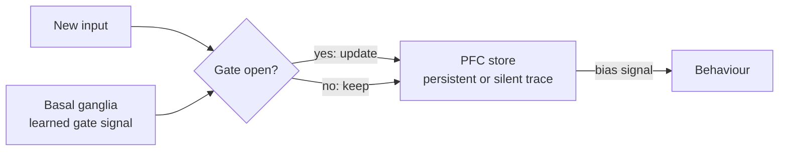

# Working Memory and Executive Function

Working memory is the ability to hold a small amount of information available for seconds and to use it in ongoing thought. Executive function is the set of control processes that decide what is held, what is updated and what is acted on. Both depend heavily on the prefrontal cortex, and their mechanisms bear directly on how recurrent networks and attention-based models keep information over time.

## Overview

Working memory is the store that holds information while it is being used: a phone number between hearing it and dialling it, the next step of a multi-step calculation, or the goal of the task in hand. It differs from long-term memory, which keeps information for days and years and is covered in [Memory & Learning in the Brain](../memory-learning/index.md). Working memory is short-lived and has a small capacity.

The classic framework is due to Baddeley and Hitch (1974). They described a multicomponent system with a central executive that directs attention and two slave stores, one for verbal material and one for visuospatial material. Later work kept the idea of a limited store but concentrated on its mechanisms. Cowan (2001) reviewed the capacity studies and argued that the limit is about three to five chunks, below an older figure of about seven that had been offered as a rough estimate.[^1]

Executive function is the umbrella term for the processes that select, maintain, switch and inhibit goal-directed behaviour. Diamond (2013) treats inhibition, working memory and cognitive flexibility as the core executive functions. The two concepts overlap. Working memory is what executive control operates on, and executive control decides what enters and leaves working memory.

The prefrontal cortex (PFC) is the region most associated with both. The same design question arises in AI: a transformer keeps a context window, a recurrent network keeps a hidden state and an agent keeps notes. Each is a choice about where information is held and how it is updated.

## Key concepts

- **Working memory**: information kept available for seconds, so that it can be used for ongoing processing.
- **Persistent activity**: sustained firing of neurons during a delay, which holds a memory as a pattern of spikes.
- **Activity-silent memory**: a memory held in the state of synapses rather than in continuous firing, so that neurons can be quiet while the memory persists.
- **Capacity limit**: the small number of items that can be kept at once, estimated at about three to five chunks (Cowan, 2001).
- **Gating**: a signal that decides whether a store takes in new input or keeps its current contents.
- **Executive (cognitive) control**: the top-down biasing of processing toward a goal, including selection, switching and inhibition.
- **Context window**: in a language model, the span of tokens the model can attend to at one time, the nearest AI counterpart of a working-memory buffer.

## How it works

A standard way to study working memory is the delayed-response task. A cue is shown, it disappears, and after a delay the subject must respond according to where or what the cue was. Recordings in monkeys found neurons in the dorsolateral prefrontal cortex that kept firing during the delay, with firing that depended on the remembered location (Funahashi et al., 1989). This suggested that a memory could be held as sustained activity. In network models, a group of neurons with mutually excitatory connections can settle into a stable pattern of activity, called an attractor, that persists after the input is removed.

A different account holds that the memory is kept in the state of synapses. Short-term changes in synaptic strength, driven by residual calcium, can store a trace while neurons are quiet. A brief burst of spikes reads the trace out or refreshes it (Mongillo et al., 2008). The two accounts explain the same delay behaviour, and they differ in what the cells are doing during the delay.

Holding information is only half of the problem. Executive control decides when to update. Miller and Cohen (2001) proposed that the PFC actively maintains representations of goals and the means to reach them, and that these send bias signals to other areas. O'Reilly and Frank (2006) modelled the update decision as a learned gate. In their model a basal ganglia actor-critic system opens the PFC store to new input when that input is task relevant and keeps the store closed otherwise.

The maintenance mechanisms and the gating mechanism are separable. A gate can control a store that is held by persistent firing or by synaptic traces.

## Key methods

Three landmark methods are compared below. Each has its own page.

| Method | What separates it | Page |
|---|---|---|
| Persistent activity (Funahashi et al., 1989) | Memory is held in sustained spiking during the delay, recorded in monkey prefrontal cortex | [Funahashi et al. 1989](funahashi-1989/index.md) |
| Activity-silent memory (Mongillo et al., 2008) | Memory is held in calcium-driven synaptic facilitation, so neurons can be silent during the delay | [Mongillo et al. 2008](mongillo-2008/index.md) |
| Gated updating (O'Reilly & Frank, 2006) | A basal ganglia actor-critic learns when the PFC store should be updated | [O'Reilly & Frank 2006](oreilly-frank-2006/index.md) |

The first two methods ask how a memory is kept. The third asks when it should change.

## Connections

- **Memory and learning**: working memory is the short-term end of the systems in [Memory & Learning in the Brain](../memory-learning/index.md). How information moves from short-term to long-term stores, including replay during sleep, is covered in [Sleep, Replay & Memory Consolidation](../sleep-and-consolidation/index.md).
- **Neuroanatomy and models**: the prefrontal and basal ganglia circuits are described in [Neuroscience Basics](../neuroscience/index.md). Attractor networks, the standard model of persistent activity, are covered in [Computational Neuroscience](../computational-neuroscience/index.md).
- **Decision and reward**: the gated model is an actor-critic, a reinforcement-learning architecture. The reward-learning side of this is covered in [Decision Making, Dopamine & Reward](../decision-reward/index.md).
- **Cognitive architectures**: working-memory buffers are a standard component of cognitive architectures; see [Cognitive Architectures](../cognitive-architectures/index.md).
- **Attention**: top-down control, covered in [Attention in Brains & Machines](../attention-brain-machine/index.md), overlaps with executive control.
- **AI: context windows**: a context window holds everything a model can read at once, and attention reads all of it at each step. The limit is therefore less about a number of slots than about how well the model finds and uses what it holds. Liu et al. (2023) found that performance drops when the relevant information sits in the middle of a long input. The transformer itself is described in [Transformer](../../theory/models/transformer/index.md).
- **AI: gated units**: the LSTM added multiplicative gates that decide what is kept (Hochreiter & Schmidhuber, 1997). The GRU has a simpler gating structure, and Chung et al. (2014) found it comparable to the LSTM. See [Gated Cells](../../theory/models/rnn/gated-cells/index.md).
- **AI: external memory**: Neural Turing Machines couple a controller to a memory that it reads and writes through attention (Graves et al., 2014).

## Applications

- **Agent design**: LLM agents keep scratchpads, summaries and task lists, so that the information needed for the current step stays in the context. The problem is the same as the brain's gating problem: what to keep, and what to drop. See [AI Agents](../../theory/models/agents/index.md) and [Agents](../../engineering/agents/index.md).
- **Sequence modelling**: gated recurrent units were evaluated on speech and polyphonic music modelling (Chung et al., 2014), one of the early empirical comparisons for sequence tasks.

## Open questions

- **Persistent or silent?** Both mechanisms can explain delay activity in models, and the evidence may differ by brain area and by task. Which mechanism, or which mixture, the brain uses is still debated.
- **Where is working memory stored?** It is not settled whether information is kept mainly in prefrontal cortex or spread across sensory and parietal areas.
- **How is gating learned?** The gated model has a specific learning rule for the basal ganglia gate. Whether cortex and basal ganglia circuits learn in this way has not been established.
- **Are executive functions one system?** Diamond's list suggests several components. Whether they reflect one control system or several separable ones is unresolved.
- **Do language models maintain information?** Attention can read a context window, but whether anything in a language model keeps information against distraction in the way that prefrontal cortex does is an open research question.

## References

### Seminal papers

- Baddeley, A. D. & Hitch, G. (1974). *Working Memory*. Psychology of Learning and Motivation. https://doi.org/10.1016/S0079-7421(08)60452-1 — The original multicomponent model, with a central executive and slave stores for verbal and visuospatial material.
- Funahashi, S., Bruce, C. J. & Goldman-Rakic, P. S. (1989). Mnemonic coding of visual space in the monkey's dorsolateral prefrontal cortex. *Journal of Neurophysiology*. https://doi.org/10.1152/jn.1989.61.2.331 — Recordings from prefrontal neurons in a delayed-response task, showing delay-period activity tied to the remembered cue location.
- Miller, E. K. & Cohen, J. D. (2001). An Integrative Theory of Prefrontal Cortex Function. *Annual Review of Neuroscience*. https://doi.org/10.1146/annurev.neuro.24.1.167 — Proposes that the PFC maintains goal and means representations that bias activity elsewhere to guide behaviour.
- Cowan, N. (2001). The magical number 4 in short-term memory: A reconsideration of mental storage capacity. *Behavioral and Brain Sciences*. https://doi.org/10.1017/S0140525X01003922 — Reviews capacity-limit studies and argues for a limit of about three to five chunks.
- O'Reilly, R. C. & Frank, M. J. (2006). Making Working Memory Work: A Computational Model of Learning in the Prefrontal Cortex and Basal Ganglia. *Neural Computation*. https://doi.org/10.1162/089976606775093909 — A model in which a basal ganglia actor-critic learns the gating of prefrontal working memory.
- Mongillo, G., Barak, O. & Tsodyks, M. (2008). Synaptic Theory of Working Memory. *Science*. https://doi.org/10.1126/science.1150769 — Proposes that working memory is held by calcium-mediated synaptic facilitation, with neurons able to stay quiet.
- Hochreiter, S. & Schmidhuber, J. (1997). Long Short-Term Memory. *Neural Computation*. https://doi.org/10.1162/neco.1997.9.8.1735 — Introduces the LSTM, whose multiplicative gate units learn to open and close access to a constant error flow.
- Cho, K. et al. (2014). Learning Phrase Representations using RNN Encoder-Decoder for Statistical Machine Translation. arXiv. https://arxiv.org/abs/1406.1078 — Proposes the RNN encoder-decoder, the paper in which the gated recurrent unit (GRU) was introduced.
- Graves, A., Wayne, G. & Danihelka, I. (2014). Neural Turing Machines. arXiv. https://arxiv.org/abs/1410.5401 — Couples a neural network to an external memory that it addresses through attention, trainable end to end.
- Vaswani, A. et al. (2017). Attention Is All You Need. arXiv. https://arxiv.org/abs/1706.03762 — Introduces the Transformer, which uses attention over the whole input in place of recurrence.

### Surveys and textbooks

- Diamond, A. (2013). Executive Functions. *Annual Review of Psychology*. https://doi.org/10.1146/annurev-psych-113011-143750 — Reviews the core executive functions of inhibition, working memory and cognitive flexibility, and how they develop.

### Articles and documentation

- Liu, N. F. et al. (2023). Lost in the Middle: How Language Models Use Long Contexts. arXiv. https://arxiv.org/abs/2307.03172 — Shows that language models use information at the start or end of a long context more reliably than information in the middle.
- Chung, J. et al. (2014). Empirical Evaluation of Gated Recurrent Neural Networks on Sequence Modeling. arXiv. https://arxiv.org/abs/1412.3555 — Compares LSTM and GRU units on polyphonic music and speech modelling, finding both better than plain tanh units.

[^1]: Cowan's estimate depends on how a chunk is defined, and his review says that capacity can be measured reliably only under carefully described conditions. The figure of seven is an older rough estimate, which Cowan's review revises.
