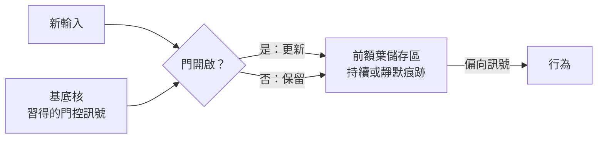

# 工作記憶與執行功能

工作記憶是在數秒之內保留少量資訊、並用於持續思考的能力。執行功能則是一組控制過程，決定保留什麼、更新什麼，以及根據什麼行動。兩者都大量依賴前額葉皮質，其機制也直接關係到循環網路與注意力模型如何隨時間保留資訊。

## 概述

工作記憶是在資訊被使用期間暫存它的儲存區：例如聽到電話號碼到撥號之間的那段時間、多步驟計算的下一步，或眼前任務的目標。它與長期記憶不同。長期記憶可以保留數天到數年的資訊，相關內容見[記憶與學習的神經機制](../memory-learning/index.md)。工作記憶的保留時間很短，容量也很小。

經典框架來自 Baddeley 與 Hitch（1974）。他們描述了一個多成分系統，其中中央執行者負責引導注意力，另有兩個附屬儲存區，分別處理語言材料與視覺空間材料。後續研究保留了「有限儲存區」的想法，但更著重於其機制。Cowan（2001）回顧容量研究，主張容量限制約為三到五個組塊，低於較早作為粗略估計而提出的約七個。[^1]

執行功能是一個總稱，指選擇、維持、切換與抑制目標導向行為的過程。Diamond（2013）把抑制、工作記憶與認知彈性視為核心執行功能。兩個概念有所重疊：工作記憶是執行控制所作用的對象，而執行控制則決定什麼資訊進入或離開工作記憶。

前額葉皮質（PFC）與這兩者的關聯最為密切。AI 也面臨相同的設計問題：Transformer 保有上下文視窗，循環網路保有隱藏狀態，代理人則保有筆記。每一種做法都是在選擇資訊存放在哪裡，以及如何更新。

## 核心概念

- **工作記憶**：在數秒內保持可用的資訊，以供持續的處理。
- **持續活動**：神經元在延遲期間持續放電，以放電的型態保存記憶。
- **活動靜默記憶**：記憶保存在突觸的狀態中，而非持續放電，因此神經元在記憶持續期間可以保持安靜。
- **容量限制**：同時能保留的少量項目，估計約為三到五個組塊（Cowan，2001）。
- **門控**：決定儲存區接收新輸入或保留既有內容的訊號。
- **執行（認知）控制**：以目標為導向、自上而下地調整處理過程，包括選擇、切換與抑制。
- **上下文視窗**：在語言模型中，模型在同一時間能關注的 token 範圍，是最接近工作記憶緩衝區的 AI 對應概念。

## 運作方式

研究工作記憶的一種標準方法是延遲反應任務。先呈現一個提示，提示消失，經過一段延遲後，受試者必須根據提示的位置或內容作出反應。在猴子身上的記錄發現，背外側前額葉皮質中有些神經元在延遲期間持續放電，而且放電取決於所記住的位置（Funahashi 等人，1989）。這顯示記憶可能以持續活動的形式保存。在網路模型中，一群彼此互相興奮連接的神經元可以收斂到一個穩定的活動型態，稱為吸引子，即使輸入已移除，這個型態仍會持續。

另一種不同的主張認為，記憶保存在突觸的狀態中。由殘留鈣驅動的短期突觸強度變化，可以在神經元安靜時儲存痕跡。一陣短暫的放電可以讀出或更新這個痕跡（Mongillo 等人，2008）。兩種主張都能解釋相同的延遲行為，差別在於延遲期間細胞實際在做什麼。

保存資訊只是問題的一半。執行控制還要決定何時更新。Miller 與 Cohen（2001）提出，前額葉皮質主動維持目標與達成目標手段的表徵，並將偏向訊號送往其他區域。O'Reilly 與 Frank（2006）則把更新決策建模為一個習得的門。在他們的模型中，基底核的演員-評論家系統在輸入與任務相關時打開前額葉的儲存區，否則保持關閉。

維持機制與門控機制可以分開看待。一個門可以控制以持續放電或突觸痕跡保存的儲存區。

## 關鍵方法

下面比較三種代表性方法，每一種都有獨立的頁面。

| 方法 | 區別在於 | 頁面 |
|---|---|---|
| 持續活動（Funahashi 等人，1989） | 記憶以延遲期間的持續放電保存，記錄自猴子的前額葉皮質 | [Funahashi 等人 1989](funahashi-1989/index.md) |
| 活動靜默記憶（Mongillo 等人，2008） | 記憶以鈣驅動的突觸易化保存，因此延遲期間神經元可以安靜 | [Mongillo 等人 2008](mongillo-2008/index.md) |
| 門控更新（O'Reilly 與 Frank，2006） | 基底核的演員-評論家學習何時更新前額葉儲存區 | [O'Reilly 與 Frank 2006](oreilly-frank-2006/index.md) |

前兩種方法問的是記憶如何被保存，第三種方法問的是記憶何時應該改變。

## 與其他主題的關聯

- **記憶與學習**：工作記憶是[記憶與學習的神經機制](../memory-learning/index.md)所述系統中的短期一端。資訊如何從短期移到長期儲存，包括睡眠中的重播，則見[睡眠、重播與記憶鞏固](../sleep-and-consolidation/index.md)。
- **神經解剖與模型**：前額葉與基底核迴路的介紹見[神經科學基礎](../neuroscience/index.md)。吸引子網路是持續活動的標準模型，見[計算神經科學](../computational-neuroscience/index.md)。
- **決策與獎勵**：門控模型是一種演員-評論家架構，屬於強化學習的一種。獎勵學習的部分見[決策、多巴胺與獎勵](../decision-reward/index.md)。
- **認知架構**：工作記憶緩衝區是認知架構的標準組件，見[認知架構](../cognitive-architectures/index.md)。
- **注意力**：[注意力：大腦與機器](../attention-brain-machine/index.md)所述的自上而下控制，與執行控制有所重疊。
- **AI：上下文視窗**：上下文視窗保存模型一次能讀取的全部內容，注意力機制則在每一步讀取其中所有內容。因此限制與其說是槽位數量，不如說是模型能多好地找到並運用其中的資訊。Liu 等人（2023）發現，當相關資訊位於長輸入的中段時，表現會下降。Transformer 本身見[Transformer](../../theory/models/transformer/index.md)。
- **AI：門控單元**：LSTM 加入了乘法門，決定保留什麼（Hochreiter 與 Schmidhuber，1997）。GRU 的門控結構較為簡單，Chung 等人（2014）發現它與 LSTM 表現相當。見[門控循環單元](../../theory/models/rnn/gated-cells/index.md)。
- **AI：外部記憶**：神經圖靈機以注意力讀寫外部記憶，並與控制器相連（Graves 等人，2014）。

## 應用

- **代理人設計**：LLM 代理人會保留草稿區、摘要與任務清單，使目前步驟所需的資訊留在上下文中。此問題與大腦的門控問題相同：保留什麼、捨棄什麼。見[AI 代理人](../../theory/models/agents/index.md)與[代理人](../../engineering/agents/index.md)。
- **序列建模**：門控循環單元在語音與複音音樂建模上被評估（Chung 等人，2014），這是序列任務中早期的實證比較之一。

## 開放問題

- **持續或靜默？** 兩種機制都能在模型中解釋延遲期間的活動，而證據可能因腦區與任務而異。大腦實際使用哪一種機制，或兩者如何混合，仍有爭議。
- **工作記憶儲存在哪裡？** 資訊主要保存在前額葉皮質，還是分布於感覺與頂葉區域，尚無定論。
- **門控如何學習？** 門控模型對基底核的門控有一套特定的學習規則。皮質與基底核迴路是否以這種方式學習，尚未確立。
- **執行功能是否為單一系統？** Diamond 的清單顯示其中包含多個成分。它們反映的是一個控制系統，還是多個可分離的系統，仍未解決。
- **語言模型是否保有資訊？** 注意力機制可以讀取上下文視窗，但語言模型中是否有任何部分能像前額葉皮質那樣抵抗干擾而保留資訊，仍是開放的研究問題。

[^1]: Cowan 的估計取決於如何定義組塊，他的綜述指出，只有在仔細描述的條件下，容量才能可靠地測量。數字七是較早的粗略估計，Cowan 的綜述對其加以修正。

## 參考文獻

### 開創性論文

- Baddeley, A. D. & Hitch, G. (1974). *Working Memory*. Psychology of Learning and Motivation. https://doi.org/10.1016/S0079-7421(08)60452-1 — 原始的多成分模型，包含中央執行者，以及處理語言與視覺空間材料的附屬儲存區。
- Funahashi, S., Bruce, C. J. & Goldman-Rakic, P. S. (1989). Mnemonic coding of visual space in the monkey's dorsolateral prefrontal cortex. *Journal of Neurophysiology*. https://doi.org/10.1152/jn.1989.61.2.331 — 在延遲反應任務中記錄前額葉神經元，顯示延遲期活動與所記住的提示位置相關。
- Miller, E. K. & Cohen, J. D. (2001). An Integrative Theory of Prefrontal Cortex Function. *Annual Review of Neuroscience*. https://doi.org/10.1146/annurev.neuro.24.1.167 — 提出前額葉皮質主動維持目標表徵，並偏向其他區域的活動以引導行為。
- Cowan, N. (2001). The magical number 4 in short-term memory: A reconsideration of mental storage capacity. *Behavioral and Brain Sciences*. https://doi.org/10.1017/S0140525X01003922 — 回顧容量限制的研究，主張限制約為三到五個組塊。
- O'Reilly, R. C. & Frank, M. J. (2006). Making Working Memory Work: A Computational Model of Learning in the Prefrontal Cortex and Basal Ganglia. *Neural Computation*. https://doi.org/10.1162/089976606775093909 — 一個模型，其中基底核的演員-評論家學習前額葉工作記憶的門控。
- Mongillo, G., Barak, O. & Tsodyks, M. (2008). Synaptic Theory of Working Memory. *Science*. https://doi.org/10.1126/science.1150769 — 提出工作記憶由鈣驅動的突觸易化所保存，神經元可以保持安靜。
- Hochreiter, S. & Schmidhuber, J. (1997). Long Short-Term Memory. *Neural Computation*. https://doi.org/10.1162/neco.1997.9.8.1735 — 提出 LSTM，其乘法門學會開啟與關閉通往恆定誤差流的通道。
- Cho, K. et al. (2014). Learning Phrase Representations using RNN Encoder-Decoder for Statistical Machine Translation. arXiv. https://arxiv.org/abs/1406.1078 — 提出 RNN 編碼器-解碼器，門控循環單元（GRU）即在此論文中提出。
- Graves, A., Wayne, G. & Danihelka, I. (2014). Neural Turing Machines. arXiv. https://arxiv.org/abs/1410.5401 — 以注意力把神經網路與外部記憶相連，並可端到端訓練。
- Vaswani, A. et al. (2017). Attention Is All You Need. arXiv. https://arxiv.org/abs/1706.03762 — 提出 Transformer，以對整個輸入的注意力取代循環。

### 綜述與教科書

- Diamond, A. (2013). Executive Functions. *Annual Review of Psychology*. https://doi.org/10.1146/annurev-psych-113011-143750 — 回顧核心執行功能（抑制、工作記憶與認知彈性）及其發展。

### 文章與文件

- Liu, N. F. et al. (2023). Lost in the Middle: How Language Models Use Long Contexts. arXiv. https://arxiv.org/abs/2307.03172 — 顯示語言模型比起長上下文中段的資訊，更能可靠地利用位於開頭或結尾的資訊。
- Chung, J. et al. (2014). Empirical Evaluation of Gated Recurrent Neural Networks on Sequence Modeling. arXiv. https://arxiv.org/abs/1412.3555 — 比較 LSTM 與 GRU 單元在複音音樂與語音建模上的表現，發現兩者都優於單純的 tanh 單元。
