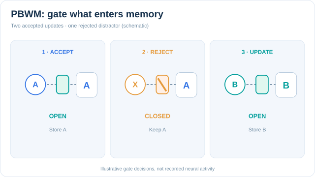

# 前額葉—基底核工作記憶（PBWM）

PBWM 是一個計算模型：前額葉皮質（prefrontal cortex, PFC）保存任務資訊，基底核則決定這些資訊何時可以改變。閘門是透過一種仿照多巴胺的強化訊號學習而得，因此系統同時學會該保存什麼，以及何時保存。O'Reilly 與 Frank（2006）提出此模型。

本頁是[工作記憶與執行功能](../index.md)之下的一種方法。若要了解持續活動與突觸狀態的比較，請參見該概述頁。

## 概述

設想一個任務：一個提示必須在延遲之後被記住，而延遲中途出現了一個無關的干擾。有用的記憶必須保護提示不受干擾，同時仍允許相關的新資訊取代舊資訊。PBWM 的做法是分工：前額葉皮質是儲存區，基底核則像是位於其前方的閘門。

## 問題

執行控制常被描述成彷彿大腦裡有一個控制者，決定要保留什麼以及如何使用它。但這個控制者背後的機制一直難以明確說明。問題在於：系統如何學會控制自己的工作記憶，包括保留哪些資訊、何時覆寫、何時忽略輸入。

這個學習問題之所以困難，有兩個原因。第一，閘控決策的後果可能要在很久之後才出現，因此信用必須跨越時間分配。第二，許多前額葉單元都可能發生改變，因此信用也必須跨越單元分配。

## 核心理念

PBWM 有三個協同運作的部分。

- **前額葉皮質。** 維持任務表徵，且只有在閘門開啟時才更新。
- **基底核。** 提供動態閘門，決定目前的輸入是否更新某個前額葉表徵。
- **類多巴胺的學習。** 中腦、基底核與杏仁核形成一個行動者—評論者（actor–critic）架構。評論者學習哪些前額葉表徵與任務相關，並訓練提供閘門的行動者。

## 方程式或演算法

論文給出完整的學習規則。本頁以編號步驟描述其大綱，而非單一方程式。

1. 輸入到達。基底核中的閘控單元決定它應該更新一組前額葉單元，還是被忽略。
2. 若閘門開啟，前額葉表徵被覆寫；若閘門關閉，先前的內容會保留，因此資訊能撐過干擾。
3. 任務產生結果。評論者比較它的預測與實際發生的情況，其差值即為預測誤差，性質與[多巴胺的獎勵預測誤差](../../neuroscience/dopamine-reward-prediction-error/index.md)頁所述相同，並在[強化學習](../../../theory/paradigms/reinforcement-learning/index.md)所涵蓋的行動者—評論者方法中扮演相同角色。
4. 預測誤差同時訓練評論者與行動者。之後的閘控決策會偏好那些曾經有用的更新。

### 教學動畫：工作記憶的選擇性閘控

**藍色提示 A** 通過開啟的閘門，寫入前額葉儲存區；**橘色干擾 X** 遇到關閉的閘門，原有記憶 A 仍被保留；之後 **青綠色提示 B** 通過開啟的閘門，更新記憶。哪些提示對任務有用，以及三次閘門的開關決策，均是**人工設定**，只為示範更新規則；**不是**模型的實際學習軌跡、解剖迴路圖或神經記錄。科學依據請參閱參考文獻中的 O'Reilly 與 Frank（2006）。

在 MkDocs 網站可使用**播放／暫停**按鈕，聚焦後按 **Enter／Space** 操作；偏好減少動態效果時，圖會維持靜態。手機可將圖區聚焦後水平捲動；GitHub 直接顯示三個狀態的靜態比較。兩份視覺資產均為原創 **CC BY-SA 4.0** 教材。

## 結果

論文在 1-2-AX 工作記憶任務上測試此學習規則。本頁不報告比較結果，請參閱原文。

## 限制

- **基準範圍。** 此優勢是在作者選定的工作記憶任務，並與作者選定的基準比較時所顯示。這並不是普遍優越性的證據。
- **解剖上的簡化。** 模型把角色指派給基底核與前額葉迴路，其層級簡化了真實的解剖結構與細胞類型。
- **生物合理性。** 模型被論證與已知迴路相符，但具體的學習規則是有待檢驗的假說，而非已被測量的機制。
- **早期工作。** 較早的一個計算模型（Frank、Loughry 與 O'Reilly，2001）探討了相同的額葉皮質與基底核交互作用，並處理相近的問題。PBWM 的貢獻在於其學習機制。

## 連結

- **執行控制理論。** PBWM 與 Miller 與 Cohen（2001）提出的前額葉控制偏置訊號觀點一致，並為其提供了學習機制。
- **多巴胺與強化學習。** 學習訊號與[決策、多巴胺與獎勵](../../decision-reward/index.md)中討論的、用於選擇的預測誤差同屬一類。
- **相關的前額葉模型。** Rougier 等人（2005）展示一個相關的前額葉模型如何透過經驗自我組織出抽象的、類規則的表徵。
- **AI：門控記憶。** LSTM 使用可學習的閘門，決定哪些資訊進入與離開記憶單元（[LSTM](../../../theory/models/rnn/gated-cells/lstm/index.md)）。它與 PBWM 在功能上的相似十分明顯，但兩者的建構方式不同。

## 應用

- **模擬前額葉任務。** PBWM 在 1-2-AX 等工作記憶基準任務上接受測試。Rougier 等人（2005）提出一個相關的前額葉模型，其模擬的任務請參閱原文。
- **設計 AI 中的門控記憶。** 保護記憶儲存區的可學習閘門，是循環網路中的核心設計，LSTM 即為一例。

## 未解問題

- **在真實大腦中，哪些訊號在何時訓練閘門？** 模型假設有一個類多巴胺的教學訊號，但該訊號在閘控中的確切時機與目標仍在研究中。
- **閘控能否超越基準任務？** 這種可學習閘門能推廣到更豐富、具有多個交互目標的真實任務到什麼程度，尚不清楚。
- **閘控與注意力如何相關？** 閘控決定什麼能進入記憶，注意力則決定什麼會被選取進行處理。兩者如何耦合，尚無定論。

## 參考文獻

### 開創性論文

- O'Reilly, R. C. & Frank, M. J. (2006). Making working memory work: a computational model of learning in the prefrontal cortex and basal ganglia. *Neural Computation* 18, 283–328. https://doi.org/10.1162/089976606775093909 — PBWM 的原始論文，提出可學習的閘門與行動者—評論者學習規則。
- Frank, M. J., Loughry, B. & O'Reilly, R. C. (2001). Interactions between frontal cortex and basal ganglia in working memory: a computational model. *Cognitive, Affective, & Behavioral Neuroscience* 1, 137–160. https://doi.org/10.3758/CABN.1.2.137 — 較早的計算模型，探討額葉皮質與基底核在工作記憶中的交互作用，正是 PBWM 所模擬的交互作用。
- Rougier, N. P., Noelle, D. C., Braver, T. S., Cohen, J. D. & O'Reilly, R. C. (2005). Prefrontal cortex and flexible cognitive control: rules without symbols. *Proceedings of the National Academy of Sciences* 102, 7338–7343. https://doi.org/10.1073/pnas.0502455102 — 顯示一個相關的前額葉模型如何在靈活的認知控制模型中形成抽象的類規則表徵。
- Hochreiter, S. & Schmidhuber, J. (1997). Long short-term memory. *Neural Computation* 9, 1735–1780. https://doi.org/10.1162/neco.1997.9.8.1735 — 提出 LSTM，其乘法閘單元學習開啟與關閉對記憶單元的存取。

### 綜述與教科書

- Miller, E. K. & Cohen, J. D. (2001). An integrative theory of prefrontal cortex function. *Annual Review of Neuroscience* 24, 167–202. https://doi.org/10.1146/annurev.neuro.24.1.167 — 回顧前額葉作為目標導向偏置訊號來源的證據，PBWM 與此框架一致。
