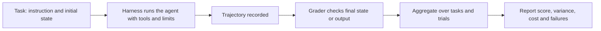

# Agent Evaluation

Agent evaluation measures whether a language-model agent completes a task, judged by the state of its environment rather than by how plausible its text sounds. It also asks how reliably, at what cost and over how many attempts the agent succeeds, which is harder than scoring a single answer. This page is one of the sub-chapters of [Agent Engineering](../index.md).

## Overview

Scoring a single answer is straightforward: compare it with a reference. An agent's output is different. It is a *trajectory*, a sequence of model calls, tool invocations and observations that may change some system, such as a code repository, a booking database or a desktop. Two agents can give the same final answer after very different trajectories, one of which deleted files along the way. The grader therefore has to look at effects. In τ-bench, for example, the database at the end of a conversation is compared with a goal state annotated in advance (Yao et al., 2024).

Benchmarks for agents multiplied after 2023. AgentBench placed language-model agents in eight interactive environments and identified poor long-term reasoning, weak decision making and weak instruction following as the main obstacles (Liu et al., 2023). SWE-bench asked models to resolve real GitHub issues in Python projects (Jimenez et al., 2023), WebArena provided self-hosted websites (Zhou et al., 2023), and GAIA posed questions that are simple for people but hard for tool-using assistants (Mialon et al., 2023). Desktop environments such as [OSWorld](../sandboxing-and-computer-use/osworld/index.md) are a related family. A 2025 survey covers these application benchmarks, from web agents to software-engineering agents, and identifies gaps in cost-efficiency, safety and robustness (Yehudai et al., 2025).

## Key concepts

- **Task and environment**: a task has an instruction and an initial state. The environment is the software or world the agent acts on. A reproducible task starts from the same snapshot every time.
- **Trajectory**: the full record of one attempt: model outputs, tool calls, observations and state changes.
- **Outcome grader**: a check on the final state, such as unit tests passing, a database matching its goal or a file existing. It is the most reliable kind when the task has an observable result.
- **Process grader**: a check on the trajectory, such as whether a forbidden tool was called.
- **Pass@k**: the probability that at least one of k attempts on a task succeeds. Chen et al. (2021) popularised it for code generation, estimating it from n of at least k samples per problem.
- **Pass^k**: the probability that all k attempts succeed. τ-bench introduced it to measure reliability across trials (Yao et al., 2024). Pass@k rises with k, while pass^k falls.
- **Cost-adjusted score**: accuracy reported together with the money, tokens or time spent to reach it.
- **Holdout set**: tasks kept out of development and used only for final reporting. Kapoor et al. (2024) argue that many agent benchmarks lack one, so agents can overfit to them.
- **Solution leakage**: a task whose answer is visible in its own issue text or comments, so a high score measures reading rather than problem solving.

## How it works

An evaluation run has five stages.

The harness connects the model to the environment and sets its tools, prompts and limits. Its design can change scores as much as the choice of model. Yang et al. (2024) show that the design of the interface through which an agent edits code and runs tests affects its performance on SWE-bench.

### Scoring repeated trials

Agents are stochastic, so one run per task is a noisy sample. If each task is attempted n times and c attempts succeed, two estimators are common. Pass@k answers whether the agent can solve a task if it is allowed to try again:

$$\text{pass@}k = \mathbb{E}_{\text{tasks}}\!\left[1-\frac{\binom{n-c}{k}}{\binom{n}{k}}\right]$$

Pass^k answers whether the agent solves the task every time it is asked:

$$\text{pass}^k = \mathbb{E}_{\text{tasks}}\!\left[\frac{\binom{c}{k}}{\binom{n}{k}}\right]$$

A large gap between the two means that the agent sometimes succeeds but cannot be relied on. In the code-generation paper, Codex solved 28.8 percent of HumanEval problems with one sample, and 70.2 percent with 100 samples per problem.[^1]

### Cost-adjusted reporting

Accuracy alone can reward expensive systems. Kapoor et al. (2024) argue that agent evaluation should report accuracy and cost together, and that the two should be optimised jointly. Their own optimisation showed the potential to reduce cost greatly while keeping accuracy on the benchmark they studied. A cost-adjusted report states the calls, tokens and money spent per task, so that a gain from a longer loop can be weighed against its price (see [MLOps & Deployment](../../mlops/index.md)).

### Reproducibility

Agent results are hard to reproduce. API models can change or be retired, live websites change between runs, harnesses differ in small details, and environments contain bugs. Kapoor et al. (2024) name the lack of standardised evaluation practice as a main cause of poor reproducibility. Zhu et al. (2025) show that task-setup and reward-design problems can under- or overestimate agent performance by up to 100 percent in relative terms.[^2] The Holistic Agent Leaderboard responds with a standard harness: its authors ran 21,730 agent rollouts across nine models and nine benchmarks, at a total cost of about 40,000 dollars, and report that the harness cut evaluation time from weeks to hours (Kapoor et al., 2025).

## Key methods

Three landmark benchmarks represent the main designs. Each has its own page.

- [SWE-bench](swe-bench/index.md) (Jimenez et al., 2023): real issues in Python repositories, graded by the project's own tests, with a simple success criterion.
- [τ-bench](tau-bench/index.md) (Yao et al., 2024): a simulated user, domain tools and written policies, graded by the final database state, with pass^k as a reliability measure.
- [WebArena](webarena/index.md) (Zhou et al., 2023): reproducible, self-hosted websites in four domains, graded by functional checks on the outcome.

## Connections

- **Agent foundations**: the loop and tool use being evaluated are described in [AI Agents](../../../theory/models/agents/index.md) and in [ReAct](../react/index.md).
- **General benchmarks**: [Evaluation & Benchmarks](../../evaluation/index.md) covers the general problem, and [Benchmark Suites](../../evaluation/benchmark-suites.md) compares knowledge and coding suites. The saturation and contamination problems described there recur for agent benchmarks.
- **Statistics**: comparing two agents requires the usual tools of validation and uncertainty. See [Evaluation and Validation](../../../theory/paradigms/supervised/evaluation-and-validation/index.md).
- **Security**: attacks such as indirect prompt injection are tested alongside capabilities. See [LLM Application Security](../../llm-security/index.md) and [Sandboxing and Computer-Use Agents](../sandboxing-and-computer-use/index.md).
- **Brain and mind**: agent benchmarks borrow the psychometric ideas of reliability, meaning consistency across repeated trials, and validity, meaning whether a test measures the ability its name claims. pass^k is a consistency measure of this kind. See [Psychology & AI](../../../brain-mind/psychology/index.md). Human baselines serve as reference points: WebArena reports 78.24 percent success for humans, and GAIA reports 92 percent for humans against 15 percent for GPT-4 with plugins, although humans and agents are not tested under identical conditions.

## Applications

- **Model development**: developers report agent scores on public benchmarks to show progress. Scores are comparable only when harnesses, budgets and grading match.
- **Product testing**: teams build private task sets from their own workflows, grade them with their own checks, and rerun them after each change to prompts, tools or models.
- **Coding agents**: SWE-bench-style tests ask whether an agent can fix real issues, a question that also applies to [AI Coding Assistants](../../coding-assistants/index.md).
- **General assistants**: GAIA tests browsing, tool use and multimodal reasoning on questions whose answers are short and unambiguous (Mialon et al., 2023).

## Open questions

- **Grader validity.** Errors in task setup and grading often surface only after publication. Whether automated checks can be made reliable without manual audit is unresolved.
- **Contamination and age.** Aleithan et al. (2024) report that over 94 percent of SWE-bench issues were created before LLMs' knowledge cutoff dates, so training overlap cannot be ruled out.[^3]
- **Realistic users.** Simulated users are cheap, but a model playing a customer may not behave like one. τ²-bench makes the user an active party who also changes the shared environment, and reports significant performance drops compared with a user-free setting (Barres et al., 2025).
- **Cost standards.** No common unit for cost exists, so cost-adjusted claims are hard to compare across providers.
- **Long horizons.** Metrics for tasks lasting hours, where one failure late in a run may matter more than many early successes, are immature.

## References

### Seminal papers

- Jimenez, C. E. et al. (2023). *SWE-bench: Can Language Models Resolve Real-World GitHub Issues?* arXiv. https://arxiv.org/abs/2310.06770 — Benchmark of 2,294 issues from 12 Python repositories, graded by the projects' own tests.
- Yao, S. et al. (2024). *τ-bench: A Benchmark for Tool-Agent-User Interaction in Real-World Domains*. arXiv. https://arxiv.org/abs/2406.12045 — Simulated-user benchmark with domain tools and policies, graded by database state, which introduces pass^k.
- Zhou, S. et al. (2023). *WebArena: A Realistic Web Environment for Building Autonomous Agents*. arXiv. https://arxiv.org/abs/2307.13854 — Self-hosted, functional websites from four domains, with benchmark tasks scored by functional correctness.
- Mialon, G. et al. (2023). *GAIA: a benchmark for General AI Assistants*. arXiv. https://arxiv.org/abs/2311.12983 — Real-world questions requiring reasoning, browsing and tool use, which are easy for humans and hard for AI systems of the time.
- Chen, M. et al. (2021). *Evaluating Large Language Models Trained on Code*. arXiv. https://arxiv.org/abs/2107.03374 — Introduces HumanEval and shows how repeated sampling raises the share of problems solved, the basis of pass@k.
- Yang, J. et al. (2024). *SWE-agent: Agent-Computer Interfaces Enable Automated Software Engineering*. arXiv. https://arxiv.org/abs/2405.15793 — Shows how a custom agent-computer interface changes an agent's performance on SWE-bench.
- Liu, X. et al. (2023). *AgentBench: Evaluating LLMs as Agents*. arXiv. https://arxiv.org/abs/2308.03688 — Eight interactive environments for assessing LLMs as agents, with an analysis of their failure modes.

### Surveys and textbooks

- Yehudai, A. et al. (2025). *Survey on Evaluation of LLM-based Agents*. arXiv. https://arxiv.org/abs/2503.16416 — Survey of agent evaluation covering core capabilities, application benchmarks and evaluation frameworks.

### Articles and documentation

- Kapoor, S. et al. (2024). *AI Agents That Matter*. arXiv. https://arxiv.org/abs/2407.01502 — Critique of agent benchmarking that argues for reporting cost with accuracy and for holdout sets.
- Zhu, Y. et al. (2025). *Establishing Best Practices for Building Rigorous Agentic Benchmarks*. arXiv. https://arxiv.org/abs/2507.02825 — Shows how task-setup and reward-design flaws distort agent scores, and proposes a checklist for benchmark builders.
- Aleithan, R. et al. (2024). *SWE-Bench+: Enhanced Coding Benchmark for LLMs*. arXiv. https://arxiv.org/abs/2410.06992 — Manual analysis of SWE-bench that finds solution leakage and weak tests among the patches counted as successes.
- Kapoor, S. et al. (2025). *Holistic Agent Leaderboard: The Missing Infrastructure for AI Agent Evaluation*. arXiv. https://arxiv.org/abs/2510.11977 — Standardised harness and leaderboard for agents, with large-scale rollouts and shared logs.
- Barres, V. et al. (2025). *τ²-Bench: Evaluating Conversational Agents in a Dual-Control Environment*. arXiv. https://arxiv.org/abs/2506.07982 — Extends τ-bench to dual control, where both the agent and the user act on a shared environment.

[^1]: Chen et al. (2021), abstract, https://arxiv.org/abs/2107.03374 — Reports 28.8 percent of HumanEval problems solved by the model and 70.2 percent with 100 samples per problem.
[^2]: Zhu et al. (2025), abstract, https://arxiv.org/abs/2507.02825 — Reports misestimation of up to 100 percent in relative terms, and a 33 percent reduction in overestimation when the checklist is applied to CVE-Bench.
[^3]: Aleithan et al. (2024), abstract, https://arxiv.org/abs/2410.06992 — Reports solution leakage in 32.67 percent of successful patches, and a resolution rate that falls from 12.47 to 3.97 percent after problematic instances are removed.
