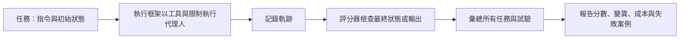

# 代理人評估

代理人評估衡量語言模型代理人是否完成任務，判斷依據是環境的最終狀態，而不是其文字看起來是否合理。它也要問：代理人可靠度如何、成本多少、需要多少次嘗試才能成功。這比為單一答案打分困難得多。本頁是[代理人工程](../index.md)的子章節之一。

## 概述

為單一答案打分很直接：與參考答案比對即可。代理人的輸出則不同，它是一段**軌跡**（trajectory），也就是由模型呼叫、工具調用與觀察結果組成的序列，可能會改變某個系統的狀態，例如程式碼儲存庫、訂位資料庫或桌面環境。兩個代理人可能給出相同的最終答案，但過程天差地遠，其中一個可能中途刪除了檔案。因此評分者必須檢視實際造成的效果。以 τ-bench 為例，對話結束時的資料庫，會與事先標註的目標狀態比對（Yao et al., 2024）。

2023 年後，代理人基準測試迅速增加。AgentBench 把語言模型代理人放進八個互動式環境，並指出長期推理薄弱、決策能力不足與指令遵循不佳是主要障礙（Liu et al., 2023）。SWE-bench 要求模型解決 Python 專案中的真實 GitHub 議題（Jimenez et al., 2023）；WebArena 提供自架網站（Zhou et al., 2023）；GAIA 則提出對人類來說簡單、對工具使用型助理卻很困難的問題（Mialon et al., 2023）。[OSWorld](../sandboxing-and-computer-use/osworld/index.md) 等桌面環境屬於同一類。一篇 2025 年的綜述涵蓋這些應用基準，從網頁代理人到軟體工程代理人都有討論，並指出在成本效率、安全性與穩健性方面仍有缺口（Yehudai et al., 2025）。

## 關鍵概念

- **任務與環境**：任務包含指令與初始狀態；環境則是代理人行動所在的軟體或世界。可重現的任務每次都從相同的快照開始。
- **軌跡**：一次嘗試的完整紀錄：模型輸出、工具呼叫、觀察結果與狀態變化。
- **結果評分器**（outcome grader）：檢查最終狀態，例如單元測試是否通過、資料庫是否符合目標、某個檔案是否存在。當任務有可觀察的結果時，這是最可靠的方式。
- **過程評分器**（process grader）：檢查軌跡本身，例如是否呼叫了被禁止的工具。
- **pass@k**：k 次嘗試中至少一次成功的機率。Chen et al. (2021) 將它推廣到程式生成領域，並以每題至少 k 個樣本（n 個）來估計。
- **pass^k**：k 次獨立嘗試全部成功的機率。τ-bench 引入它來衡量跨多次試驗的可靠度（Yao et al., 2024）。pass@k 隨 k 增加而上升，pass^k 則隨 k 增加而下降。
- **成本調整後分數**（cost-adjusted score）：與達成準確率所花費的金錢、詞元或時間一併回報的準確率。
- **保留集**（holdout set）：不參與開發、只用於最終回報的任務。Kapoor et al. (2024) 認為許多代理人基準缺少保留集，因此代理人可能對基準過度擬合。
- **解答洩漏**（solution leakage）：任務的解答已出現在議題文字或留言中，因此高分衡量的是閱讀能力，而非解題能力。

## 運作方式

一次評估執行包含五個階段。

執行框架負責把模型連接到環境，並設定工具、提示與各種限制。它的設計對分數的影響，可能不亞於模型的選擇。Yang et al. (2024) 顯示，代理人編輯程式碼與執行測試所使用的介面設計，會影響其在 SWE-bench 上的表現。

### 重複試驗的評分

代理人具有隨機性，因此每個任務只跑一次，只是一個帶有雜訊的樣本。若每個任務嘗試 n 次，其中 c 次成功，常見的估計方式有兩種。pass@k 回答的是：若允許代理人重試，它能否解出這個任務：

$$\text{pass@}k = \mathbb{E}_{\text{tasks}}\!\left[1-\frac{\binom{n-c}{k}}{\binom{n}{k}}\right]$$

pass^k 回答的是：每次被要求時，代理人是否都能解出這個任務：

$$\text{pass}^k = \mathbb{E}_{\text{tasks}}\!\left[\frac{\binom{c}{k}}{\binom{n}{k}}\right]$$

兩者之間若有大落差，代表代理人有時能成功，卻不能依賴。k 的選擇很重要。在程式生成的論文中，Codex 每題取一個樣本時解出 28.8% 的 HumanEval 題目，每題取 100 個樣本時則解出 70.2%。[^1]

### 成本調整後的回報

只看準確率，可能會獎勵昂貴的系統。Kapoor et al. (2024) 主張，代理人評估應同時回報準確率與成本，並且兩者應共同最佳化。他們自己的最佳化顯示，在大幅降低成本的同時，有機會維持準確率。成本調整後的報告應列出每個任務的模型呼叫次數、詞元數與金額，讓較長迴圈帶來的收益能與其代價相互權衡。服務端的同一項取捨，請見 [MLOps 與部署](../../mlops/index.md)。

### 可重現性

代理人的結果很難重現。API 模型可能被更新或下架，線上網站在兩次執行之間會改變，執行框架的細節也可能略有不同，環境本身還可能有錯誤。Kapoor et al. (2024) 指出，缺乏標準化的評估做法，是可重現性普遍不足的主因。Zhu et al. (2025) 則顯示，任務設定與獎勵設計的問題，可能使代理人的表現相對低估或高估多達 100%。[^2] Holistic Agent Leaderboard 以標準化的執行框架回應這些問題：作者在九個模型與九個基準上執行了 21,730 次代理人推演，總成本約 40,000 美元，並表示該框架把評估時間從數週縮短到數小時（Kapoor et al., 2025）。

## 關鍵方法

三個里程碑式的基準代表了主要的設計方向，每個都有專屬頁面。

- [SWE-bench](swe-bench/index.md)（Jimenez et al., 2023）：Python 儲存庫中的真實議題，由專案自身的測試評分，成功標準單純。
- [τ-bench](tau-bench/index.md)（Yao et al., 2024）：模擬使用者、領域工具與書面政策，以最終資料庫狀態評分，並以 pass^k 衡量可靠度。
- [WebArena](webarena/index.md)（Zhou et al., 2023）：可重現的自架網站，涵蓋四個領域，以功能性檢查來評估結果。

## 相關連結

- **代理人基礎**：被評估的迴圈與工具使用，見 [AI 代理人](../../../theory/models/agents/index.md)與 [ReAct](../react/index.md)。
- **一般基準測試**：[評估與基準](../../evaluation/index.md)涵蓋一般性問題，[基準測試套件](../../evaluation/benchmark-suites.md)比較知識與程式類套件。那裡談到的飽和與資料汙染問題，在代理人基準中同樣出現。
- **統計**：比較兩個代理人需要驗證與不確定性的常用工具，見[評估與驗證](../../../theory/paradigms/supervised/evaluation-and-validation/index.md)。
- **安全**：間接提示注入等攻擊會與能力一併測試。見 [LLM 應用安全](../../llm-security/index.md)與[沙箱與電腦操作代理人](../sandboxing-and-computer-use/index.md)。
- **大腦與心智**：代理人基準借用了心理計量學的概念：信度（reliability，即跨多次試驗的一致性）與效度（validity，即測驗是否測到其名稱所宣稱的能力）。pass^k 就是這類一致性指標。見[心理學與 AI](../../../brain-mind/psychology/index.md)。人類基線也被當作參照點：WebArena 報告人類的成功率為 78.24%，GAIA 則報告人類為 92%，而 GPT-4 搭配外掛程式為 15%。不過人類與代理人的測試條件並不相同。

## 應用

- **模型開發**：開發者會在公開基準上回報代理人分數以展示進展。只有在執行框架、預算與評分方式相同時，分數才具可比性。
- **產品測試**：團隊從自身工作流程建立私有任務集，用自己的檢查方式評分，並在每次調整提示、工具或模型後重跑。
- **程式代理人**：SWE-bench 式的測試詢問代理人能否修復真實議題，這個問題同樣適用於 [AI 程式助手](../../coding-assistants/index.md)。
- **通用助理**：GAIA 測試的是瀏覽、工具使用與多模態推理，問題的答案簡短且無歧義（Mialon et al., 2023）。

## 開放問題

- **評分的有效性。** 任務設定與評分的錯誤，往往要等到發表後才被發現。自動檢查能否在不經人工稽核的情況下變得可靠，仍未解決。
- **資料汙染與時效。** Aleithan et al. (2024) 指出，超過 94% 的 SWE-bench 議題早於 LLM 的知識截止日期，因此無法排除訓練資料重疊的可能。[^3]
- **真實使用者。** 模擬使用者成本低，但扮演顧客的模型未必像真正的顧客。τ²-bench 讓使用者成為主動的一方，同樣會改變共享環境；與沒有使用者的設定相比，其表現有明顯下降（Barres et al., 2025）。
- **成本標準。** 目前沒有通用的成本單位，因此很難跨供應商比較經成本調整後的主張。
- **長時程。** 針對持續數小時的任務，其評量指標仍不成熟；在這類任務中，執行後段的一次失敗，可能比前段的許多次成功更重要。

## 參考文獻

### 奠基性論文

- Jimenez, C. E. et al. (2023). *SWE-bench: Can Language Models Resolve Real-World GitHub Issues?* arXiv. https://arxiv.org/abs/2310.06770 — 來自 12 個 Python 儲存庫、共 2,294 個議題的基準，由各專案自身的測試評分。
- Yao, S. et al. (2024). *τ-bench: A Benchmark for Tool-Agent-User Interaction in Real-World Domains*. arXiv. https://arxiv.org/abs/2406.12045 — 含領域工具與政策的模擬使用者基準，以資料庫狀態評分，並提出 pass^k。
- Zhou, S. et al. (2023). *WebArena: A Realistic Web Environment for Building Autonomous Agents*. arXiv. https://arxiv.org/abs/2307.13854 — 來自四個領域、可自架的功能性網站，基準任務以功能正確性評分。
- Mialon, G. et al. (2023). *GAIA: a benchmark for General AI Assistants*. arXiv. https://arxiv.org/abs/2311.12983 — 需要推理、瀏覽與工具使用的真實世界問題，對人類簡單，對當時的 AI 系統則困難。
- Chen, M. et al. (2021). *Evaluating Large Language Models Trained on Code*. arXiv. https://arxiv.org/abs/2107.03374 — 提出 HumanEval，並展示重複取樣如何提高解題比例，這是 pass@k 的基礎。
- Yang, J. et al. (2024). *SWE-agent: Agent-Computer Interfaces Enable Automated Software Engineering*. arXiv. https://arxiv.org/abs/2405.15793 — 顯示自訂的代理人與電腦介面如何改變代理人在 SWE-bench 上的表現。
- Liu, X. et al. (2023). *AgentBench: Evaluating LLMs as Agents*. arXiv. https://arxiv.org/abs/2308.03688 — 八個互動式環境，用於評估 LLM 作為代理人的表現，並分析其失敗原因。

### 綜述與教科書

- Yehudai, A. et al. (2025). *Survey on Evaluation of LLM-based Agents*. arXiv. https://arxiv.org/abs/2503.16416 — 代理人評估的綜述，涵蓋核心能力、應用基準、通用代理人與評估框架。

### 文章與文件

- Kapoor, S. et al. (2024). *AI Agents That Matter*. arXiv. https://arxiv.org/abs/2407.01502 — 對代理人基準測試的檢討，主張同時回報成本與準確率，並建立保留集。
- Zhu, Y. et al. (2025). *Establishing Best Practices for Building Rigorous Agentic Benchmarks*. arXiv. https://arxiv.org/abs/2507.02825 — 說明任務設定與獎勵設計的缺陷如何扭曲代理人分數，並為基準建構者提出檢查清單。
- Aleithan, R. et al. (2024). *SWE-Bench+: Enhanced Coding Benchmark for LLMs*. arXiv. https://arxiv.org/abs/2410.06992 — 對 SWE-bench 的人工分析，發現被計為成功的補丁中有解答洩漏與測試薄弱的問題。
- Kapoor, S. et al. (2025). *Holistic Agent Leaderboard: The Missing Infrastructure for AI Agent Evaluation*. arXiv. https://arxiv.org/abs/2510.11977 — 標準化的代理人執行框架與排行榜，包含大規模推演與共享紀錄。
- Barres, V. et al. (2025). *τ²-Bench: Evaluating Conversational Agents in a Dual-Control Environment*. arXiv. https://arxiv.org/abs/2506.07982 — 將 τ-bench 延伸為雙向控制：代理人與使用者都會作用於共享環境。

[^1]: Chen et al. (2021)，摘要，https://arxiv.org/abs/2107.03374 — 報告模型在 HumanEval 上每題一個樣本時解出 28.8%，每題 100 個樣本時解出 70.2%。
[^2]: Zhu et al. (2025)，摘要，https://arxiv.org/abs/2507.02825 — 報告相對誤差高達 100% 的高估或低估，並說明在 CVE-Bench 上套用檢查清單後，高估減少 33%。
[^3]: Aleithan et al. (2024)，摘要，https://arxiv.org/abs/2410.06992 — 報告 32.67% 的成功補丁存在解答洩漏，且在移除有問題的實例後，解決率從 12.47% 降至 3.97%。
