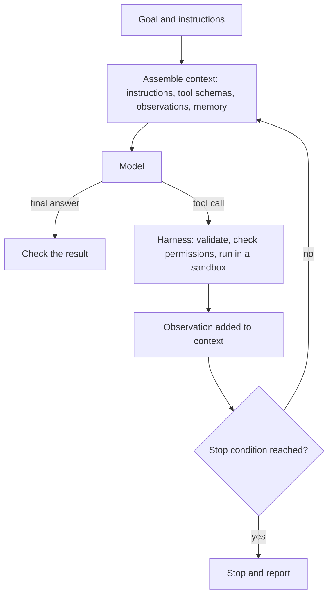

# Agent Engineering

Agent engineering is the practice of building software in which a language model runs in a loop, decides what to do next, calls tools and reads their results, and of making such systems reliable, safe and measurable. It is the practitioner's counterpart to the conceptual account of [AI Agents](../../theory/models/agents/index.md).

## Overview

A single prompt returns a single answer. An agent keeps going: it reads its goal, chooses an action, observes what happened and chooses again, until the task is finished or a limit is reached. Much of the engineering lies outside the model. Someone has to decide which tools the agent may use, what it sees at each step, how its outputs are checked, what it is allowed to change, when it must stop, and how its behaviour is recorded.

Practitioners often separate *workflows*, in which code fixes the sequence of model calls, from *agents*, in which the model decides its own path through a task. Anthropic's guidance recommends finding the simplest solution that works and adding autonomy only when it is needed, because agents trade latency and cost for flexibility, and because their errors can compound over many steps (Anthropic, 2024). This page covers the whole practical stack. Each part that needs more depth has its own sub-chapter, listed below.

## Key concepts

- **Agent loop**: the cycle of a model call, an action, an observation and the next model call. The loop ends with a final answer, a stop condition or an error.
- **Harness**: the code around the model. It builds each prompt, parses the model's output, runs tools, applies limits and records the run. Much of an agent's reliability comes from the harness rather than the model.
- **Tool**: a function the model may request, described by a name, a schema and a short explanation. The harness executes the call and returns the result as an observation.
- **Context engineering**: choosing what enters the model's context at each step, such as instructions, tool descriptions, earlier observations and retrieved documents. Anthropic defines it as curating the best set of information the model sees during inference, which is broader than the wording of a prompt (Anthropic, 2025).
- **Memory**: information that outlives a single model call. Short-term memory is usually the context window itself. Long-term memory is an external store, such as files, a database or summaries, that is written during a run and read in later runs.
- **Stop conditions and budgets**: limits on steps, tokens, money or time. Without them a loop can repeat indefinitely.
- **Trace**: the full record of a run, including model outputs, tool calls and results. Traces are the raw material for debugging, evaluation and monitoring.
- **Permissions and guardrails**: rules about which actions need approval, which data may be read or written, and which external services may be reached.

## How it works

Most agent systems share one skeleton, whatever framework they use:

Each step has its own failure modes. The model may call a tool with malformed arguments, choose a tool it should not use, repeat an action that has already failed, or declare success too early. The harness can validate arguments and refuse disallowed calls, but it cannot by itself judge whether the final answer is right. For that the system needs a check that does not depend on the model's own opinion: a test suite, a schema validator, a second model acting as reviewer, or a human approval step. Anthropic stresses that agents need ground truth from the environment at each step, such as tool results or code execution (Anthropic, 2024).

The main design choice is who decides the next step. Predefined code is predictable and easy to test, but it cannot handle open-ended tasks. Model-directed control handles open-ended tasks, but it needs more monitoring and budgets. Most production systems mix the two, with a fixed pipeline that contains one or two agentic steps, or a planning step that hands narrower jobs to focused routines.

## Key methods

Two landmark methods define the basic patterns of the loop and of learning from failure. Each has its own page.

- [ReAct](react/index.md): interleaves free-text reasoning with actions and observations in one loop. It is the reference point for most later designs of the loop.
- [Reflexion](reflexion/index.md): after a failed attempt, the agent writes a verbal reflection into memory and uses it on the next attempt. It improves without changing the model's weights.

## Sub-topics

Five sub-chapters cover the parts of this topic in more depth: tool calling and the Model Context Protocol, sandboxing and computer-use agents, multi-agent orchestration patterns, agent evaluation, and agent observability and tracing.

- [Tool Calling and the Model Context Protocol](tool-calling-and-mcp/index.md): tool definitions and JSON schemas, structured outputs, the Model Context Protocol, and tool-result handling with error recovery.
- [Sandboxing and Computer-Use Agents](sandboxing-and-computer-use/index.md): code execution sandboxes, browser and GUI agents, screenshot-based computer use, permission models and isolating side effects.
- [Multi-Agent Orchestration](multi-agent-orchestration/index.md): planner–worker, debate, role-based teams and hierarchical delegation, and when several agents beat a single one.
- [Agent Evaluation](agent-evaluation/index.md): SWE-bench, τ-bench and WebArena, pass@k and pass^k as reliability measures, cost-adjusted reporting and the reproducibility problems of agent benchmarks.

## Connections

- **Conceptual foundation**: definitions, the taxonomy of agents and the comparison with cognitive architectures are in [AI Agents](../../theory/models/agents/index.md). This page assumes that vocabulary.
- **Prompting and context**: [Prompt Engineering](../prompting/index.md) covers writing instructions. Context engineering extends this to everything the model sees across many steps.
- **Retrieval and memory**: retrieval can act as a tool or as the read path of a memory store. See [Retrieval-Augmented Generation](../rag/index.md) and [Vector Databases](../vector-databases/index.md).
- **Security**: an agent that reads untrusted content and holds tools is exposed to [indirect prompt injection](../llm-security/indirect-prompt-injection.md) and to excessive agency, both covered in [LLM Application Security](../llm-security/index.md).
- **Reasoning**: planning inside a single model call is covered in [Reasoning](../../theory/models/reasoning/index.md). The [chain-of-thought](../../theory/models/reasoning/chain-of-thought.md) technique is the basis of the thoughts in ReAct.
- **Frameworks and products**: agent frameworks and SDKs are surveyed in [Frameworks & Tools](../frameworks/index.md). [AI Coding Assistants](../coding-assistants/index.md) is the most mature application of agents so far.
- **Serving and cost**: a long loop multiplies model calls, so latency and cost become deployment questions. See [MLOps & Deployment](../mlops/index.md).
- **Reinforcement learning**: Reflexion learns from feedback without updating weights, an alternative to the parameter updates of [Reinforcement Learning](../../theory/paradigms/reinforcement-learning/index.md).
- **Brain and mind**: the agent vocabulary borrows from cognition. The context window resembles working memory, external stores resemble long-term memory, and the planning step resembles executive control. The resemblance is loose and is most useful as design vocabulary. [Cognitive Architectures](../../brain-mind/cognitive-architectures/index.md) sets out the classic systems, and [CoALA](../../brain-mind/cognitive-architectures/coala/index.md) maps language agents onto them. For the human side of memory, see [Memory and Learning](../../brain-mind/memory-learning/index.md).
- **Safety**: the risks of systems that act autonomously are discussed in [Safety & Alignment](../../society/safety-alignment/index.md).

## Applications

- **Software engineering**: agents read a repository, edit files, run tests and propose changes for review. SWE-bench, built from real GitHub issues, is a common test of this ability (Jimenez et al., 2023).
- **Computer and web use**: agents operate browsers and desktop applications from screenshots and input events. OSWorld benchmarks such agents on open-ended tasks in real operating-system environments (Xie et al., 2024).
- **Customer service and back-office work**: agents look up records, call internal interfaces and draft actions for a person to approve. τ-bench tests agents that converse with a simulated user, call domain tools and follow written policies (Yao et al., 2024).
- **Simulation**: Generative Agents combine a stored record of experience, periodic reflection and planning to drive simulated characters in a sandbox town (Park et al., 2023).

## Open questions

- **Reliability over long horizons.** Small error rates per step compound over many steps. How to keep success high over long tasks is unsettled. τ-bench reports that agents succeed on fewer than half of its tasks and are inconsistent across repeated trials, so single-run success rates can mislead (Yao et al., 2024).[^1]
- **Where control should live.** Fixed workflows are predictable and flexible loops are powerful. Which tasks justify the extra autonomy is still a practical judgement, and it is not settled by any single benchmark.
- **Memory.** What to store, when to summarise or forget, and how to stop stale or wrong notes from steering later decisions are open problems.
- **Evaluation.** Agent tasks depend on the state of an environment, not only on the final text, and they are often unstable. See [Evaluation & Benchmarks](../evaluation/index.md) for the general problem.
- **Security.** Granting enough permission for useful work, while preventing data leaks and irreversible actions, has no complete solution, and prompt injection is hard to rule out.
- **Cost.** Each extra step adds model calls and latency, so the value of extra autonomy has to be weighed against its price.

## References

### Seminal papers

- Yao, S. et al. (2022). *ReAct: Synergizing Reasoning and Acting in Language Models*. arXiv. https://arxiv.org/abs/2210.03629 — Interleaves reasoning traces with task actions in one prompting loop, with gains on question answering and interactive decision tasks.
- Schick, T. et al. (2023). *Toolformer: Language Models Can Teach Themselves to Use Tools*. arXiv. https://arxiv.org/abs/2302.04761 — Shows that a model can learn, from a few demonstrations per API, when to call external tools and how to use their results.
- Shinn, N. et al. (2023). *Reflexion: Language Agents with Verbal Reinforcement Learning*. arXiv. https://arxiv.org/abs/2303.11366 — Agents write verbal reflections on failed attempts into memory and use them to improve on later trials, without weight updates.

### Surveys and textbooks

- Wang, L. et al. (2023). *A Survey on Large Language Model based Autonomous Agents*. arXiv. https://arxiv.org/abs/2308.11432 — Survey of the profile, memory, planning and action modules of LLM agents, and of how such agents are evaluated.
- Sumers, T. R. et al. (2023). *Cognitive Architectures for Language Agents*. arXiv. https://arxiv.org/abs/2309.02427 — Proposes a framework that organises language agents by their memory, action space and decision cycle, drawing on cognitive science.

### Articles and documentation

- Anthropic (2024). *Building effective AI agents*. Anthropic Engineering. https://www.anthropic.com/engineering/building-effective-agents — Practical guidance on workflows versus agents, and on choosing the simplest design that works.
- Anthropic (2025). *Effective context engineering for AI agents*. Anthropic Engineering. https://www.anthropic.com/engineering/effective-context-engineering-for-ai-agents — Explains context engineering, the degradation of long contexts, and techniques such as compaction and structured note-taking.
- Anthropic (2026). *Demystifying evals for AI agents*. Anthropic Engineering. https://www.anthropic.com/engineering/demystifying-evals-for-ai-agents — Defines graders, transcripts and outcomes for agent evaluation, and the pass@k and pass^k metrics.
- Jimenez, C. E. et al. (2023). *SWE-bench: Can Language Models Resolve Real-World GitHub Issues?* arXiv. https://arxiv.org/abs/2310.06770 — Benchmark of software engineering problems from real GitHub issues, in which a model must edit a codebase to resolve each issue.
- Yao, S. et al. (2024). *τ-bench: A Benchmark for Tool-Agent-User Interaction in Real-World Domains*. arXiv. https://arxiv.org/abs/2406.12045 — Benchmark of conversations between a simulated user and an agent that uses domain APIs and must follow policy rules.
- Xie, T. et al. (2024). *OSWorld: Benchmarking Multimodal Agents for Open-Ended Tasks in Real Computer Environments*. arXiv. https://arxiv.org/abs/2404.07972 — Execution-based benchmark for agents that use real operating-system environments across arbitrary applications.
- Park, J. S. et al. (2023). *Generative Agents: Interactive Simulacra of Human Behavior*. arXiv. https://arxiv.org/abs/2304.03442 — Simulated characters that store experiences, reflect on them and plan from retrieved memories inside a sandbox town.

[^1]: Yao et al. (2024), τ-bench abstract, https://arxiv.org/abs/2406.12045 — Source of the finding that the tested function-calling agents succeed on under half of the tasks and vary across repeated trials.
