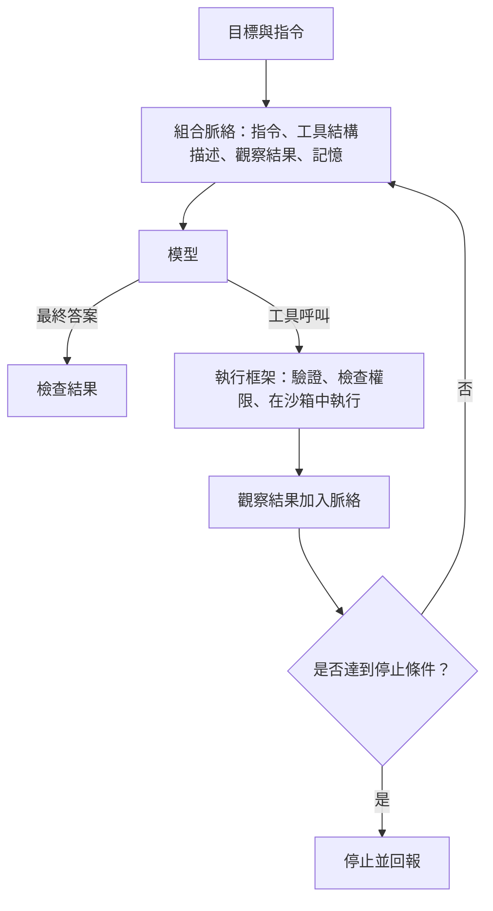

# 代理人工程

代理人工程是建構一類軟體的實務：語言模型在迴圈中運作，決定下一步要做什麼、呼叫工具並讀取結果；同時也包括讓這類系統可靠、安全且可被量測。它是 [AI 代理人](../../theory/models/agents/index.md)概念性介紹的實作者版本。

## 概述

單一提示只會得到單一回答。代理人則會持續運作：它讀取目標、選擇行動、觀察結果，然後再做下一次選擇，直到任務完成或達到上限為止。大部分工程工作其實在模型之外。有人必須決定代理人可以使用哪些工具、每一步能看到什麼、輸出如何檢查、允許改動什麼、何時必須停止，以及它的行為如何被記錄。

實務上常把**工作流程**與**代理人**分開看待：前者由程式碼決定模型呼叫的順序，後者則由模型自行決定在任務中的路徑。Anthropic 的建議是先找出能用的最簡單方案，只有在需要時才增加自主性，因為代理人會以延遲與成本換取彈性，而且其錯誤可能在多個步驟中累積（Anthropic，2024）。本頁涵蓋整個實務技術堆疊；需要更深入探討的部分，各有其子主題，列於下方。

## 關鍵概念

- **代理人迴圈（agent loop）**：模型呼叫、行動、觀察，再到下一次模型呼叫的循環。迴圈以最終答案、停止條件或錯誤結束。
- **執行框架（harness）**：模型外圍的程式碼。它負責組合每一步的提示、解析模型輸出、執行工具、套用限制並記錄執行過程。代理人的可靠度，很大一部分來自執行框架而非模型本身。
- **工具（tool）**：模型可以請求呼叫的函式，以名稱、結構描述與簡短說明來描述。執行框架負責實際執行，並把結果以觀察的形式回傳。
- **脈絡工程（context engineering）**：決定每一步有哪些內容進入模型的脈絡，例如指令、工具說明、先前的觀察結果與檢索到的文件。Anthropic 將它定義為在推論過程中策劃並維護模型所見資訊的最佳組合，範圍比提示的措辭更廣（Anthropic，2025）。
- **記憶（memory）**：超出單次模型呼叫仍然存在的資訊。短期記憶通常就是上下文視窗本身；長期記憶則是外部儲存，例如檔案、資料庫或摘要，在執行期間寫入，並在之後的執行中讀取。
- **停止條件與預算（stop conditions and budgets）**：對步數、token 數、金額或時間設定的上限。沒有這些限制，迴圈可能無止境地重複。
- **追蹤紀錄（trace）**：一次執行的完整紀錄，包括模型輸出、工具呼叫與結果。追蹤紀錄是除錯、評估與監控的原始材料。
- **權限與護欄（permissions and guardrails）**：規定哪些行動需要核准、哪些資料可以讀寫，以及可以連到哪些外部服務的規則。

## 運作方式

多數代理人系統，不論使用哪一種框架，都有相同的骨架：

每一步都有其失敗模式。模型可能以格式錯誤的參數呼叫工具、選用了不該使用的工具、重複一個已經失敗的行動，或過早宣告任務完成。執行框架可以驗證參數並拒絕不允許的呼叫，但它本身無法判斷最終答案是否正確。為此，系統需要一項不依賴模型自身意見的檢查，例如測試套件、結構驗證器、充當審查者的第二個模型，或人工核准步驟。Anthropic 強調，代理人在每一步都需要來自環境的基準事實，例如工具結果或程式執行的結果（Anthropic，2024）。

最主要的設計選擇，是由誰決定下一步。預先寫好的程式碼可預測、容易測試，但無法處理開放式任務；由模型主導的控制可以處理開放式任務，卻需要更多的監控與預算。多數實際系統會混合兩者：固定的流程中包含一兩個代理人步驟，或由規劃步驟把範圍較窄的工作交給專門的子程序。

## 關鍵方法

有兩個里程碑式的方法定義了迴圈的基本模式，以及如何從失敗中學習。每個方法各有專屬頁面。

- [ReAct](react/index.md)：在同一個迴圈中，把自由文字的推理與行動、觀察交錯進行。它是之後多數迴圈設計的參考起點。
- [Reflexion](reflexion/index.md)：一次失敗的嘗試結束後，代理人把語言反思寫入記憶，並在下一次嘗試時使用它。它不需要改變模型的權重就能改進。

## 子主題

本主題的五個子章節會更深入地探討各個部分：工具呼叫與 Model Context Protocol、沙箱與電腦操作代理人、多代理人編排模式、代理人評估，以及代理人可觀測性與追蹤。

- [工具呼叫與 Model Context Protocol](tool-calling-and-mcp/index.md)：工具定義與 JSON 結構描述、結構化輸出、Model Context Protocol，以及工具結果的處理與錯誤復原。
- [沙箱與電腦操作代理人](sandboxing-and-computer-use/index.md)：程式執行沙箱、瀏覽器與 GUI 代理人、以螢幕截圖為基礎的電腦操作、權限模型，以及隔離副作用。
- [多代理人編排](multi-agent-orchestration/index.md)：規劃者－工作者、辯論、角色式團隊與階層式委派，以及何時多個代理人勝過單一代理人。
- [代理人評估](agent-evaluation/index.md)：SWE-bench、τ-bench 與 WebArena 等基準、作為可靠度指標的 pass@k 與 pass^k、成本調整後的回報，以及代理人基準的可重現性問題。
- [代理人可觀測性與追蹤](observability/index.md)：模型與工具呼叫的追蹤、token 與成本核算、軌跡重播、失敗分類法，以及支援這些工作的 LLMOps 工具。

## 相關連結

- **概念基礎**：關於定義、代理人的分類，以及與認知架構的比較，請見 [AI 代理人](../../theory/models/agents/index.md)。本頁預設讀者已熟悉該頁的詞彙。
- **提示與脈絡**：[提示工程](../prompting/index.md)談如何撰寫指令；脈絡工程則把範圍擴大到模型在多個步驟中看到的所有內容。
- **檢索與記憶**：檢索既可以作為工具，也可以作為記憶儲存的讀取路徑。請見[檢索增強生成](../rag/index.md)與[向量資料庫與語意搜尋](../vector-databases/index.md)。
- **安全**：會讀取不受信任內容並持有工具的代理人，會面臨[間接提示注入](../llm-security/indirect-prompt-injection.md)與過度代理的風險，兩者都在 [LLM 應用安全](../llm-security/index.md)中說明。
- **推理**：在單次模型呼叫內進行的規劃，請見[推理模型與測試時運算](../../theory/models/reasoning/index.md)。[思維鏈](../../theory/models/reasoning/chain-of-thought.md)技巧是 ReAct 中思考步驟的基礎。
- **框架與產品**：代理人框架與 SDK 的概覽，見[框架與工具](../frameworks/index.md)。[AI 程式助手](../coding-assistants/index.md)是目前最成熟的代理人應用。
- **服務化與成本**：長迴圈會倍增模型呼叫次數，因此延遲與成本成為部署問題。請見 [MLOps 與部署](../mlops/index.md)。
- **強化學習**：Reflexion 不更新權重，而是從回饋中學習，與[強化學習](../../theory/paradigms/reinforcement-learning/index.md)透過參數更新來學習的方式不同。
- **大腦與心智**：代理人的詞彙借用了認知科學的概念。脈絡視窗類似工作記憶，外部儲存類似長期記憶，規劃步驟則類似執行控制。這種類比相當鬆散，較適合作為設計的詞彙。[認知架構](../../brain-mind/cognitive-architectures/index.md)介紹經典系統，[CoALA：語言代理人的認知架構](../../brain-mind/cognitive-architectures/coala/index.md)則把語言代理人對應到這些系統上。關於人類記憶的一面，請見[記憶與學習的神經機制](../../brain-mind/memory-learning/index.md)。
- **安全**：自主行動系統的風險，見 [安全與對齊](../../society/safety-alignment/index.md)。

## 應用

- **軟體工程**：代理人閱讀儲存庫、編輯檔案、執行測試，並提出供審查的變更。以真實 GitHub 議題建構的 SWE-bench，是常見的此類能力測試（Jimenez 等人，2023）。
- **電腦與網頁操作**：代理人透過螢幕截圖與輸入事件操作瀏覽器與桌面應用程式。OSWorld 在真實作業系統環境中，以開放式任務評測這類代理人（Xie 等人，2024）。
- **客服與後勤作業**：代理人查詢紀錄、呼叫內部介面，並草擬待人員核准的行動。τ-bench 測試代理人與模擬使用者對話、呼叫領域工具，並遵循書面政策的能力（Yao 等人，2024）。
- **模擬**：Generative Agents 結合儲存的經驗、定期反思與規劃，驅動沙箱小鎮中的模擬角色（Park 等人，2023）。

## 開放問題

- **長時程的可靠度。** 每一步的小錯誤率會在多個步驟中累積。如何在長任務中維持高成功率，目前仍未解決。τ-bench 報告，代理人在其任務中的成功率不到一半，且在重複執行之間表現不穩定，因此單次執行的成功率可能產生誤導（Yao 等人，2024）。[^1]
- **控制應該放在哪裡。** 固定的工作流程可預測，彈性迴圈則較有能力。哪些任務值得付出額外的自主性代價，仍是實務上的判斷，沒有任何單一基準能定論。
- **記憶。** 應該儲存什麼、何時摘要或遺忘，以及如何避免過時或錯誤的筆記影響之後的決策，都是尚待解決的問題。
- **評估。** 代理人任務取決於環境的狀態，而不只是最終文字，而且常常不穩定。一般性的問題請見[評估與基準](../evaluation/index.md)。
- **安全性。** 要授予足以完成工作的權限，同時防止資料外洩與不可逆的行動，目前沒有完整解方；提示注入也難以完全排除。
- **成本。** 每增加一步都會增加模型呼叫與延遲，因此額外自主性的價值必須與其代價權衡。

## 參考文獻

### 奠基性論文

- Yao, S. et al. (2022). *ReAct: Synergizing Reasoning and Acting in Language Models*. arXiv. https://arxiv.org/abs/2210.03629 — 提出 ReAct，在同一個提示迴圈中交錯推理軌跡與任務行動，並在問答與互動式決策任務上有所提升。
- Schick, T. et al. (2023). *Toolformer: Language Models Can Teach Themselves to Use Tools*. arXiv. https://arxiv.org/abs/2302.04761 — 顯示模型可以從每個 API 的少量示範中，學會何時呼叫外部工具，以及如何使用其結果。
- Shinn, N. et al. (2023). *Reflexion: Language Agents with Verbal Reinforcement Learning*. arXiv. https://arxiv.org/abs/2303.11366 — 代理人把失敗嘗試的語言反思寫入記憶，並在之後的嘗試中加以利用，不需更新權重。

### 綜述與教科書

- Wang, L. et al. (2023). *A Survey on Large Language Model based Autonomous Agents*. arXiv. https://arxiv.org/abs/2308.11432 — 綜述 LLM 代理人，涵蓋記憶、規劃與行動模組，以及此類代理人的評估方式。
- Sumers, T. R. et al. (2023). *Cognitive Architectures for Language Agents*. arXiv. https://arxiv.org/abs/2309.02427 — 提出以記憶、行動空間與決策循環來組織語言代理人的框架，並借鑒認知科學。

### 文章與文件

- Anthropic (2024). *Building effective AI agents*. Anthropic Engineering. https://www.anthropic.com/engineering/building-effective-agents — 關於工作流程與代理人之別的實用指引，以及如何選擇能用的最簡單設計。
- Anthropic (2025). *Effective context engineering for AI agents*. Anthropic Engineering. https://www.anthropic.com/engineering/effective-context-engineering-for-ai-agents — 說明脈絡工程、長脈絡的退化，以及壓縮與結構化筆記等技術。
- Anthropic (2026). *Demystifying evals for AI agents*. Anthropic Engineering. https://www.anthropic.com/engineering/demystifying-evals-for-ai-agents — 為代理人評估定義評分器、追蹤紀錄與結果，並介紹 pass@k 與 pass^k 指標。
- Jimenez, C. E. et al. (2023). *SWE-bench: Can Language Models Resolve Real-World GitHub Issues?* arXiv. https://arxiv.org/abs/2310.06770 — 以真實 GitHub 議題建構的軟體工程問題基準，模型必須編輯程式碼以解決每個議題。
- Yao, S. et al. (2024). *τ-bench: A Benchmark for Tool-Agent-User Interaction in Real-World Domains*. arXiv. https://arxiv.org/abs/2406.12045 — 模擬使用者與代理人對話的基準，代理人需使用領域 API 並遵循政策規則。
- Xie, T. et al. (2024). *OSWorld: Benchmarking Multimodal Agents for Open-Ended Tasks in Real Computer Environments*. arXiv. https://arxiv.org/abs/2404.07972 — 以執行結果為依據的基準，評測在真實作業系統環境中、可使用任意應用程式的代理人。
- Park, J. S. et al. (2023). *Generative Agents: Interactive Simulacra of Human Behavior*. arXiv. https://arxiv.org/abs/2304.03442 — 模擬角色會儲存經驗、反思，並從檢索到的記憶中規劃，活動於沙箱小鎮之中。

[^1]: Yao 等人（2024），τ-bench 摘要，https://arxiv.org/abs/2406.12045 — 所測試的函式呼叫代理人成功率不到一半，且在重複執行之間表現不一的來源。
