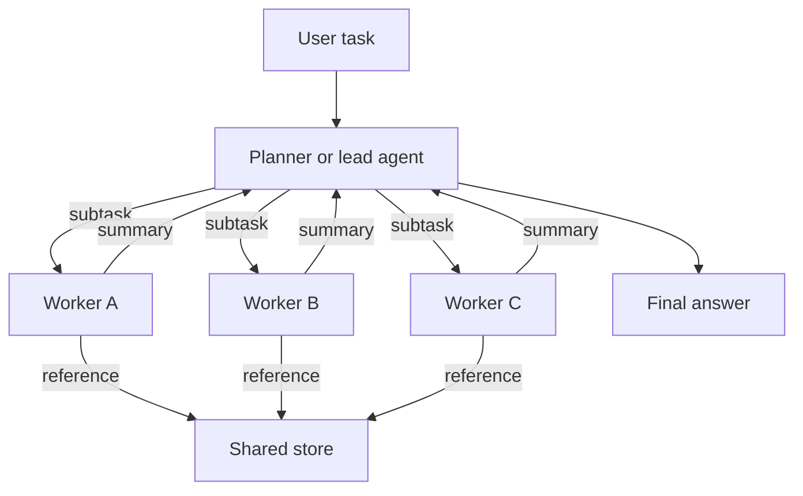

# Multi-Agent Orchestration

Multi-agent orchestration is the design of systems in which several language model agents share a task, and of the rules that decide who plans, who does what, how work and information pass between agents, and how results are combined. It is a sub-chapter of [Agent Engineering](../index.md), and a central question in that field is when a second agent is worth its cost at all.

## Overview

A single agent has one context window, one sequence of steps and one set of mistakes. Several agents can work in parallel, each with its own context, and a second agent can check the first. Anthropic reports that a multi-agent research system, with a lead agent that delegated searches to subagents, outperformed a single agent on an internal research evaluation by 90.2 percent.[^1] The same report also found that agents use about four times the tokens of a chat, and multi-agent systems about fifteen times, so the gain has to be worth the cost.

The gain is not general. A study of 260 configurations across six benchmarks found that the same multi-agent architecture could raise performance by 80.8 percent on a decomposable financial task and lower it by 70.0 percent on a sequential planning task.[^2] Performance depends on whether the task splits into independent parts, and on how well the architecture matches that structure. The rest of this chapter follows that theme.

## Key concepts

- **Orchestrator or lead agent**: the agent that decides how a task is split, gives out subtasks and assembles the results.
- **Worker or subagent**: an agent that performs one subtask, usually with its own tools and a fresh context.
- **Role**: a fixed profile and set of duties for an agent, such as reviewer or engineer.
- **Message passing**: agents send each other messages, in free text or in a fixed format.
- **Shared memory**: agents read and write a common store, a form of blackboard. Workers can store large outputs externally and pass only references, which avoids copying them through the conversation.
- **Topology**: the pattern of who talks to whom. Kim et al. (2025) compare independent, centralised, decentralised and hybrid topologies.
- **Coordination overhead**: the tokens, latency and information loss that come from agents communicating, which a single agent does not pay.

## How it works

Most systems combine three elements: a way to split the task, a way for agents to exchange information, and a way to decide the final output. The diagram shows a common hierarchical shape.

The main patterns differ in who decides the next step and how the agents interact:

- **Planner–worker.** One agent decomposes the task, and workers execute the parts. The planner may re-plan when a worker fails. [HuggingGPT](hugginggpt/index.md) is an early example, and Magentic-One (Fourney et al., 2024) is a later one with an orchestrator that directs web, file and code agents.
- **Debate.** Peer agents answer the same question and critique each other over several rounds, until they agree or a judge decides. See [Multi-Agent Debate](debate/index.md).
- **Role-based teams.** Agents take fixed roles, such as product manager, architect and engineer, and hand over structured documents along a fixed procedure. See [MetaGPT](metagpt/index.md).
- **Hierarchical delegation.** Orchestrators hand work to sub-orchestrators, which hand it to workers. The lead agent keeps the overall plan and each level sees only its own part, which keeps individual contexts small.

Choosing between message passing and shared memory is itself a design decision. Messages keep the conversation explicit and easy to inspect, but they make every agent read more text. Shared memory lets a worker's large output be used by others without being retyped, but it needs rules for who may write, and it can hold stale or conflicting entries.

## Key methods

Three landmark methods on this page compare as follows. Each has its own page.

| Method | Structure | What decides the next step | Landmark evidence |
|---|---|---|---|
| [Multi-Agent Debate](debate/index.md) | Equal peers, rounds of critique | Agreement among peers, or a judge | Du et al. (2023): debate beats single agents and majority voting on reasoning, and single agents on factuality |
| [MetaGPT](metagpt/index.md) | Fixed roles on an assembly line | Standardised operating procedures | Hong et al. (2023): higher executability and less revision than ChatDev on a software benchmark |
| [HuggingGPT](hugginggpt/index.md) | One planner and specialist workers | A single planning model | Shen et al. (2023): planning quality limits the whole pipeline |

## When several agents help, and when they do not

**Multi-agent designs tend to help** when the task splits into parts that can run in parallel and that need little shared context. Breadth-first research is the clearest case: separate searches run at the same time, and each subagent returns a condensed result. Anthropic notes that its token use explains most of the performance variance on a browsing benchmark, which suggests that spreading work across agents adds effective capacity.[^1] Separate contexts also help when one window cannot hold the material. Models use long inputs unevenly, and performance drops when relevant information sits in the middle of a long context (Liu et al., 2023). That is a reason to split material, though it does not show that teams beat a single agent with good retrieval.

**Multi-agent designs tend not to help** when the task is sequential, when each step depends on the last, or when all agents need the same detailed context. In the study of 260 configurations, performance on a sequential planning task fell by as much as 70.0 percent.[^2] Anthropic makes a similar point: many coding tasks contain fewer independent parts than research, and agents coordinate poorly.[^1] The same study found that architectures without a central verifier let errors spread further, and that gains from coordination shrink once a single agent is already strong. An analysis of more than 1,600 annotated traces from seven multi-agent frameworks found that many failures come from system design and misaligned communication, and that gains on popular benchmarks are often minimal (Cemri et al., 2025).

The practical rule that follows is to start with the simplest design that works. Anthropic recommends this for agent systems in general, and it applies with more force here, because a second agent multiplies cost and failure modes (Anthropic, 2024).

## Connections

- **Agent Engineering**: the parent chapter covers the single-agent loop, with [ReAct](../react/index.md) and [Reflexion](../reflexion/index.md) as its landmark methods.
- **Conceptual foundations**: [AI Agents](../../../theory/models/agents/index.md) defines the vocabulary used here, and [Cognitive Architectures](../../../brain-mind/cognitive-architectures/index.md) covers the older systems that combined specialised modules.
- **Frameworks**: [Frameworks & Tools](../../frameworks/index.md) lists agent frameworks, including AutoGen, which is built around conversations between agents (Wu et al., 2023).
- **Retrieval and memory**: shared memory is in practice a retrieval system. See [Retrieval-Augmented Generation](../../rag/index.md).
- **Evaluation**: multi-agent results are sensitive to the benchmark and to repeated runs, as covered in [Evaluation & Benchmarks](../../evaluation/index.md).
- **Security**: messages between agents can carry untrusted content from one agent to another, so an injected instruction may spread. See [LLM Application Security](../../llm-security/index.md).
- **Brain and mind**: the shared-memory pattern resembles the global workspace theory of conscious access, in which information becomes available to many processes once it is broadcast (see [Global workspace](../../../brain-mind/consciousness/global-workspace/index.md)). The analogy is loose, but it gives the design a vocabulary. [CoALA](../../../brain-mind/cognitive-architectures/coala/index.md) maps language agents onto cognitive architectures, which is the closest existing bridge.

## Applications

- **Software development**: role-based teams produce requirements, designs and code in a pipeline, with MetaGPT and ChatDev as the best-known examples (Hong et al., 2023; Qian et al., 2023).
- **Research and search**: breadth-first questions suit a lead agent with parallel subagents, as in Anthropic's research system.[^1]
- **Ensembles**: Mixture-of-Agents uses layers of LLM agents, where each agent in a layer reads the previous layer's outputs. The authors report 65.1 percent on AlpacaEval 2.0, against 57.5 percent for GPT-4 Omni, using open-source models (Wang et al., 2024).

## Open questions

- **Predicting the right design.** The scaling study's framework identifies the best architecture for 87 percent of held-out configurations,[^2] but the predictor is tied to the benchmarks it was built on. Whether the rule transfers to new tasks is open.
- **Communication.** How much information is lost when a long context is compressed into messages, and how to design formats that keep what matters, are still unsettled.
- **Shared memory.** Rules for writing, reading and retiring shared entries, and for resolving conflicts between agents, have few established answers.
- **Evaluation.** Gains reported on a single benchmark may not hold across tasks, so careful measurement against a single-agent baseline with the same budget is needed.
- **Cost.** Each added agent adds tokens. The value of extra agents has to be weighed against the price of the task.

## References

### Seminal papers

- Du, Y. et al. (2023). *Improving Factuality and Reasoning in Language Models through Multiagent Debate*. arXiv. https://arxiv.org/abs/2305.14325 — Introduces multi-round debate between language model instances, with gains on reasoning and factuality tasks.
- Hong, S. et al. (2023). *MetaGPT: Meta Programming for A Multi-Agent Collaborative Framework*. arXiv. https://arxiv.org/abs/2308.00352 — Role-based agents that follow standardised procedures and pass structured documents along an assembly line.
- Qian, C. et al. (2023). *ChatDev: Communicative Agents for Software Development*. arXiv. https://arxiv.org/abs/2307.07924 — A chat-based software company of role-playing agents that design, code and test software through dialogue.
- Wu, Q. et al. (2023). *AutoGen: Enabling Next-Gen LLM Applications via Multi-Agent Conversation*. arXiv. https://arxiv.org/abs/2308.08155 — Open-source framework for building applications from agents that converse, with customisable interaction behaviour.
- Shen, Y. et al. (2023). *HuggingGPT: Solving AI Tasks with ChatGPT and its Friends in Hugging Face*. arXiv. https://arxiv.org/abs/2303.17580 — A language model plans tasks and delegates them to specialist models, the planner-worker pattern.
- Wang, J. et al. (2024). *Mixture-of-Agents Enhances Large Language Model Capabilities*. arXiv. https://arxiv.org/abs/2406.04692 — Layered LLM agents in which each layer builds on the previous layer's outputs, with results on AlpacaEval 2.0.
- Liu, N. F. et al. (2023). *Lost in the Middle: How Language Models Use Long Contexts*. arXiv. https://arxiv.org/abs/2307.03172 — Shows that performance drops when relevant information lies in the middle of a long input, a motivation for splitting context.

### Surveys and textbooks

- Guo, T. et al. (2024). *Large Language Model based Multi-Agents: A Survey of Progress and Challenges*. arXiv. https://arxiv.org/abs/2402.01680 — Survey of LLM-based multi-agent systems, covering profiles, communication, mechanisms and challenges.

### Articles and documentation

- Anthropic (2025). *How we built our multi-agent research system*. Anthropic Engineering. https://www.anthropic.com/engineering/multi-agent-research-system — Describes a lead agent with subagents, its token costs and the reasons it works on breadth-first research.
- Anthropic (2024). *Building effective AI agents*. Anthropic Engineering. https://www.anthropic.com/engineering/building-effective-agents — Practical guidance on choosing the simplest agent design that works before adding autonomy or agents.
- Fourney, A. et al. (2024). *Magentic-One: A Generalist Multi-Agent System for Solving Complex Tasks*. arXiv. https://arxiv.org/abs/2411.04468 — An orchestrator that plans and re-plans while directing specialist agents for web, file and code tasks.
- Kim, Y. et al. (2025). *Towards a Science of Scaling Agent Systems*. arXiv. https://arxiv.org/abs/2512.08296 — Controlled comparison of five agent architectures over six benchmarks, showing that performance depends on the match between coordination and task structure.
- Cemri, M. et al. (2025). *Why Do Multi-Agent LLM Systems Fail?* arXiv. https://arxiv.org/abs/2503.13657 — Taxonomy of 14 failure modes across seven multi-agent frameworks, grouped into system design, inter-agent misalignment and task verification.

[^1]: Anthropic (2025), *How we built our multi-agent research system*, https://www.anthropic.com/engineering/multi-agent-research-system — Source of the 90.2 percent figure on an internal research evaluation, the token multipliers and the account of token use on the browsing benchmark.
[^2]: Kim et al. (2025), abstract, https://arxiv.org/abs/2512.08296 — Source of the 260-configuration study, the +80.8 and -70.0 percent figures, the 87 percent architecture-selection rate and the capability-saturation finding.
