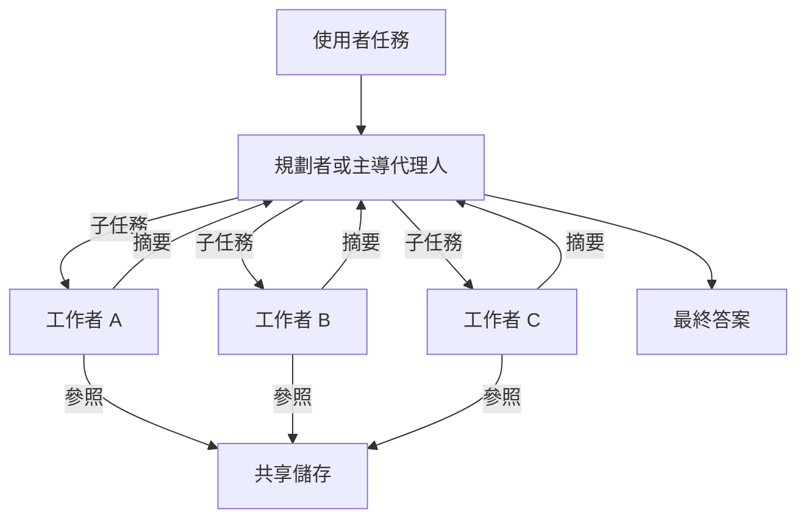

# 多代理人編排

多代理人編排是指設計讓數個語言模型代理人共同承擔任務的系統，並制定規則，決定由誰規劃、由誰執行，工作與資訊如何在代理人之間傳遞，以及如何合併結果。它是[代理人工程](../index.md)的子章節，而該領域的一個核心問題是：第二個代理人究竟何時值得它的成本。

## 概述

單一代理人只有一個脈絡視窗、一串步驟，也只有一組錯誤。數個代理人可以平行工作，各自擁有脈絡，而第二個代理人也能檢查第一個代理人的結果。Anthropic 報告，一個多代理人研究系統（由主導代理人把搜尋工作委派給子代理人）在內部研究評估上，比單一代理人高出 90.2%。[^1] 同一份報告也指出，代理人的 token 用量約為聊天的四倍，多代理人系統則約為十五倍，因此這樣的效益必須與成本相稱。

這種效益並非普遍存在。一項涵蓋六個基準、260 種配置的研究發現，同一種多代理人架構，在可分解的金融任務上可使表現提升 80.8%，在順序規劃任務上卻可使表現下降 70.0%。[^2] 表現取決於任務是否能切分為獨立的部分，以及架構與這種結構的吻合程度。本章其餘部分都圍繞這個主題展開。

## 關鍵概念

- **編排者或主導代理人（orchestrator or lead agent）**：決定任務如何切分、分派子任務並組合結果的代理人。
- **工作者或子代理人（worker or subagent）**：執行單一子任務的代理人，通常有自己的工具與全新的脈絡。
- **角色（role）**：為代理人固定的設定檔與職責，例如審查者或工程師。
- **訊息傳遞（message passing）**：代理人彼此傳送訊息，可以是自由文字，也可以是固定格式。
- **共享記憶（shared memory）**：代理人讀寫共同的儲存空間，是黑板（blackboard）的一種形式。工作者可以把大型輸出存到外部，只回傳參照，避免它們在對話中被重複複製。
- **拓撲（topology）**：誰與誰溝通的模式。Kim 等人（2025）比較了獨立、集中式、去中心化與混合式等拓撲。
- **協調負擔（coordination overhead）**：代理人彼此溝通所產生的 token、延遲與資訊損耗，這些是單一代理人不需承擔的。

## 運作方式

多數系統會結合三個要素：切分任務的方式、代理人交換資訊的方式，以及決定最終輸出的方式。下圖顯示常見的階層式結構。

主要模式的差別在於：由誰決定下一步，以及代理人之間如何互動。

- **規劃者－工作者。** 一個代理人拆解任務，由工作者執行各部分。規劃者在工作者失敗時可以重新規劃。[HuggingGPT](hugginggpt/index.md) 是早期的例子，Magentic-One（Fourney 等人，2024）則是後來的例子，其中的編排者會指揮負責網頁、檔案與程式碼的代理人。
- **辯論。** 對等的代理人回答同一問題，並在數輪之間互相批判，直到達成一致或由裁判決定。見[多代理人辯論](debate/index.md)。
- **角色式團隊。** 代理人擔任固定角色，例如產品經理、架構師與工程師，依固定程序交接結構化文件。見 [MetaGPT](metagpt/index.md)。
- **階層式委派。** 編排者把工作交給次級編排者，再由它們交給工作者。主導代理人保有整體計畫，每一層只看到自己負責的部分，因此各個脈絡能保持精簡。

在訊息傳遞與共享記憶之間作選擇，本身也是一項設計決策。訊息讓對話清楚且易於檢查，但會讓每個代理人必須閱讀更多文字。共享記憶讓一位工作者的大型輸出能被其他人使用，而不必重新輸入，但需要規定誰能寫入，而且可能保存過時或互相衝突的內容。

## 關鍵方法

本頁的三個里程碑方法比較如下。每個方法各有專頁。

| 方法 | 結構 | 由誰決定下一步 | 里程碑證據 |
|---|---|---|---|
| [多代理人辯論](debate/index.md) | 對等代理人，數輪批判 | 對等代理人之間的一致，或裁判 | Du 等人（2023）：在推理上，辯論勝過單一代理人與多數決；在事實性上，勝過單一代理人 |
| [MetaGPT](metagpt/index.md) | 固定角色，沿裝配線進行 | 標準作業程序 | Hong 等人（2023）：在軟體基準上，可執行性高於 ChatDev，所需修訂較少 |
| [HuggingGPT](hugginggpt/index.md) | 一個規劃者與數個專門工作者 | 單一規劃模型 | Shen 等人（2023）：規劃品質限制了整個流程 |

## 何時多個代理人有幫助，何時沒有

**多代理人設計傾向於在下列情況下有幫助**：任務能切分為可平行執行、且幾乎不需共享脈絡的部分。廣度優先的研究是最明顯的例子：各項搜尋同時進行，每個子代理人回傳濃縮後的結果。Anthropic 指出，其 token 用量能解釋瀏覽基準上大部分的表現變異，這顯示把工作分散到多個代理人，確實增加了有效的運算能力。[^1] 當一個脈絡視窗裝不下所有材料時，獨立脈絡也有幫助。模型對長輸入的運用並不均勻，相關資訊位於長脈絡中段時，表現會下降（Liu 等人，2023）。這是切分材料的理由之一，但它並不表示團隊必然勝過配有良好檢索的單一代理人。

**多代理人設計傾向於在下列情況下沒有幫助**：任務是順序性的、每一步都依賴前一步，或所有代理人都需要相同的詳細脈絡。在 260 種配置的研究中，順序規劃任務的表現最多下降了 70.0%。[^2] Anthropic 也提出類似的觀察：許多程式設計任務包含的獨立部分比研究任務少，而代理人之間的協調也不理想。[^1] 同一研究還發現，沒有中央驗證者的架構會讓錯誤擴散得更遠，而且當單一代理人本身已經很強時，協調所帶來的效益會縮小。一項針對七個常見多代理人框架、超過 1,600 條已標註追蹤紀錄的分析發現，許多失敗來自系統設計與溝通錯位，而且在常見基準上的進步往往很小（Cemri 等人，2025）。

由此而來的實務原則是：從能運作的最簡單設計開始。Anthropic 對一般代理人系統提出的建議即是如此，而在多代理人的情境下更為重要，因為每多一個代理人，成本與失敗模式都會倍增（Anthropic，2024）。

## 相關連結

- **代理人工程**：母章節涵蓋單一代理人的迴圈，其里程碑方法為 [ReAct](../react/index.md) 與 [Reflexion](../reflexion/index.md)。
- **概念基礎**：[AI 代理人](../../../theory/models/agents/index.md)定義了本頁使用的詞彙；[認知架構](../../../brain-mind/cognitive-architectures/index.md)則介紹結合了專門模組的早期系統。
- **框架**：[框架與工具](../../frameworks/index.md)列出代理人框架，其中包括以代理人之間的對話為核心的 AutoGen（Wu 等人，2023）。
- **檢索與記憶**：共享記憶在實務上就是一種檢索系統。請見[檢索增強生成](../../rag/index.md)。
- **評估**：多代理人的結果對基準與重複執行十分敏感，相關內容見[評估與基準](../../evaluation/index.md)。
- **安全**：代理人之間傳遞的訊息可能攜帶來自不受信任內容的指令，因此注入的指令可能擴散。請見 [LLM 應用安全](../../llm-security/index.md)。
- **大腦與心智**：共享記憶的模式類似全域工作空間理論中的意識存取：資訊一旦被廣播，就能供許多處理過程使用（見[全域工作空間](../../../brain-mind/consciousness/global-workspace/index.md)）。這個類比相當鬆散，但它為設計提供了詞彙。[CoALA](../../../brain-mind/cognitive-architectures/coala/index.md) 把語言代理人對應到認知架構，是目前最接近的橋樑。

## 應用

- **軟體開發**：角色式團隊以流水線的方式產生需求、設計與程式碼，最著名的例子是 MetaGPT 與 ChatDev（Hong 等人，2023；Qian 等人，2023）。
- **研究與搜尋**：廣度優先的問題適合由主導代理人搭配平行子代理人處理，例如 Anthropic 的研究系統。[^1]
- **集成**：Mixture-of-Agents 使用多層 LLM 代理人，每一層的代理人都讀取前一層的輸出。作者報告，僅使用開源模型時，它在 AlpacaEval 2.0 上達到 65.1%，而 GPT-4 Omni 為 57.5%（Wang 等人，2024）。

## 開放問題

- **預測正確的設計。** 該擴展研究的框架能為 87% 的保留配置找出最佳架構，[^2] 但這個預測器依賴於建立它時所用的基準。這個規則能否轉移到新任務上，仍是開放問題。
- **溝通。** 把長脈絡壓縮為訊息時會損失多少資訊，以及如何設計能保留關鍵內容的格式，仍無定論。
- **共享記憶。** 關於寫入、讀取與淘汰共享條目的規則，以及解決代理人之間衝突的方式，目前有的定論很少。
- **評估。** 在單一基準上報告的進步，未必能推廣到其他任務，因此需要在相同預算下，與單一代理人基準進行仔細的量測。
- **成本。** 每增加一個代理人就增加 token 用量，額外代理人的價值必須與任務的代價相權衡。

## 參考文獻

### 奠基性論文

- Du, Y. et al. (2023). *Improving Factuality and Reasoning in Language Models through Multiagent Debate*. arXiv. https://arxiv.org/abs/2305.14325 — 提出語言模型實例之間的多輪辯論，並在推理與事實性任務上取得進步。
- Hong, S. et al. (2023). *MetaGPT: Meta Programming for A Multi-Agent Collaborative Framework*. arXiv. https://arxiv.org/abs/2308.00352 — 以角色為基礎的代理人，遵循標準程序，並沿裝配線傳遞結構化文件。
- Qian, C. et al. (2023). *ChatDev: Communicative Agents for Software Development*. arXiv. https://arxiv.org/abs/2307.07924 — 由扮演角色的代理人組成的聊天式軟體公司，透過對話進行設計、編碼與測試。
- Wu, Q. et al. (2023). *AutoGen: Enabling Next-Gen LLM Applications via Multi-Agent Conversation*. arXiv. https://arxiv.org/abs/2308.08155 — 開源框架，用來建構由會互相對話的代理人組成的應用程式，互動行為可以客製化。
- Shen, Y. et al. (2023). *HuggingGPT: Solving AI Tasks with ChatGPT and its Friends in Hugging Face*. arXiv. https://arxiv.org/abs/2303.17580 — 語言模型規劃任務並將其委派給專門模型，即規劃者－工作者模式。
- Wang, J. et al. (2024). *Mixture-of-Agents Enhances Large Language Model Capabilities*. arXiv. https://arxiv.org/abs/2406.04692 — 多層 LLM 代理人，每一層都以前一層的輸出為基礎，並在 AlpacaEval 2.0 上取得結果。
- Liu, N. F. et al. (2023). *Lost in the Middle: How Language Models Use Long Contexts*. arXiv. https://arxiv.org/abs/2307.03172 — 顯示當相關資訊位於長輸入的中段時，表現會下降，是切分脈絡的動機之一。

### 綜述與教科書

- Guo, T. et al. (2024). *Large Language Model based Multi-Agents: A Survey of Progress and Challenges*. arXiv. https://arxiv.org/abs/2402.01680 — 綜述以 LLM 為基礎的多代理人系統，涵蓋設定檔、溝通、機制與挑戰。

### 文章與文件

- Anthropic (2025). *How we built our multi-agent research system*. Anthropic Engineering. https://www.anthropic.com/engineering/multi-agent-research-system — 說明主導代理人與子代理人的架構、其 token 成本，以及它在廣度優先研究上有效的原因。
- Anthropic (2024). *Building effective AI agents*. Anthropic Engineering. https://www.anthropic.com/engineering/building-effective-agents — 關於在增加自主性或代理人之前，先選擇最簡單且可行的代理人設計的實用指引。
- Fourney, A. et al. (2024). *Magentic-One: A Generalist Multi-Agent System for Solving Complex Tasks*. arXiv. https://arxiv.org/abs/2411.04468 — 一個編排者負責規劃與重新規劃，同時指揮負責網頁、檔案與程式碼任務的專門代理人。
- Kim, Y. et al. (2025). *Towards a Science of Scaling Agent Systems*. arXiv. https://arxiv.org/abs/2512.08296 — 在六個基準上比較五種代理人架構的受控研究，顯示表現取決於協調方式與任務結構的吻合程度。
- Cemri, M. et al. (2025). *Why Do Multi-Agent LLM Systems Fail?* arXiv. https://arxiv.org/abs/2503.13657 — 對七個多代理人框架中 14 種失敗模式的分類，分為系統設計、代理人之間的錯位與任務驗證三類。

[^1]: Anthropic (2025)，*How we built our multi-agent research system*，https://www.anthropic.com/engineering/multi-agent-research-system — 90.2% 這個數字的來源（內部研究評估）、token 用量倍數，以及瀏覽基準上 token 用量的說明。
[^2]: Kim et al. (2025)，摘要，https://arxiv.org/abs/2512.08296 — 260 種配置的研究、+80.8% 與 -70.0% 的數字、87% 的架構選擇率，以及能力飽和的發現的來源。
