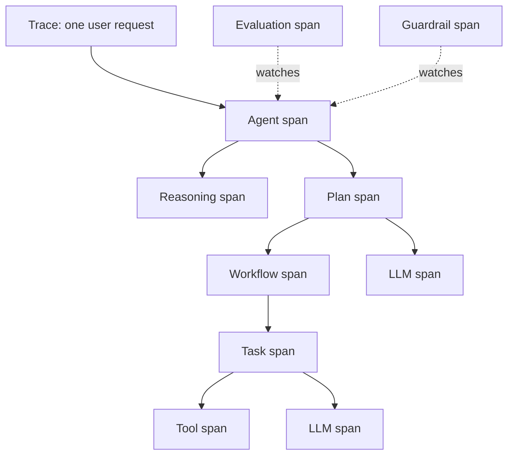

# AgentOps Taxonomy of Traceable Artifacts

The AgentOps taxonomy, proposed by Dong, Lu and Zhu (2024), lists the artifacts that an LLM agent should trace across its lifecycle, how those artifacts relate to one another, and what each kind of trace span should record. It is a reference template for tools that monitor, log and analyse agents, and one of the key methods on the [Agent Observability and Tracing](../index.md) page.

## Overview

Dong et al. take a DevOps view. An agent is a compound system: a language model sits among a context engine, external tools, knowledge bases and other agents, and at run time it produces goals and plans that did not exist at design time. Because such agents act autonomously, behave non-deterministically and change over time, the people responsible for them need to see what they do in order to detect anomalies, understand failures and assign accountability.

The authors found that existing tools focus mainly on LLM metrics and prompt management, with limited support for agent-specific artifacts such as goals, plans and tools. The taxonomy is meant to fill that gap.

## Key concepts

- **Design-time and runtime artifacts**: design-time artifacts are the parts an engineer builds, such as the context engine and the tools. Runtime artifacts are produced while the agent runs, such as goals, plans and tool results.
- **Trace and span**: a trace is the record of one request, from the user's goal to the final result. Its root span represents the whole request, and nested spans describe individual steps.
- **Span metadata**: each span carries a name, start time, duration, inputs and outputs, errors with tracebacks, and metrics such as input and output tokens.
- **Feedback**: explicit feedback, such as a rating, and implicit feedback, such as whether a user accepted an output. Implicit feedback is harder to collect but often more frequent and reliable.
- **Levels of evaluation**: the final response, a single step in isolation, or the whole trajectory of actions.

## How it works

The taxonomy was built in three stages.

1. **Mapping study.** Search GitHub and the web with terms such as "AgentOps", "Agent" with "LLMOps" and "Agent" with "Observability", screening the first three pages of web results. Keep tools that offer monitoring or tracing, have a formal release and public documentation. This yields 17 tools.
2. **Data extraction.** For each tool, record its scope, key features and the artifacts it traces.
3. **Relationship model and taxonomy.** Derive an entity-relationship model linking the artifacts, then specify the metadata for each span type.

In the model, a knowledge base feeds a reasoning step, a plan is realised as a workflow, a workflow consists of tasks, and tasks use tools and call the model. Evaluation and guardrail spans watch the other spans.

## Results

The paper is a conceptual and descriptive study and reports no experiments.

- **Tracing is universal.** Every tool in the authors' table implemented tracing, which they treat as the most direct route to observability.
- **Most tools target LLM applications.** Most describe themselves as observability for LLM applications in general, and four are aimed at agents.
- **Features vary.** Prompt management and evaluation are common, but guardrails appear in only a minority of tools.

## Limitations

- **No empirical validation.** Validation through real-world case studies and a prototype is listed as future work.
- **Incomplete coverage.** Keyword searches may have missed tools, and the data model may lack useful attributes, such as trace links between steps.
- **Snapshot.** The data were collected in late 2024, and the tool landscape has changed since.

## Open questions

- Which artifacts are essential? Recording every span in full is costly and raises privacy risk.
- How should communication between agents be linked, given that the paper flags trace links as a gap?
- Will the taxonomy converge with shared telemetry standards? Zheng et al. (2025) note that observability is being unified by standards from the OpenTelemetry GenAI working group.[^1]
- How should sensitive content in traces be governed? Chan et al. (2024) discuss the privacy implications of visibility measures for agents.

[^1]: Zheng et al. (2025), related-work section, https://arxiv.org/abs/2508.02736

## References

### Seminal papers

- Dong, L., Lu, Q. & Zhu, L. (2024). *AgentOps: Enabling Observability of LLM Agents*. arXiv. https://arxiv.org/abs/2411.05285 — Taxonomy of the artifacts and metadata that agent tracing should record, derived from a mapping study of observability tools.
- Chan, A. et al. (2024). *Visibility into AI Agents*. arXiv. https://arxiv.org/abs/2401.13138 — Assesses agent identifiers, real-time monitoring and activity logging as measures of visibility, and their privacy implications.
- Zheng, Y. et al. (2025). *AgentSight: System-Level Observability for AI Agents Using eBPF*. arXiv. https://arxiv.org/abs/2508.02736 — Observes agents from outside their application code by joining model traffic with kernel events, placing its work within the AgentOps concept.
- Chen, L., Zaharia, M. & Zou, J. (2023). *FrugalGPT: How to Use Large Language Models While Reducing Cost and Improving Performance*. arXiv. https://arxiv.org/abs/2305.05176 — Shows that LLM API prices differ widely and proposes routing queries through a cascade of models to cut inference cost.

### Surveys and textbooks

- Mohammadi, M. et al. (2025). *Evaluation and Benchmarking of LLM Agents: A Survey*. arXiv. https://arxiv.org/abs/2507.21504 — Taxonomy of what agent evaluation measures and how, including the metrics and tooling that support it.

### Articles and documentation

- Anthropic (2024). *Building effective AI agents*. Anthropic Engineering. https://www.anthropic.com/engineering/building-effective-agents — Notes that agentic systems trade latency and cost for performance, and recommends extensive testing in sandboxed environments.
