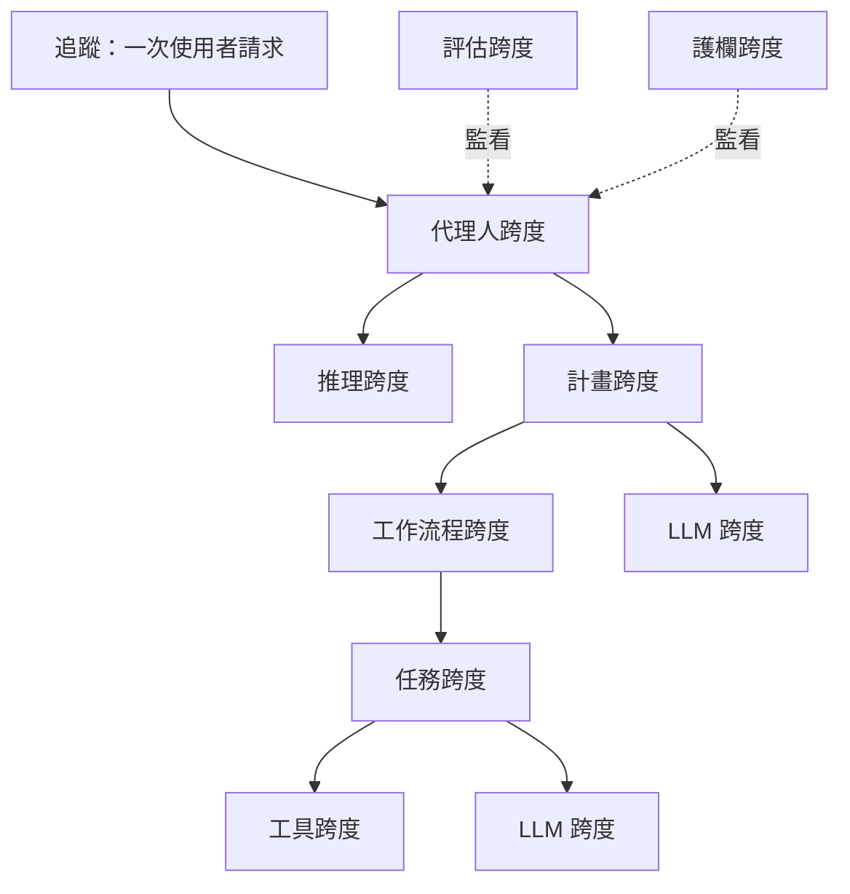

# AgentOps 可追蹤構件分類法

AgentOps 分類法由 Dong、Lu 與 Zhu（2024）提出，列出 LLM 代理人在整個生命週期中應該追蹤的構件、這些構件彼此之間的關係，以及每一類追蹤跨度應該記錄的內容。它是用來監控、記錄與分析代理人的工具之參考範本，也是[代理人可觀測性與追蹤](../index.md)頁面中的關鍵方法之一。

## 概述

Dong 等人採取 DevOps 的觀點。代理人是一個複合系統：語言模型位於脈絡引擎、外部工具、知識庫與其他代理人之間，並在執行時產生設計階段並不存在的目標與計畫。由於代理人會自主行動、表現出非確定性，並且會隨時間改變，負責它們的人需要看見它們在做什麼，才能偵測異常、理解失敗，並在事故發生時釐清責任。

作者發現，現有工具主要著重於 LLM 指標與提示管理，對目標、計畫與工具等代理人特有的構件支援有限。此分類法正是為了填補這個缺口。

## 關鍵概念

- **設計階段與執行階段的構件（design-time and runtime artifacts）**：設計階段的構件是工程師建構的部分，例如脈絡引擎與工具。執行階段的構件是代理人運作時產生的，例如目標、計畫與工具結果。
- **追蹤與跨度（trace and span）**：追蹤是一次請求的紀錄，從使用者的目標到最終結果。其根跨度代表整個請求，巢狀的跨度則描述個別步驟。
- **跨度中繼資料（span metadata）**：每個跨度記錄名稱、開始時間、持續時間、輸入與輸出、帶有堆疊追蹤的錯誤，以及輸入與輸出詞元數等指標。
- **回饋（feedback）**：明確回饋，例如評分；以及隱含回饋，例如使用者是否接受某個輸出。隱含回饋較難收集，但通常更頻繁、也更可靠。
- **評估層級（levels of evaluation）**：最終回應、孤立地看單一步驟，或是整段行動軌跡。

## 運作方式

此分類法分三個階段建立。

1. **對照研究（mapping study）。** 在 GitHub 與網路上以「AgentOps」、「Agent」搭配「LLMOps」與「Agent」搭配「Observability」等詞彙搜尋，網路搜尋只看前三頁結果。保留提供監控或追蹤、有正式發行版本且有公開文件的工具。此流程得到 17 個工具。
2. **資料擷取。** 為每個工具記錄其範圍、主要功能與所追蹤的構件。
3. **關係模型與分類法。** 由擷取的資料推導出一個實體關係模型，連結各個構件，再為每種跨度類型規定中繼資料。

在此模型中，知識庫為推理步驟提供資料，計畫會實現為工作流程，工作流程由任務組成，任務則使用工具並呼叫模型。評估與護欄跨度會監看其他跨度。

## 結果

本文是概念性與描述性的研究，沒有進行實驗。

- **追蹤十分普遍。** 作者表中的每一個工具都已實作追蹤，作者認為這是通往可觀測性最直接的途徑。
- **多數工具以 LLM 應用為對象。** 多數工具將自己描述為泛用 LLM 應用的可觀測性工具，只有四個以代理人為對象。
- **功能各異。** 提示管理與評估很常見，但護欄只出現在少數工具中。

## 限制

- **沒有實證驗證。** 以真實世界案例研究與原型工具進行驗證，被列為未來的工作。
- **工具涵蓋不完整。** 關鍵字搜尋可能漏掉工具，資料模型也可能缺少有用的屬性，例如步驟之間的追蹤連結。
- **資料為快照。** 資料收集於 2024 年底，此後工具生態已有所變動。

## 開放問題

- 哪些構件是必要的？完整記錄每個跨度既昂貴又有隱私風險。
- 代理人之間的通訊應如何連結？論文指出，追蹤連結是尚待補足的缺口。
- 此分類法會不會與共通的遙測標準趨於一致？Zheng 等人（2025）指出，可觀測性正由 OpenTelemetry GenAI 工作小組的標準所統一。[^1]
- 追蹤紀錄中的敏感內容應如何治理？Chan 等人（2024）討論了代理人可見性措施的隱私影響。

## 參考文獻

### 奠基性論文

- Dong, L., Lu, Q. & Zhu, L.（2024）。*AgentOps: Enabling Observability of LLM Agents*。arXiv。https://arxiv.org/abs/2411.05285 — 代理人追蹤應記錄的構件與中繼資料分類法，取材自對可觀測性工具的對照研究。
- Chan, A. 等人（2024）。*Visibility into AI Agents*。arXiv。https://arxiv.org/abs/2401.13138 — 以代理人識別碼、即時監控與活動紀錄作為可見性措施進行評估，並討論其隱私影響。
- Zheng, Y. 等人（2025）。*AgentSight: System-Level Observability for AI Agents Using eBPF*。arXiv。https://arxiv.org/abs/2508.02736 — 從應用程式外部觀察代理人，將模型流量與核心事件相互結合，並將其工作置於 AgentOps 的概念之下。
- Chen, L., Zaharia, M. & Zou, J.（2023）。*FrugalGPT: How to Use Large Language Models While Reducing Cost and Improving Performance*。arXiv。https://arxiv.org/abs/2305.05176 — 顯示 LLM API 價格差異很大，並提出將查詢經由模型級聯路由以降低推論成本的方法。

### 綜述與教科書

- Mohammadi, M. 等人（2025）。*Evaluation and Benchmarking of LLM Agents: A Survey*。arXiv。https://arxiv.org/abs/2507.21504 — 代理人評估衡量什麼、如何衡量的分類，包括支援它的指標與工具。

### 文章與文件

- Anthropic（2024）。*Building effective AI agents*。Anthropic Engineering。https://www.anthropic.com/engineering/building-effective-agents — 指出代理人系統以延遲與成本換取效能，並建議進行充分的沙箱測試。

[^1]: Zheng 等人（2025），相關研究一節，https://arxiv.org/abs/2508.02736
