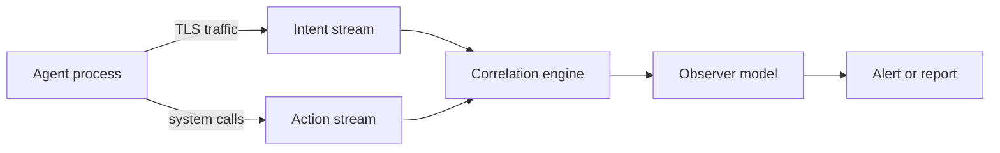

# AgentSight: Boundary Tracing for AI Agents

AgentSight (Zheng et al., 2025) observes a running AI agent from outside its application code, at the boundaries where the agent touches the world: its encrypted traffic to the model provider and the operating system's system calls. It joins the two streams into one causal trace using eBPF probes in the Linux kernel. It is one of the key methods on the [Agent Observability and Tracing](../index.md) page.

## Overview

Most agent observability works inside the application. Frameworks such as LangChain and AutoGen record an agent's reasoning and tool choices, which gives a view of intent. The authors argue that this view is brittle: it needs updates whenever the framework changes, and a shell command that bypasses the framework escapes it. System-level monitors take the opposite view. They see every file access and process start, but without the prompt behind them, a data-analysis script and a malicious payload look the same.

The paper calls the gap between these views a *semantic gap*. Boundary tracing avoids it by watching the interfaces that agents cannot avoid: the network for communication and the kernel for system operations. Frameworks change often, but these interfaces are stable.

## Key concepts

- **Intent stream**: the decrypted prompts and responses of the model, captured in the TLS functions of libraries such as OpenSSL.
- **Action stream**: process events and system calls, such as process execution, file opens, network connections and `execve`, captured in the kernel.
- **eBPF**: a mechanism that runs small, verified programs inside the Linux kernel, used here to attach probes without changing the agent's code.
- **Process lineage**: the tree of processes started by the agent. The kernel filter passes events only from this tree, which keeps overhead low.
- **Observer model**: a second language model that reads the correlated trace and judges it, for example whether the actions fit the stated goal.

## How it works

The authors implemented the design as a userspace daemon of about 6,000 lines of Rust and C, with a 3,000-line script front end. The pipeline has five steps.

1. **Capture intent.** eBPF uprobes on the TLS library's send and receive functions expose decrypted model traffic, and the daemon reassembles streamed responses.
2. **Capture actions.** Kernel tracepoints build the process tree, and kprobes watch selected system calls.
3. **Filter in the kernel.** Only events from the agent's process lineage reach userspace.
4. **Correlate.** A correlation engine links each model exchange to the system events that follow it. In one attack case, 521 raw events were merged into 37.
5. **Analyse.** The observer model reads the correlated trace and explains it in natural language, which the authors prefer to brittle rule-based detection.

## Results

The evaluation has two parts, overhead and case studies, and both are small.

- **Overhead.** On three developer workflows, each run three times with and without AgentSight, the overhead was 3.4%, 4.9% and 0.4%, an average of 2.9%.[^1]
- **Prompt injection.** An agent building a C project followed a hidden instruction in a README-linked page and sent `/etc/passwd` to a remote server, disguised as a build step. AgentSight captured the chain from the URL fetch to the exfiltration, and the observer returned a high-confidence attack score.
- **Reasoning loop.** A research agent repeatedly called a search tool with the same wrong arguments after each error. The observer identified a "try-fail-re-reason" loop from the sequence of calls.
- **Multi-agent coordination.** Six collaborating Claude Code subagents were monitored. Sequential dependencies and file-lock contention caused many retries, and the authors suggest clearer role separation could reduce runtime and token cost.

## Limitations

- **Small evaluation.** The paper has three workflows and three case studies, and reports no detection or false-positive rates.
- **Hooked libraries.** Intent capture depends on hooking the TLS functions of a library such as OpenSSL. Other stacks would need adaptation.
- **Platform.** The implementation relies on eBPF and ran on Linux.
- **Observer errors.** Semantic judgements inherit the errors and cost of the observer model.
- **Visible content.** The daemon sees every model exchange in plain text, a data-protection question the paper does not study in depth.

## Open questions

- How well does observer judgement hold up at scale, compared with rule-based detection?
- Should a monitor watch what a model says it is thinking or what it does? Baker et al. (2025) found that monitoring chain of thought caught reward hacking better than monitoring actions, but that optimising against the monitor taught hidden reasoning.[^2]
- How can boundary tracing be made privacy-preserving, for example by keeping only the events an alert needs?

[^1]: Zheng et al. (2025), Table 1 and Section 5.1, https://arxiv.org/abs/2508.02736
[^2]: Baker et al. (2025), abstract, https://arxiv.org/abs/2503.11926

## References

### Seminal papers

- Zheng, Y. et al. (2025). *AgentSight: System-Level Observability for AI Agents Using eBPF*. arXiv. https://arxiv.org/abs/2508.02736 — Introduces boundary tracing with eBPF, joining decrypted model traffic with kernel events and reporting under 3% overhead.
- Dong, L., Lu, Q. & Zhu, L. (2024). *AgentOps: Enabling Observability of LLM Agents*. arXiv. https://arxiv.org/abs/2411.05285 — Taxonomy of the artifacts and metadata that agent tracing should record, within which AgentSight places its work.
- Greshake, K. et al. (2023). *Not what you've signed up for: Compromising Real-World LLM-Integrated Applications with Indirect Prompt Injection*. arXiv. https://arxiv.org/abs/2302.12173 — Shows how instructions hidden in content an LLM application retrieves can take over its actions, the kind of threat the first case study tests.
- Baker, B. et al. (2025). *Monitoring Reasoning Models for Misbehavior and the Risks of Promoting Obfuscation*. arXiv. https://arxiv.org/abs/2503.11926 — Shows that chain-of-thought monitoring can detect reward hacking better than action monitoring, and that training against the monitor can hide intent.

### Articles and documentation

- Anthropic (2024). *Building effective AI agents*. Anthropic Engineering. https://www.anthropic.com/engineering/building-effective-agents — Notes the potential for compounding errors in agents and recommends extensive testing in sandboxed environments.
