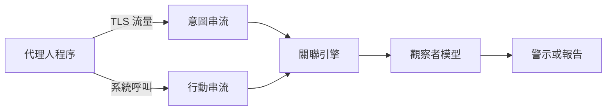

# AgentSight：AI 代理人的邊界追蹤

AgentSight（Zheng 等人，2025）從應用程式程式碼之外觀察正在執行的 AI 代理人，觀察的位置是代理人與外部世界接觸的邊界：它與模型供應商之間的加密流量，以及作業系統的系統呼叫。它利用 Linux 核心中的 eBPF 探針，將兩股資料串流合併為一條因果追蹤。它是[代理人可觀測性與追蹤](../index.md)頁面中的關鍵方法之一。

## 概述

多數代理人的可觀測性技術是在應用程式內部運作的。LangChain 與 AutoGen 等框架會記錄代理人的推理與工具選擇，因此提供的是意圖的視角。作者認為這種視角很脆弱：每當框架改版就需要更新，而繞過框架的 shell 指令則會逃離它的觀察。系統層級的監控則採取相反的觀點。它們能看見每一次檔案存取與程序啟動，卻看不到背後的提示，因此資料分析腳本與惡意酬載看起來沒有分別。

論文把這兩種視角之間的落差稱為「語意落差」。邊界追蹤的做法，是觀察代理人無法避開的介面來避開此落差：用於通訊的網路，以及用於系統操作的核心。框架經常改變，但這些介面是穩定的。

## 關鍵概念

- **意圖串流（intent stream）**：模型解密後的提示與回應，在 OpenSSL 等函式庫的 TLS 函式中擷取。
- **行動串流（action stream）**：程序事件與系統呼叫，例如程序執行、開啟檔案、網路連線與 `execve`，在核心中擷取。
- **eBPF**：一種在 Linux 核心內執行小型、經過驗證之程式的機制。此處用來附加探針，而無需修改代理人的程式碼。
- **程序譜系（process lineage）**：代理人所啟動的程序樹。核心過濾器只放行來自此樹的事件，以降低額外負擔。
- **觀察者模型（observer model）**：讀取已關聯追蹤紀錄並加以判斷的第二個語言模型，例如判斷行動是否符合既定目標。

## 運作方式

作者將此設計實作為一個使用者空間守護程序，約 6,000 行 Rust 與 C 程式碼，另有 3,000 行的腳本前端。管線分為五個步驟。

1. **擷取意圖。** eBPF uprobe 附加於 TLS 函式庫的傳送與接收函式，取得解密後的模型流量，守護程序並重組串流式回應。
2. **擷取行動。** 核心 tracepoint 建立程序樹，kprobe 則監看選定的系統呼叫。
3. **在核心中過濾。** 只有來自代理人程序譜系的事件會被送往使用者空間。
4. **關聯。** 關聯引擎把每一次模型交換與同一譜系中隨後發生的系統事件相連。在一個攻擊案例中，521 個原始事件被合併為 37 個。
5. **分析。** 觀察者模型讀取已關聯的追蹤紀錄，並以自然語言加以說明；作者認為這比脆弱的規則式偵測更好。

## 結果

評估分為額外負擔與案例研究兩部分，兩者規模都很小。

- **額外負擔。** 在三個開發者工作流程中，每個流程各執行三次，分別在有與沒有 AgentSight 的情況下比較，額外負擔分別為 3.4%、4.9% 與 0.4%，平均為 2.9%。[^1]
- **提示注入。** 一個負責建置 C 專案的代理人，遵循了 README 所連結頁面中的隱藏指令，並把 `/etc/passwd` 偽裝成建置步驟送往遠端伺服器。AgentSight 擷取了從 URL 擷取到資料外洩的完整鏈條，觀察者則回傳了高信心的攻擊分數。
- **推理迴圈。** 一個研究代理人在每次錯誤後，都以相同的錯誤參數重複呼叫搜尋工具。觀察者從呼叫序列中辨識出「嘗試—失敗—重新推理」的迴圈。
- **多代理人協調。** 監控了六個協作的 Claude Code 子代理人。順序相依與檔案鎖競爭造成大量重試，作者認為更清楚的角色分工可以減少執行時間與詞元成本。

## 限制

- **評估規模小。** 論文只有三個工作流程與三個案例研究，且沒有報告偵測率或誤報率。
- **依賴被掛鉤的函式庫。** 意圖擷取依賴於掛鉤 OpenSSL 等函式庫的 TLS 函式。其他技術堆疊需要調整。
- **平台。** 此實作依賴 eBPF，並在 Linux 上執行。
- **觀察者的錯誤。** 語意判斷來自第二個模型，因此會承襲該模型的錯誤與成本。
- **可見內容。** 守護程序以純文字看見每一次模型交換的內容，這是論文未深入研究的資料保護問題。

## 開放問題

- 觀察者的判斷在大規模情況下表現如何？與規則式偵測相比又如何？
- 監控器應該監看模型說它在想什麼，還是監看它做了什麼？Baker 等人（2025）發現，監控思維鏈比只監控行動更能偵測獎勵駭客，但針對監控器進行最佳化會教會模型隱藏推理。[^2]
- 邊界追蹤如何在保護隱私的前提下進行？例如只保留警示所需的事件。

## 參考文獻

### 奠基性論文

- Zheng, Y. 等人（2025）。*AgentSight: System-Level Observability for AI Agents Using eBPF*。arXiv。https://arxiv.org/abs/2508.02736 — 提出以 eBPF 進行的邊界追蹤，將解密後的模型流量與核心事件相連，並在開發者工作流程中報告低於 3% 的額外負擔。
- Dong, L., Lu, Q. & Zhu, L.（2024）。*AgentOps: Enabling Observability of LLM Agents*。arXiv。https://arxiv.org/abs/2411.05285 — 代理人追蹤應記錄的構件與中繼資料分類法，AgentSight 的工作即置於其框架之下。
- Greshake, K. 等人（2023）。*Not what you've signed up for: Compromising Real-World LLM-Integrated Applications with Indirect Prompt Injection*。arXiv。https://arxiv.org/abs/2302.12173 — 顯示隱藏在 LLM 應用所檢索內容中的指令，如何能夠接管其行動，這正是第一個案例研究所測試的威脅。
- Baker, B. 等人（2025）。*Monitoring Reasoning Models for Misbehavior and the Risks of Promoting Obfuscation*。arXiv。https://arxiv.org/abs/2503.11926 — 顯示思維鏈監控比行動監控更能偵測獎勵駭客，且針對監控器進行訓練可能使意圖被隱藏。

### 文章與文件

- Anthropic（2024）。*Building effective AI agents*。Anthropic Engineering。https://www.anthropic.com/engineering/building-effective-agents — 指出代理人可能使錯誤累積，並建議在沙箱環境中進行充分測試。

[^1]: Zheng 等人（2025），表 1 與第 5.1 節，https://arxiv.org/abs/2508.02736
[^2]: Baker 等人（2025），摘要，https://arxiv.org/abs/2503.11926
