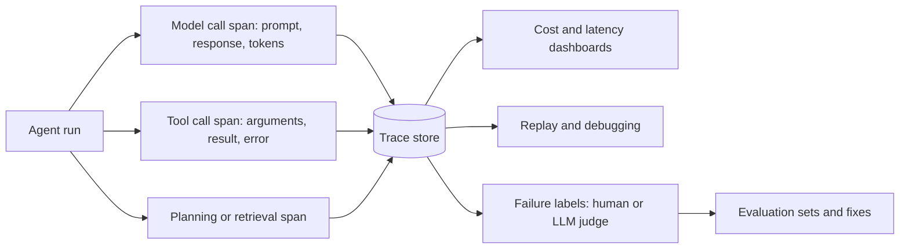

# Agent Observability and Tracing

Agent observability is the practice of recording what an LLM agent does, from each model call and tool call to the cost of every step, so that engineers can debug, measure and audit runs whose paths were not scripted in advance. Tracing is its central technique: a structured record of one run that can be read back, replayed and labelled after the fact.

## Overview

Conventional software is observed through logs, metrics and traces. The program reports what it did, and an operator reads the reports. An agent makes this harder in three ways. Its path through a task is chosen at run time by a model, so the same input can produce different sequences of calls. A failure can begin at step three and surface only at step twenty, as a wrong answer. And a bill can depend on how many times a loop repeated, not on the size of any single request. [Agent Engineering](../index.md) describes the loop itself. Observability asks what must be recorded about the loop so that someone can understand it later.

Three questions follow. *Reconstruction* asks whether someone can see the prompts, responses, tool arguments and results, in order. *Measurement* asks whether a team can see token use, latency and cost per run, per step and per user. *Diagnosis* asks whether a failed run can be located and classified, so that the next fix addresses the right cause. The first two are mainly engineering. The third is partly research, because verifying the ground truth of a multi-agent failure is hard.[^1]

## Key concepts

- **Trace**: the complete record of one run, from the user's request to the final output.
- **Span**: a timed step within a trace, such as a model call, a tool call, a retrieval or a planning step. Spans nest, so an agent span can contain tool and model spans. The [AgentOps taxonomy](agentops-taxonomy/index.md) lists the fields each span should carry.
- **Token accounting**: counting the input and output [tokens](../../../reference/glossary/index.md) of each model call. Providers charge by token, so counts convert directly into money.
- **Trajectory**: the ordered sequence of actions and observations in a run. Evaluating a trajectory checks the path as well as the final answer.
- **Replay**: running a recorded trajectory again, either to read it step by step or to re-execute it with the recorded tool results.
- **Failure taxonomy**: a fixed set of defined failure categories used to label traces consistently. The [MAST taxonomy](mast-failure-taxonomy/index.md) is one example.
- **Failure attribution**: identifying which agent and which step caused a failed run.
- **LLM-as-judge**: a model that reads a trace and grades it, used where human labelling would be too slow.

## How it works

A typical stack instruments the agent so that every model call and tool call emits a span. Each span is written to a store under its trace identifier, and derived values such as token counts and cost are computed from the recorded metadata. Dashboards group spans by run, user or model, while debugging tools, evaluation sets and labelling queues read from the same store.

Instrumentation can happen at three layers. Framework hooks record calls made through an agent framework. They are easy to add but miss anything the framework does not mediate. Client wrappers record every call to a model API, but not what the agent does with the answer. Boundary tracing observes the process from outside, at the network and kernel interfaces, and so captures what the agent actually does. [AgentSight](agentsight/index.md) is an example of this last approach.

**Token and cost accounting.** Model APIs usually report token counts for each request, and cost is those counts multiplied by per-token prices. Prices vary widely. FrugalGPT notes that LLM API fees can differ by two orders of magnitude, and it proposes a cascade that learns which models to call for each query.[^2] For agents the figure that matters is cost per completed task, not cost per call, because retries, long contexts and repeated loops multiply the calls. A trace is what makes this visible.

**Replay.** Recorded traces support three uses. A person can read a trace to find where a run went wrong. A team can re-execute a run with the recorded tool results, to test a changed prompt against the same environment. A system can reuse a trace as experience: AgentRR records an interaction trace, summarises it into a structured experience and replays that experience in similar later tasks, with a check function intended to keep replay safe.[^3] Exact replay is hard, because a live model is not deterministic, so replay usually fixes the tool results and treats the model's output as a fresh sample.

## Key methods

Three landmark methods, each with its own page, show the main directions of the field.

| Method | Year | Direction | What separates it |
|---|---|---|---|
| [MAST](mast-failure-taxonomy/index.md) | 2025 | Failure taxonomy | Fourteen failure modes in three categories, validated with an LLM annotator |
| [AgentOps taxonomy](agentops-taxonomy/index.md) | 2024 | Trace design | Which artifacts and span types a tool should record, and how they relate |
| [AgentSight](agentsight/index.md) | 2025 | Boundary tracing | Observes from outside the application, correlating model traffic with system calls |

## Connections

- **Agent loop.** Observability is the monitoring layer of the harness described in [Agent Engineering](../index.md).
- **Tools and sandboxes.** Tool spans record the calls defined in [Tool Calling & MCP](../tool-calling-and-mcp/index.md). The side effects discussed in [Sandboxing & Computer-Use Agents](../sandboxing-and-computer-use/index.md) are what boundary tracing observes.
- **Multi-agent systems.** Coordination failures are the subject of [Multi-Agent Orchestration](../multi-agent-orchestration/index.md), and MAST is built from such systems.
- **Production operations.** Cost monitoring, drift and serving latency belong to [MLOps & Deployment](../../mlops/index.md), which lists tracing among its LLMOps practices. The cost that tracing measures is the subject of [Inference Optimization](../../inference-optimization/index.md).
- **Evaluation.** Traces are the raw material for trajectory-level evaluation, covered in [Evaluation & Benchmarks](../../evaluation/index.md).
- **Products.** The commercial and open-source tools that implement these ideas are surveyed in [Frameworks & Tools](../../frameworks/index.md).
- **Security.** Traces can reveal injected instructions and data exfiltration, the risks in [LLM Application Security](../../llm-security/index.md) and [indirect prompt injection](../../llm-security/indirect-prompt-injection.md).
- **Safety and interpretability.** Monitoring a model's chain of thought is one form of observation, discussed alongside [chain-of-thought reasoning](../../../theory/models/reasoning/chain-of-thought.md) and [reward hacking](../../../society/safety-alignment/reward-hacking.md). Interpretability asks about a model's internals instead; see [Interpretability](../../../society/interpretability/index.md).
- **Brain and mind.** A trace is a record the system can read back, a design analogue of metacognition, the monitoring of one's own reasoning that [cognitive architectures](../../../brain-mind/cognitive-architectures/index.md) include among their functions. The analogy is loose, since a trace is written by software and nobody claims it is the agent's experience. A closer parallel is the predictive-coding idea that a system compares expectations with outcomes and treats mismatches as signals ([Predictive Coding & Free Energy](../../../brain-mind/predictive-coding/index.md)). Anomaly alerts in agent monitoring do something similar.

## Applications

- **Debugging.** In one case study, a trace exposed a loop in which a research agent repeated the same failing search call after each error.[^4]
- **Security monitoring.** In a test, correlating model traffic with system calls exposed a prompt-injection chain that ended in data exfiltration.[^4]
- **Cost control.** Token use per run shows which paths are expensive. Cost tracking is among the features of the tools that the AgentOps paper surveys.[^5]
- **Team design.** In a six-agent case, the trace showed agents blocked by file-lock contention, a finding the authors read as a case for clearer role separation.[^4]
- **Tooling.** Every tool in the AgentOps survey implements tracing, which makes it the baseline feature of agent operations.[^5]

## Open questions

- **Privacy.** Traces hold user data, prompts and secrets. How long they are kept and who may read them is unsettled. Chan et al. (2024) analyse the privacy and concentration-of-power implications of visibility measures.[^6]
- **Watching thoughts or actions.** Baker et al. (2025) found that monitoring a model's chain of thought detected reward hacking better than monitoring its actions alone, but that optimising against the monitor led to hidden reasoning.[^7]
- **Attribution.** Automated judges identify the responsible agent more reliably than the decisive step. Zhang et al. (2025) report 53.5% agent-level and 14.2% step-level accuracy for their best method.[^8]
- **Standards.** Tools record different fields. Shared conventions are being developed, and the taxonomies on this page are proposals, not standards.[^9]

[^1]: Cemri et al. (2025), Section 1, on the difficulty of verifying ground truth for root-cause detection, https://arxiv.org/abs/2503.13657
[^2]: Chen, Zaharia & Zou (2023), abstract, https://arxiv.org/abs/2305.05176
[^3]: Feng et al. (2025), abstract, https://arxiv.org/abs/2505.17716
[^4]: Zheng et al. (2025), Section 5.2, https://arxiv.org/abs/2508.02736
[^5]: Dong et al. (2024), Section 3, https://arxiv.org/abs/2411.05285
[^6]: Chan et al. (2024), abstract, https://arxiv.org/abs/2401.13138
[^7]: Baker et al. (2025), abstract, https://arxiv.org/abs/2503.11926
[^8]: Zhang et al. (2025), abstract, https://arxiv.org/abs/2505.00212
[^9]: Zheng et al. (2025), related-work section, on OpenTelemetry GenAI standards, https://arxiv.org/abs/2508.02736

## References

### Seminal papers

- Dong, L., Lu, Q. & Zhu, L. (2024). *AgentOps: Enabling Observability of LLM Agents*. arXiv. https://arxiv.org/abs/2411.05285 — Taxonomy of the artifacts and metadata that agent tracing should record, derived from a mapping study of observability tools.
- Cemri, M. et al. (2025). *Why Do Multi-Agent LLM Systems Fail?*. arXiv. https://arxiv.org/abs/2503.13657 — Introduces the MAST failure taxonomy and an LLM annotator, applied to 1,642 annotated traces from seven frameworks.
- Zheng, Y. et al. (2025). *AgentSight: System-Level Observability for AI Agents Using eBPF*. arXiv. https://arxiv.org/abs/2508.02736 — Observes agents from outside their application by joining decrypted model traffic with kernel events.
- Chan, A. et al. (2024). *Visibility into AI Agents*. arXiv. https://arxiv.org/abs/2401.13138 — Assesses agent identifiers, real-time monitoring and activity logging as measures of visibility, and their privacy implications.
- Chen, L., Zaharia, M. & Zou, J. (2023). *FrugalGPT: How to Use Large Language Models While Reducing Cost and Improving Performance*. arXiv. https://arxiv.org/abs/2305.05176 — Shows that LLM API prices differ widely and proposes a cascade of models that reduces inference cost.
- Zhang, S. et al. (2025). *Which Agent Causes Task Failures and When? On Automated Failure Attribution of LLM Multi-Agent Systems*. arXiv. https://arxiv.org/abs/2505.00212 — Introduces the Who&When dataset of failure logs and compares three automated attribution methods.
- Feng, E. et al. (2025). *Get Experience from Practice: LLM Agents with Record & Replay*. arXiv. https://arxiv.org/abs/2505.17716 — Records agent traces, summarises them into reusable experience and replays that experience in similar tasks.
- Baker, B. et al. (2025). *Monitoring Reasoning Models for Misbehavior and the Risks of Promoting Obfuscation*. arXiv. https://arxiv.org/abs/2503.11926 — Shows that chain-of-thought monitoring can detect reward hacking better than action monitoring, and that training against it can hide intent.

### Surveys and textbooks

- Mohammadi, M. et al. (2025). *Evaluation and Benchmarking of LLM Agents: A Survey*. arXiv. https://arxiv.org/abs/2507.21504 — Taxonomy of what agent evaluation measures and how, including the metrics and tooling that support it.

### Articles and documentation

- Anthropic (2024). *Building effective AI agents*. Anthropic Engineering. https://www.anthropic.com/engineering/building-effective-agents — Notes that agents trade latency and cost for performance, can compound errors, and should be tested extensively in sandboxed environments.
