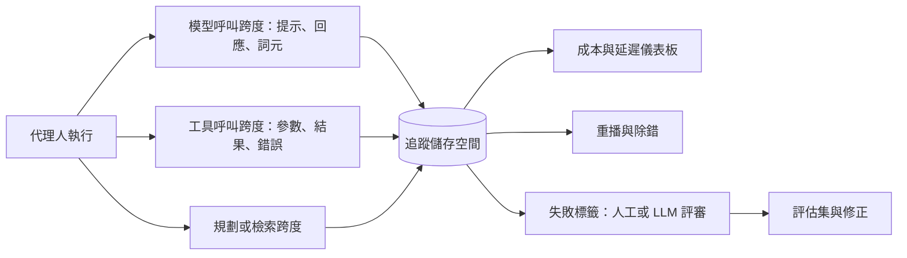

# 代理人可觀測性與追蹤

代理人可觀測性，是記錄 LLM 代理人所做的一切的實務：從每一次模型呼叫、每一次工具呼叫，到每個步驟的成本。有了這些紀錄，工程師就能除錯、量測並稽核那些事先沒有寫成劇本的執行過程。追蹤（tracing）是其中的核心技術：它是一份結構化的單次執行紀錄，事後可以讀取、重播並加上標籤。

## 概述

傳統軟體透過日誌、指標與追蹤來觀察。程式回報它做了什麼，操作人員閱讀這些回報。代理人讓情況更困難，原因有三。第一，它在任務中的路徑是由模型在執行時選定的，因此相同的輸入可能產生不同的呼叫序列。第二，失敗可能從第三步就已經發生，卻要到第二十步才以錯誤答案的形式浮現。第三，帳單的多寡可能取決於迴圈重複了幾次，而不是任何單一請求的大小。[代理人工程](../index.md)描述的是迴圈本身。可觀測性則關心：必須記錄下哪些東西，之後才有人能理解這個迴圈。

由此衍生三個問題。**重建**問的是：能否依序看見提示、回應、工具參數與結果。**量測**問的是：團隊能否看見每次執行、每個步驟與每位使用者的詞元用量、延遲與成本。**診斷**問的是：失敗的執行能否被定位並歸類，使下一次修正針對正確的原因。前兩者主要是工程問題。第三者則部分屬於研究問題，因為在多代理人系統中，要驗證失敗的基準事實本來就很困難。[^1]

## 關鍵概念

- **追蹤（trace）**：一次執行的完整紀錄，從使用者的請求到最終輸出。
- **跨度（span）**：追蹤中一個有時間長度的步驟，例如一次模型呼叫、一次工具呼叫、一次檢索或一次規劃。跨度可以巢狀排列，因此代理人跨度可以包含工具跨度與模型跨度。[AgentOps 分類法](agentops-taxonomy/index.md)列出每種跨度應該記錄的欄位。
- **詞元用量核算（token accounting）**：計算每次模型呼叫的輸入與輸出[詞元](../../../reference/glossary/index.md)數。供應商依詞元計費，因此詞元數可以直接換算成金錢。
- **軌跡（trajectory）**：一次執行中行動與觀察的先後序列。評估軌跡，檢查的是路徑，而不只是最終答案。
- **重播（replay）**：重新執行一段已記錄的軌跡，可以是逐步閱讀，也可以是用已記錄的工具結果重新執行。
- **失敗分類法（failure taxonomy）**：一組固定且有定義的失敗類別，用來一致地標註追蹤紀錄。[MAST 分類法](mast-failure-taxonomy/index.md)是其中一例。
- **失敗歸因（failure attribution）**：找出是哪一個代理人、哪一個步驟造成失敗的執行。
- **以 LLM 充當評審（LLM-as-judge）**：由模型閱讀追蹤紀錄並為其評分。這在人工標註過於緩慢時使用。

## 運作方式

典型的系統會對代理人進行插樁（instrumentation），使每一次模型呼叫與工具呼叫都送出一個跨度。每個跨度會以其追蹤識別碼寫入儲存空間，並由記錄下來的中繼資料計算出詞元數與成本等衍生數值。儀表板依執行、使用者或模型來分組跨度；除錯工具、評估集與標註佇列則讀取同一個儲存空間。

插樁可以在三個層次進行。框架掛鉤（framework hooks）記錄透過代理人框架發出的呼叫，容易加入，但會漏掉框架沒有經手的部分。用戶端包裝器（client wrappers）記錄每一次對模型 API 的呼叫，卻不知道代理人如何使用回應。邊界追蹤（boundary tracing）則從外部觀察程序，在網路與核心介面處進行，因此能捕捉代理人實際做了什麼。[AgentSight](agentsight/index.md)是最後一種做法的例子。

**詞元與成本核算。** 模型 API 通常會在每次請求中回報詞元數，成本則是這些詞元數乘上每個詞元的價格。價格差異很大。FrugalGPT 指出，不同供應商的 LLM API 費用可相差兩個數量級，並提出一種級聯方法，學習每個查詢應該呼叫哪些模型。[^2]對代理人而言，重要的數字是每個完成任務的成本，而不是每次呼叫的成本，因為重試、過長的脈絡與重複的迴圈都會使呼叫次數倍增。追蹤紀錄正是讓這些成本看得見的工具。

**重播。** 已記錄的追蹤有三種用途。人可以閱讀追蹤紀錄，找出執行在哪裡出錯。團隊可以用已記錄的工具結果重新執行，在相同的環境中測試修改後的提示。系統也可以把追蹤紀錄當作經驗來重用：AgentRR 記錄互動軌跡，將其摘要為結構化的經驗，並在相似的後續任務中重播該經驗，同時以檢查函式確保重播的安全。[^3]精確重播並不容易，因為實際的模型並非確定性的，因此重播通常會固定工具結果，並把模型的輸出視為新的一次取樣。

## 關鍵方法

三個里程碑式的方法各有專屬頁面，分別代表這個領域的主要方向。

| 方法 | 年份 | 方向 | 區別之處 |
|---|---|---|---|
| [MAST](mast-failure-taxonomy/index.md) | 2025 | 失敗分類法 | 三個類別共十四種失敗模式，並以 LLM 標註器驗證 |
| [AgentOps 分類法](agentops-taxonomy/index.md) | 2024 | 追蹤設計 | 工具應記錄哪些構件與跨度類型，以及它們之間的關係 |
| [AgentSight](agentsight/index.md) | 2025 | 邊界追蹤 | 從應用程式外部觀察，將模型流量與系統呼叫相互關聯 |

## 相關連結

- **代理人迴圈。** 可觀測性是[代理人工程](../index.md)所描述的執行框架中的監控層。
- **工具與沙箱。** 工具跨度記錄[工具呼叫與 MCP](../tool-calling-and-mcp/index.md)所定義的呼叫。[沙箱與電腦操作代理人](../sandboxing-and-computer-use/index.md)所討論的副作用，正是邊界追蹤所觀察的對象。
- **多代理人系統。** 協調失敗是[多代理人編排](../multi-agent-orchestration/index.md)的主題，而 MAST 正是以這類系統為基礎建立的。
- **生產營運。** 成本監控、分布偏移與服務延遲屬於 [MLOps 與部署](../../mlops/index.md)，該頁把追蹤列為 LLMOps 實務之一。追蹤所量測的成本，則是[推論最佳化](../../inference-optimization/index.md)的課題。
- **評估。** 追蹤紀錄是軌跡層級評估的原始材料，見[評估與基準](../../evaluation/index.md)。
- **產品。** 實作這些想法的商業與開源工具，見[框架與工具](../../frameworks/index.md)的概覽。
- **安全。** 追蹤紀錄可以揭露被注入的指令與資料外洩，這些風險見 [LLM 應用安全](../../llm-security/index.md)與[間接提示注入](../../llm-security/indirect-prompt-injection.md)。
- **安全與可解釋性。** 監控模型的思維鏈是觀察的一種形式，可與[思維鏈](../../../theory/models/reasoning/chain-of-thought.md)及[獎勵駭客](../../../society/safety-alignment/reward-hacking.md)一併參照。可解釋性則探究模型的內部，見[可解釋性](../../../society/interpretability/index.md)。
- **大腦與心智。** 追蹤紀錄是系統可以回頭讀取的紀錄，在設計上類似後設認知，也就是監控自身推理的能力；[認知架構](../../../brain-mind/cognitive-architectures/index.md)把它列為功能之一。這個類比並不嚴謹，因為追蹤紀錄是由軟體寫成的，而沒有人主張它就是代理人的經驗。更接近的對應是預測編碼的想法：系統把預期與結果相比較，並把不一致視為訊號（[預測編碼與自由能原理](../../../brain-mind/predictive-coding/index.md)）。代理人監控中的異常警示，做的也是類似的事。

## 應用

- **除錯。** 在一個案例研究中，追蹤紀錄揭露了一個研究代理人在每次錯誤後重複同一個失敗搜尋呼叫的迴圈。[^4]
- **安全監控。** 在一項測試中，將模型流量與系統呼叫相互關聯，揭露了一條以資料外洩結束的提示注入鏈。[^4]
- **成本控制。** 每次執行的詞元用量，能顯示哪些路徑最昂貴。成本追蹤是 AgentOps 論文所調查的工具功能之一。[^5]
- **團隊設計。** 在一個六代理人的案例中，追蹤紀錄顯示代理人因檔案鎖競爭而互相阻塞，作者認為這說明了需要更清楚的角色分工。[^4]
- **工具實作。** AgentOps 調查中的每一個工具都實作了追蹤，這使它成為代理人營運的基本功能。[^5]

## 開放問題

- **隱私。** 追蹤紀錄包含使用者資料、提示與機密。保存多久、誰可以讀取，尚無定論。Chan 等人（2024）分析了代理人可見性措施在隱私與權力集中方面的影響。[^6]
- **監看思考或監看行動。** Baker 等人（2025）發現，監控模型的思維鏈比只監控其行動更能偵測獎勵駭客行為，但若針對監控器進行最佳化，模型會發展出隱藏的推理。[^7]
- **歸因。** 自動評審比起找出決定性的步驟，更能可靠地找出負責的代理人。Zhang 等人（2025）報告其最佳方法的代理人層級準確率為 53.5%，步驟層級準確率為 14.2%。[^8]
- **標準。** 各工具記錄的欄位不同。業界正在發展共通的慣例，而本頁介紹的分類法仍是提案，而非標準。[^9]

[^1]: Cemri 等人（2025），第 1 節，關於多代理人系統中驗證根本原因基準事實的困難，https://arxiv.org/abs/2503.13657
[^2]: Chen、Zaharia 與 Zou（2023），摘要，https://arxiv.org/abs/2305.05176
[^3]: Feng 等人（2025），摘要，https://arxiv.org/abs/2505.17716
[^4]: Zheng 等人（2025），第 5.2 節，https://arxiv.org/abs/2508.02736
[^5]: Dong 等人（2024），第 3 節，https://arxiv.org/abs/2411.05285
[^6]: Chan 等人（2024），摘要，https://arxiv.org/abs/2401.13138
[^7]: Baker 等人（2025），摘要，https://arxiv.org/abs/2503.11926
[^8]: Zhang 等人（2025），摘要，https://arxiv.org/abs/2505.00212
[^9]: Zheng 等人（2025），相關研究一節，關於 OpenTelemetry GenAI 標準，https://arxiv.org/abs/2508.02736

## 參考文獻

### 奠基性論文

- Dong, L., Lu, Q. & Zhu, L.（2024）。*AgentOps: Enabling Observability of LLM Agents*。arXiv。https://arxiv.org/abs/2411.05285 — 代理人追蹤應記錄的構件與中繼資料的分類法，取材自對可觀測性工具的系統性對照研究。
- Cemri, M. 等人（2025）。*Why Do Multi-Agent LLM Systems Fail?*。arXiv。https://arxiv.org/abs/2503.13657 — 提出 MAST 失敗分類法與 LLM 標註器，應用於來自七個框架的 1,642 條標註追蹤紀錄。
- Zheng, Y. 等人（2025）。*AgentSight: System-Level Observability for AI Agents Using eBPF*。arXiv。https://arxiv.org/abs/2508.02736 — 透過將解密後的模型流量與核心事件相互結合，從應用程式外部觀察代理人。
- Chan, A. 等人（2024）。*Visibility into AI Agents*。arXiv。https://arxiv.org/abs/2401.13138 — 以代理人識別碼、即時監控與活動紀錄作為可見性措施進行評估，並討論其隱私影響。
- Chen, L., Zaharia, M. & Zou, J.（2023）。*FrugalGPT: How to Use Large Language Models While Reducing Cost and Improving Performance*。arXiv。https://arxiv.org/abs/2305.05176 — 顯示 LLM API 價格差異很大，並提出可降低推論成本的模型級聯方法。
- Zhang, S. 等人（2025）。*Which Agent Causes Task Failures and When? On Automated Failure Attribution of LLM Multi-Agent Systems*。arXiv。https://arxiv.org/abs/2505.00212 — 提出 Who&When 失敗日誌資料集，並比較三種自動歸因方法。
- Feng, E. 等人（2025）。*Get Experience from Practice: LLM Agents with Record & Replay*。arXiv。https://arxiv.org/abs/2505.17716 — 記錄代理人追蹤紀錄，將其摘要為可重用的經驗，並在相似任務中重播該經驗。
- Baker, B. 等人（2025）。*Monitoring Reasoning Models for Misbehavior and the Risks of Promoting Obfuscation*。arXiv。https://arxiv.org/abs/2503.11926 — 顯示思維鏈監控比行動監控更能偵測獎勵駭客，且針對此監控進行訓練可能使意圖被隱藏。

### 綜述與教科書

- Mohammadi, M. 等人（2025）。*Evaluation and Benchmarking of LLM Agents: A Survey*。arXiv。https://arxiv.org/abs/2507.21504 — 代理人評估所衡量的內容與方式的分類，包括支援它的指標與工具。

### 文章與文件

- Anthropic（2024）。*Building effective AI agents*。Anthropic Engineering。https://www.anthropic.com/engineering/building-effective-agents — 指出代理人以延遲與成本換取效能，可能使錯誤累積，並應在沙箱環境中充分測試。
