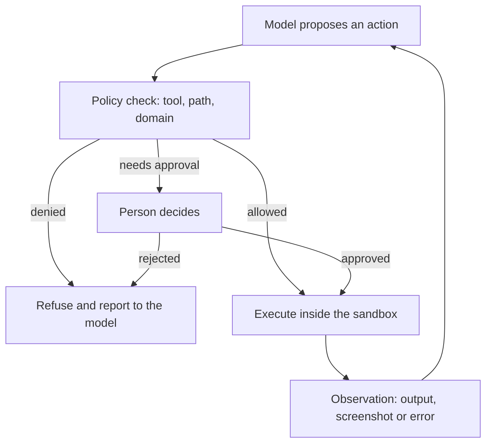

# Sandboxing and Computer-Use Agents

An agent that runs code, browses the web or operates a desktop can change things that cannot be undone. Sandboxing confines those effects to a controlled environment, and computer-use methods let a model act through the same interfaces a person uses, such as screenshots, a mouse and a keyboard. This page covers how the two fit together and how permission models decide what an agent may touch. It is one of the sub-chapters of [Agent Engineering](../index.md).

## Overview

A language model that only writes text has limited effects, because nothing it writes happens by itself. Once it can execute code, open a web page, submit a form or click a button, each action has consequences in the world, and some of them cannot be reversed: a deleted file, a sent message, a payment. Sandboxing is the family of techniques that limit those consequences. Permission models decide which actions are allowed at all, and when a person must confirm them.

Operating-system researchers have long isolated programs from one another. Computer-use agents push the problem further: they receive a picture of a screen and return the next click, with no interface prepared for them. That makes them general, and harder to contain, because a screen shows whatever an outside party has placed on it.

The containment problem is old. Lampson described the confinement problem in 1973 as keeping a program from passing information to anyone other than its caller (Lampson, 1973). Saltzer and Schroeder set out the least-privilege principle, that a program should hold only the access it needs, in 1975 (Saltzer & Schroeder, 1975). Agents make both ideas more pressing, because the program's behaviour is chosen at run time by a model that reads untrusted text.

## Key concepts

- **Sandbox**: an environment whose access to files, processes and the network is restricted by the system, so that a misled process cannot reach beyond it.
- **Isolation boundary**: the line the sandbox enforces. It may be a process, a container, a virtual machine or a policy inside an interpreter.
- **Code execution sandbox**: a setting in which the agent's actions are code, run by an interpreter inside a container or virtual machine, with the output fed back to the model.
- **Computer-use agent**: an agent that perceives a graphical interface, usually through screenshots, and acts through mouse and keyboard events.
- **GUI grounding**: mapping a description such as "the Save button" to the pixel coordinates where that element appears. It is a frequent point of failure for computer-use agents.
- **Permission model**: the rules that decide which tools, data and actions an agent may use, and when a person must approve them.
- **Side effect**: a change made outside the model, such as a file write, a sent message or a purchase.
- **Injected instructions**: text hidden in content the agent reads, such as a web page, that tries to redirect its actions. See [indirect prompt injection](../../llm-security/indirect-prompt-injection.md).

## How it works

Computer-use and code-running agents follow the same loop as any agent, with two additions: an environment in which actions run, and a policy layer that checks each action before it runs.

**Code execution.** The model writes code, and an interpreter runs it. Isolation can be applied at several layers: a container or microVM, a file-system allow-list and a network allow-list. Anthropic's sandboxed coding agent, for example, builds on operating-system mechanisms, lets the agent write only within its working directory, and routes network traffic through a proxy that asks the user before reaching a new domain. The article argues that both file-system and network boundaries are needed, since each one alone leaves a route for harm (Anthropic, 2025).

**Computer use.** The model returns a request naming an action, such as click coordinates or text to type. The developer's software performs it and returns a new screenshot, and the loop repeats until a final answer (Anthropic, 2024; Anthropic, n.d.). Because the developer runs the actions, the environment is the developer's responsibility. Anthropic's documentation advises a dedicated virtual machine or container with minimal privileges, a domain allow-list, and human confirmation before consequential steps such as payments (Anthropic, n.d.).

**Permission models.** Three kinds of control are commonly combined. Tool allow-lists fix which functions an agent can call at all. Per-action approval asks a person before a risky step. Information-flow policies go further: they track where a value came from and where it may go, so that data read from an untrusted source cannot reach a tool that sends it elsewhere. The third kind is the newest, and its best-known example is CaMeL (Debenedetti et al., 2025).

## Key methods

Three landmark works represent the main approaches. Each has its own page.

- [CodeAct](codeact/index.md) (Wang et al., 2024): the agent's actions are executable Python, so the interpreter becomes the place where actions are contained and observed.
- [OSWorld](osworld/index.md) (Xie et al., 2024): a benchmark environment in which each task runs in a restorable virtual machine, with screenshot or accessibility-tree observations and execution-based checks.
- [CaMeL](camel/index.md) (Debenedetti et al., 2025): a defence that extracts control and data flow from the user's request and enforces policies when tools are called, rather than relying on the model to ignore injected text.

## Connections

- **Agent foundations.** The loop and tools these systems rely on are defined in [AI Agents](../../../theory/models/agents/index.md).
- **Security.** An agent that reads untrusted content and holds tools is exposed to injected instructions and excessive agency. The threats and controls are set out in [LLM Application Security](../../llm-security/index.md), and the design of CaMeL draws on the same principles.
- **Perception.** Reading a screen requires a model that combines vision and text. See [Multimodal Models](../../../theory/models/multimodal/index.md) and [Computer Vision](../../../theory/models/computer-vision/index.md).
- **Evaluation.** Agents that change state need evaluators that inspect the final state of an environment. See [Evaluation & Benchmarks](../../evaluation/index.md).
- **Brain and mind.** People act on screens through vision and motor control, and they attend to one region at a time. A screenshot agent receives the same kind of image without eye movements or attention, which may help explain some grounding failures. See [Visual Perception](../../../brain-mind/visual-perception/index.md).
- **Cybersecurity.** Least privilege, isolation and monitoring come from classical security practice. See [Cybersecurity](../../../applications/cybersecurity/index.md).
- **Safety.** How much autonomy to grant a system that acts in the world is discussed in [Safety & Alignment](../../../society/safety-alignment/index.md).

## Applications

- **Coding agents.** Agents that edit a repository and run its tests do so inside a container or a restricted shell, so that a mistaken command cannot reach the developer's other files (Anthropic, 2025).
- **Browser and web testing.** Web agents are evaluated on self-hosted websites that reproduce common domains such as e-commerce and content management, so that their actions have no real-world effect. WebArena is a prominent example (Zhou et al., 2023).[^1]
- **Screen-based models.** Models trained on graphical interfaces, such as CogAgent, can navigate using screenshots alone (Hong et al., 2023).

## Open questions

- **Grounding.** Screenshot-based agents still fail to locate the right element often. On OSWorld the best model tested at the time reached a small fraction of the success rate of humans on the same tasks.[^2] Whether better vision models or better interfaces close the gap is unsettled.
- **Friction.** A sandbox that asks too often is ignored, and one that asks too rarely is unsafe. Anthropic reports a large fall in permission prompts after introducing its sandbox, which is a vendor's own measurement rather than an independent one (Anthropic, 2025).[^3] How to set the trade-off for different users is unresolved.
- **The cost of security.** Information-flow policies block some attacks, but they also block some legitimate tasks, and writing the policies takes effort. CaMeL's authors report a lower task success rate than an undefended system on the same benchmark.[^4]
- **Evaluation.** Attacks and defences change together, and a benchmark is a snapshot of that process. AgentDojo was built as an extensible environment for this reason (Debenedetti et al., 2024).
- **Who draws the boundary.** The sandbox may be set by the provider, the developer or the user, and no common standard exists yet.

## References

### Seminal papers

- Lampson, B. W. (1973). *A note on the confinement problem*. Communications of the ACM. https://doi.org/10.1145/362375.362389 — Defines the confinement problem, keeping a program from leaking information to any party other than its caller, with examples and necessary conditions.
- Saltzer, J. H. & Schroeder, M. D. (1975). *The protection of information in computer systems*. Proceedings of the IEEE. https://doi.org/10.1109/PROC.1975.9939 — Classic statement of protection principles, including least privilege, that underpin later sandboxing and permission systems.
- Greshake, K. et al. (2023). *Not what you've signed up for: Compromising Real-World LLM-Integrated Applications with Indirect Prompt Injection*. arXiv. https://arxiv.org/abs/2302.12173 — Shows that text retrieved by an LLM application can carry instructions that hijack its tools, the threat that permission models must address.
- Xie, T. et al. (2024). *OSWorld: Benchmarking Multimodal Agents for Open-Ended Tasks in Real Computer Environments*. arXiv. https://arxiv.org/abs/2404.07972 — Execution-based benchmark for computer-use agents, run in virtual machines across Ubuntu, Windows and macOS.
- Wang, X. et al. (2024). *Executable Code Actions Elicit Better LLM Agents*. arXiv. https://arxiv.org/abs/2402.01030 — Proposes Python code as the agent's action space, executed in an interpreter, and reports higher success than JSON or text actions on its benchmark.
- Debenedetti, E. et al. (2025). *Defeating Prompt Injections by Design*. arXiv. https://arxiv.org/abs/2503.18813 — Proposes CaMeL, which separates control and data flow and enforces capability-based security policies when tools are called.
- Zhou, S. et al. (2023). *WebArena: A Realistic Web Environment for Building Autonomous Agents*. arXiv. https://arxiv.org/abs/2307.13854 — Self-hosted, reproducible websites from four common domains, with functional benchmark tasks for web agents.
- Hong, W. et al. (2023). *CogAgent: A Visual Language Model for GUI Agents*. arXiv. https://arxiv.org/abs/2312.08914 — Visual language model for GUI understanding that navigates PC and Android interfaces from screenshots alone.

### Surveys and textbooks

- Wang, L. et al. (2023). *A Survey on Large Language Model based Autonomous Agents*. arXiv. https://arxiv.org/abs/2308.11432 — Survey of LLM agents covering their profiles, memory, planning and actions, which frames the tool and environment questions on this page.
- Debenedetti, E. et al. (2024). *AgentDojo: A Dynamic Environment to Evaluate Prompt Injection Attacks and Defenses for LLM Agents*. arXiv. https://arxiv.org/abs/2406.13352 — Extensible benchmark of tool-using tasks and security test cases for measuring injection attacks and defences.

### Articles and documentation

- Anthropic (2024). *Computer use, Claude 3.5 Sonnet, and Claude 3.5 Haiku*. Anthropic News. https://www.anthropic.com/news/3-5-models-and-computer-use — Announces the computer-use beta, in which the model reads screenshots and returns mouse and keyboard actions for the developer's software to perform.
- Anthropic (2025). *Making Claude Code safer with sandboxing*. Anthropic Engineering. https://www.anthropic.com/engineering/claude-code-sandboxing — Explains operating-system-level file-system and network isolation for a coding agent, and why both boundaries are needed.
- Anthropic (n.d.). *Computer use tool*. Claude Platform documentation. https://docs.claude.com/en/docs/agents-and-tools/tool-use/computer-use-tool — Describes the screenshot-and-action loop and recommends isolated environments, domain allow-lists and human confirmation for consequential actions.

[^1]: Zhou et al. (2023), WebArena abstract, https://arxiv.org/abs/2307.13854 — Describes the self-hosted, functional web environment on which the benchmark tasks run.
[^2]: Xie et al. (2024), OSWorld abstract, https://arxiv.org/abs/2404.07972 — Reports that humans complete over 72.36 percent of the tasks, while the best model tested achieves 12.24 percent.
[^3]: Anthropic (2025), *Making Claude Code safer with sandboxing*, https://www.anthropic.com/engineering/claude-code-sandboxing — Reports an 84 percent reduction in permission prompts in the company's internal usage.
[^4]: Debenedetti et al. (2025), CaMeL abstract, https://arxiv.org/abs/2503.18813 — Reports 77 percent of AgentDojo tasks solved with provable security, against 84 percent for an undefended system.
