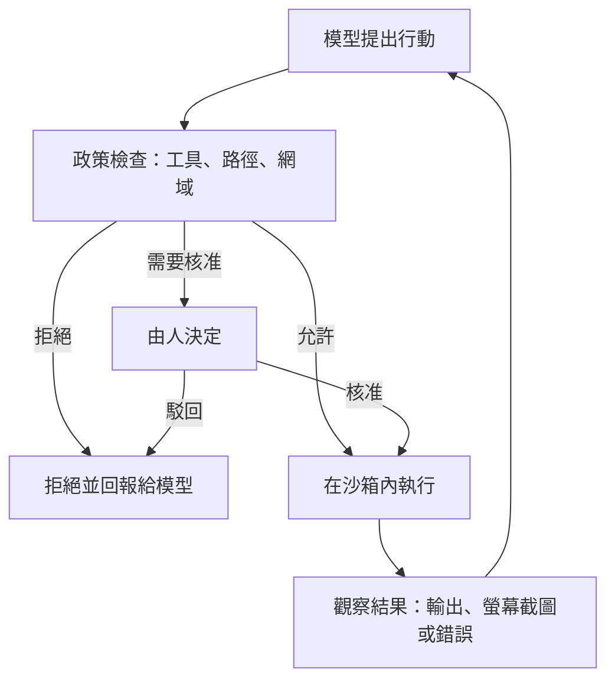

# 沙箱與電腦操作代理人

會執行程式碼、瀏覽網頁或操作桌面的代理人，可能會造成無法復原的改變。沙箱把這些影響限制在受控的環境之中，而電腦操作方法則讓模型透過人所使用的同一種介面行動，例如螢幕截圖、滑鼠與鍵盤。本頁說明兩者如何相互配合，以及權限模型如何決定代理人可以觸及什麼。它是 [代理人工程](../index.md)的子章節之一。

## 概述

只會產生文字的語言模型，影響範圍有限，因為它寫出的東西不會自行發生。一旦它能執行程式碼、開啟網頁、送出表單或點擊按鈕，每個行動都會在現實世界產生後果，而其中有些後果無法復原：一個被刪除的檔案、一則已送出的訊息、一筆付款。沙箱是一系列用來限制這些後果的技術。權限模型則決定哪些行動根本被允許，以及何時必須由人確認。

作業系統研究者早已把程式彼此隔離。電腦操作代理人則把這個問題推得更遠：它接收一張螢幕的影像，並回傳下一次點擊，而沒有為它準備任何專用介面。這使它的能力廣泛，也更難加以限制，因為螢幕上會顯示任何外部人士放置的內容。

遏制問題由來已久。Lampson 在 1973 年把「遏制問題」描述為：如何防止程式把資訊傳給呼叫者以外的任何人（Lampson, 1973）。Saltzer 與 Schroeder 在 1975 年提出最小權限原則，即程式只應持有所需的存取權限（Saltzer & Schroeder, 1975）。代理人使這兩項觀念更加迫切，因為程式的行為是在執行時由一個閱讀不受信任文字的模型所決定。

## 關鍵概念

- **沙箱（sandbox）**：一種環境，其對檔案、行程與網路的存取受到系統限制，使被誤導的行程無法超出其範圍。
- **隔離邊界（isolation boundary）**：沙箱所強制執行的界線。它可以是一個行程、一個容器、一台虛擬機，或直譯器內部的一條政策。
- **程式執行沙箱（code execution sandbox）**：代理人的行動是程式碼、由放在容器或虛擬機內的直譯器執行，並把輸出回饋給模型的一種設定。
- **電腦操作代理人（computer-use agent）**：透過（通常是螢幕截圖的）方式感知圖形介面，並以滑鼠與鍵盤事件進行操作的代理人。
- **GUI 定位（GUI grounding）**：把「儲存按鈕」之類的描述對應到該元素在螢幕上的像素座標。這是電腦操作代理人常見的失敗點。
- **權限模型（permission model）**：決定代理人可以使用哪些工具、資料與行動，以及何時必須由人核准的規則。
- **副作用（side effect）**：發生在模型之外的改變，例如寫入檔案、送出訊息或完成購買。
- **注入指令（injected instructions）**：隱藏在代理人所讀取內容（例如網頁）中、試圖改變其行動的文字。參見[間接提示注入](../../llm-security/indirect-prompt-injection.md)。

## 運作方式

電腦操作代理人與程式執行代理人遵循與一般代理人相同的迴圈，但多了兩個部分：行動執行的環境，以及在每個行動執行前加以檢查的政策層。

**程式執行。** 模型撰寫程式碼，由直譯器執行。隔離可以套用在多個層次：容器或 microVM、檔案系統的允許清單，以及網路的允許清單。例如，Anthropic 的沙箱化程式助手建立在作業系統機制之上，只允許代理人在其工作目錄內寫入，並將網路流量經由代理伺服器轉送，在連到新網域前詢問使用者。該文章主張檔案系統與網路兩道邊界都必要，因為單獨一道都會留下造成傷害的途徑（Anthropic, 2025）。

**電腦操作。** 模型回傳一個請求，指定行動內容，例如點擊座標或要輸入的文字。開發者的軟體執行該行動並回傳新的螢幕截圖，迴圈重複進行，直到產生最終答案（Anthropic, 2024；Anthropic, n.d.）。由於行動是由開發者執行，環境也由開發者負責。Anthropic 的文件建議使用權限最少的專用虛擬機或容器、網域允許清單，並在付款等具有後果的步驟之前由人確認（Anthropic, n.d.）。

**權限模型。** 通常會結合三種控制。工具允許清單決定代理人能呼叫哪些函式。逐項核准會在有風險的步驟前詢問人。資訊流政策則更進一步：它追蹤某個值的來源與可去的地方，使得從不受信任來源讀到的資料無法流入會把它送往別處的工具。第三種是最新的方法，最廣為人知的例子是 CaMeL（Debenedetti et al., 2025）。

## 關鍵方法

三項里程碑式的工作代表主要的做法，每項各有專屬頁面。

- [CodeAct](codeact/index.md)（Wang et al., 2024）：代理人的行動是可執行的 Python，因此直譯器成為行動被遏制與觀察的地方。
- [OSWorld](osworld/index.md)（Xie et al., 2024）：一個基準環境，每項任務都在可還原的虛擬機中執行，以螢幕截圖或無障礙樹狀結構作為觀察，並以執行結果進行檢查。
- [CaMeL](camel/index.md)（Debenedetti et al., 2025）：一種防禦方法，從使用者的請求中擷取控制流與資料流，並在呼叫工具時執行政策，而不是依賴模型忽略注入的文字。

## 相關連結

- **代理人基礎。** 這些系統所依賴的迴圈與工具，定義於 [AI 代理人](../../../theory/models/agents/index.md)。
- **安全。** 讀取不受信任內容並持有工具的代理人，會暴露於注入指令與過度代理的風險。相關威脅與控制措施見 [LLM 應用安全](../../llm-security/index.md)，而 CaMeL 的設計也採用相同的原則。
- **感知。** 讀取螢幕需要結合視覺與文字的模型。參見[多模態模型](../../../theory/models/multimodal/index.md)與[電腦視覺](../../../theory/models/computer-vision/index.md)。
- **評估。** 會改變狀態的代理人，需要能檢查環境最終狀態的評估器。參見[評估與基準](../../evaluation/index.md)。
- **大腦與心智。** 人透過視覺與運動控制在螢幕上行動，並且一次只注意一個區域。螢幕截圖代理人接收的是同類影像，卻沒有眼球運動與注意力，這或許有助於解釋部分定位失敗。參見[視覺感知](../../../brain-mind/visual-perception/index.md)。
- **網路安全。** 最小權限、隔離與監控源自傳統安全實務。參見[網路安全](../../../applications/cybersecurity/index.md)。
- **安全性與對齊。** 應該給予一個會在現實世界中行動的系統多少自主權，已在[安全與對齊](../../../society/safety-alignment/index.md)中討論。

## 應用

- **程式助手。** 會編輯儲存庫並執行其測試的代理人，在容器或受限的殼層中運作，使錯誤的指令無法觸及開發者的其他檔案（Anthropic, 2025）。
- **瀏覽器與網頁測試。** 網頁代理人在自行架設、重現常見網域（如電子商務與內容管理）的網站上評估，因此其行動不會產生真實世界的效果。WebArena 是著名的例子（Zhou et al., 2023）。[^1]
- **以螢幕為基礎的模型。** 在圖形介面上訓練的模型，例如 CogAgent，可以只靠螢幕截圖進行導覽（Hong et al., 2023）。

## 開放問題

- **定位。** 以螢幕截圖為基礎的代理人，仍經常找不到正確的元素。在 OSWorld 上，當時測試的最佳模型只達到人類在相同任務上成功率的一小部分。[^2] 更好的視覺模型或更好的介面能否縮小差距，尚無定論。
- **摩擦。** 詢問過於頻繁的沙箱會被忽略，而詢問過少的沙箱則不安全。Anthropic 報告在引入其沙箱後，權限提示大幅減少，但這是廠商自行的量測，並非獨立的評估（Anthropic, 2025）。[^3] 如何為不同使用者設定這種取捨，仍未解決。
- **安全的代價。** 資訊流政策會阻擋一些攻擊，但也會阻擋一些合理的任務，而且撰寫政策需要花費心力。CaMeL 的作者報告，其任務成功率在同一基準上低於未加防禦的系統。[^4]
- **評估。** 攻擊與防禦會一起演變，而基準只是這個過程的一個快照。AgentDojo 正是為此被建構為可擴充的環境（Debenedetti et al., 2024）。
- **誰來劃定邊界。** 沙箱可能由提供者、開發者或使用者設定，而目前尚無共同的標準。

## 參考文獻

### 奠基性論文

- Lampson, B. W. (1973). *A note on the confinement problem*. Communications of the ACM. https://doi.org/10.1145/362375.362389 — 定義遏制問題，即防止程式把資訊洩漏給呼叫者以外的任何一方，並附有例子與必要條件。
- Saltzer, J. H. & Schroeder, M. D. (1975). *The protection of information in computer systems*. Proceedings of the IEEE. https://doi.org/10.1109/PROC.1975.9939 — 保護原則的經典陳述，包括最小權限，為後來的沙箱與權限系統奠定基礎。
- Greshake, K. et al. (2023). *Not what you've signed up for: Compromising Real-World LLM-Integrated Applications with Indirect Prompt Injection*. arXiv. https://arxiv.org/abs/2302.12173 — 顯示 LLM 應用所檢索的文字可能夾帶指令而劫持其工具，這正是權限模型必須面對的威脅。
- Xie, T. et al. (2024). *OSWorld: Benchmarking Multimodal Agents for Open-Ended Tasks in Real Computer Environments*. arXiv. https://arxiv.org/abs/2404.07972 — 以執行結果為依據的電腦操作代理人基準，在 Ubuntu、Windows 與 macOS 的虛擬機中運行。
- Wang, X. et al. (2024). *Executable Code Actions Elicit Better LLM Agents*. arXiv. https://arxiv.org/abs/2402.01030 — 提出以 Python 程式碼作為代理人的行動空間，並由直譯器執行；在其基準上，成功率高於 JSON 或文字行動。
- Debenedetti, E. et al. (2025). *Defeating Prompt Injections by Design*. arXiv. https://arxiv.org/abs/2503.18813 — 提出 CaMeL，分離控制流與資料流，並在呼叫工具時執行以能力為基礎的安全政策。
- Zhou, S. et al. (2023). *WebArena: A Realistic Web Environment for Building Autonomous Agents*. arXiv. https://arxiv.org/abs/2307.13854 — 來自四個常見網域、可自行架設且可重現的網站，附有供網頁代理人使用的功能性基準任務。
- Hong, W. et al. (2023). *CogAgent: A Visual Language Model for GUI Agents*. arXiv. https://arxiv.org/abs/2312.08914 — 視覺語言模型，用於理解圖形介面，並僅依螢幕截圖在 PC 與 Android 介面中導覽。

### 綜述與教科書

- Wang, L. et al. (2023). *A Survey on Large Language Model based Autonomous Agents*. arXiv. https://arxiv.org/abs/2308.11432 — LLM 代理人綜述，涵蓋其角色設定、記憶、規劃與行動，為本頁的工具與環境問題提供背景。
- Debenedetti, E. et al. (2024). *AgentDojo: A Dynamic Environment to Evaluate Prompt Injection Attacks and Defenses for LLM Agents*. arXiv. https://arxiv.org/abs/2406.13352 — 可擴充的基準，包含工具使用任務與安全測試案例，用於衡量注入攻擊與防禦。

### 文章與文件

- Anthropic (2024). *Computer use, Claude 3.5 Sonnet, and Claude 3.5 Haiku*. Anthropic News. https://www.anthropic.com/news/3-5-models-and-computer-use — 宣布電腦操作的測試版，模型讀取螢幕截圖並回傳滑鼠與鍵盤行動，由開發者的軟體執行。
- Anthropic (2025). *Making Claude Code safer with sandboxing*. Anthropic Engineering. https://www.anthropic.com/engineering/claude-code-sandboxing — 說明程式助手在作業系統層級的檔案系統與網路隔離，以及為何兩道邊界都必要。
- Anthropic (n.d.). *Computer use tool*. Claude Platform documentation. https://docs.claude.com/en/docs/agents-and-tools/tool-use/computer-use-tool — 說明螢幕截圖與行動的迴圈，並建議在隔離環境中執行、使用網域允許清單，並在具後果的行動前由人確認。

[^1]: Zhou 等人（2023），WebArena 摘要，https://arxiv.org/abs/2307.13854 — 描述基準任務所運行、可自行架設且具功能性的網頁環境。
[^2]: Xie 等人（2024），OSWorld 摘要，https://arxiv.org/abs/2404.07972 — 報告人類完成超過 72.36% 的任務，而所測試的最佳模型達到 12.24%。
[^3]: Anthropic（2025），*Making Claude Code safer with sandboxing*，https://www.anthropic.com/engineering/claude-code-sandboxing — 報告在公司內部使用中，權限提示減少了 84%。
[^4]: Debenedetti 等人（2025），CaMeL 摘要，https://arxiv.org/abs/2503.18813 — 報告在 AgentDojo 任務中，以可證明的安全性解決了 77% 的任務，未加防禦的系統則為 84%。
