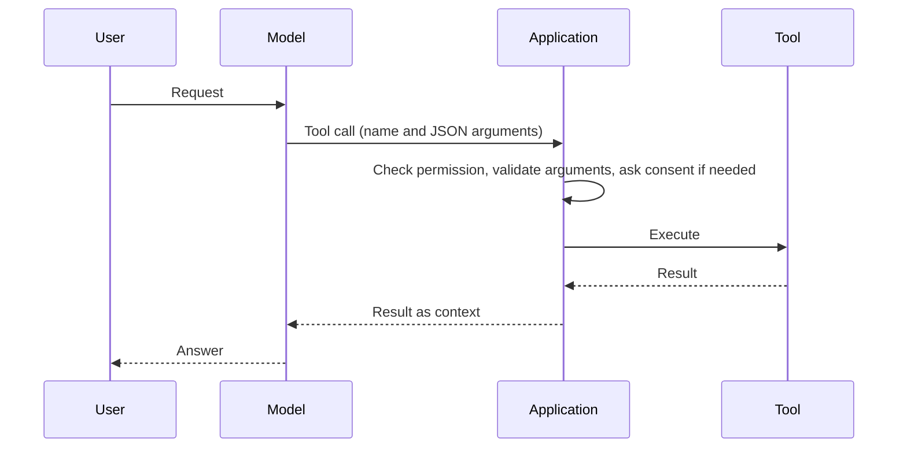

# Tool calling and the Model Context Protocol

Tool calling lets a language model request actions in external systems, such as a search, a file read or an API call. The model emits a structured request, and the application runs it. The Model Context Protocol (MCP) is an open standard for connecting models and applications to such tools, data sources and prompt templates.

This page is part of [Agent Engineering](index.md).

## Overview

On its own a language model produces only text. Tools extend it. The application describes each available function with a name, a description and an input schema. The model decides when to use a function and fills in its arguments. The application executes the call and returns the result, and the model continues from there.

Two research papers set out the core ideas. Toolformer (Schick et al., 2023) describes a model trained to decide which APIs to call, when to call them, with which arguments, and how to use the results. ReAct (Yao et al., 2022) interleaves reasoning traces with actions, so that the model can track and update its plan as tool results arrive.

## Key concepts

- **Tool (function):** a named operation with a description and typed inputs.
- **Tool call:** the model's structured request, normally JSON that matches the tool's schema.
- **Tool result:** the output of the call, returned to the model as new context.
- **Host, client and server:** in MCP, the host is the application that runs the model, the client is the connector inside it, and the server is the service that offers capabilities.
- **Resources, prompts and tools:** the three server features in MCP. Resources are data for the model or user, prompts are reusable templates, and tools are functions the model may execute.

## How it works

The application, not the model, runs the call. This is what allows it to check permissions, validate the arguments and ask the user for consent before anything changes state.

## Designing tool interfaces

- **Narrow tools with clear names.** The description is the text the model reads when it chooses a tool, so it should say what the tool does and when to use it.
- **Validate before execution.** Check arguments against the schema, and check values as well as types.
- **Return concise, structured results.** Large outputs fill the context window and can hide the information the model needs.
- **Separate read-only tools from tools that change state.** Require confirmation for the second group.

## Model Context Protocol

MCP is specified in a versioned document; this page cites the 2025-06-18 revision. Messages use JSON-RPC 2.0 over stateful connections, and client and server negotiate their capabilities when they connect. Servers can offer resources, prompts and tools. Clients can offer sampling (requests from a server for an LLM completion), roots (the filesystem or URI boundaries a server may work in) and elicitation (requests for input from the user). The specification says that tools represent arbitrary code execution, that hosts must obtain explicit user consent before invoking any tool, and that tool descriptions should be treated as untrusted unless they come from a trusted server. The protocol takes some inspiration from the Language Server Protocol, which standardised how editors connect to language support.

## Limitations

- **Injection through tool results and descriptions.** Text returned by a tool, or written into a tool description, can carry instructions. Greshake et al. (2023) show indirect prompt injection in LLM-integrated applications, and the same risk applies to tool outputs. See [LLM Application Security](../llm-security/index.md).
- **Too many tools.** Long tool catalogues use context and make selection harder.
- **Right tool, wrong values.** A schema check catches type errors but not a wrong argument value, such as the wrong date.
- **Measuring success.** A correct outcome may come from a lucky sequence of calls. Benchmarks that check the final database or environment state are one answer (see [Agent evaluation](agent-evaluation.md)).

## Connections

- The agent framing, including planning and memory, is on [AI Agents](../../theory/models/agents/index.md).
- Retrieval can be exposed as a tool, as described on [Retrieval-Augmented Generation](../rag/index.md).
- Logging of tool calls for audit is covered on [Agent observability](agent-observability.md).

## Applications

- **Coding assistants** that read files, run tests and propose edits.
- **Customer-support agents** that look up orders and issue refunds after confirmation.
- **Data assistants** that query databases through read-only tools.

## Open questions

- How should a model choose reliably from hundreds of tools?
- How should trust be assigned to tool descriptions from third-party servers?
- Does a shared protocol such as MCP solve the integration problem, or mainly move it to security review?

## References

### Seminal papers

- Schick, T. et al. (2023). Toolformer: Language Models Can Teach Themselves to Use Tools. arXiv. https://arxiv.org/abs/2302.04761 — Trains a model to decide which APIs to call, when, with which arguments, and how to use the results.
- Yao, S. et al. (2023). ReAct: Synergizing Reasoning and Acting in Language Models. ICLR. https://arxiv.org/abs/2210.03629 — Interleaves reasoning traces and task actions, so the model can plan, track and update its steps.
- Greshake, K. et al. (2023). Not what you've signed up for: Compromising Real-World LLM-Integrated Applications with Indirect Prompt Injection. arXiv. https://arxiv.org/abs/2302.12173 — Shows that content an application retrieves can carry instructions that the model follows.

### Surveys and textbooks

- Xi, Z. et al. (2023). The Rise and Potential of Large Language Model Based Agents: A Survey. arXiv. https://arxiv.org/abs/2309.07864 — Broad survey of LLM-based agents, covering their construction, applications and open challenges.

### Articles and documentation

- Model Context Protocol. *Specification, revision 2025-06-18*. https://modelcontextprotocol.io/specification/2025-06-18 — Defines hosts, clients and servers, the resources, prompts and tools features, and the security principles for tool use.
