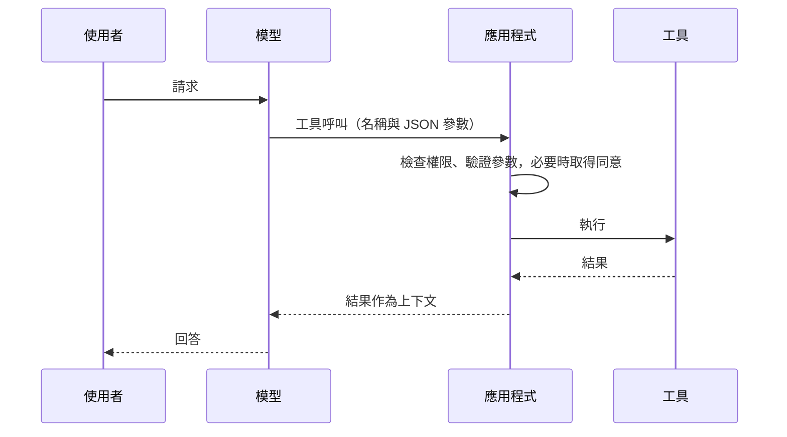

# 工具呼叫與模型上下文協定

工具呼叫讓語言模型請求外部系統採取行動，例如搜尋、讀取檔案或呼叫 API。模型會送出結構化的請求，由應用程式執行。模型上下文協定（MCP）是一個開放標準，用來把模型與應用程式連接到這些工具、資料來源與提示範本。

本頁是[代理工程](index.zh-TW.md)的一部分。

## 概述

單獨的語言模型只會產生文字。工具可以擴充它的能力。應用程式以名稱、描述與輸入結構描述來說明每個可用的函式；模型決定何時使用某個函式，並填入其參數。應用程式執行呼叫並回傳結果，模型再從那裡繼續。

兩篇研究論文奠定了核心概念。Toolformer（Schick 等人，2023）描述一個訓練過的模型，會決定呼叫哪個 API、何時呼叫、使用什麼參數，以及如何運用結果。ReAct（Yao 等人，2022）則把推理軌跡與行動交錯進行，使模型能在工具結果到達時追蹤並更新其計畫。

## 關鍵概念

- **工具（函式）：**一個具名操作，附有描述與型別化的輸入。
- **工具呼叫：**模型的結構化請求，通常是符合工具結構描述的 JSON。
- **工具結果：**呼叫的輸出，作為新的上下文回傳給模型。
- **主機、用戶端與伺服器：**在 MCP 中，主機是執行模型的應用程式，用戶端是其中的連接器，伺服器則是提供能力的服務。
- **資源、提示與工具：**MCP 伺服器的三項功能。資源是供模型或使用者使用的資料，提示是可重複使用的範本，工具則是模型可以執行的函式。

## 運作方式

由應用程式而非模型來執行呼叫。這使應用程式能在任何狀態被改變之前檢查權限、驗證參數並向使用者取得同意。

## 工具介面設計

- **工具要窄、名稱要清楚。**模型選擇工具時讀的是描述，因此描述應說明工具做什麼、何時使用。
- **執行前先驗證。**依結構化描述檢查參數，既要檢查型別，也要檢查數值。
- **回傳簡潔、結構化的結果。**過大的輸出會填滿上下文視窗，並可能掩蓋模型需要的資訊。
- **把唯讀工具與會改變狀態的工具分開。**後者應要求確認。

## 模型上下文協定

MCP 以有版本的文件規範；本頁引用 2025-06-18 修訂版。訊息以 JSON-RPC 2.0 透過有狀態的連線傳送，用戶端與伺服器在連線時協商各自的能力。伺服器可以提供資源、提示與工具。用戶端可以提供取樣（伺服器請求 LLM 補全）、根（伺服器可以作業的檔案系統或 URI 邊界）以及誘導（向使用者要求輸入）。規範指出，工具代表任意程式碼執行，主機在呼叫任何工具之前必須取得使用者明確同意，而除非來自受信任的伺服器，工具描述應被視為不可信。此協定的設計部分借鑑了語言伺服器協定，後者標準化了編輯器如何連接語言支援。

## 限制

- **經由工具結果與描述的注入。**工具回傳的文字，或寫入工具描述中的文字，可能夾帶指令。Greshake 等人（2023）展示了整合 LLM 的應用程式中的間接提示注入，同樣的風險也適用於工具輸出。見[LLM 應用安全](../llm-security/index.zh-TW.md)。
- **工具過多。**過長的工具目錄會佔用上下文，也使選擇更困難。
- **工具正確、參數錯誤。**結構描述檢查能抓到型別錯誤，卻抓不到錯誤的參數值，例如錯誤的日期。
- **衡量成功。**正確的結果可能來自僥倖的呼叫序列。檢查最終資料庫或環境狀態的基準是一種解法（見[代理評估](agent-evaluation.zh-TW.md)）。

## 關聯

- 包括規劃與記憶在內的代理框架，見[AI 代理](../../theory/models/agents/index.zh-TW.md)。
- 檢索可以作為工具提供，見[檢索增強生成](../rag/index.zh-TW.md)。
- 為稽核而記錄工具呼叫，見[代理可觀測性](agent-observability.zh-TW.md)。

## 應用

- **程式設計助理**：讀取檔案、執行測試並提出編輯建議。
- **客服代理**：查詢訂單，並在確認後處理退款。
- **資料助理**：透過唯讀工具查詢資料庫。

## 開放問題

- 模型如何在數百個工具中可靠地選擇？
- 第三方伺服器提供的工具描述，應給予多少信任？
- 像 MCP 這樣的共通協定，是解決了整合問題，還是主要把問題轉移到安全審查？

## 參考文獻

### 開創性論文

- Schick, T. 等人（2023）。*Toolformer: Language Models Can Teach Themselves to Use Tools*。arXiv。https://arxiv.org/abs/2302.04761 — 訓練模型決定何時呼叫哪個 API、使用什麼參數，以及如何運用結果。
- Yao, S. 等人（2023）。*ReAct: Synergizing Reasoning and Acting in Language Models*。ICLR。https://arxiv.org/abs/2210.03629 — 交錯推理軌跡與任務行動，使模型能規劃並追蹤其步驟。
- Greshake, K. 等人（2023）。*Not what you've signed up for: Compromising Real-World LLM-Integrated Applications with Indirect Prompt Injection*。arXiv。https://arxiv.org/abs/2302.12173 — 顯示應用程式擷取的內容可能夾帶模型會遵循的指令。

### 調查與教科書

- Xi, Z. 等人（2023）。*The Rise and Potential of Large Language Model Based Agents: A Survey*。arXiv。https://arxiv.org/abs/2309.07864 — 對以 LLM 為基礎之代理的廣泛調查，涵蓋其建構方式、應用與待解挑戰。

### 文章與文件

- Model Context Protocol。*Specification, revision 2025-06-18*。https://modelcontextprotocol.io/specification/2025-06-18 — 定義主機、用戶端與伺服器，資源、提示與工具功能，以及工具使用的安全原則。
