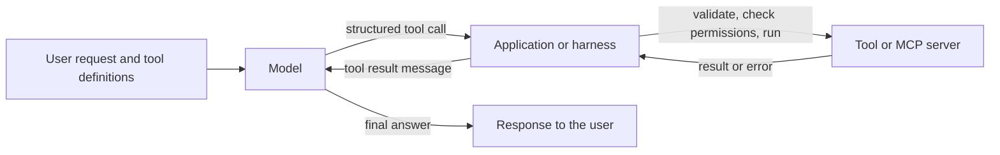

# Tool Calling and the Model Context Protocol

Tool calling lets a language model request an action in external software by naming a function and filling in arguments that match a declared schema. The Model Context Protocol (MCP) is an open standard for connecting models and applications to tools and data sources through a shared interface, so that each integration does not have to be written from scratch.

## Overview

A language model produces text. On its own it cannot look up an exchange rate or add a calendar entry; it can only describe such an action. Tool calling closes that gap. The developer describes a set of functions to the model, the model decides when one of them is needed and writes out a structured request, and the surrounding software performs the action and returns the result for the model to read. The model never executes anything itself.

Two problems follow. The first concerns the model: can it choose the right tool, fill in valid arguments and use the result correctly? Models can be trained for this, and the output can be constrained so that a request is at least well formed. The second concerns the ecosystem: if every application writes its own connector to every data source, the integration work grows with the product of the two. MCP addresses this second problem. At its launch, Anthropic described it as a way of replacing fragmented integrations with a single protocol (Anthropic, 2024).

This page covers the interface between model and tool. The loop that decides what to do next is covered in [Agent Engineering](../index.md), with its method pages [ReAct](../react/index.md) and [Reflexion](../reflexion/index.md).

## Key concepts

- **Tool definition**: a name, a natural-language description and a parameter schema. The description is part of the model's input, so it influences when a tool is chosen as much as the schema does.
- **JSON Schema**: a standard vocabulary for describing the structure of JSON documents, including required fields, types and allowed values. Tool parameter schemas are often written in JSON Schema or a subset of it (JSON Schema organization).
- **Tool call**: the model's output naming a tool and giving its arguments, usually as a JSON object. The call itself changes nothing until the application runs it.
- **Tool result**: the value the application returns after running a call, placed in the conversation so the model can read it. Errors are returned the same way.
- **Client tool and server tool**: a client tool runs in the application that made the request. A server tool runs on the model provider's infrastructure, as a built-in web search does. Anthropic's documentation draws this distinction (Anthropic, current documentation).
- **Constrained decoding**: at each step the decoder may choose only tokens that keep the output valid under a grammar or regular expression. Outlines compiles such constraints into a finite-state machine over the model's vocabulary (Willard & Louf, 2023).
- **Model Context Protocol (MCP)**: an open protocol in which an AI application, the client, connects to servers that expose data and tools, and lists and calls what they offer.

## How it works

A single tool call follows a round trip that repeats for as long as the model needs tools:

1. The application sends the conversation together with the tool definitions.
2. The model either answers directly or returns a structured request to call a named tool.
3. The application checks the arguments against the schema and the caller's permissions, runs the tool, and obtains a result or an error.
4. The result is appended to the conversation as a new message. The model reads it and then either answers or makes another call.

**Schemas and strictness.** The schema constrains what the model is asked to produce. Validation after the fact catches a mismatch, but a rejected call costs a full round trip. Some providers offer a strict mode in which tool calls are guaranteed to match the schema (Anthropic, current documentation). Open-source libraries achieve similar guarantees by constraining the decoder, so that invalid tokens are never sampled, as Outlines does (Willard & Louf, 2023). These guarantees cover form, not meaning. A well-formed call can still name the wrong tool or a wrong value.

**Choosing a tool.** The model chooses by reading descriptions, so overlapping or vague descriptions produce wrong calls. Anthropic's guidance for tool design recommends a small number of tools that match real workflows, clear names, namespacing by service or resource, and evaluation on realistic tasks (Anthropic, 2025a). Research on tool learning describes four stages: planning, tool selection, tool calling and response generation (Qu et al., 2024).

**Protocols.** MCP separates the application from the tool provider. A host application contains MCP clients, and each client connects to an MCP server that wraps a database, a file system or a software-as-a-service API. Because the interface is shared, a server written once can serve any compatible client. The launch shipped pre-built servers for systems such as Google Drive, Slack, GitHub and Postgres (Anthropic, 2024). Other protocols, such as those for agent-to-agent messaging, are surveyed in [Frameworks & Tools](../../frameworks/index.md).

**Results and errors.** Result handling is the least glamorous part of the stack and often decides reliability. Three practices recur in the guidance. A result should carry the information the model needs rather than every field the API returns. Long results should be paginated, filtered or truncated. Errors should say what went wrong and how to correct it, so the model can recover rather than repeat the same call (Anthropic, 2025a). Without this, a failing call can trap the model in a loop. The authors of ToolLLM describe this as error propagation and use it to motivate their search method (Qin et al., 2023).

**Context cost.** Each tool definition and intermediate result occupies the context window. Anthropic reports that loading many MCP tool definitions up front is costly, and proposes letting agents write code that calls the servers instead (Anthropic, 2025b).

## Key methods

Three landmark methods, each with its own page, illustrate the main approaches to teaching models to call tools. They differ mainly in where the training signal comes from.

| Method | Year | Training signal and contribution |
|---|---|---|
| [Toolformer](toolformer/index.md) | 2023 | The model's own language-modelling loss, used to keep only those self-annotated calls that help it predict the text that follows. |
| [Gorilla](gorilla/index.md) | 2023 | Instruction and API pairs generated with a stronger model, with retrieved API documentation in the prompt, to reduce invented APIs. |
| [ToolLLM](toolllm/index.md) | 2023 | Solution paths for instructions over real REST APIs, found by a depth-first search that can abandon failing branches, and checked by an automatic evaluator. |

## Connections

- **Agent foundations**: tool use is one of the defining capacities of an agent, as set out in [AI Agents](../../../theory/models/agents/index.md).
- **Prompting**: a tool description is itself a prompt, and [Prompt Engineering](../../prompting/index.md) covers how to write one.
- **Security**: tool access is the route by which injected text becomes an action. See [Indirect prompt injection](../../llm-security/indirect-prompt-injection.md) and [LLM Application Security](../../llm-security/index.md). Each MCP server adds privileges, and a 2026 audit tool searches servers for over-privileged capabilities (Huang et al., 2026).
- **Coding assistants**: [AI Coding Assistants](../../coding-assistants/index.md) rely on tool calls to edit files and run commands.
- **Evaluation**: success often depends on the state of an environment, not on the text of the reply. See [Evaluation & Benchmarks](../../evaluation/index.md).
- **Brain and mind**: tool use is not peculiar to machines. The New Caledonian crow shapes a wire into a hook to reach food, and [Tool Use in New Caledonian Crows](../../../brain-mind/animal-cognition/tool-use-crows/index.md) describes that case. Qin et al. (2023) relate tool learning in models to the cognitive origins of human tool use. The parallel is suggestive, not evidence of shared mechanisms.

## Applications

- **Software development**: coding assistants call file, search and shell tools. MCP servers connect them to repositories and issue trackers.
- **Enterprise data**: one protocol lets an assistant reach several internal systems without a connector for each (Anthropic, 2024).
- **Customer service**: API-Bank tests models on planning, retrieving and calling APIs in dialogues. Its authors report that their tool-augmented model Lynx improved on Alpaca's tool use by more than 26 points (Li et al., 2023).[^1]

## Open questions

- **Reliability.** The τ-bench authors report that a leading function-calling agent succeeds on fewer than half of its tasks, and that results vary across repeated trials (Yao et al., 2024).[^2] Single-run success rates can therefore mislead.
- **Scale of tool catalogues.** As the number of tools grows, descriptions compete for context and selection becomes harder. Whether discovery by search or by code is the right answer is not settled.
- **Permissions.** A tool that is useful is often powerful. Deciding least privilege for servers, and which actions need confirmation, has no accepted standard.
- **Error recovery.** When should an agent retry, switch tools, ask the user or stop? Current systems rely mostly on prompts and budgets.

## References

### Seminal papers

- Schick, T. et al. (2023). *Toolformer: Language Models Can Teach Themselves to Use Tools*. arXiv. https://arxiv.org/abs/2302.04761 — Shows a model learning when to call a calculator, search tools and a calendar from its own filtered annotations.
- Patil, S. G. et al. (2023). *Gorilla: Large Language Model Connected with Massive APIs*. arXiv. https://arxiv.org/abs/2305.15334 — Finetunes a LLaMA-based model to write API calls and to read retrieved documentation, reducing hallucinated APIs.
- Qin, Y. et al. (2023). *ToolLLM: Facilitating Large Language Models to Master 16000+ Real-world APIs*. arXiv. https://arxiv.org/abs/2307.16789 — Builds a tool-use instruction dataset over real REST APIs and a tree-search method for finding valid call sequences.
- Yao, S. et al. (2022). *ReAct: Synergizing Reasoning and Acting in Language Models*. arXiv. https://arxiv.org/abs/2210.03629 — Interleaves reasoning with actions in one loop, in which each observation returns to the model as context.
- Willard, B. T. & Louf, R. (2023). *Efficient Guided Generation for Large Language Models*. arXiv. https://arxiv.org/abs/2307.09702 — Constrains token generation with finite-state machines built from regular expressions and grammars, so that outputs follow a required structure.
- Li, M. et al. (2023). *API-Bank: A Comprehensive Benchmark for Tool-Augmented LLMs*. arXiv. https://arxiv.org/abs/2304.08244 — A runnable benchmark of 73 API tools and annotated tool-use dialogues, with error analysis of planning, retrieval and calling.
- Yao, S. et al. (2024). *τ-bench: A Benchmark for Tool-Agent-User Interaction in Real-World Domains*. arXiv. https://arxiv.org/abs/2406.12045 — A benchmark of simulated users talking to agents that call domain APIs under policy rules, with a reliability metric over repeated trials.

### Surveys and textbooks

- Qin, Y. et al. (2023). *Tool Learning with Foundation Models*. arXiv. https://arxiv.org/abs/2304.08354 — Frames tool learning as planning and tool selection, with experiments on eighteen tools.
- Qu, C. et al. (2024). *Tool Learning with Large Language Models: A Survey*. arXiv. https://arxiv.org/abs/2405.17935 — Organises the literature by planning, tool selection, tool calling and response generation, and reviews benchmarks and evaluation methods.

### Articles and documentation

- Anthropic (2024). *Introducing the Model Context Protocol*. Anthropic. https://www.anthropic.com/news/model-context-protocol — Announces MCP as an open standard, with its client and server architecture and first pre-built servers.
- Anthropic. *Tool use with Claude*. Claude Platform Docs. https://docs.claude.com/en/docs/agents-and-tools/tool-use/overview — Official description of client and server tools, tool_use and tool_result blocks, and strict tool use.
- Anthropic (2025a). *Writing effective tools for AI agents*. Anthropic Engineering. https://www.anthropic.com/engineering/writing-tools-for-agents — Practical guidance on tool design, namespacing, concise responses and helpful errors.
- Anthropic (2025b). *Code execution with MCP for efficient agents*. Anthropic Engineering. https://www.anthropic.com/engineering/code-execution-with-mcp — Explains how loading tool definitions and passing intermediate results through the model consume context, and an alternative design.
- JSON Schema organization. *JSON Schema: Specification*. https://json-schema.org/specification — The standard vocabulary for describing and validating the structure of JSON documents, used to define tool parameters.
- Huang, C., Huang, X. & Milani Fard, A. (2026). *Auditing MCP Servers for Over-Privileged Tool Capabilities*. arXiv. https://arxiv.org/abs/2603.21641 — Presents a toolkit that finds risky capabilities in MCP servers through static pattern matching and sandboxed fuzzing.

[^1]: Li et al. (2023), API-Bank abstract, https://arxiv.org/abs/2304.08244 — Source of the Lynx comparison with Alpaca.
[^2]: Yao et al. (2024), τ-bench abstract, https://arxiv.org/abs/2406.12045 — Source of the gpt-4o success rate and consistency figures.
