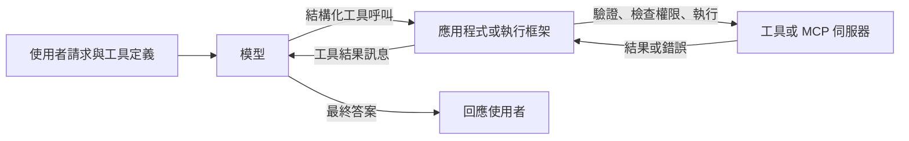

# 工具呼叫與 Model Context Protocol

工具呼叫讓語言模型透過指定函式名稱並填入符合宣告結構描述的引數，來請求外部軟體執行某個動作。Model Context Protocol（MCP）是一項開放標準，透過共同的介面把模型與應用程式連接到工具與資料來源，使每一項整合都不必從頭撰寫。

## 概述

語言模型產生的是文字。單靠它無法查詢匯率或新增行事曆項目，它只能描述這類動作。工具呼叫填補了這個缺口。開發者向模型描述一組函式，模型判斷何時需要其中一個並寫出結構化的請求，周圍的軟體再執行該動作，並把結果回傳，供模型閱讀。模型本身從不執行任何程式。

由此衍生出兩個問題。第一個與模型有關：它能否選對工具、填入有效的引數，並正確使用結果？模型可以經過訓練來做到這一點，輸出也可以受到約束，使請求至少格式正確。第二個與生態系有關：如果每個應用程式都要為每個資料來源撰寫自己的連接器，整合工作量會隨兩者的乘積成長。MCP 針對的正是第二個問題。Anthropic 在發表時表示，MCP 的目的是以單一協定取代零散的整合（Anthropic，2024）。

本頁涵蓋模型與工具之間的介面。決定下一步做什麼的迴圈，則在[代理人工程](../index.md)及其方法頁 [ReAct](../react/index.md) 與 [Reflexion](../reflexion/index.md) 中說明。

## 關鍵概念

- **工具定義（tool definition）**：包含名稱、自然語言說明與引數結構描述。說明屬於模型的輸入，因此它對工具何時被選用的影響，和結構描述一樣大。
- **JSON Schema**：描述 JSON 文件結構的標準詞彙，包括必填欄位、型別與允許的值。工具的引數結構描述常以 JSON Schema 或其子集撰寫（JSON Schema 組織）。
- **工具呼叫（tool call）**：模型的輸出，指明工具名稱與引數，通常是一個 JSON 物件。在應用程式執行之前，呼叫本身不會改變任何東西。
- **工具結果（tool result）**：應用程式執行呼叫後回傳的值，放進對話中讓模型閱讀。錯誤也以相同方式回傳。
- **用戶端工具與伺服器端工具**：用戶端工具在發出請求的應用程式中執行；伺服器端工具則在模型提供者的基礎設施上執行，例如內建的網路搜尋。Anthropic 的文件區分了這兩者（Anthropic，現行文件）。
- **受限解碼（constrained decoding）**：解碼器在每一步只能選擇使輸出仍符合文法或正規表示式的詞元。Outlines 把這類限制編譯成對模型詞彙的有限狀態機（Willard 與 Louf，2023）。
- **Model Context Protocol（MCP）**：一種開放協定，AI 應用程式（即用戶端）連接到提供資料與工具的伺服器，並列出及呼叫伺服器所提供的功能。

## 運作方式

只要模型還需要工具，單次工具呼叫就會沿著以下的往返流程進行：

1. 應用程式把對話連同工具定義一起送給模型。
2. 模型可以直接回答，也可以回傳一個結構化請求，要求呼叫某個具名工具。
3. 應用程式依結構描述檢查引數與呼叫者的權限，執行工具，並取得結果或錯誤。
4. 結果以新訊息的形式附加到對話中。模型閱讀後，再決定回答或進行下一次呼叫。

**結構描述與嚴格性。** 結構描述限制了模型被要求產生的內容。事後驗證能發現不符之處，但被拒絕的呼叫會多耗費一整趟往返。有些提供者提供嚴格模式，保證工具呼叫符合結構描述（Anthropic，現行文件）。開源函式庫則透過限制解碼器達到類似的保證，使無效的詞元永遠不會被取樣，Outlines 即是一例（Willard 與 Louf，2023）。這些保證只涵蓋格式，不涵蓋語意。格式正確的呼叫仍可能指定錯誤的工具或錯誤的值。

**選擇工具。** 模型是透過閱讀說明來選擇工具的，因此說明若模糊或彼此重疊，就會導致錯誤的呼叫。Anthropic 的工具設計指引建議：工具數量要少，並對應實際工作流程；名稱要清楚；依服務或資源加上命名空間；並以貼近實際的任務進行評估（Anthropic，2025a）。工具學習的研究則把流程分為四個階段：規劃、工具選擇、工具呼叫與回應生成（Qu 等人，2024）。

**協定。** MCP 把應用程式與工具提供者分開。宿主應用程式內含 MCP 用戶端，每個用戶端連接到一個 MCP 伺服器，伺服器可包裝資料庫、檔案系統或軟體即服務的 API。由於介面是共通的，寫一次的伺服器就能服務任何相容的用戶端。發表時提供的預建伺服器涵蓋 Google Drive、Slack、GitHub 與 Postgres 等系統（Anthropic，2024）。其他協定，例如代理人之間的訊息傳遞協定，則在[框架與工具](../frameworks/index.md)中介紹。

**結果與錯誤。** 結果處理是整個技術堆疊中最不起眼的部分，卻常常決定可靠度。指引中反覆出現三項做法。結果應只包含模型需要的資訊，而非 API 回傳的每一個欄位。過長的結果應分頁、過濾或截斷。錯誤訊息則應說明發生了什麼問題，以及如何修正，讓模型能夠復原，而不是重複同一個呼叫（Anthropic，2025a）。若沒有這些處理，失敗的呼叫可能使模型陷入迴圈。ToolLLM 的作者把這種現象稱為錯誤傳播，並以此作為其搜尋方法的動機（Qin 等人，2023）。

**脈絡成本。** 每個工具定義與每個中間結果都會佔用脈絡視窗。Anthropic 指出，預先載入大量 MCP 工具定義的成本很高，並建議改讓代理人撰寫程式去呼叫伺服器（Anthropic，2025b）。

## 關鍵方法

以下三個里程碑方法各有獨立頁面，說明教導模型呼叫工具的主要途徑。它們的主要差異在於訓練訊號的來源。

| 方法 | 年份 | 訓練訊號與貢獻 |
|---|---|---|
| [Toolformer](toolformer/index.md) | 2023 | 模型自身的語言建模損失，用來只保留那些有助於預測後續文字的自我標註呼叫。 |
| [Gorilla](gorilla/index.md) | 2023 | 以較強模型產生的指令與 API 配對，並在提示中加入檢索到的 API 文件，以減少憑空捏造的 API。 |
| [ToolLLM](toolllm/index.md) | 2023 | 針對真實 REST API 的指令所得出的解題路徑，以可捨棄失敗分支的深度優先搜尋找到，並由自動評估器檢查。 |

## 相關連結

- **代理人基礎**：工具使用是代理人最基本的能力之一，見 [AI 代理人](../../theory/models/agents/index.md)。
- **提示**：工具說明本身就是一段提示，[提示工程](../prompting/index.md)說明如何撰寫。
- **安全**：工具權限是注入的文字轉變為動作的途徑。參見[間接提示注入](../llm-security/indirect-prompt-injection.md)與[LLM 應用安全](../llm-security/index.md)。每個 MCP 伺服器都會增加權限，而 2026 年的一項稽核工具會搜尋伺服器中權限過大的功能（Huang 等人，2026）。
- **程式助理**：[AI 程式助理](../coding-assistants/index.md)依賴工具呼叫來編輯檔案與執行指令。
- **評估**：成功與否往往取決於環境的狀態，而非回覆的文字。參見[評估與基準測試](../evaluation/index.md)。
- **腦與心智**：使用工具並非機器獨有。新喀里多尼亞烏鴉會把金屬絲彎成鉤子以取得食物，[新喀里多尼亞烏鴉的工具使用](../../brain-mind/animal-cognition/tool-use-crows/index.md)一頁描述了這個案例。Qin 等人（2023）把模型中的工具學習與人類工具使用的認知起源相連結。這種類比頗具啟發性，但並不是模型與動物認知共享相同機制的證據。

## 應用

- **軟體開發**：程式助理呼叫檔案、搜尋與 shell 工具。MCP 伺服器把它們連接到程式庫與問題追蹤系統。
- **企業資料**：單一協定讓一個助理能存取多個內部系統，而不必為每個系統各準備一個連接器（Anthropic，2024）。
- **客服**：API-Bank 在對話中測試模型的規劃、檢索與呼叫 API 能力。其作者報告，他們的工具增強模型 Lynx 在工具使用上比 Alpaca 高出 26 分以上（Li 等人，2023）。[^1]

## 開放問題

- **可靠度。** τ-bench 的作者報告，一個領先的函式呼叫代理人只能完成不到一半的任務，且在重複試驗中結果不一（Yao 等人，2024）。[^2]單次執行的成功率因此可能產生誤導。
- **工具目錄的規模。** 工具數量增加時，說明會競爭脈絡空間，選擇也會變得更困難。以搜尋或以程式碼來發現工具，是否為正確解答，尚無定論。
- **權限。** 有用的工具往往也很有力量。如何為伺服器決定最小權限，以及哪些動作需要確認，目前沒有公認的標準。
- **錯誤復原。** 代理人應何時重試、改用其他工具、詢問使用者，或停止？目前的系統主要依賴提示與預算。

## 參考文獻

### 奠基性論文

- Schick, T. et al. (2023). *Toolformer: Language Models Can Teach Themselves to Use Tools*. arXiv. https://arxiv.org/abs/2302.04761 — 展示語言模型如何從自身經過篩選的標註中，學會何時呼叫計算機、搜尋工具與行事曆。
- Patil, S. G. et al. (2023). *Gorilla: Large Language Model Connected with Massive APIs*. arXiv. https://arxiv.org/abs/2305.15334 — 微調以 LLaMA 為基礎的模型來撰寫 API 呼叫，並讓它閱讀檢索到的文件，以減少幻覺產生的 API。
- Qin, Y. et al. (2023). *ToolLLM: Facilitating Large Language Models to Master 16000+ Real-world APIs*. arXiv. https://arxiv.org/abs/2307.16789 — 建立涵蓋真實 REST API 的工具使用指令資料集，以及尋找有效呼叫序列的樹狀搜尋方法。
- Yao, S. et al. (2022). *ReAct: Synergizing Reasoning and Acting in Language Models*. arXiv. https://arxiv.org/abs/2210.03629 — 在單一迴圈中交錯推理與行動，每次觀察都會回到模型的脈絡中。
- Willard, B. T. & Louf, R. (2023). *Efficient Guided Generation for Large Language Models*. arXiv. https://arxiv.org/abs/2307.09702 — 以正規表示式與文法建構的有限狀態機來約束詞元生成，使輸出遵循所需的結構。
- Li, M. et al. (2023). *API-Bank: A Comprehensive Benchmark for Tool-Augmented LLMs*. arXiv. https://arxiv.org/abs/2304.08244 — 可執行的基準測試，包含 73 個 API 工具與標註的工具使用對話，並分析規劃、檢索與呼叫的錯誤。
- Yao, S. et al. (2024). *τ-bench: A Benchmark for Tool-Agent-User Interaction in Real-World Domains*. arXiv. https://arxiv.org/abs/2406.12045 — 由模擬使用者與代理人對話的基準測試，代理人需依政策規則呼叫領域 API，並有跨多次試驗的可靠度指標。

### 綜述與教科書

- Qin, Y. et al. (2023). *Tool Learning with Foundation Models*. arXiv. https://arxiv.org/abs/2304.08354 — 把工具學習定義為分解任務、規劃並選擇工具的框架，並以十八種工具的實驗回顧此領域。
- Qu, C. et al. (2024). *Tool Learning with Large Language Models: A Survey*. arXiv. https://arxiv.org/abs/2405.17935 — 依規劃、工具選擇、工具呼叫與回應生成來整理文獻，並回顧基準測試與評估方法。

### 文章與文件

- Anthropic (2024). *Introducing the Model Context Protocol*. Anthropic. https://www.anthropic.com/news/model-context-protocol — 宣布 MCP 為開放標準，介紹其用戶端與伺服器架構及首批預建伺服器。
- Anthropic. *Tool use with Claude*. Claude Platform Docs. https://docs.claude.com/en/docs/agents-and-tools/tool-use/overview — 官方說明用戶端與伺服器端工具、tool_use 與 tool_result 區塊，以及嚴格工具使用。
- Anthropic (2025a). *Writing effective tools for AI agents*. Anthropic Engineering. https://www.anthropic.com/engineering/writing-tools-for-agents — 關於工具設計、命名空間、精簡回應與有幫助的錯誤訊息的實務指引。
- Anthropic (2025b). *Code execution with MCP for efficient agents*. Anthropic Engineering. https://www.anthropic.com/engineering/code-execution-with-mcp — 說明載入工具定義與讓中間結果經過模型如何耗費脈絡，以及另一種設計。
- JSON Schema organization. *JSON Schema: Specification*. https://json-schema.org/specification — 描述與驗證 JSON 文件結構的標準詞彙，用於定義工具引數。
- Huang, C., Huang, X. & Milani Fard, A. (2026). *Auditing MCP Servers for Over-Privileged Tool Capabilities*. arXiv. https://arxiv.org/abs/2603.21641 — 提出一套工具，透過靜態模式比對與沙箱模糊測試，在 MCP 伺服器中找出有風險的功能。

[^1]: Li 等人（2023），API-Bank 摘要，https://arxiv.org/abs/2304.08244 — Lynx 與 Alpaca 比較結果的來源。
[^2]: Yao 等人（2024），τ-bench 摘要，https://arxiv.org/abs/2406.12045 — gpt-4o 成功率與一致性數據的來源。
