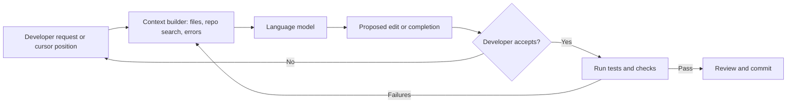

---
related:
- engineering/frameworks
- engineering/prompting
- engineering/evaluation
- engineering/llm-security
- engineering/mlops
tags:
- engineering
- software development
- coding assistants
aliases:
- AI 程式助手
- AI coding assistants
---

# AI Coding Assistants

AI coding assistants are language models that help a programmer write, read, test and change code. They range from inline completion inside an editor, through chat that explains or edits a selected file, to agents that plan a change across a repository, run the tests and revise the result. The field moves quickly, so this page describes the categories and the evidence about them rather than any single product.

## Overview

A coding assistant is a language model with a particular context: the file being edited, the surrounding project, the error output of a test run, and the developer's instruction. Models trained on large amounts of code can complete functions from a docstring, translate between languages and suggest fixes for failing tests. The evidence on their value is mixed. Controlled studies have found large speed-ups on some well-specified tasks and slow-downs for experienced developers working on their own mature codebases. Studies have also found that people who use an assistant can write less secure code, so the tool changes how work is checked, not only how fast it is written.

## Key concepts

- **Code completion**: predicting the next tokens at the cursor, often using the code before and after it. Models trained with fill-in-the-middle objectives handle insertions inside existing code.
- **Context**: the material the model sees, such as open files, imports, retrieved snippets from the repository, and documentation. Most practical quality differences come from what is in context.
- **Functional correctness**: whether generated code passes tests. Benchmarks such as HumanEval measure this on short standalone functions, which is a narrower task than maintaining a codebase.
- **Human verification**: reading, running and reviewing generated code. The assistant proposes; the developer remains responsible for the change.
- **Agentic loop**: a cycle of planning, editing, running commands or tests, reading the output, and revising. It depends on tools being available and on a clear success signal.

## How it works

Most assistants combine a model with a context builder and an interface. The context builder decides which code to send, the model proposes an edit or a completion, and the interface shows it for acceptance. In agentic systems the output of tools (test results, compiler errors, search hits) is fed back to the model as new context, and the loop repeats until a stopping condition is met or the developer intervenes.

## Key methods

The categories below are product patterns rather than separate research methods, so each is described here and compared, without a separate method page.

| Category | Typical interaction | Strength | Main risk |
|---|---|---|---|
| Inline completion | Suggested text as the developer types | Fast, low friction for routine code | Plausible but wrong code is accepted without checking |
| Chat over selected code | Question, explanation or edit request about a file or selection | Good for understanding unfamiliar code | Context may omit the rest of the system |
| Repository-aware editing | Multi-file change proposed from a single instruction | Handles refactors and cross-file changes | Larger diffs are harder to review |
| Autonomous agents | Plans, edits, runs tests and iterates with limited supervision | Can resolve well-specified issues end to end | Needs a reliable test signal; costly and can drift from intent |

## Evidence on productivity and quality

- Chen et al. (2021) introduced Codex and HumanEval, a benchmark that checks whether generated functions pass tests. The benchmark measures short standalone functions, not whole projects.
- Ziegler et al. (2022) studies how neural code completion is used and how its productivity can be assessed. Its evidence comes from usage in a real setting rather than from a controlled comparison of finished tasks.
- Peng et al. (2023) ran a controlled experiment in which the developers with GitHub Copilot completed a JavaScript HTTP-server task 55.8 per cent faster than the control group. The task is short and well specified, so the result does not transfer directly to long-lived code.
- Becker et al. (2025) studied 16 experienced open-source developers working on their own repositories. The abstract reports that allowing AI tools increased completion time by 19 per cent. This suggests that gains on constructed tasks may not carry over to familiar, mature codebases.
- Sarkar et al. (2022) studies what programming with an AI code generator is like for the programmer, using a qualitative account of the interaction.

## Security and correctness

- Pearce et al. (2021) generated programs with Copilot in scenarios where vulnerabilities were known, and reported that about 40 per cent of the 1,689 generated programs across 89 scenarios were vulnerable.
- Perry et al. (2022) ran a user study and found that participants with an AI assistant wrote significantly less secure code than those without access.
- Barke, James and Polikarpova (2022) observed programmers using a code-generating model to see how they interact with its suggestions.

These results argue for keeping tests, static analysis and secret scanning in the loop, and for reviewing generated code with the same rigour as human code.

## Agents and repository-level tasks

Benchmarks for repository-level work ask a system to resolve a real issue in an open-source project and to pass the project's own tests. SWE-bench (Jimenez et al., 2024) is the reference benchmark for this task. SWE-agent (Yang et al., 2024) studies how the interface between the model and the computer (file viewing, editing and test running) changes the results. Scores on these benchmarks are sensitive to the harness, the model version and the exact task set, so comparisons should use the same harness and report the variance.

## Trade-offs

- **Speed versus verification**: a suggestion that is accepted quickly still needs to be understood. Measuring only generation speed can miss defects that appear later.
- **Context versus privacy**: sending more of the codebase improves suggestions but raises questions about what leaves the developer's machine and how it is stored. Organisations set these rules through their tool configuration and contracts.
- **Consistency**: generated code may follow patterns that differ from the house style, and a team may accumulate code that no one wrote deliberately. Shared conventions, linters and review checklists reduce this.
- **Skill formation**: junior developers may rely on suggestions before they learn the underlying reasoning. Evidence on this is limited, and it is an open concern for training programmes.

## Connections

- The model behind an assistant is covered in [Large Language Models](../../theory/models/llm/index.md). Context and instructions are covered in [Prompt Engineering](../prompting/index.md).
- Measuring whether an assistant helps is part of [Evaluation & Benchmarks](../evaluation/index.md).
- Tool access for agents raises the security concerns in [LLM Application Security](../llm-security/index.md).
- Serving and cost questions for large deployments are covered in [MLOps & Deployment](../mlops/index.md) and [Frameworks & Tools](../frameworks/index.md).

## Open questions

- How should productivity be measured for work that spans weeks, such as maintenance and review, rather than a single constructed task?
- Which evaluation harness changes give the most reliable comparison between agent systems on repository-level tasks?
- How can teams keep reviewing generated code effectively when the volume of changes grows?
- What practices let junior developers learn from assistants without losing the skills the assistants automate?

## References

### Seminal papers

- Chen, M. et al. (2021). *Evaluating Large Language Models Trained on Code*. arXiv:2107.03374. https://arxiv.org/abs/2107.03374 — Introduces Codex and the HumanEval benchmark, which checks whether generated functions pass tests.
- Jimenez, C. E. et al. (2024). *SWE-bench: Can Language Models Resolve Real-World GitHub Issues?* ICLR 2024. arXiv:2310.06770. https://arxiv.org/abs/2310.06770 — Benchmark that asks systems to resolve real issues in open-source repositories and pass their tests.

### Related work

- Ziegler, A. et al. (2022). *Productivity Assessment of Neural Code Completion*. arXiv:2205.06537. https://arxiv.org/abs/2205.06537 — Studies how neural code completion is used and how its effect on productivity can be assessed.
- Peng, S. et al. (2023). *The Impact of AI on Developer Productivity: Evidence from GitHub Copilot*. arXiv:2302.06590. https://arxiv.org/abs/2302.06590 — Controlled experiment in which developers with Copilot completed a programming task 55.8 per cent faster.
- Sarkar, A. et al. (2022). *What is it like to program with artificial intelligence?* PPIG 2022. arXiv:2208.06213. https://arxiv.org/abs/2208.06213 — Qualitative account of what programming with an AI code generator is like.
- Barke, S., James, M. B. & Polikarpova, N. (2022). *Grounded Copilot: How Programmers Interact with Code-Generating Models*. arXiv:2206.15000. https://arxiv.org/abs/2206.15000 — Observational study of how programmers interact with a code-generating model's suggestions.
- Pearce, H. et al. (2021). *Asleep at the Keyboard? Assessing the Security of GitHub Copilot's Code Contributions*. IEEE S&P 2022. arXiv:2108.09293. https://arxiv.org/abs/2108.09293 — Measures how often Copilot's generated programs contain known vulnerabilities across 89 scenarios.
- Perry, N. et al. (2022). *Do Users Write More Insecure Code with AI Assistants?* arXiv:2211.03622. DOI 10.1145/3576915.3623157. https://arxiv.org/abs/2211.03622 — User study finding that participants with an AI assistant wrote less secure code.
- Yang, J. et al. (2024). *SWE-agent: Agent-Computer Interfaces Enable Automated Software Engineering*. arXiv:2405.15793. https://arxiv.org/abs/2405.15793 — Studies how the agent-computer interface affects the performance of software-engineering agents.
- Becker, J. et al. (2025). *Measuring the Impact of Early-2025 AI on Experienced Open-Source Developer Productivity*. arXiv:2507.09089. https://arxiv.org/abs/2507.09089 — Study in which experienced developers on mature repositories took longer to finish tasks when AI tools were allowed.
