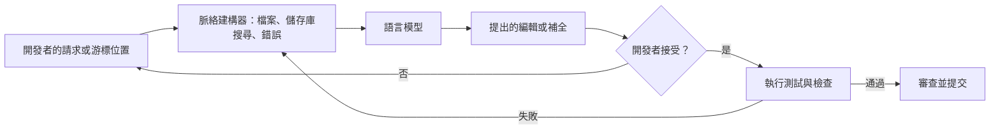

---
related:
- engineering/frameworks
- engineering/prompting
- engineering/evaluation
- engineering/llm-security
- engineering/mlops
tags:
- engineering
- software development
- coding assistants
aliases:
- AI 程式助手
- AI coding assistants
---

# AI 程式助手

AI 程式助手是能協助程式設計師撰寫、閱讀、測試與修改程式碼的語言模型。它們的形式從編輯器內的行內補全，到針對所選檔案解釋或修改的對話，再到能規劃跨儲存庫的變更、執行測試並修正結果的代理人。這個領域變化很快，因此本頁描述的是類別與相關證據，而不是某一個產品。

## 概述

程式助手是一種帶有特定脈絡的語言模型：脈絡包括正在編輯的檔案、周圍的專案、測試執行的錯誤輸出，以及開發者的指令。在大量程式碼上訓練的模型，可以依照函式的文件字串補完函式、在語言之間翻譯，並提出修正失敗測試的建議。關於其價值的證據並不一致：受控研究在某些定義明確的任務上發現大幅加速，但對於在自己成熟程式庫中工作的資深開發者，研究卻發現反而變慢。另外也有研究發現，使用助手的人可能寫出較不安全的程式碼，因此這項工具改變的不只是寫程式的速度，也改變了檢查工作的方式。

## 關鍵概念

- **程式碼補全**：在游標處預測接下來的 token，通常同時參考游標前後的程式碼。以填補中間內容（fill-in-the-middle）為目標訓練的模型，能處理既有程式碼中間的插入。
- **脈絡**：模型所看到的材料，例如開啟中的檔案、匯入的套件、從儲存庫檢索出的片段，以及說明文件。多數實際的品質差異來自脈絡的內容。
- **功能正確性**：生成的程式碼能否通過測試。HumanEval 等基準在簡短的獨立函式上衡量這點，任務範圍比維護整個程式庫窄得多。
- **人工驗證**：閱讀、執行並審查生成的程式碼。助手提出建議，但變更仍由開發者負責。
- **代理人迴圈**：規劃、編輯、執行指令或測試、讀取輸出、再修正的循環。它依賴可用的工具與清楚的成功訊號。

## 運作方式

多數助手結合了模型、脈絡建構器與使用介面。脈絡建構器決定要送出哪些程式碼，模型提出編輯或補全，介面則顯示結果供開發者接受。在代理人系統中，工具的輸出（測試結果、編譯錯誤、搜尋結果）會作為新的脈絡回饋給模型，循環重複，直到達到停止條件或開發者介入為止。

## 關鍵方法

以下類別是產品的互動模式，而不是各自獨立的研究方法，因此在此描述並比較，不另立方法頁。

| 類別 | 典型互動 | 優點 | 主要風險 |
|---|---|---|---|
| 行內補全 | 開發者打字時顯示建議文字 | 快速，對例行程式碼的干擾少 | 看似合理但錯誤的程式碼可能未經檢查就被接受 |
| 針對所選程式碼的對話 | 關於檔案或選取範圍的問題、解釋或編輯要求 | 有助於理解不熟悉的程式碼 | 脈絡可能遺漏系統的其他部分 |
| 儲存庫感知的編輯 | 由單一指令提出跨檔案的變更 | 能處理重構與跨檔案修改 | 變更範圍較大，較難審查 |
| 自主代理人 | 規劃、編輯、執行測試並反覆修正，監督有限 | 能端到端解決定義明確的問題 | 需要可靠的測試訊號；成本較高，且可能偏離原意 |

## 生產力與品質的證據

- Chen 等人（2021）提出 Codex 與 HumanEval，這是一個檢驗生成的函式能否通過測試的基準。該基準衡量的是簡短的獨立函式，而不是整個專案。
- Ziegler 等人（2022）研究神經網路程式碼補全如何被使用，以及如何評估其對生產力的影響。其證據來自實際環境中的使用情況，而不是對已完成任務的受控比較。
- Peng 等人（2023）進行受控實驗，使用 GitHub Copilot 的開發者在一項 JavaScript HTTP 伺服器任務中，完成速度比對照組快 55.8%。這項任務簡短且定義明確，因此結果無法直接套用到長期維護的程式碼。
- Becker 等人（2025）研究 16 位在自己儲存庫中工作的資深開源開發者。摘要報告，允許使用 AI 工具後，完成任務的時間增加了 19%。這顯示在構造出來的任務上的收益，未必能延續到熟悉、成熟的程式庫。
- Sarkar 等人（2022）從程式設計師的角度描述，使用 AI 程式碼生成時寫程式是什麼樣的經驗，採用的是質性的敘述。

## 安全與正確性

- Pearce 等人（2021）在已知會出現漏洞的情境中用 Copilot 生成程式，並報告在 89 個情境、共 1,689 個生成的程式中，約 40% 存在漏洞。
- Perry 等人（2022）進行使用者研究，發現有 AI 助手的參與者所寫的程式碼，安全性顯著低於沒有助手的參與者。
- Barke、James 與 Polikarpova（2022）觀察程式設計師使用程式碼生成模型的情形，以了解他們如何與模型的建議互動。

這些結果顯示，循環中應保留測試、靜態分析與機密掃描，並以與審查人工程式碼相同的嚴謹度審查生成的程式碼。

## 代理人與儲存庫層級的任務

儲存庫層級的基準要求系統解決開源專案中的真實問題，並通過該專案自己的測試。SWE-bench（Jimenez 等人，2024）是此任務的參考基準。SWE-agent（Yang 等人，2024）研究模型與電腦之間的介面（檢視檔案、編輯與執行測試）如何影響結果。這些基準的分數對執行框架、模型版本與任務集合都很敏感，因此比較時應使用相同的框架，並回報其變異程度。

## 取捨

- **速度與驗證**：快速接受的建議仍需要被理解。只衡量生成速度，可能會漏掉之後才出現的缺陷。
- **脈絡與隱私**：送出更多程式碼能改善建議，但也引發了哪些內容離開開發者電腦、如何儲存的問題。組織透過工具設定與合約來制定這些規則。
- **一致性**：生成的程式碼可能採用與團隊風格不同的模式，團隊也可能累積沒有人刻意寫下的程式碼。共用的慣例、linter 與審查清單有助於降低這個問題。
- **技能養成**：初學者可能在理解背後的推理之前，就依賴建議。目前關於這點的證據有限，對培訓計畫來說是一個值得關注的問題。

## 相關連結

- 助手背後的模型見[大型語言模型](../../theory/models/llm/index.md)。脈絡與指令見[提示工程](../prompting/index.md)。
- 衡量助手是否有幫助，屬於[評估與基準](../evaluation/index.md)的範圍。
- 代理人的工具存取會帶來[LLM 應用安全](../llm-security/index.md)所討論的疑慮。
- 大規模部署的服務化與成本問題，見 [MLOps 與部署](../mlops/index.md) 與 [框架與工具](../frameworks/index.md)。

## 開放問題

- 對於跨越數週的工作（例如維護與審查），而不是單一構造出來的任務，應如何衡量生產力？
- 在儲存庫層級的任務上，哪些評估框架的改動最能讓代理人系統之間的比較更可靠？
- 當變更量增加時，團隊如何持續有效地審查生成的程式碼？
- 有哪些做法能讓初學者從助手中學習，而不致失去助手所取代的技能？

## 參考文獻

### 重要論文

- Chen, M. 等人（2021）。*Evaluating Large Language Models Trained on Code*。arXiv:2107.03374。https://arxiv.org/abs/2107.03374 — 提出 Codex 與 HumanEval 基準，檢驗生成的函式能否通過測試。
- Jimenez, C. E. 等人（2024）。*SWE-bench: Can Language Models Resolve Real-World GitHub Issues?* ICLR 2024。arXiv:2310.06770。https://arxiv.org/abs/2310.06770 — 要求系統解決開源儲存庫中的真實問題並通過其測試的基準。

### 相關工作

- Ziegler, A. 等人（2022）。*Productivity Assessment of Neural Code Completion*。arXiv:2205.06537。https://arxiv.org/abs/2205.06537 — 研究神經網路程式碼補全如何被使用，以及如何評估其對生產力的影響。
- Peng, S. 等人（2023）。*The Impact of AI on Developer Productivity: Evidence from GitHub Copilot*。arXiv:2302.06590。https://arxiv.org/abs/2302.06590 — 受控實驗，使用 Copilot 的開發者完成程式任務的速度快了 55.8%。
- Sarkar, A. 等人（2022）。*What is it like to program with artificial intelligence?* PPIG 2022。arXiv:2208.06213。https://arxiv.org/abs/2208.06213 — 對使用 AI 程式碼生成器寫程式的質性描述。
- Barke, S.、James, M. B. 與 Polikarpova, N.（2022）。*Grounded Copilot: How Programmers Interact with Code-Generating Models*。arXiv:2206.15000。https://arxiv.org/abs/2206.15000 — 觀察程式設計師如何與程式碼生成模型的建議互動。
- Pearce, H. 等人（2021）。*Asleep at the Keyboard? Assessing the Security of GitHub Copilot's Code Contributions*。IEEE S&P 2022。arXiv:2108.09293。https://arxiv.org/abs/2108.09293 — 衡量 Copilot 生成的程式在 89 個情境中含有已知漏洞的比例。
- Perry, N. 等人（2022）。*Do Users Write More Insecure Code with AI Assistants?* arXiv:2211.03622。DOI 10.1145/3576915.3623157。https://arxiv.org/abs/2211.03622 — 使用者研究發現，有 AI 助手的參與者寫出的程式碼安全性較低。
- Yang, J. 等人（2024）。*SWE-agent: Agent-Computer Interfaces Enable Automated Software Engineering*。arXiv:2405.15793。https://arxiv.org/abs/2405.15793 — 研究代理人與電腦之間的介面如何影響軟體工程代理人的表現。
- Becker, J. 等人（2025）。*Measuring the Impact of Early-2025 AI on Experienced Open-Source Developer Productivity*。arXiv:2507.09089。https://arxiv.org/abs/2507.09089 — 研究發現，允許使用 AI 工具時，成熟儲存庫中的資深開發者完成任務的時間變長。
