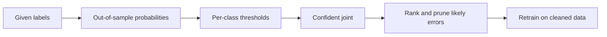

---
tags:
- engineering
- data
aliases:
- 置信學習
---

# Confident Learning

Confident learning finds label errors in a supervised dataset by comparing the given labels with the out-of-sample predictions of a model. It estimates which examples are probably mislabelled and how the noisy labels relate to the unknown true labels, then removes or flags those examples. It was developed for benchmark test sets, where a few percent of labels can change which model appears best.

## Overview

Human-labelled data contains errors, and the errors are not random. Annotators confuse similar classes, and ambiguous examples get inconsistent labels. A model trained on the noisy labels may memorise them, so its predictions cannot be used to find them directly. Confident learning avoids this by using predictions made on data the model did not train on, usually through cross-validation, and by treating the disagreement with the given label as evidence of error.

## Key concepts

- **Out-of-sample predicted probabilities**: for each example, the probability the model assigns to each class when that example was held out.
- **Per-class thresholds**: for each class, the average predicted probability over examples labelled with that class, which defines what counts as confident.
- **Confident joint**: a matrix that counts, for each given label and each likely true label, the examples that are confidently assigned to that pair. Its off-diagonal mass estimates the label noise.
- **Pruning**: removing or re-labelling the examples in the off-diagonal cells, then retraining.

## How it works

The method first obtains out-of-sample probabilities, then builds the confident joint from examples that clearly belong to another class than their given label. The off-diagonal counts give an estimate of the noise rate between each pair of classes, which in turn selects the examples to prune.

## Key methods

The method is the confident joint from out-of-sample probabilities, followed by pruning of the off-diagonal examples. Northcutt, Jiang and Chuang (2021) give the full estimator and state the assumptions under which it estimates the noise structure. Northcutt, Athalye and Mueller (2021) apply the same idea to the test sets of widely used benchmarks and report that the errors are enough to destabilise the rankings of models.

## Results

The benchmark study reports label errors across the test sets of several widely used datasets, and shows that correcting them changes which models rank highest. The method's paper evaluates pruning on datasets with known noise. The exact figures depend on the dataset and the noise model, so readers should check the paper's experiments rather than rely on a summary.

## Limitations

- **Needs out-of-sample predictions**: cross-validation costs several training runs, and the probabilities must be well calibrated.
- **Assumes class-conditional noise**: when errors depend on the individual example rather than on the class, the estimated noise structure is wrong.
- **Systematic errors are hard**: if many annotators make the same mistake, the model and the annotators agree and the error is not flagged.
- **Less studied for text generation**: most results come from classification; labels for free-form outputs need other checks.

## Open questions

- How should confident learning be adapted for preference data and for labels that are not a single class?
- Can the method separate true label errors from ambiguous examples where several labels are reasonable?

## References

### Seminal papers

- Northcutt, C. G., Jiang, L. & Chuang, I. L. (2021). *Confident Learning: Estimating Uncertainty in Dataset Labels*. arXiv:1911.00068. https://arxiv.org/abs/1911.00068 — Defines the confident joint and the pruning procedure for estimating and correcting label errors.

### Related work

- Northcutt, C. G., Athalye, A. & Mueller, J. (2021). *Pervasive Label Errors in Test Sets Destabilize Machine Learning Benchmarks*. NeurIPS 2021 Datasets and Benchmarks Track. arXiv:2103.14749. https://arxiv.org/abs/2103.14749 — Applies the approach to benchmark test sets and shows that label errors change model rankings.
- Song, H. et al. (2022). *Learning from Noisy Labels with Deep Neural Networks: A Survey*. arXiv:2007.08199. https://arxiv.org/abs/2007.08199 — A survey of methods for training under label noise, of which label cleaning is one family.
- Han, B. et al. (2018). *Co-teaching: Robust Training of Deep Neural Networks with Extremely Noisy Labels*. arXiv:1804.06872. https://arxiv.org/abs/1804.06872 — Trains two networks that select small-loss examples for each other, an alternative way of handling noisy labels during training.
- Patrini, G. et al. (2016). *Making Deep Neural Networks Robust to Label Noise: a Loss Correction Approach*. arXiv:1609.03683. https://arxiv.org/abs/1609.03683 — Corrects the training loss using an estimated noise transition matrix, a model-based alternative to pruning.
