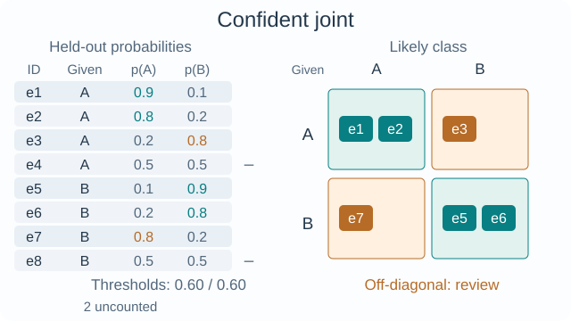

---
tags:
- engineering
- data
aliases:
- 置信學習
---

# Confident Learning

Confident learning finds label errors in a supervised dataset by comparing the given labels with the out-of-sample predictions of a model. It estimates which examples are probably mislabelled and how the noisy labels relate to the unknown true labels, then removes or flags those examples. It was developed for benchmark test sets, where a few percent of labels can change which model appears best.

## Overview

Human-labelled data contains errors, and the errors are not random. Annotators confuse similar classes, and ambiguous examples get inconsistent labels. A model trained on the noisy labels may memorise them, so its predictions cannot be used to find them directly. Confident learning avoids this by using predictions made on data the model did not train on, usually through cross-validation, and by treating the disagreement with the given label as evidence of error.

## Key concepts

- **Out-of-sample predicted probabilities**: for each example, the probability the model assigns to each class when that example was held out.
- **Per-class thresholds**: for each class, the average predicted probability over examples labelled with that class, which defines what counts as confident.
- **Confident joint**: a matrix that counts, for each given label and each likely true label, the examples that are confidently assigned to that pair. Its off-diagonal mass estimates the label noise.
- **Pruning**: removing or re-labelling the examples in the off-diagonal cells, then retraining.

## How it works

The method first obtains out-of-sample probabilities, then counts confident assignments into both diagonal and off-diagonal cells using class-specific thresholds. The off-diagonal counts give an estimate of the noise rate between each pair of classes, which in turn selects the examples to prune.

*Original teaching animation, CC BY-SA 4.0.* The left table contains eight constructed held-out predictions, not a fitted model or benchmark. For each class $j$, define the confidence threshold as the mean predicted probability for $j$ among examples with given label $j$. Here both thresholds are $(0.9+0.8+0.2+0.5)/4=0.60$. An example is counted in the row of its **given** label and the column of a class meeting its threshold. If none qualify, do not count it. In the paper's collision rule, when several classes qualify, use the overall probability argmax; the binary example below has no collisions. Chips move from the example list into the corresponding matrix cells.

The resulting **raw, uncalibrated** confident joint is

$$
C=\begin{pmatrix}2&1\\1&2\end{pmatrix}.
$$

Examples e4 and e8 meet neither threshold. Examples e3 and e7 land off the diagonal and deserve inspection, not automatic relabelling. In the complete estimator (Northcutt, Jiang and Chuang, 2021, in References), the counts are calibrated to the given-label marginals and normalised to estimate the joint distribution; pruning and ranking are separate decisions. Thus the two off-diagonal counts out of six counted examples are **not** a measured dataset error rate.

MkDocs provides Play/Pause and reduced-motion support; on narrow screens swipe horizontally or focus the figure and use the left/right arrow keys. [GitHub static overview](../../assets/concept-animations/confident-joint-counting-still.svg) · [Standalone animation](../../assets/concept-animations/confident-joint-counting-motion.svg).

### From counts to a joint distribution

Let $n_i$ denote the number of examples with given label $i$, and $N=\sum_i n_i$. When each row has nonzero count, the real-valued estimator in Northcutt et al. (2021, Eq. 3) can be written as

$$
\hat Q_{ij}=\frac{n_i}{N}\frac{C_{ij}}{\sum_k C_{ik}}.
$$

In the animation, $n_A=n_B=4$ and each raw row sums to 3. Rescaling each row by $4/3$ and dividing by 8 gives

$$
\hat Q=\begin{pmatrix}1/3&1/6\\1/6&1/3\end{pmatrix}.
$$

The row sums are $1/2$ and the total is 1. Its off-diagonal mass is $1/3$, an estimated noise fraction under the estimator's assumptions, not a verified error rate or a count of specific examples. The two flagged examples are still just review candidates. This calculation is not depicted in the raw-count animation. Integer pruning budgets require a separate rounding and selection rule.

The equal row counts hide the importance of calibration: in a separate hypothetical case with the same raw matrix but observed class counts 4 and 6, direct division by the raw total 6 would incorrectly assign both observed classes mass $1/2$. Row calibration instead gives masses $2/5$ and $3/5$ and preserves the within-row proportions. This formula does not cover a row with no confident counts; that case needs explicit handling rather than division by zero.

## Key methods

The method is the confident joint from out-of-sample probabilities, followed by pruning of the off-diagonal examples. Northcutt, Jiang and Chuang (2021) give the full estimator and state the assumptions under which it estimates the noise structure. Northcutt, Athalye and Mueller (2021) apply the same idea to the test sets of widely used benchmarks and report that the errors are enough to destabilise the rankings of models.

## Results

The benchmark study reports label errors across the test sets of several widely used datasets, and shows that correcting them changes which models rank highest. The method's paper evaluates pruning on datasets with known noise. The exact figures depend on the dataset and the noise model, so readers should check the paper's experiments rather than rely on a summary.

## Limitations

- **Needs out-of-sample predictions**: cross-validation costs several training runs, and the probabilities must be well calibrated.
- **Assumes class-conditional noise**: when errors depend on the individual example rather than on the class, the estimated noise structure is wrong.
- **Systematic errors are hard**: if many annotators make the same mistake, the model and the annotators agree and the error is not flagged.
- **Less studied for text generation**: most results come from classification; labels for free-form outputs need other checks.

## Open questions

- How should confident learning be adapted for preference data and for labels that are not a single class?
- Can the method separate true label errors from ambiguous examples where several labels are reasonable?

## References

### Seminal papers

- Northcutt, C. G., Jiang, L. & Chuang, I. L. (2021). *Confident Learning: Estimating Uncertainty in Dataset Labels*. arXiv:1911.00068. https://arxiv.org/abs/1911.00068 — Defines the confident joint and the pruning procedure for estimating and correcting label errors.

### Related work

- Northcutt, C. G., Athalye, A. & Mueller, J. (2021). *Pervasive Label Errors in Test Sets Destabilize Machine Learning Benchmarks*. NeurIPS 2021 Datasets and Benchmarks Track. arXiv:2103.14749. https://arxiv.org/abs/2103.14749 — Applies the approach to benchmark test sets and shows that label errors change model rankings.
- Song, H. et al. (2022). *Learning from Noisy Labels with Deep Neural Networks: A Survey*. arXiv:2007.08199. https://arxiv.org/abs/2007.08199 — A survey of methods for training under label noise, of which label cleaning is one family.
- Han, B. et al. (2018). *Co-teaching: Robust Training of Deep Neural Networks with Extremely Noisy Labels*. arXiv:1804.06872. https://arxiv.org/abs/1804.06872 — Trains two networks that select small-loss examples for each other, an alternative way of handling noisy labels during training.
- Patrini, G. et al. (2016). *Making Deep Neural Networks Robust to Label Noise: a Loss Correction Approach*. arXiv:1609.03683. https://arxiv.org/abs/1609.03683 — Corrects the training loss using an estimated noise transition matrix, a model-based alternative to pruning.
