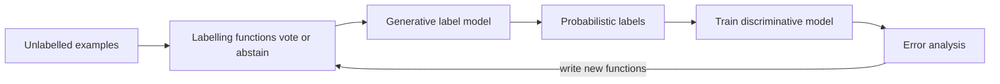

---
tags:
- engineering
- data
aliases:
- 資料編程與弱監督
---

# Data Programming and Weak Supervision

Data programming creates training labels by writing many noisy labelling functions, such as rules, heuristics and pattern matches, and then combining their votes with a generative model. The model estimates how accurate each function is and how they agree, without any hand-labelled ground truth, and outputs probabilistic labels for a discriminative model to learn from. It turns labelling from a per-example task into a programming task.

## Overview

Hand labelling is slow and expensive, and crowdsourced labels are noisy. Many domains, however, have useful signals that are not labels: keywords, knowledge bases, existing classifiers, regular expressions and expert rules. Each signal is imprecise, and they overlap. Data programming treats each signal as a labelling function that may abstain, and learns how much to trust each one from the pattern of their agreements and disagreements.

## Key concepts

- **Labelling function**: a function that takes an example and returns a label or abstains. Functions can be rules, heuristics, distant supervision or model outputs.
- **Generative label model**: a probabilistic model over the true label and the function outputs. It estimates each function's accuracy and correlations without labels.
- **Probabilistic labels**: soft training targets produced by the label model, which a discriminative model is trained on so that it can generalise beyond the rules.
- **Coverage and conflict**: the share of examples a function labels, and the share where it disagrees with others. Both guide which functions to write next.

## How it works

Labelling functions vote on each example. The generative model combines the votes into a probabilistic label, and the downstream classifier is trained on those labels. Writing new functions and checking coverage and conflict is the loop in which people spend their time.

## Key methods

The method is labelling functions combined by a generative label model that learns their accuracies without ground truth, followed by training a discriminative model on the resulting probabilistic labels. Ratner et al. (2016) introduce the framework and its theory. Ratner et al. (2017) describe Snorkel, a system that implements it, and Bach et al. (2019) report deploying weak supervision at industrial scale. Ratner et al. (2019) extend the approach to several tasks at once.

## Results

The original paper evaluates models trained on labels from the generative model against baselines on several tasks. The Snorkel system and the industrial case study describe how weak supervision speeds up training-set creation in practice, and the gains depend on how good the labelling functions are. Results vary by task, so readers should check each paper's experiments.

## Limitations

- **Function quality limits the result**: poor or highly correlated functions are hard to detect, and the model assumes some structure in their dependencies.
- **Writing functions takes expert time**: the effort moves from labelling to designing and debugging rules.
- **Domain-specific**: the approach works best where useful signals exist, such as knowledge bases and keyword lists, and less well for open-ended generation.
- **Bias is inherited**: a labelling function that encodes a biased rule produces biased training data with confident-looking probabilities.

## Open questions

- How can labelling functions be generated automatically, for example by language models, without losing the accuracy estimates?
- How should data programming be combined with hand labels and active learning when both are available?

## References

### Seminal papers

- Ratner, A. et al. (2016). *Data Programming: Creating Large Training Sets, Quickly*. arXiv:1605.07723. https://arxiv.org/abs/1605.07723 — Introduces labelling functions and a generative model that learns their accuracies without ground truth.

### Related work

- Ratner, A. et al. (2017). *Snorkel: Rapid Training Data Creation with Weak Supervision*. Proceedings of the VLDB Endowment. https://doi.org/10.14778/3157794.3157797 — The Snorkel system, which implements data programming for practitioners.
- Bach, S. H. et al. (2019). *Snorkel DryBell: A Case Study in Deploying Weak Supervision at Industrial Scale*. arXiv:1812.00417. https://arxiv.org/abs/1812.00417 — Reports deploying weak supervision in an industrial setting with many labelling sources.
- Ratner, A. et al. (2019). *Training Complex Models with Multi-Task Weak Supervision*. arXiv:1810.02840. https://arxiv.org/abs/1810.02840 — Extends the label model to several tasks and sources of supervision at once.
- Zhang, J. et al. (2022). *A Survey on Programmatic Weak Supervision*. arXiv:2202.05433. https://arxiv.org/abs/2202.05433 — Surveys the family of methods that learn from programmatic and noisy sources of labels.
