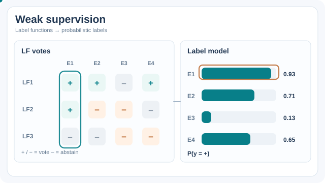

# 資料編程與弱監督

資料編程透過撰寫許多帶雜訊的標註函式（例如規則、啟發式方法與模式比對）來產生訓練標籤，再以生成式模型整合它們的投票。這個生成式模型不需要人工標註的真實答案，就能估計每個函式的準確度以及它們彼此的一致性，並輸出機率型標籤，供判別式模型學習。它把標註從逐筆進行的工作，變成一項程式設計工作。

## 概述

人工標註既慢又貴，眾包標籤又帶有雜訊。然而許多領域都有有用的訊號，只是它們不是標籤：關鍵字、知識庫、既有分類器、正規表達式與專家規則。每個訊號都不精確，而且彼此重疊。資料編程把每個訊號視為一個可以棄權的標註函式，並從它們之間一致與不一致的模式，學出應該多信任哪一個。

## 關鍵概念

- **標註函式（labelling function）**：接收一個樣本並回傳標籤或棄權的函式。它可以是規則、啟發式方法、遠端監督或模型輸出。
- **生成式標籤模型（generative label model）**：對真實標籤與各函式輸出之間的機率模型。它在沒有標籤的情況下估計每個函式的準確度與相關性。
- **機率型標籤（probabilistic labels）**：由標籤模型產生的軟目標，判別式模型用它來訓練，因此能超越規則本身做泛化。
- **覆蓋率與衝突（coverage and conflict）**：一個函式標註到的樣本比例，以及與其他函式意見不一致的比例。兩者用來決定接下來要寫哪些函式。

## 運作方式

標註函式對每個樣本投票。生成式模型把投票整合成機率型標籤，下游的分類器則在這些標籤上訓練。撰寫新函式並檢查覆蓋率與衝突，是人們實際花時間的迴圈。

*原創教學動畫，CC BY-SA 4.0。* E1–E4 是四筆虛構樣本；LF1–LF3 投下正（+）、負（−）或棄權（–）的票。移動的外框把投票欄位對應到右邊的軟標籤，顯示 \(P(y=+)\) 約為 **0.93、0.71、0.13、0.65**。為了使示意機率可以驗算，假設二元類別先驗為 0.5，且三個標註函式的對稱準確率已知、在給定真實標籤下相互獨立，依序為 0.85、0.70、0.75；棄權不提供概似比。以 E2 為例，LF1 與 LF2 的投票衝突，正類勝算為 \((0.85/0.15)(0.30/0.70)\)，故 \(P(y=+)\approx0.71\)。**此圖並未用四筆樣本實際擬合標籤模型**；資料編程需要在模型假設下利用大量未標註資料估計標註來源的準確率與相依性，對高度相關的函式尤其需要審慎處理。MkDocs 提供播放／暫停與降低動態效果；GitHub 可[檢視靜態投票總覽](../../assets/concept-animations/weak-supervision-vote-fusion-still.svg)。

## 關鍵方法

這個方法是：由生成式標籤模型整合標註函式（在沒有真實答案的情況下學出它們的準確度），再於得到的機率型標籤上訓練判別式模型。Ratner 等人（2016）提出此框架與其理論。Ratner 等人（2017）描述實作此框架的 Snorkel 系統，Bach 等人（2019）報告在工業規模上部署弱監督的經驗。Ratner 等人（2019）則把方法延伸到多個任務。

## 結果

原始論文在數個任務上，比較由生成式模型標籤訓練的模型與基準方法。Snorkel 系統與工業案例說明了弱監督在實務上如何加快訓練資料的建立，而效益取決於標註函式的品質。結果因任務而異，讀者應參考各篇論文的實驗。

## 限制

- **函式品質決定結果**：品質差或高度相關的函式很難被察覺，而模型假設它們的相依關係具有某種結構。
- **撰寫函式需要專家時間**：工作從標註轉為設計與除錯規則。
- **依領域而定**：當存在有用的訊號（例如知識庫與關鍵字清單）時效果最好，對開放式生成的效果較差。
- **偏誤會被繼承**：編碼了偏誤規則的標註函式，會以看似有把握的機率產生帶偏誤的訓練資料。

## 開放問題

- 能否自動產生標註函式（例如由語言模型產生），同時保留準確度估計？
- 當手動標籤、主動學習與資料編程同時可用時，應如何組合？

## 參考文獻

### 重要論文

- Ratner, A. et al. (2016). *Data Programming: Creating Large Training Sets, Quickly*. arXiv:1605.07723. https://arxiv.org/abs/1605.07723 — 提出標註函式，以及在沒有真實答案的情況下學出其準確度的生成式模型。

### 相關工作

- Ratner, A. et al. (2017). *Snorkel: Rapid Training Data Creation with Weak Supervision*. Proceedings of the VLDB Endowment. https://doi.org/10.14778/3157794.3157797 — 實作資料編程的 Snorkel 系統，供實務工作者使用。
- Bach, S. H. et al. (2019). *Snorkel DryBell: A Case Study in Deploying Weak Supervision at Industrial Scale*. arXiv:1812.00417. https://arxiv.org/abs/1812.00417 — 報告在工業場景中部署弱監督，涉及許多標籤來源。
- Ratner, A. et al. (2019). *Training Complex Models with Multi-Task Weak Supervision*. arXiv:1810.02840. https://arxiv.org/abs/1810.02840 — 把標籤模型延伸到同時處理多個任務與多種監督來源。
- Zhang, J. et al. (2022). *A Survey on Programmatic Weak Supervision*. arXiv:2202.05433. https://arxiv.org/abs/2202.05433 — 綜述從程式化且帶雜訊的標籤來源學習的一族方法。
