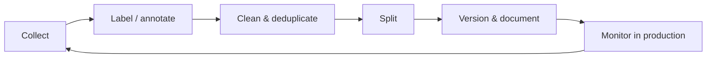

---
related:
- foundations/paradigms/semi-supervised
- foundations/paradigms/active
- society/ethics
- engineering/evaluation
---

# Data

"Data-centric AI": for most real projects, better data beats a better model.

## Lifecycle

## Collection

- First-party logs, sensors, records; public datasets; web crawling (respect robots.txt and terms); licensed data; simulation
- Sampling must match the deployment population — think about who is missing
- Consent, privacy and copyright from the start (GDPR, local privacy laws)

## Labelling

| Approach | Notes |
|---|---|
| Expert annotation | Gold standard in medicine, law, science; expensive |
| Crowdsourcing | Scale; needs quality control (redundancy, gold questions, agreement metrics) |
| Weak / programmatic supervision | Labelling functions (Snorkel) |
| Active learning | Label only informative samples ([Active Learning](../../foundations/paradigms/active/index.md)) |
| Model-assisted / LLM labelling | Fast; validate against human labels and watch for systematic bias |
| Preference data | Pairwise comparisons for RLHF/DPO |

Write **annotation guidelines** with examples and edge cases; measure inter-annotator agreement (Cohen's / Fleiss' κ, Krippendorff's α).

## Cleaning and quality

- Deduplication (exact and near-duplicate, MinHash) — critical for LLM pre-training and for avoiding test leakage
- Label-error detection (confident learning / cleanlab)
- Outlier and corruption checks, schema validation (Great Expectations, pandera)
- For web text: language ID, quality classifiers, toxicity and PII filtering (e.g. FineWeb, DCLM pipelines)

## Splitting without leakage

- Split by **entity** (patient, user, device), by **time**, or by **site** when generalisation across them matters
- Deduplicate across splits
- Keep a locked final test set

## Synthetic data

- Uses: augmentation, rare events, privacy, instruction tuning, reasoning traces, simulation for robotics and driving
- Risks: amplifying model biases; **model collapse** when models are trained recursively on their own outputs without fresh real data (Shumailov et al., 2024, *Nature*); verification needed (e.g. execute generated code, check math answers)

## Documentation and governance

- **Datasheets for Datasets** (Gebru et al.) and **Data Cards**; **Model Cards** for models
- Data versioning: DVC, lakeFS, Hugging Face dataset revisions
- Lineage and access control; retention policies
- Licences and provenance (Data Provenance Initiative audits found widespread licence mislabelling)

## Scale reference points

| Domain | Typical scale |
|---|---|
| ImageNet-1k | 1.28 million labelled images |
| LAION-5B | 5.85 billion image–text pairs (later found to contain problematic material, prompting re-release) |
| Frontier LLM pre-training | Tens of trillions of tokens |
| Instruction tuning | Thousands to millions of examples — quality matters more than quantity (LIMA, 2023) |

## Resources

- Gebru et al. (2021), "Datasheets for Datasets", *CACM*
- Northcutt et al. (2021), "Pervasive label errors in test sets destabilize ML benchmarks"
- Penedo et al. (2024), FineWeb
- [Data-Centric AI resources (MIT course)](https://dcai.csail.mit.edu/)
