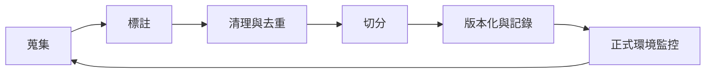

# 資料

「以資料為中心的 AI」：對大多數實際專案來說，更好的資料勝過更好的模型。

## 生命週期

## 蒐集

- 第一方的日誌、感測器與紀錄；公開資料集；網路爬取（須遵守 robots.txt 與服務條款）；授權資料；模擬
- 抽樣必須符合實際部署的族群——要思考誰被遺漏了
- 從一開始就處理同意、隱私與著作權問題（GDPR 與各地的隱私法）

## 標註

| 方法 | 說明 |
|---|---|
| 專家標註 | 醫學、法律、科學領域的黃金標準；成本高 |
| 眾包 | 可擴大規模；需要品質控管（重複標註、黃金題、一致性指標） |
| 弱監督／程式化監督 | 標註函式（Snorkel） |
| 主動學習 | 只標註有資訊量的樣本（[主動學習](../../theory/paradigms/active/index.md)） |
| 模型輔助或 LLM 標註 | 快速；需與人工標籤比對驗證，並留意系統性偏誤 |
| 偏好資料 | 用於 RLHF／DPO 的成對比較 |

撰寫附有範例與邊界案例的**標註指南**；測量標註者之間的一致性（Cohen's κ、Fleiss' κ、Krippendorff's α）。

## 清理與品質

- 去重（完全重複與近似重複，MinHash）——對 LLM 預訓練至關重要，也能避免測試資料洩漏
- 標籤錯誤偵測（confident learning／cleanlab）
- 離群值與損壞檢查、結構驗證（Great Expectations、pandera）
- 網路文字：語言辨識、品質分類器、毒性與個人資料過濾（例如 FineWeb、DCLM 流程）

## 避免洩漏的切分

- 依**實體**（病人、使用者、裝置）、依**時間**，或在意跨地點泛化時依**地點**切分
- 在切分之間做去重
- 保留一個鎖定的最終測試集

## 合成資料

- 用途：資料擴增、罕見事件、隱私、指令微調、推理軌跡、機器人與自動駕駛的模擬
- 風險：放大模型偏見；當模型在自己的輸出上遞迴訓練、又沒有新的真實資料時，會出現**模型崩潰**（Shumailov et al., 2024, *Nature*）；需要驗證（例如執行生成的程式碼、檢查數學答案）

## 文件記錄與治理

- **Datasheets for Datasets**（Gebru et al.）與**資料卡**；模型則使用**模型卡**
- 資料版本控制：DVC、lakeFS、Hugging Face 的資料集版本
- 資料血統與存取控管；保留政策
- 授權與來源（Data Provenance Initiative 的稽核發現，授權標示錯誤相當普遍）

## 規模參考

| 領域 | 典型規模 |
|---|---|
| ImageNet-1k | 128 萬張有標註影像 |
| LAION-5B | 58.5 億組影像—文字配對（後來發現含有問題內容，因而重新發布） |
| 前沿 LLM 預訓練 | 數十兆（trillion）個 token |
| 指令微調 | 數千到數百萬筆範例——品質比數量重要（LIMA, 2023） |

## 學習資源

- Gebru et al. (2021), "Datasheets for Datasets", *CACM*
- Northcutt et al. (2021), "Pervasive label errors in test sets destabilize ML benchmarks"
- Penedo et al. (2024), FineWeb
- [以資料為中心的 AI 資源（MIT 課程）](https://dcai.csail.mit.edu/)
