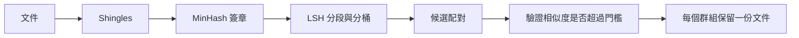

---
tags:
- engineering
- data
aliases:
- MinHash 去重
---

# MinHash 去重

MinHash 去重能在太大、無法兩兩比較的語料中找出近似重複的文件。它把每份文件表示成一個精簡的簽章，簽章的一致比例可估計兩份文件的重疊程度，再用局部敏感雜湊（LSH）找出可能成對的文件，而不必檢查所有配對。它是語言模型預訓練前移除重複網頁文字的標準工具。

## 概述

完全去重（對整份文件做雜湊）會漏掉一種很常見的情況：頁面被複製時，只改了標頭、日期或幾個字。這些近似複本仍會讓模型把同一段文字學上很多次。兩兩比較所有文件是平方級的成本，對數十億份文件來說不可行。MinHash 把比較轉換成短簽章與雜湊查詢，因此成本大致隨語料大小線性成長。

## 關鍵概念

- **Shingles（字串片段）**：文件中所有重疊的詞或字元 n-gram 所組成的集合。兩份文件的比較，就是比較它們 shingle 集合的重疊程度。
- **Jaccard 相似度**：兩個 shingle 集合的交集大小除以聯集大小。接近 1 表示近似重複。
- **MinHash 簽章**：對許多個雜湊函數，各自保留文件所有 shingle 的最小雜湊值。兩份簽章相同位置的一致比例，是 Jaccard 相似度的無偏估計。
- **局部敏感雜湊（LSH）**：把每個簽章切成若干段（band），對每段做雜湊。共享同一段的文件會落在同一個桶中，成為候選配對。段數與每段的列數決定了能找出配對的相似度門檻。

## 運作方式

每份文件先切出 shingle，轉成簽章，再由 LSH 分桶。候選配對接著做更精確的相似度檢查，每個重複群組只保留一份文件。

## 關鍵方法

這個方法是 MinHash 簽章加上 LSH 分段，接著套用相似度門檻，並在群組層級決定保留哪一份。Broder（1997）提出基於 shingle 最小雜湊的「相似性」（resemblance）度量。Lee 等人（2022）指出，移除訓練語料中的近似重複會改變語言模型逐字重現訓練資料的程度，使這個方法成為預訓練流程的標準步驟。

## 結果

Lee 等人（2022）報告，移除近似重複能降低模型逐字重現訓練序列的頻率，並指出標準語料中的重複文字相當普遍。後來的大型語料流程，例如 DataComp-LM，把去重列為它們比較的整理選項之一，因此去重的效果是與過濾和混合一起衡量，而非單獨衡量。

## 限制

- **門檻的選擇**：門檻太高會保留近似複本；門檻太低則會移除合理的重複文字，例如授權標頭、樣板與引文。
- **範圍**：在整個語料、跨切分、或只在單一來源內去重，結果不同，合適的選擇取決於目標。
- **語意上的複本會漏掉**：改寫與翻譯的 shingle 重疊很低，MinHash 無法移除它們。
- **大規模的成本**：每份文件都要計算並儲存簽章與分桶結果，需要分散式處理。

## 開放問題

- 當語料要訓練數個 epoch 時，移除近似重複的好處是否大於壞處？
- 如何把去重與資料混合結合，避免把稀有的高品質來源與網頁複本一起移除？
- 語意去重何時值得付出比 MinHash 更高的成本？

## 參考文獻

### 重要論文

- Broder, A. Z. (1997). *On the resemblance and containment of documents*. https://www.cs.princeton.edu/courses/archive/spring13/cos598C/broder97resemblance.pdf — 提出以文件 shingle 的最小雜湊估計文件之間的相似性。

### 相關工作

- Lee, K. et al. (2021). *Deduplicating Training Data Makes Language Models Better*. arXiv:2107.06499. https://arxiv.org/abs/2107.06499 — 顯示預訓練語料中的近似重複會增加模型逐字重現訓練文字的情況，移除它們有幫助。
- Li, J. et al. (2024). *DataComp-LM: In search of the next generation of training sets for language models*. arXiv:2406.11794. https://arxiv.org/abs/2406.11794 — 一個資料整理的基準，其中去重是與過濾和混合一起比較的策略之一。
- Soldaini, L. et al. (2024). *Dolma: an Open Corpus of Three Trillion Tokens for Language Model Pretraining Research*. arXiv:2402.00159. https://arxiv.org/abs/2402.00159 — 一個三兆 token 的開放預訓練語料，附有完整的整理流程。
- Penedo, G. et al. (2024). *The FineWeb Datasets: Decanting the Web for the Finest Text Data at Scale*. arXiv:2406.17557. https://arxiv.org/abs/2406.17557 — 一個大型網頁文字語料，以及產生它的過濾流程。
