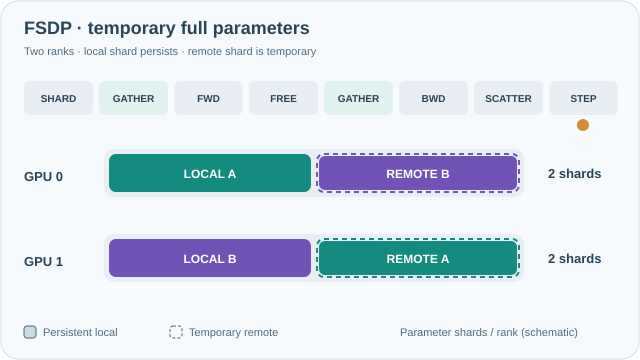

---
tags:
- engineering
- systems
aliases:
- 完全分片資料平行
---

# PyTorch FSDP

Fully Sharded Data Parallel (FSDP) is PyTorch's implementation of ZeRO-style sharding. It wraps modules into sharded units, stores each unit's parameters across the data-parallel devices, gathers them just before use and frees them afterwards, so that a model can be trained with data parallelism while its state is spread across devices.

## Overview

Sharding model state is effective only if it is easy to use. FSDP makes it a framework feature: the user wraps the model, and the library handles gathering parameters, reducing gradients and scheduling communication. Each sharded unit keeps only its own shard of the flattened parameters, so the peak memory is set by the largest unit rather than the whole model.

## Key concepts

- **Sharded unit**: a group of modules whose parameters are flattened and sharded together. Unit boundaries set when parameters are gathered.
- **All-gather**: collects a unit's full parameters on each device just before its forward or backward pass.
- **Reduce-scatter**: sums gradients across devices and leaves each device with the shard it owns.
- **Prefetching**: starting the next unit's all-gather while the current unit computes, so communication overlaps with computation.

## How it works

For each sharded unit, FSDP all-gathers its parameters before the forward pass, computes, and frees the gathered copy. In the backward pass it all-gathers again, computes gradients, and reduce-scatters them so that each device keeps only its gradient shard. The optimizer then updates each device's own shard.

**Interactive timeline on MkDocs:** Play/Pause, step backward/forward, scrub the timeline, or choose 0.5×/1×/2× speed. Motion starts paused, controls are keyboard-accessible, and reduced-motion preferences retain the readable still image. All timings and values are schematic, not measured GPU results.

*Original continuous teaching animation, CC BY-SA 4.0.* Solid A/B blocks are **persistent local parameter shards**; dashed blocks are temporary remote shards materialised by all-gather for this unit. They disappear after resharding, and the second gather precedes backward computation. Moving dots represent parameter transfers and the later reduce-scatter of gradient contributions; the timeline ends with each rank updating **only its own shard**. The diagram illustrates the **full-shard, reshard-after-forward** path for one unit on two ranks, not every FSDP configuration. Transfer speed, timing and memory size are schematic, **not benchmark measurements**. MkDocs adds keyboard-accessible **Play/Pause** and a reduced-motion fallback; on narrow screens, scroll horizontally. [GitHub-readable static overview](../../assets/concept-animations/fsdp-gather-scatter-still.svg).

### Temporary parameter residency across the two gathers

*Original teaching animation, CC BY-SA 4.0.* Solid blocks remain resident; dashed-outline positions are filled **only when all-gather materializes the remote parameter shard**. The per-rank indicator changes from one to two schematic parameter shards during forward and backward computation, returning to one after resharding. This illustrates the **temporary full-parameter residency for one FSDP unit**, not total GPU memory: activations, gradients, optimizer states, prefetch overlap and allocator effects are excluded. The phase durations and shard sizes are **not measurements**. MkDocs provides keyboard Play/Pause and a reduced-motion fallback; narrow screens can scroll horizontally. [GitHub-readable gather-state preview](../../assets/concept-animations/fsdp-parameter-residency-still.svg).

### Interactive parameter residency and reshard policy (MkDocs)

*Original computation probe; GitHub shows the reviewed static fallback above.* On MkDocs, adjust **2–8 ranks**, a **64–512 MiB** parameter unit and **Reshard after forward**. Play, pause, step or seek through shard → forward all-gather → forward → reshard/retain → backward gather/reuse → backward → reduce-scatter; choose 0.5×/1×/2× speed. The two comparison rows show why retaining full parameters between passes avoids the second all-gather but holds more parameter memory. For a 256 MiB unit across four ranks, steady sharded storage is **64 MiB per rank** and full gathered storage is **256 MiB per rank**. These are **analytical parameter-only teaching values**, not GPU measurements; activations, gradients, optimizer state, prefetch overlap and temporary buffers are excluded. Keyboard controls work without a mouse, reduced-motion users can step manually, and the fallback remains visible without JavaScript.

## Key methods

The method is the per-unit gather, compute and free cycle with gradient reduce-scatter. The paper's evidence is measured memory and throughput for large transformer models on many GPUs, and the design trade-offs it documents.

## Results

The paper reports memory and throughput results for training large transformer models with FSDP across many GPUs, and documents how unit boundaries and prefetching affect performance. Exact figures depend on the model and cluster, so readers should check the paper's experiments.

## Limitations

- **Unit boundaries matter**: poorly chosen units either gather too much at once or cause many small, slow communications.
- **Tuning per model**: prefetch and sharding settings need adjustment for each architecture.
- **Communication**: sharded parameters add communication, which must be overlapped to keep throughput.

## Open questions

- How should units be chosen automatically for models with irregular structure?
- How does FSDP interact with tensor and pipeline parallelism in one training job?

## References

### Seminal papers

- Zhao, Y. et al. (2023). *PyTorch FSDP: Experiences on Scaling Fully Sharded Data Parallel*. VLDB 2023. https://arxiv.org/abs/2304.11277 — Documents the design of fully sharded data parallelism in PyTorch and the performance trade-offs of its units and prefetching.

### Related work

- Rajbhandari, S. et al. (2020). *ZeRO: Memory Optimizations Toward Training Trillion Parameter Models*. SC 2020. https://arxiv.org/abs/1910.02054 — The algorithm that FSDP's sharding of parameters, gradients and optimizer state follows.
- Li, S. et al. (2020). *PyTorch Distributed: Experiences on Accelerating Data Parallel Training*. VLDB 2020. https://arxiv.org/abs/2006.15704 — The replicated data-parallel design that FSDP extends with sharding.
- Shoeybi, M. et al. (2019). *Megatron-LM: Training Multi-Billion Parameter Language Models Using Model Parallelism*. https://arxiv.org/abs/1909.08053 — Layer-internal splitting, which FSDP does not do and which can be combined with it.
- Narayanan, D. et al. (2021). *Efficient Large-Scale Language Model Training on GPU Clusters Using Megatron-LM*. SC 2021. https://arxiv.org/abs/2104.04473 — Shows how sharded data parallelism is combined with tensor and pipeline parallelism at cluster scale.
