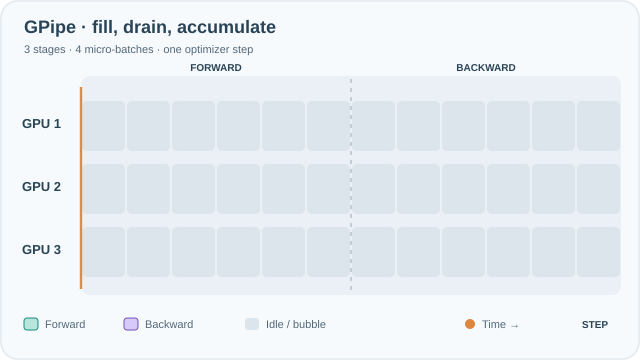
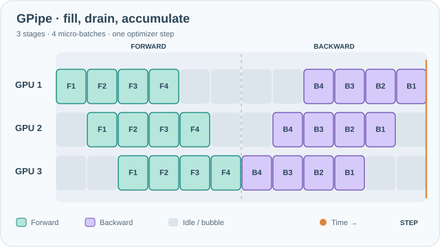
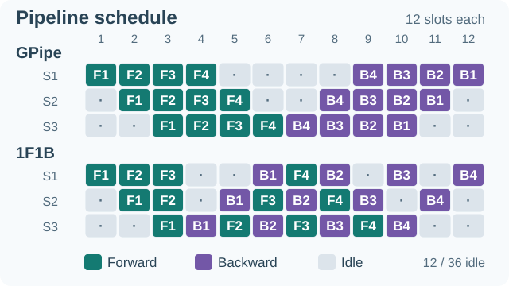
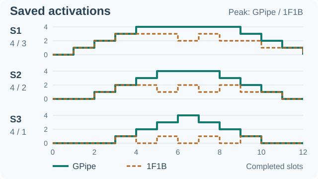

---
tags:
- engineering
- systems
aliases:
- GPipe 管線平行
---

# GPipe: Pipeline Parallelism with Micro-Batches

GPipe splits a network into sequential stages placed on different devices, then divides each mini-batch into micro-batches so that several stages can work at once. The gradients of all micro-batches are accumulated, and the optimizer takes one step per batch, so training keeps the semantics of synchronous SGD.

## Overview

A model too large for one device can be split by layers, with each device holding a contiguous group of layers. Done naively, only one device works at a time. GPipe fills the pipeline by sending micro-batches through the stages in sequence, so each stage processes a different micro-batch while its neighbours process others. The cost is the idle time at the start and end of each step, called the pipeline bubble.

## Key concepts

- **Stage**: a contiguous group of layers placed on one device.
- **Micro-batch**: a slice of the mini-batch that flows through the pipeline as a unit.
- **Bubble**: the fraction of time devices sit idle while the pipeline fills and drains.
- **Activation memory**: each in-flight micro-batch must keep its activations until its backward pass, which limits how many can be in flight.

## How it works

With $K$ stages and $M$ micro-batches, the forward passes are scheduled through the pipeline, then the backward passes run in reverse order. The idle fraction, or bubble, is approximately $\frac{K-1}{M+K-1}$, so more micro-batches make the pipeline more efficient. Gradients from all micro-batches are summed before a single optimizer step.

**Interactive timeline on MkDocs:** Play/Pause, step backward/forward, scrub the timeline, or choose 0.5×/1×/2× speed. Motion starts paused, controls are keyboard-accessible, and reduced-motion preferences retain the readable still image. All timings and values are schematic, not measured GPU results.

*Original continuous teaching animation, CC BY-SA 4.0.* The moving orange playhead reveals completed work; teal F1–F4 cells are forward computations and violet B4–B1 cells are backward computations. The grey cells make fill/drain bubbles visible. This **illustrative, equal-duration** 3-stage/4-micro-batch schedule has 12 idle stage-slots out of 36 (one-third), consistent with the idealised bubble fraction above; it is **not measured GPU utilisation**. Gradients accumulate over all four backward micro-batches before **one** optimizer update. On MkDocs, use **Play/Pause** (keyboard accessible); reduced-motion settings show the static fallback. On narrow screens, scroll horizontally to inspect all time slots. [GitHub-readable static schedule](../../assets/concept-animations/gpipe-fill-drain-still.svg).

### Gradient accumulation before the optimizer step

*Original teaching animation, CC BY-SA 4.0.* Each filled teal dot marks **one completed micro-batch gradient contribution** at that pipeline stage, not a gradient magnitude. GPU 3 starts accumulating B4 first, followed by GPU 2 and GPU 1; each stage receives B4–B1 in backward order. Only after **all four contributions at every stage** does one logical optimizer step update the stage-local parameter partitions. The 13-slot clock and gradient arrival times are **schematic, not measured latency**. The MkDocs player supports keyboard Play/Pause and a reduced-motion still; on mobile, scroll horizontally. [GitHub-readable final-state preview](../../assets/concept-animations/gpipe-gradient-accumulation-still.svg).

### Explore the pipeline bubble

Change the number of stages $K$ and micro-batches $M$, then step through or play the **idealised all-forward/all-backward GPipe schedule**. Each F/B cell is one completed forward/backward micro-batch operation; grey cells are idle. The counter is an operation count, not a gradient magnitude. Under equal stage times the bubble fraction is $(K-1)/(M+K-1)$; more micro-batches reduce this fraction but may increase activation-memory pressure. These slots and percentages are **analytical teaching examples, not measured GPU utilisation**. On a narrow screen, scroll the schedule horizontally.

### Synchronous 1F1B: change the schedule, not the optimizer semantics

Non-interleaved one-forward-one-backward (1F1B, as in PipeDream-Flush) starts backward work earlier than GPipe's all-forward/all-backward schedule. A warm-up of forward passes is followed by alternating forward and backward work on each stage, then a backward drain. Weights remain fixed within the mini-batch and the optimizer updates only after all backward contributions are accumulated.[^pipeline-schedules]

*Original teaching animation, CC BY-SA 4.0.* F/B cells identify a forward/backward computation for the numbered micro-batch; a dot marks a completed idle slot, while blank cells are future slots. The cursor moves continuously and a column becomes visible only when that slot completes. For three stages, four micro-batches, equal-duration forward/backward operations and negligible communication time, both schedules execute 24 operations in 12 wall-clock slots, with 12 idle stage-slots out of 36 (one-third). The fraction is relative to elapsed capacity, not the overhead relative to ideal busy time (12/24). Non-interleaved 1F1B changes when work is done; it does not remove the pipeline bubble in this example. These are schematic timings, not GPU measurements. [GitHub static preview](../../assets/concept-animations/gpipe-1f1b-schedule-still.svg) · [Full animation](../../assets/concept-animations/gpipe-1f1b-schedule-motion.svg).

On MkDocs, use Play/Pause, the previous/next-slot buttons, timeline slider or speed selector to compare both schedules at the same time. The horizontal region is keyboard-focusable on narrow screens. Reduced motion initially shows the completed static schedule.

### Saved activation lifetime

*Original teaching animation, CC BY-SA 4.0.* At the end of each slot, a completed forward saves one activation set for its micro-batch and the matching backward frees it. The solid teal line is GPipe and the dashed orange line is 1F1B. This assumes a fixed-size saved set per micro-batch within each stage and ignores rematerialization, in-operation workspace, communication buffers and allocator overhead; the counts are not measured bytes or total device memory. [GitHub static preview](../../assets/concept-animations/gpipe-activation-liveness-still.svg) · [Full animation](../../assets/concept-animations/gpipe-activation-liveness-motion.svg).

| Stage | GPipe peak saved sets | 1F1B peak saved sets |
|---|---:|---:|
| S1 | 4 | 3 |
| S2 | 4 | 2 |
| S3 | 4 | 1 |

If each stage's saved set occupies $A_s$ bytes, the illustrative per-stage peak is $4A_s$ for GPipe versus $(4-s)A_s$ for 1F1B, with stages numbered $s=1,2,3$. For the standard balanced non-interleaved schedule with $K$ stages and $M$ micro-batches, the corresponding maximum number of outstanding forwards on stage $s$ is $\min(M,K-s+1)$; GPipe retains up to $M$. Actual memory also depends on the implementation of activation checkpointing and the stage's other live tensors. The earlier backward work reduces saved activation residency without changing the number of computations or this idealized bubble.

For a second reading exercise, seek both figures to the end of slot 3: GPipe and 1F1B have each saved $(3,2,1)$ sets across stages. At the end of slot 6, GPipe has $(4,4,4)$ whereas 1F1B has $(2,2,0)$. With equal-size sets across stages, the maximum simultaneous aggregate count over this example is 12 versus 6. This is a sum across devices, not a single-device peak; the sum of independent stage peaks is only an upper bound in general because their peak times may differ. Use the same saved-set and slot-boundary assumptions as the curves.

For unequal stage sizes, read the same curves with weights rather than counting sets. If $A_1,A_2,A_3$ are 2, 4 and 8 MiB, respectively, the simultaneous saved-activation peak is 56 MiB for GPipe (slot 6) versus 22 MiB for 1F1B (slot 3). A second quantity is activation residency over time: summing the weighted counts at boundaries 0 through 11 gives 288 versus 130 MiB·slot, interpreting each boundary count as the saved sets retained until the next boundary. This discrete memory-time proxy is neither a peak allocation nor memory traffic; it does not count reads/writes or model within-slot allocations. All sizes and durations are illustrative.

A third reading exercise connects the schedule cells to the area under each saved-set curve. Let $f_{s,b}$ and $r_{s,b}$ be the completion slots of the forward and backward for micro-batch $b$ at stage $s$. Its saved set is live at boundaries $f_{s,b}$ through $r_{s,b}-1$, for $d_{s,b}=r_{s,b}-f_{s,b}$ slots. Counting the same saved sets either by time or by micro-batch gives $\sum_{t=0}^{11}L_s(t)=\sum_{b=1}^{4}d_{s,b}$ in this example. At S1, GPipe retains the four sets for $(11,9,7,5)$ slots, while 1F1B retains them for $(5,6,7,5)$ slots, respectively. Thus 1F1B reduces the aggregate residency at S1 from 32 to 23 set·slots, but not every micro-batch has a strictly shorter lifetime (B3 and B4 are unchanged). At S2 and S3 the respective totals are $(24,16)$ versus $(13,4)$ set·slots. Multiplying these three totals by the stage sizes reproduces the weighted memory-time exercise above. This identity is for the illustrative boundary-count model, not continuous allocation traces.

On MkDocs, use the keyboard-accessible Play/Pause, previous/next slot, timeline and speed controls for both figures. The initial and reduced-motion fallback is the full still; the final two seconds of playback hold the completed schedule.

## Key methods

The method is the micro-batch pipeline with synchronous gradient accumulation. The paper's evidence is measured throughput as the number of accelerators grows, for very large image models.

## Results

The paper reports close to linear speedup as accelerators are added for the models it evaluates. The bubble formula predicts the overhead, and the paper uses micro-batch counts that keep it small.

## Limitations

- **Bubble overhead**: with few micro-batches, the bubble is large and devices sit idle.
- **Activation memory**: all in-flight micro-batches keep their activations, which later schedules reduce.
- **Stage balance**: uneven stage costs leave the slowest stage as the bottleneck.

## Open questions

- Which schedules, such as interleaved or one-forward-one-backward schedules, reduce the bubble and activation memory best for transformer language models?
- How should stages be balanced when layers have very different costs?

## References

### Seminal papers

- Huang, Y. et al. (2019). *GPipe: Efficient Training of Giant Neural Networks using Pipeline Parallelism*. NeurIPS 2019. https://arxiv.org/abs/1811.06965 — Pipelines micro-batches across model partitions and analyses the resulting bubble overhead.

### Related work

- Narayanan, D. et al. (2021). *Efficient Large-Scale Language Model Training on GPU Clusters Using Megatron-LM*. SC 2021. https://arxiv.org/abs/2104.04473 — Combines pipeline parallelism with tensor and data parallelism for transformer models.
- Shoeybi, M. et al. (2019). *Megatron-LM: Training Multi-Billion Parameter Language Models Using Model Parallelism*. https://arxiv.org/abs/1909.08053 — The layer-internal split that pipeline parallelism complements.
- Rajbhandari, S. et al. (2020). *ZeRO: Memory Optimizations Toward Training Trillion Parameter Models*. SC 2020. https://arxiv.org/abs/1910.02054 — Reduces model-state memory on each stage, a different route to fitting large models.
- Li, S. et al. (2020). *PyTorch Distributed: Experiences on Accelerating Data Parallel Training*. VLDB 2020. https://arxiv.org/abs/2006.15704 — Describes the data-parallel communication that pipelines are often combined with.

[^pipeline-schedules]: Narayanan et al. (2021), *Efficient Large-Scale Language Model Training on GPU Clusters Using Megatron-LM*. https://arxiv.org/abs/2104.04473 — Section 2.2.1 contrasts GPipe with the non-interleaved PipeDream-Flush schedule and analyzes activation residency and pipeline bubbles.
