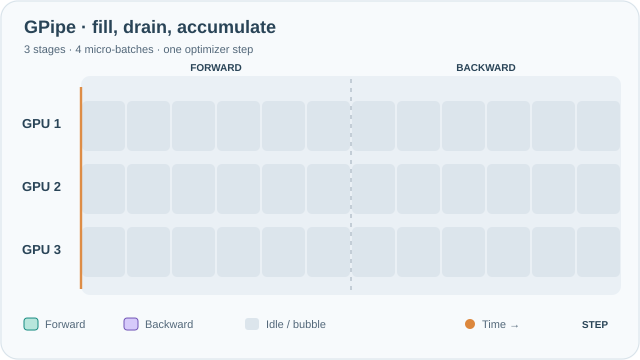

# GPipe：以微批次進行管線平行

GPipe 把網路切成依序執行的階段，分別放在不同裝置上，再把每個小批次切成微批次，使多個階段能同時工作。所有微批次的梯度會被累積，每個批次只做一次最佳化步驟，因此訓練保留了同步 SGD 的語意。

## 概述

模型太大、單一裝置放不下時，可以依層切分，每個裝置負責一段連續的層。若直接這樣做，一次只有一個裝置在工作。GPipe 讓微批次依序流經各階段，使每個階段在處理一個微批次時，相鄰階段正在處理其他微批次，以此填滿管線。代價是每個步驟開始與結束時的閒置時間，稱為管線泡沫（pipeline bubble）。

## 關鍵概念

- **階段（stage）**：放在同一個裝置上的一段連續層。
- **微批次（micro-batch）**：小批次的一部分，以一個單位流經管線。
- **泡沫（bubble）**：管線填充與排空時，裝置閒置的時間比例。
- **激活記憶體（activation memory）**：每個飛行中的微批次都必須保留其激活值，直到反向傳播為止，這限制了同時在飛行中的微批次數量。

## 運作方式

設有 $K$ 個階段與 $M$ 個微批次。前向傳播依序通過管線，之後反向傳播以相反順序執行。閒置比例，也就是泡沫，約為 $\frac{K-1}{M+K-1}$，因此微批次越多，管線效率越高。所有微批次的梯度會先加總，再做一次最佳化步驟。

*原創連續教學動畫，CC BY-SA 4.0。* 橘色時間指標逐步揭露已完成的運算；青綠色 F1–F4 是前向計算，紫色 B4–B1 是反向計算，灰格表示管線填充與排空期間的閒置。這是**各階段耗時相同的示意排程**：3 個階段、4 個微批次共有 36 個階段時槽，其中 12 個閒置（約三分之一），符合上方理想化泡沫公式，**不是 GPU 實測利用率**。所有反向微批次的梯度累積完畢後，才進行**一次**最佳化器更新。MkDocs 可用鍵盤操作「播放／暫停」，減少動態效果設定會顯示靜態回退圖；手機可左右捲動查看完整時間軸。[GitHub 可讀的靜態排程](../../assets/concept-animations/gpipe-fill-drain-still.svg)。

### 梯度累積與最佳化器更新時機

*原創教學動畫，CC BY-SA 4.0。* 每個填滿的青綠色圓點代表該階段**已完成一個微批次的梯度貢獻**，不是梯度大小。GPU 3 最先累積 B4，接著才輪到 GPU 2、GPU 1；各階段依 B4 到 B1 的反向順序完成四次累積。**所有階段都完成四個梯度貢獻後**，才進行一次邏輯上的最佳化器步驟，各階段分別更新自己持有的參數。13 格時間軸及梯度抵達時刻均為**教學示意，非實測延遲**。MkDocs 提供鍵盤可操作的播放／暫停及減少動態效果回退；手機可左右捲動。[GitHub 可讀的最終狀態預覽](../../assets/concept-animations/gpipe-gradient-accumulation-still.svg)。

## 關鍵方法

這個方法是微批次管線搭配同步的梯度累積。論文的證據是：隨著加速器數量增加，所量測到的吞吐量變化，對象是非常大型的影像模型。

## 結果

論文指出，對其評估的模型，加入加速器後的加速幾乎呈線性。泡沫公式可以預測額外開銷，論文所用的微批次數量也能讓泡沫維持在較小的範圍。

## 限制

- **泡沫開銷**：微批次數量少時，泡沫很大，裝置會閒置。
- **激活記憶體**：所有飛行中的微批次都要保留激活值，後續的排程方式能減少這部分記憶體。
- **階段平衡**：各階段成本不均時，最慢的階段會成為瓶頸。

## 開放問題

- 哪一種排程（例如交錯式或一前一後式排程）能最有效地減少 Transformer 語言模型的泡沫與激活記憶體？
- 當各層的成本差異很大時，應如何平衡各階段？

## 參考文獻

### 重要論文

- Huang, Y. et al. (2019). *GPipe: Efficient Training of Giant Neural Networks using Pipeline Parallelism*. NeurIPS 2019. https://arxiv.org/abs/1811.06965 — 把微批次在模型分割之間做管線化，並分析由此產生的泡沫開銷。

### 相關工作

- Narayanan, D. et al. (2021). *Efficient Large-Scale Language Model Training on GPU Clusters Using Megatron-LM*. SC 2021. https://arxiv.org/abs/2104.04473 — 把管線平行與張量平行、資料平行結合，用於 Transformer 模型。
- Shoeybi, M. et al. (2019). *Megatron-LM: Training Multi-Billion Parameter Language Models Using Model Parallelism*. https://arxiv.org/abs/1909.08053 — 管線平行所補足的層內切分方式。
- Rajbhandari, S. et al. (2020). *ZeRO: Memory Optimizations Toward Training Trillion Parameter Models*. SC 2020. https://arxiv.org/abs/1910.02054 — 降低每個階段上的模型狀態記憶體，是讓大型模型放得進去的另一條路。
- Li, S. et al. (2020). *PyTorch Distributed: Experiences on Accelerating Data Parallel Training*. VLDB 2020. https://arxiv.org/abs/2006.15704 — 描述管線常與之搭配的資料平行通訊。
