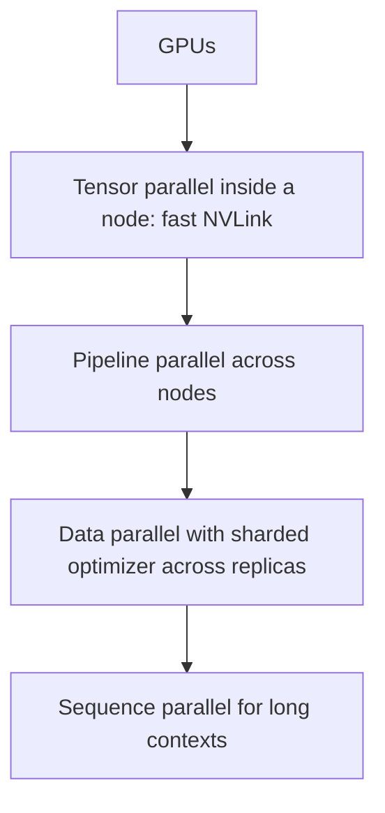

---
related:
- theory/models/transformer
tags:
- engineering
- systems
aliases:
- 分散式訓練
---

# Distributed Training

Distributed training spreads the work of training one model across many accelerators. It is needed when a model's weights, gradients and optimizer state do not fit on one device, or when training would take too long on one device. The engineering problem is to split computation and memory while keeping communication between devices from dominating run time.

## Overview

Training a large model needs three kinds of memory on every device: the weights, the gradients, and the optimizer state. With mixed-precision Adam, the state alone costs about 16 bytes per parameter, so a model with a few billion parameters can exceed the memory of one accelerator before any activations are stored. Distributed training answers this in two ways: replicate the model and split the data, or split the model itself.

## Key concepts

- **Data parallelism (DP)**: every device holds a full copy of the model and processes a different slice of each batch. Gradients are averaged with an all-reduce before each update.
- **Tensor parallelism (TP)**: individual matrix multiplications are split across devices, so each holds part of every layer. It needs fast links between devices, usually inside one node.
- **Pipeline parallelism (PP)**: consecutive groups of layers live on different devices, and micro-batches flow through them like an assembly line. The idle time at the start and end of each step is the *pipeline bubble*.
- **Sequence and context parallelism**: long sequences are split along the token dimension, so attention and activations fit in memory.
- **Expert parallelism**: in mixture-of-experts models, different experts live on different devices and tokens are routed to them, so the all-to-all exchange of tokens becomes the main communication cost.
- **Sharding (ZeRO, FSDP)**: data parallelism in which optimizer state, gradients or parameters are partitioned across the data-parallel group, and gathered only when needed.
- **Collective communication**: all-reduce, all-gather and reduce-scatter. For a ring all-reduce of $S$ bytes across $N$ devices, each device sends about $2\frac{N-1}{N}S$ bytes, so the cost is nearly independent of $N$ but depends strongly on bandwidth.

## How it works

Memory and communication decide the strategy. A common recipe in large runs is to combine them:

The inner dimensions need the most bandwidth, so they stay within a node. Outer dimensions, which exchange less data, can cross slower networks. The right mix depends on model size, sequence length and interconnect; the bandwidth limits behind this are covered in [AI Hardware](../hardware/index.md).

## Key methods

Each named method has its own page, covering the problem it solves, its core idea, the algorithm, the reported results and its limitations. The table compares them.

| Method | Problem it solves | Core idea | Main trade-off | Page |
|---|---|---|---|---|
| Megatron-LM tensor parallelism | A layer's weights do not fit on one device | Split each block by columns then rows, with one all-reduce | Needs fast intra-node links | [Megatron-LM Tensor Parallelism](megatron-tensor-parallelism.md) |
| ZeRO | Data parallelism replicates all model state | Partition optimizer state, gradients, then parameters in three stages | Stage 3 adds all-gather traffic | [ZeRO](zero.md) |
| GPipe | A model too large for one device leaves stages idle | Split layers into stages and pipeline micro-batches | Bubble of $\frac{K-1}{M+K-1}$ and activation memory | [GPipe](gpipe.md) |
| PyTorch FSDP | Sharding must be practical inside a framework | Gather each unit's parameters, compute, free, and reduce-scatter gradients | Unit boundaries and prefetching need tuning | [PyTorch FSDP](fsdp.md) |

## Connections

- Optimizer and learning-rate choices in large batches are covered in [Training & Fine-tuning](../training/index.md).
- Interconnects and memory bandwidth set what communication pattern is affordable: see [AI Hardware](../hardware/index.md).
- Serving a sharded model follows different constraints, covered in [Inference optimization](../inference-optimization/index.md).
- Mixture-of-experts layers add expert parallelism to the mix, so they connect this page to the architecture material under [Transformer](../../theory/models/transformer/index.md).

## Applications

- **Pre-training frontier language models**: combinations of tensor, pipeline and data parallelism across thousands of accelerators.
- **Fine-tuning models that do not fit on one GPU**: sharded data parallelism with FSDP or DeepSpeed ZeRO is the usual route.
- **Vision and multimodal training**: data parallelism with gradient all-reduce is often enough when the model fits on one device.

## Open questions

- **Communication versus compute**: overlapping communication with computation works well on fast networks, but not always on slow ones.
- **Fault tolerance**: long runs across thousands of devices fail often, so checkpointing and restart strategy matter as much as speed.
- **Load balance**: pipeline stages and expert routing can be uneven, which wastes devices.
- **More variants**: sequence-parallel attention schemes, asynchronous updates and automatic parallelism planners each trade simplicity against efficiency.

## References

### Seminal papers

- Shoeybi, M. et al. (2019). *Megatron-LM: Training Multi-Billion Parameter Language Models Using Model Parallelism*. https://arxiv.org/abs/1909.08053 — Introduces intra-layer tensor parallelism for transformers that needs one all-reduce per block.
- Rajbhandari, S. et al. (2020). *ZeRO: Memory Optimizations Toward Training Trillion Parameter Models*. SC 2020. https://arxiv.org/abs/1910.02054 — Partitions optimizer state, gradients and parameters across data-parallel devices to cut per-device memory.
- Huang, Y. et al. (2019). *GPipe: Efficient Training of Giant Neural Networks using Pipeline Parallelism*. NeurIPS 2019. https://arxiv.org/abs/1811.06965 — Pipelines micro-batches across model partitions and analyses the resulting bubble overhead.
- Li, S. et al. (2020). *PyTorch Distributed: Experiences on Accelerating Data Parallel Training*. VLDB 2020. https://arxiv.org/abs/2006.15704 — Describes the design of PyTorch's data-parallel training, including gradient bucketing that overlaps communication with computation.
- Zhao, Y. et al. (2023). *PyTorch FSDP: Experiences on Scaling Fully Sharded Data Parallel*. VLDB 2023. https://arxiv.org/abs/2304.11277 — Documents the design of fully sharded data parallelism inside PyTorch and its performance trade-offs.

### Surveys and systems papers

- Narayanan, D. et al. (2021). *Efficient Large-Scale Language Model Training on GPU Clusters Using Megatron-LM*. SC 2021. https://arxiv.org/abs/2104.04473 — Combines tensor, pipeline and data parallelism and studies how to map them onto GPU clusters.
