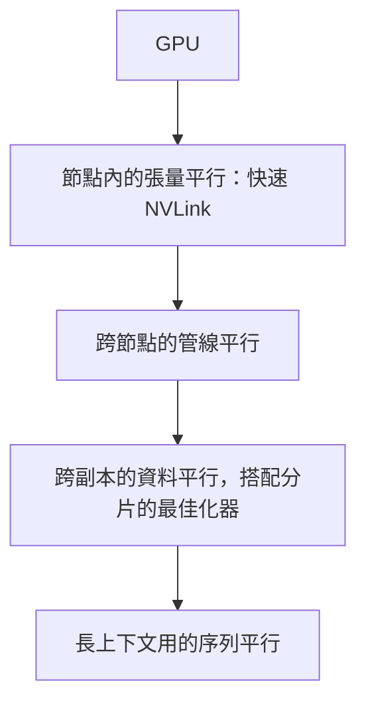

# 分散式訓練

分散式訓練把同一個模型的訓練工作分散到多個加速器上。當模型的權重、梯度與最佳化器狀態在單一裝置上放不下，或單一裝置訓練時間太長時，就需要它。工程上的問題是切分計算與記憶體，同時讓裝置之間的通訊不主導執行時間。

## 概述

訓練大型模型時，每個裝置都需要三類記憶體：權重、梯度與最佳化器狀態。以混合精度的 Adam 為例，光是最佳化器狀態就約需每個參數 16 位元組，因此數十億參數的模型在儲存激活值之前，就可能超過單一加速器的記憶體。分散式訓練有兩種應對方式：複製模型、切分資料；或切分模型本身。

## 關鍵概念

- **資料平行（DP）**：每個裝置持有完整模型副本，處理每個批次中不同的一部分。每次更新前，會以 all-reduce 平均梯度。
- **張量平行（TP）**：把個別的矩陣乘法切分到多個裝置上，每個裝置持有每一層的一部分。它需要裝置之間有快速連線，通常限於單一節點內。
- **管線平行（PP）**：相鄰的層群組放在不同裝置上，微批次像流水線一樣依序通過。每個步驟開頭與結尾的閒置時間稱為*管線泡沫（pipeline bubble）*。
- **序列與上下文平行**：長序列沿 token 維度切分，讓注意力與激活值能放進記憶體。
- **專家平行**：在混合專家模型中，不同專家位於不同裝置，token 被路由到對應的專家。因此 token 的 all-to-all 交換成為主要通訊成本。
- **分片（ZeRO、FSDP）**：一種資料平行，把最佳化器狀態、梯度或參數分割到資料平行群組中，只在需要時才收集回來。
- **集體通訊**：all-reduce、all-gather 與 reduce-scatter。對 $S$ 位元組的環狀 all-reduce 而言，跨 $N$ 個裝置時，每個裝置約傳送 $2\frac{N-1}{N}S$ 位元組，因此成本幾乎與 $N$ 無關，但強烈依賴頻寬。

## 運作方式

記憶體與通訊決定策略。大型訓練常見的做法是把它們組合起來：

內層維度需要最多頻寬，因此留在節點內。外層維度交換的資料較少，可以跨越較慢的網路。正確的組合取決於模型大小、序列長度與互連方式；背後的頻寬限制見 [AI 硬體](../hardware/index.zh-TW.md)。

## 關鍵方法

### Megatron-LM 張量平行（Shoeybi et al., 2019）

- **問題**：單一 Transformer 層的權重矩陣放不進一張 GPU，而單靠資料平行無法降低每個裝置的記憶體。
- **核心想法**：把每個 MLP 區塊的第一個權重矩陣按列切分，第二個按行切分，使兩半結果只需一次 all-reduce 即可合併。注意力則以頭為單位做同樣的切分。
- **方程式或演算法**：對 $Y = \mathrm{GeLU}(XA)$，若 $A = [A_1, A_2]$ 按列切分，每個裝置各自計算 $\mathrm{GeLU}(XA_i)$；下一個矩陣按行切分，使部分結果只需一次歸約即可相加。
- **結果**：論文指出，在數百顆 GPU 上訓練數十億參數的語言模型，該規模下的擴展效率仍接近線性。
- **限制**：這種通訊模式假設節點內連線很快；跨慢速網路做張量平行成本很高。

### ZeRO：分割最佳化器狀態、梯度與參數（Rajbhandari et al., 2020）

- **問題**：資料平行會在每個裝置上複製全部模型狀態，因此增加裝置時，每個裝置的記憶體並不會減少。
- **核心想法**：把狀態分割到資料平行群組中，分三個階段。第一階段分片最佳化器狀態，第二階段也分片梯度，第三階段再分片參數，參數在需要時逐層收集。
- **方程式或演算法**：以 $\Psi$ 表示參數量、$N_d$ 表示資料平行裝置數，並假設混合精度 Adam 每個參數約有 $K = 12$ 位元組的最佳化器狀態。論文給出的每裝置記憶體為：第一階段 $(4 + \tfrac{12}{N_d})\Psi$ 位元組，第二階段 $(2 + \tfrac{14}{N_d})\Psi$，第三階段 $\tfrac{16}{N_d}\Psi$。
- **結果**：論文指出，在大型叢集上訓練了超過千億參數的模型，記憶體降低幅度隨裝置數量增加而擴大。
- **限制**：第三階段在前向與反向傳播中都要增加 all-gather 通訊，因此記憶體降低的同時，通訊成本會上升。

### GPipe：以微批次進行管線平行（Huang et al., 2019）

- **問題**：太大的模型無法放進單一裝置，而單一批次又會讓其他階段在一個階段工作時閒置。
- **核心想法**：把網路切成 $K$ 個依序執行的階段，分配到 $K$ 個裝置上；每個小批次再切成 $M$ 個微批次，使多個階段能同時工作。梯度會累積，並在每個批次結束時只做一次最佳化步驟，保留同步 SGD 的訓練語意。
- **方程式或演算法**：閒置比例，即泡沫，約為 $\frac{K-1}{M+K-1}$，因此微批次越多，管線效率越高。
- **結果**：論文指出，在非常大型的影像模型上，加速器越多，加速幾乎呈線性，這也是它的評估情境。
- **限制**：$M$ 小時泡沫會變大；此外，每個飛行中的微批次都必須保存激活值，這促成了 1F1B 等後續排程。

### PyTorch FSDP（Zhao et al., 2023）

- **問題**：如 ZeRO 的資料平行分片，必須能在主流深度學習框架中實用，且對使用者程式碼的改動要很少。
- **核心想法**：把每個模組包成分片單元，將其展平的參數分散在各裝置上，在使用前 all-gather，用完後釋放。預先取得（prefetch）可讓 all-gather 與計算重疊。
- **方程式或演算法**：每個分片單元在前向傳播時對參數做一次 all-gather，反向傳播時再做一次，並對梯度做 reduce-scatter。
- **結果**：論文報告了在多顆 GPU 上訓練大型 Transformer 模型的記憶體與吞吐量結果，並說明影響效能的設計取捨。
- **限制**：分片單元的邊界與預先取得設定會強烈影響吞吐量，每個模型都需要調校。

## 相關連結

- 大批次下的最佳化器與學習率選擇，見[訓練與微調](../training/index.zh-TW.md)。
- 互連與記憶體頻寬決定了哪些通訊模式負擔得起，見 [AI 硬體](../hardware/index.zh-TW.md)。
- 部署分片模型受到不同的限制，見[推論最佳化](../inference-optimization/index.zh-TW.md)。
- 混合專家層會把專家平行加進來，因此本頁也連到 [Transformer](../../theory/models/transformer/index.zh-TW.md) 下的架構內容。

## 應用

- **預訓練前沿語言模型**：在數千顆加速器上組合張量、管線與資料平行。
- **微調單一 GPU 放不下的模型**：使用 FSDP 或 DeepSpeed ZeRO 的分片資料平行是常見做法。
- **視覺與多模態訓練**：當模型能放進單一裝置時，帶有梯度 all-reduce 的資料平行通常就夠用。

## 開放問題

- **通訊與計算的取捨**：在快速網路上，通訊與計算重疊效果很好；在慢速網路上則不一定。
- **容錯**：跨數千顆裝置的長時間訓練經常失敗，因此檢查點與重啟策略和速度同樣重要。
- **負載平衡**：管線階段與專家路由可能不均，造成裝置閒置。
- **更多變體**：序列平行的注意力方案、非同步更新與自動平行規劃器，各自在簡單性與效率之間取捨。

## 參考文獻

### 奠基性論文

- Shoeybi, M. et al. (2019). *Megatron-LM: Training Multi-Billion Parameter Language Models Using Model Parallelism*. https://arxiv.org/abs/1909.08053 — 提出 Transformer 的層內張量平行，每個區塊只需一次 all-reduce。
- Rajbhandari, S. et al. (2020). *ZeRO: Memory Optimizations Toward Training Trillion Parameter Models*. SC 2020. https://arxiv.org/abs/1910.02054 — 把最佳化器狀態、梯度與參數分割到資料平行裝置上，以降低每個裝置的記憶體。
- Huang, Y. et al. (2019). *GPipe: Efficient Training of Giant Neural Networks using Pipeline Parallelism*. NeurIPS 2019. https://arxiv.org/abs/1811.06965 — 把微批次管線化穿過模型分割區，並分析由此產生的泡沫開銷。
- Li, S. et al. (2020). *PyTorch Distributed: Experiences on Accelerating Data Parallel Training*. VLDB 2020. https://arxiv.org/abs/2006.15704 — 說明 PyTorch 資料平行訓練的設計，包括以梯度分桶讓通訊與計算重疊。
- Zhao, Y. et al. (2023). *PyTorch FSDP: Experiences on Scaling Fully Sharded Data Parallel*. VLDB 2023. https://arxiv.org/abs/2304.11277 — 記錄完全分片資料平行在 PyTorch 中的設計與效能取捨。

### 綜述與系統論文

- Narayanan, D. et al. (2021). *Efficient Large-Scale Language Model Training on GPU Clusters Using Megatron-LM*. SC 2021. https://arxiv.org/abs/2104.04473 — 結合張量、管線與資料平行，並研究如何把它們映射到 GPU 叢集上。
