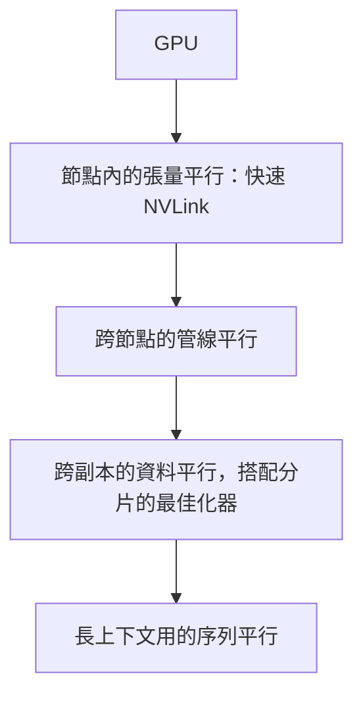

# 分散式訓練

分散式訓練把同一個模型的訓練工作分散到多個加速器上。當模型的權重、梯度與最佳化器狀態在單一裝置上放不下，或單一裝置訓練時間太長時，就需要它。工程上的問題是切分計算與記憶體，同時讓裝置之間的通訊不主導執行時間。

## 概述

訓練大型模型時，每個裝置都需要三類記憶體：權重、梯度與最佳化器狀態。以混合精度的 Adam 為例，光是最佳化器狀態就約需每個參數 16 位元組，因此數十億參數的模型在儲存激活值之前，就可能超過單一加速器的記憶體。分散式訓練有兩種應對方式：複製模型、切分資料；或切分模型本身。

## 關鍵概念

- **資料平行（DP）**：每個裝置持有完整模型副本，處理每個批次中不同的一部分。每次更新前，會以 all-reduce 平均梯度。
- **張量平行（TP）**：把個別的矩陣乘法切分到多個裝置上，每個裝置持有每一層的一部分。它需要裝置之間有快速連線，通常限於單一節點內。
- **管線平行（PP）**：相鄰的層群組放在不同裝置上，微批次像流水線一樣依序通過。每個步驟開頭與結尾的閒置時間稱為*管線泡沫（pipeline bubble）*。
- **序列與上下文平行**：長序列沿 token 維度切分，讓注意力與激活值能放進記憶體。
- **專家平行**：在混合專家模型中，不同專家位於不同裝置，token 被路由到對應的專家。因此 token 的 all-to-all 交換成為主要通訊成本。
- **分片（ZeRO、FSDP）**：一種資料平行，把最佳化器狀態、梯度或參數分割到資料平行群組中，只在需要時才收集回來。
- **集體通訊**：all-reduce、all-gather 與 reduce-scatter。對 $S$ 位元組的環狀 all-reduce 而言，跨 $N$ 個裝置時，每個裝置約傳送 $2\frac{N-1}{N}S$ 位元組，因此成本幾乎與 $N$ 無關，但強烈依賴頻寬。

## 運作方式

記憶體與通訊決定策略。大型訓練常見的做法是把它們組合起來：

內層維度需要最多頻寬，因此留在節點內。外層維度交換的資料較少，可以跨越較慢的網路。正確的組合取決於模型大小、序列長度與互連方式；背後的頻寬限制見 [AI 硬體](../hardware/index.zh-TW.md)。

## 關鍵方法

每個具名方法都有自己的頁面，內容包括它要解決的問題、核心想法、演算法、報告的結果與限制。下表是它們的比較。

| 方法 | 要解決的問題 | 核心想法 | 主要取捨 | 頁面 |
|---|---|---|---|---|
| Megatron-LM 張量平行 | 單一層的權重放不進一張裝置 | 每個區塊先按列、再按行切分，只需一次 all-reduce | 需要節點內的快速連線 | [Megatron-LM 張量平行](megatron-tensor-parallelism.zh-TW.md) |
| ZeRO | 資料平行會複製全部模型狀態 | 分三個階段分割最佳化器狀態、梯度，最後是參數 | 第三階段增加 all-gather 流量 | [ZeRO](zero.zh-TW.md) |
| GPipe | 模型太大放不進單一裝置，各階段會閒置 | 把層切成階段，並對微批次做管線化 | 泡沫為 $\frac{K-1}{M+K-1}$，且需要激活記憶體 | [GPipe 管線平行](gpipe.zh-TW.md) |
| PyTorch FSDP | 分片必須能在框架中實用 | 收集每個單元的參數、計算、釋放，並對梯度做 reduce-scatter | 分片單元邊界與預先取得需要調校 | [PyTorch FSDP](fsdp.zh-TW.md) |

## 相關連結

- 大批次下的最佳化器與學習率選擇，見[訓練與微調](../training/index.zh-TW.md)。
- 互連與記憶體頻寬決定了哪些通訊模式負擔得起，見 [AI 硬體](../hardware/index.zh-TW.md)。
- 部署分片模型受到不同的限制，見[推論最佳化](../inference-optimization/index.zh-TW.md)。
- 混合專家層會把專家平行加進來，因此本頁也連到 [Transformer](../../theory/models/transformer/index.zh-TW.md) 下的架構內容。

## 應用

- **預訓練前沿語言模型**：在數千顆加速器上組合張量、管線與資料平行。
- **微調單一 GPU 放不下的模型**：使用 FSDP 或 DeepSpeed ZeRO 的分片資料平行是常見做法。
- **視覺與多模態訓練**：當模型能放進單一裝置時，帶有梯度 all-reduce 的資料平行通常就夠用。

## 開放問題

- **通訊與計算的取捨**：在快速網路上，通訊與計算重疊效果很好；在慢速網路上則不一定。
- **容錯**：跨數千顆裝置的長時間訓練經常失敗，因此檢查點與重啟策略和速度同樣重要。
- **負載平衡**：管線階段與專家路由可能不均，造成裝置閒置。
- **更多變體**：序列平行的注意力方案、非同步更新與自動平行規劃器，各自在簡單性與效率之間取捨。

## 參考文獻

### 奠基性論文

- Shoeybi, M. et al. (2019). *Megatron-LM: Training Multi-Billion Parameter Language Models Using Model Parallelism*. https://arxiv.org/abs/1909.08053 — 提出 Transformer 的層內張量平行，每個區塊只需一次 all-reduce。
- Rajbhandari, S. et al. (2020). *ZeRO: Memory Optimizations Toward Training Trillion Parameter Models*. SC 2020. https://arxiv.org/abs/1910.02054 — 把最佳化器狀態、梯度與參數分割到資料平行裝置上，以降低每個裝置的記憶體。
- Huang, Y. et al. (2019). *GPipe: Efficient Training of Giant Neural Networks using Pipeline Parallelism*. NeurIPS 2019. https://arxiv.org/abs/1811.06965 — 把微批次管線化穿過模型分割區，並分析由此產生的泡沫開銷。
- Li, S. et al. (2020). *PyTorch Distributed: Experiences on Accelerating Data Parallel Training*. VLDB 2020. https://arxiv.org/abs/2006.15704 — 說明 PyTorch 資料平行訓練的設計，包括以梯度分桶讓通訊與計算重疊。
- Zhao, Y. et al. (2023). *PyTorch FSDP: Experiences on Scaling Fully Sharded Data Parallel*. VLDB 2023. https://arxiv.org/abs/2304.11277 — 記錄完全分片資料平行在 PyTorch 中的設計與效能取捨。

### 綜述與系統論文

- Narayanan, D. et al. (2021). *Efficient Large-Scale Language Model Training on GPU Clusters Using Megatron-LM*. SC 2021. https://arxiv.org/abs/2104.04473 — 結合張量、管線與資料平行，並研究如何把它們映射到 GPU 叢集上。
