---
tags:
- engineering
- systems
aliases:
- Megatron 張量平行
---

# Megatron-LM Tensor Parallelism

Megatron-LM tensor parallelism splits the weight matrices inside each transformer layer across several devices, so that a single layer can be trained when its weights do not fit on one device. The split is arranged so that each block needs only a single all-reduce, which keeps communication small enough to run inside a node.

## Overview

Data parallelism replicates the whole model, so it does not reduce the memory needed for one layer. Tensor parallelism attacks that problem directly: each device holds a slice of every large matrix. The challenge is to choose the slicing so that the partial results can be combined with few communication steps. Megatron-LM's answer is to split the first matrix of each MLP by columns and the second by rows, and to split attention by heads.

## Key concepts

- **Column-parallel linear layer**: the weight is split by columns, so each device computes a different slice of the output with no communication in the forward pass.
- **Row-parallel linear layer**: the weight is split by rows, so each device produces a partial sum that must be added across devices.
- **Head-parallel attention**: each device handles a subset of attention heads, which are independent of one another.
- **Intra-node placement**: tensor parallelism communicates at every layer, so its devices are placed on the fastest links, usually within one node.

## How it works

For an MLP block computing $Y = \mathrm{GeLU}(XA)$ followed by a second matrix $B$, the first matrix is split as $A = [A_1, A_2]$ by columns. Each device computes $\mathrm{GeLU}(XA_i)$ on its own. The second matrix is split by rows as $B = [B_1; B_2]$, so each device computes a partial product, and a single all-reduce sums the results. Attention follows the same pattern, with the heads divided across devices and the output projection split by rows.

*Original continuous teaching animation, CC BY-SA 4.0.* Both GPUs receive the same input **X**. The first projection's **column partitions A1/A2** produce separate hidden slices; GeLU is applied **locally** before the second projection's **row partitions B1/B2** produce partial outputs **p1/p2**. Violet signals then meet at **one all-reduce**, after which both ranks have **Y = p1 + p2**. There is no forward collective between the first projection and local GeLU. The animation depicts a schematic two-way MLP split, **not measured communication latency or model outputs**; it omits backward collectives and biases. On MkDocs, use keyboard-accessible **Play/Pause**; reduced-motion settings show the completed computation. On narrow screens, scroll horizontally. [GitHub-readable completed-path preview](../../assets/concept-animations/megatron-column-row-still.svg).

## Key methods

The method is the column-then-row split of each block with a single all-reduce. The paper's evidence is that this scheme trains models with billions of parameters across many GPUs without an unacceptable loss in efficiency.

## Results

The paper reports training multi-billion-parameter language models on hundreds of GPUs, with efficiency that stays high for that model size. Exact numbers depend on the hardware and model configuration, so readers should check the paper's scaling tables.

## Limitations

- **Intra-node focus**: communication happens at every layer, so tensor parallelism across slow inter-node links is costly.
- **Model-specific code**: the split must be written into each layer type, which requires changes to model code.
- **Pipeline and data parallelism are still needed**: tensor parallelism alone does not scale to the largest clusters.

## Open questions

- How should tensor, pipeline and data parallelism be combined as interconnects get faster or slower?
- Can sequence and context parallelism reduce the activation memory that tensor parallelism leaves unchanged?

## References

### Seminal papers

- Shoeybi, M. et al. (2019). *Megatron-LM: Training Multi-Billion Parameter Language Models Using Model Parallelism*. https://arxiv.org/abs/1909.08053 — Introduces the column-then-row split of transformer blocks that needs one all-reduce per block.

### Related work

- Narayanan, D. et al. (2021). *Efficient Large-Scale Language Model Training on GPU Clusters Using Megatron-LM*. SC 2021. https://arxiv.org/abs/2104.04473 — Combines tensor, pipeline and data parallelism and studies how to map them onto GPU clusters.
- Rajbhandari, S. et al. (2020). *ZeRO: Memory Optimizations Toward Training Trillion Parameter Models*. SC 2020. https://arxiv.org/abs/1910.02054 — Reduces the memory that tensor parallelism does not split, by partitioning optimizer state across data-parallel devices.
- Huang, Y. et al. (2019). *GPipe: Efficient Training of Giant Neural Networks using Pipeline Parallelism*. NeurIPS 2019. https://arxiv.org/abs/1811.06965 — The complementary strategy of splitting layers across devices rather than splitting each layer.
- Zhao, Y. et al. (2023). *PyTorch FSDP: Experiences on Scaling Fully Sharded Data Parallel*. VLDB 2023. https://arxiv.org/abs/2304.11277 — A framework-level alternative for sharding parameters across data-parallel devices.
