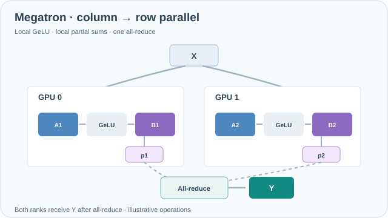

# Megatron-LM 張量平行

Megatron-LM 的張量平行會把每個 Transformer 層內的權重矩陣切分到多個裝置上，使單一層即使權重放不進一張裝置，仍能訓練。切分方式經過安排，每個區塊只需要一次 all-reduce，通訊量小到可以在節點內執行。

## 概述

資料平行會複製整個模型，因此無法減少單一層所需的記憶體。張量平行直接處理這個問題：每個裝置持有每個大型矩陣的一部分。挑戰在於選擇切分方式，使部分結果能用很少的通訊步驟合併。Megatron-LM 的做法是：MLP 的第一個矩陣按列切分，第二個按行切分，注意力則按頭切分。

## 關鍵概念

- **列平行線性層（column-parallel linear）**：權重按列切分，每個裝置計算輸出的不同片段，前向傳播不需要通訊。
- **行平行線性層（row-parallel linear）**：權重按行切分，每個裝置得到一個部分和，必須跨裝置相加。
- **頭平行注意力（head-parallel attention）**：每個裝置處理一部分注意力頭，各頭彼此獨立。
- **節點內配置（intra-node placement）**：張量平行每一層都要通訊，因此裝置通常放在最快的連線上，也就是同一個節點內。

## 運作方式

對於計算 $Y = \mathrm{GeLU}(XA)$ 的 MLP 區塊，接著乘上第二個矩陣 $B$：第一個矩陣按列切成 $A = [A_1, A_2]$。每個裝置各自計算 $\mathrm{GeLU}(XA_i)$。第二個矩陣按行切成 $B = [B_1; B_2]$，因此每個裝置算出部分乘積，再由一次 all-reduce 加總結果。注意力遵循同樣的模式：頭分散到各裝置，輸出投影則按行切分。

**MkDocs 互動時間軸：** 這組分散式訓練動畫現在可用「播放／暫停」、「上一步／下一步」、時間軸拖曳及 0.5×／1×／2× 速度操作。動畫預設暫停，支援鍵盤；偏好減少動態效果時會保留可閱讀的靜態回退圖。圖中時間與數值均為教學示意，並非實際 GPU 量測。

*原創連續教學動畫，CC BY-SA 4.0。* 兩個 GPU 都收到相同輸入 **X**。第一個投影矩陣的**列分片 A1/A2** 產生不同的隱藏特徵切片；各 rank **在本地執行 GeLU**，再由第二個投影矩陣的**行分片 B1/B2** 計算部分輸出 **p1/p2**。紫色訊號最後在**一次 all-reduce** 中合併，兩個 rank 都得到 **Y = p1 + p2**。第一個投影與本地 GeLU 之間不需要前向集體通訊。這是**兩路 MLP 切分的教學示意**，**不是實測通訊延遲或模型輸出**；圖中省略反向通訊與偏置。MkDocs 提供鍵盤可操作的播放／暫停，減少動態效果設定會顯示完成後的靜態圖；手機可左右捲動。[GitHub 可讀的完成路徑預覽](../../assets/concept-animations/megatron-column-row-still.svg)。

### 互動式 MLP 張量平行通訊（MkDocs）

*原創運算互動示範；GitHub 可直接閱讀上方靜態總覽。* 在 MkDocs 可選擇 **2、4 或 8 個張量平行裝置**及 **1–8 個 Token**，透過播放／暫停、單步、拖曳時間軸及 0.5×／1×／2× 速度，觀察複製輸入 X、列切分 W1、本地 GeLU、行切分 W2、all-reduce，最後每個裝置取得 Y。示意設定為隱藏維度 **H=8**、MLP 擴張維度 **4H=32**、每元素 **2 B**。每裝置的中間特徵寬度為 **32/N**，而各裝置部分輸出的形狀仍是 **T×8**；必須完成 all-reduce 才會產生各裝置共享的 Y。理想化 ring all-reduce 每裝置傳輸量估算為 **2(N−1)/N × (T×8×2 B)**。這是**解析式通訊示意，並非網路流量、頻寬或模型輸出實測**；省略反向集體通訊與偏置。支援鍵盤操作、減少動態效果時手動單步及無 JavaScript 靜態回退；手機可水平捲動各裝置。

**檢視 Ring 集體通訊：** 在 **All-reduce** 階段，第二條滑桿可逐回合查看 $2(N-1)$ 次 Ring 通訊：先以 $N-1$ 回合 Reduce-scatter 將各裝置的貢獻累加至負責的分塊，再以 $N-1$ 回合 All-gather 將完成的分塊分送給所有裝置。每格的分數代表該分塊**已累加的裝置貢獻數／總裝置數**，不是實測張量值。每回合、每裝置的傳輸量增加 $(T\times8\times2)/N$ B，直到完成時才達到 $2(N-1)/N\times(T\times8\times2)$ B。只有完成集體通訊後才顯示最終 Y。表格可水平捲動，回合滑桿支援鍵盤操作。

## 關鍵方法

這個方法是把每個區塊做列再行的切分，並且只用一次 all-reduce。論文的證據是：這個方案能在許多 GPU 上訓練數十億參數的模型，且效率沒有明顯下降。

## 結果

論文指出，在數百顆 GPU 上訓練了數十億參數的語言模型，該模型規模下的效率仍維持在高水準。確切數字取決於硬體與模型設定，讀者應參考論文中的擴展性表格。

## 限制

- **集中在節點內**：每一層都要通訊，因此跨越較慢的節點間連線做張量平行成本很高。
- **與模型程式碼耦合**：切分必須寫進每種層的實作中，需要修改模型程式碼。
- **仍需要管線平行與資料平行**：單靠張量平行無法擴展到最大的叢集。

## 開放問題

- 隨著互連速度改變，張量、管線與資料平行應如何組合？
- 序列平行與上下文平行能否降低張量平行未能切分的激活記憶體？

## 參考文獻

### 重要論文

- Shoeybi, M. et al. (2019). *Megatron-LM: Training Multi-Billion Parameter Language Models Using Model Parallelism*. https://arxiv.org/abs/1909.08053 — 提出 Transformer 區塊的列再行切分方式，每個區塊只需一次 all-reduce。

### 相關工作

- Narayanan, D. et al. (2021). *Efficient Large-Scale Language Model Training on GPU Clusters Using Megatron-LM*. SC 2021. https://arxiv.org/abs/2104.04473 — 結合張量、管線與資料平行，並研究如何把它們對應到 GPU 叢集上。
- Rajbhandari, S. et al. (2020). *ZeRO: Memory Optimizations Toward Training Trillion Parameter Models*. SC 2020. https://arxiv.org/abs/1910.02054 — 透過在資料平行裝置間分割最佳化器狀態，降低張量平行沒有切分的那部分記憶體。
- Huang, Y. et al. (2019). *GPipe: Efficient Training of Giant Neural Networks using Pipeline Parallelism*. NeurIPS 2019. https://arxiv.org/abs/1811.06965 — 互補的策略：把層切分到不同裝置上，而不是切分每一層本身。
- Zhao, Y. et al. (2023). *PyTorch FSDP: Experiences on Scaling Fully Sharded Data Parallel*. VLDB 2023. https://arxiv.org/abs/2304.11277 — 框架層級的替代方案，在資料平行裝置間分片參數。
