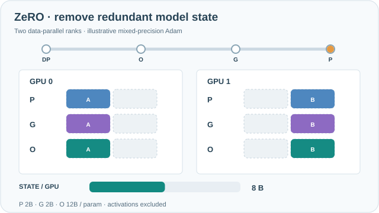

---
tags:
- engineering
- systems
aliases:
- ZeRO 記憶體最佳化
---

# ZeRO: Zero Redundancy Optimizer

ZeRO removes the memory copies that data parallelism makes of model state. It partitions the optimizer state, the gradients and then the parameters across the data-parallel devices in three stages, so per-device memory falls as more devices are added, while the training itself stays data-parallel.

## Overview

With plain data parallelism, every device stores the full weights, gradients and optimizer state. For mixed-precision Adam, the state costs about 16 bytes per parameter, so a model of a few billion parameters can exceed the memory of one accelerator before activations are counted. ZeRO observes that this state is redundant across devices and partitions it. Each device then keeps only its own shard and gathers the rest when a layer needs it.

## Key concepts

- **Optimizer state**: the momentum and variance terms of Adam and the fp32 master weights, which are the largest part of the state.
- **Stage 1**: partition only the optimizer state across devices.
- **Stage 2**: also partition the gradients, so each device keeps the gradient shard it owns.
- **Stage 3**: also partition the parameters, which are gathered layer by layer before use and freed afterwards.
- **Collective operations**: all-gather fetches shards when needed, and reduce-scatter sends each device the gradient shard it owns.

## How it works

Each stage removes one more source of redundancy. With $\Psi$ parameters, $N_d$ data-parallel devices and Adam in mixed precision, the paper gives the per-device memory as $(4 + \tfrac{12}{N_d})\Psi$ bytes for stage 1, $(2 + \tfrac{14}{N_d})\Psi$ for stage 2, and $\tfrac{16}{N_d}\Psi$ for stage 3.

**Interactive timeline on MkDocs:** Play/Pause, step backward/forward, scrub the timeline, or choose 0.5×/1×/2× speed. Motion starts paused, controls are keyboard-accessible, and reduced-motion preferences retain the readable still image. All timings and values are schematic, not measured GPU results.

*Original continuous teaching animation, CC BY-SA 4.0.* The two GPU columns begin with replicated **P** (parameters), **G** (gradients), and **O** (optimizer state). Each rank retains only its own colour-coded A/B half as ZeRO stages 1–3 successively shard O, G, then P. The lower bar shows an **illustrative** mixed-precision Adam state budget for **two ranks**: 16 → 10 → 9 → 8 bytes per parameter per rank, using P = 2 B, G = 2 B and O = 12 B. This excludes activations, temporary all-gather buffers, fragmentation, and communication; it is **not a measured GPU memory trace**. The orange progress marker follows each sharding transition. On MkDocs, use keyboard-accessible **Play/Pause**; reduced-motion settings show the static final state. On narrow screens, scroll horizontally to keep labels readable. [GitHub-readable final-state preview](../../assets/concept-animations/zero-state-sharding-still.svg).

### Explore ZeRO memory as rank count changes

Choose $N_d$ data-parallel ranks and step through the replicated baseline and ZeRO stages 1–3. The live stacked bar separates parameters **P = 2 B**, gradients **G = 2 B**, and optimizer state **O = 12 B** per parameter for a schematic mixed-precision Adam configuration. At stage 1, only O is sharded; at stage 2, G is also sharded; at stage 3, P is sharded. Thus the per-rank state changes from $16$ to $4+12/N_d$, $2+14/N_d$, and $16/N_d$ bytes per parameter. **These are analytical model-state budgets, not measured GPU memory**, and omit activations, all-gather buffers, and communication costs. Play advances stages; in reduced-motion mode, use the keyboard-accessible step controls instead.

## Key methods

The method is the three-stage partitioning of model state, with parameters gathered on demand. The paper's evidence is the per-device memory formulas and experiments on very large models across many GPUs.

## Results

The paper reports training models with more than a hundred billion parameters on large clusters, with per-device memory that falls as devices are added. Throughput depends on the stage and on how well communication overlaps with computation.

## Limitations

- **Communication cost**: stage 3 adds all-gather traffic in both the forward and backward passes, so memory savings come with more communication.
- **Tuning**: the best stage depends on the network, model size and batch size, so it needs measurement.
- **Model state only**: activations are not partitioned by these stages, so other techniques are still needed for long sequences.

## Open questions

- How much of stage 3's communication can be hidden behind computation on slower networks?
- How should ZeRO be combined with tensor and pipeline parallelism at the scale of thousands of devices?

## References

### Seminal papers

- Rajbhandari, S. et al. (2020). *ZeRO: Memory Optimizations Toward Training Trillion Parameter Models*. SC 2020. https://arxiv.org/abs/1910.02054 — Partitions optimizer state, gradients and parameters across data-parallel devices in three stages.

### Related work

- Zhao, Y. et al. (2023). *PyTorch FSDP: Experiences on Scaling Fully Sharded Data Parallel*. VLDB 2023. https://arxiv.org/abs/2304.11277 — A framework implementation of the same idea of sharding parameters and gathering them on demand.
- Li, S. et al. (2020). *PyTorch Distributed: Experiences on Accelerating Data Parallel Training*. VLDB 2020. https://arxiv.org/abs/2006.15704 — Describes the replicated data-parallel baseline that ZeRO removes the redundancy from.
- Shoeybi, M. et al. (2019). *Megatron-LM: Training Multi-Billion Parameter Language Models Using Model Parallelism*. https://arxiv.org/abs/1909.08053 — Splits each layer's weights instead, a complementary way to reduce per-device memory.
- Narayanan, D. et al. (2021). *Efficient Large-Scale Language Model Training on GPU Clusters Using Megatron-LM*. SC 2021. https://arxiv.org/abs/2104.04473 — Shows how ZeRO-style sharding and other parallelism are combined in large clusters.
