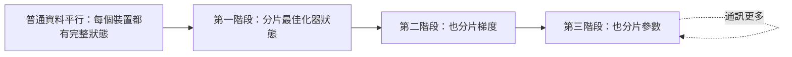

---
tags:
- engineering
- systems
aliases:
- ZeRO 記憶體最佳化
---

# ZeRO：Zero Redundancy Optimizer

ZeRO 移除資料平行中每份模型狀態的重複副本。它分三個階段，把最佳化器狀態、梯度，最後是參數，分散到各個資料平行裝置上。裝置越多，每個裝置的記憶體用量就越低，而訓練本身仍然是資料平行。

## 概述

在一般的資料平行中，每個裝置都保存完整的權重、梯度與最佳化器狀態。以混合精度 Adam 來算，每個參數的狀態約需 16 位元組，因此參數量只有幾十億的模型，在計入激活值之前就可能超過單一加速器的記憶體。ZeRO 注意到這些狀態在裝置之間是重複的，於是把它們分割。每個裝置只保存自己的分片，需要時再向其他裝置收集其餘部分。

## 關鍵概念

- **最佳化器狀態（optimizer state）**：Adam 的動量與變異數項，以及 fp32 的主權重，是狀態中最大的一部分。
- **第一階段**：只分割最佳化器狀態。
- **第二階段**：另外也分割梯度，使每個裝置只保留自己負責的梯度分片。
- **第三階段**：另外也分割參數，參數在使用前逐層收集，用完即釋放。
- **集體通訊操作**：all-gather 在需要時收集分片，reduce-scatter 則把梯度的對應分片分發給每個裝置。

## 運作方式

每個階段都移除一種重複來源。設 $\Psi$ 為參數量、$N_d$ 為資料平行裝置數，並使用混合精度 Adam。論文給出的每裝置記憶體為：第一階段 $(4 + \tfrac{12}{N_d})\Psi$ 位元組，第二階段 $(2 + \tfrac{14}{N_d})\Psi$，第三階段 $\tfrac{16}{N_d}\Psi$。

## 關鍵方法

這個方法是把模型狀態分成三個階段分割，並在需要時才收集參數。論文的證據包括上述的每裝置記憶體公式，以及在大量 GPU 上對超大型模型所做的實驗。

## 結果

論文報告了在大型叢集上訓練超過千億參數的模型，且每裝置記憶體隨裝置數增加而下降。吞吐量取決於所用的階段，以及通訊與計算重疊的程度。

## 限制

- **通訊成本**：第三階段在前向與反向傳播中都要增加 all-gather 流量，因此省下的記憶體要以更多通訊來換。
- **需要調校**：最適合的階段取決於網路、模型大小與批次大小，必須實際量測。
- **只處理模型狀態**：激活值不受這些階段分割，因此長序列仍需要其他技術。

## 開放問題

- 在較慢的網路上，第三階段的通訊有多少能被計算隱藏？
- 在數千個裝置的規模下，ZeRO 應如何與張量平行與管線平行組合？

## 參考文獻

### 重要論文

- Rajbhandari, S. et al. (2020). *ZeRO: Memory Optimizations Toward Training Trillion Parameter Models*. SC 2020. https://arxiv.org/abs/1910.02054 — 在三個階段中，分割資料平行裝置間的最佳化器狀態、梯度與參數。

### 相關工作

- Zhao, Y. et al. (2023). *PyTorch FSDP: Experiences on Scaling Fully Sharded Data Parallel*. VLDB 2023. https://arxiv.org/abs/2304.11277 — 同一想法在框架中的實作：分片參數並在需要時收集。
- Li, S. et al. (2020). *PyTorch Distributed: Experiences on Accelerating Data Parallel Training*. VLDB 2020. https://arxiv.org/abs/2006.15704 — 描述 ZeRO 所要移除冗餘的、複製式的資料平行基準。
- Shoeybi, M. et al. (2019). *Megatron-LM: Training Multi-Billion Parameter Language Models Using Model Parallelism*. https://arxiv.org/abs/1909.08053 — 改為切分每一層的權重，是另一種降低單裝置記憶體的互補方式。
- Narayanan, D. et al. (2021). *Efficient Large-Scale Language Model Training on GPU Clusters Using Megatron-LM*. SC 2021. https://arxiv.org/abs/2104.04473 — 展示大型叢集中如何把 ZeRO 式分片與其他平行方式組合。
