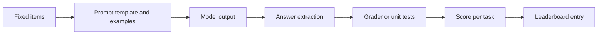

# Benchmark Suites: MMLU, HELM and Successors

A benchmark suite is a fixed collection of tasks, scored the same way for every model, so that language models can be compared on one scale. MMLU, HELM, BIG-bench, GPQA, HumanEval and MATH are among the most cited suites, and several have been followed by harder successors as scores approached their ceilings.

## Overview

Before shared suites, each laboratory reported results on its own tasks, which made comparison difficult. A suite fixes the questions, prompt format, grader and metric, so scores from different developers can be placed side by side. The suites differ in scope. HumanEval asks for short Python functions and MATH for competition mathematics. MMLU covers 57 subjects, from elementary mathematics to law. HELM and BIG-bench aim wider, combining many scenarios or hundreds of tasks.

Broad suites tend to follow one life cycle: a suite is introduced as hard, models improve, scores bunch near the top, and the suite stops separating models. The [evaluation overview](index.md) lists saturation among the common pitfalls.

## Key concepts

- **Benchmark suite**: a versioned set of tasks with a fixed prompt protocol, grader and metrics.
- **Saturation**: most models score near the maximum, so the remaining differences are small compared with noise and prompt effects.
- **Contamination**: test items, or close paraphrases, appear in pretraining data, so a high score partly reflects memorisation.
- **Construct validity**: whether a score measures the ability its name claims.
- **Leaderboard**: a public table of scores, run by the maintainer or self-reported by developers.

## How it works

Most knowledge suites are multiple-choice. Each question is placed in a template, often after a few solved examples (few-shot prompting). The model generates a letter or assigns a likelihood to each option, the answer is extracted and compared with the key, and the score is the proportion correct, averaged over subjects.

Coding and math suites are graded differently. For HumanEval, a generated function is run against unit tests. Repeated sampling raises the solve rate, because a problem counts as solved if any sample passes (Chen et al., 2021). For MATH, final answers are compared after normalisation, which is harder than it sounds, since one value can be written in many equivalent forms.

### Running a leaderboard

A leaderboard is only as comparable as its protocol. Some maintainers run every model through one shared harness; others accept numbers that developers ran themselves, with their own prompts and settings. The number of examples shown, the template, answer parsing and token budget can all change a score. A careful leaderboard records the version, date, settings and whether the maintainer reproduced each score. Human-preference arenas follow another protocol: users compare two anonymous responses, and the votes are aggregated into a ranking (Chiang et al., 2024).

## Key methods

| Suite | Year | What it measures | Format | Status |
|---|---|---|---|---|
| MMLU | 2020 | Knowledge and problem solving in 57 subjects | Four-option multiple choice | Widely used; errors found in its questions |
| MMLU-Pro | 2024 | Harder, reasoning-heavy questions | Ten options | Built in response to a plateau on MMLU |
| HELM | 2022 | Scenarios scored on seven metrics | Mixed | Described by its authors as a living benchmark |
| BIG-bench | 2022 | 204 tasks beyond the models of its time | Mixed, with a human baseline | Large collaborative task set |
| GPQA | 2023 | Graduate-level science questions resistant to web search | Multiple choice | Hard even for skilled non-experts |
| HumanEval | 2021 | Python functions written from docstrings | Code, graded by unit tests | Close to saturated (see [Software Development](../../applications/software/index.md)) |
| MATH | 2021 | Competition mathematics with step-by-step solutions | Free-form answer | Accuracy was low even for large models at publication |

MMLU, HELM and BIG-bench cover many abilities, so their scores summarise a broad profile. GPQA and MATH probe narrower, deeper expertise, and HumanEval tests a single skill with an objective grader.

### Saturation and contamination

At publication most models scored near random chance on MMLU, and the largest GPT-3 model was roughly 20 points above it (Hendrycks et al., 2020). MMLU-Pro was introduced partly because MMLU scores had plateaued; its authors measured prompt sensitivity of 4 to 5 percent on MMLU, against about 2 percent on the new suite.[^mmlupro]

Errors are a problem of their own. A re-annotation of MMLU found ground-truth errors that obscure the real capabilities of models (Gema et al., 2024).[^gema] Contamination is harder to see. Deng et al. (2023) propose overlap checks against pretraining corpora and a slot-guessing test that can be applied to closed models.

## Connections

Benchmark design borrows from psychometrics, the science of building tests. Item difficulty, reliability and construct validity apply directly, and whether a score reflects the named ability is the question psychologists ask of intelligence tests (Raji et al., 2021). See [Psychology & AI](../../brain-mind/psychology/index.md) for the human side. BIG-bench bridges the two: several of its tasks draw on childhood development and linguistics, and its human baseline came from expert raters who performed the same tasks.

The scores these suites report are also the yardstick for scaling studies. The [compute-optimal training](../../theory/models/llm/compute-optimal-training/index.md) page reports MMLU results for a model trained under a fixed budget. For the statistics of comparing two scores, see [Evaluation and Validation](../../theory/paradigms/supervised/evaluation-and-validation/index.md).

## Applications

- **Model selection**: developers compare candidates on suites such as MMLU or HumanEval, then check performance on their own tasks.
- **Regression testing**: teams rerun a public suite, or a subset of it, after each change to a prompt, model or retrieval setting.
- **Reanalysis**: HELM released its raw prompts and completions, so other researchers can recompute its metrics (Liang et al., 2022).
- **Code assistants**: functional tests like HumanEval judge code generation, though they cover short standalone functions rather than whole projects. See [Coding Assistants](../coding-assistants/index.md).

## Open questions

- **Staying hard**: dynamic benchmarks, rebuilt with annotators and models in the loop, are one proposal (Kiela et al., 2021).
- **Format and ability**: does a format change alter what is measured? MMLU-Pro reports that chain-of-thought prompting helped on its harder questions, unlike on MMLU (Wang et al., 2024).
- **Hidden training data**: how can contamination be detected for closed models whose training corpora are not visible?
- **Whose preferences**: arena rankings depend on who votes, and agreement with expert raters does not settle whom an arena represents.

[^mmlupro]: Wang et al. (2024), listed in References. The paper reports that MMLU-Pro expands the choice set from four to ten options and measures prompt sensitivity across 24 prompt styles.
[^gema]: Gema et al. (2024), listed in References. The authors estimate that 6.49 percent of MMLU questions contain errors, and that 57 percent of the analysed Virology questions do.

## References

### Seminal papers

- Hendrycks, D. et al. (2020). *Measuring Massive Multitask Language Understanding*. arXiv. https://arxiv.org/abs/2009.03300 — Introduces MMLU, a multiple-choice test across 57 subjects for broad knowledge.
- Hendrycks, D. et al. (2021). *Measuring Mathematical Problem Solving With the MATH Dataset*. arXiv. https://arxiv.org/abs/2103.03874 — Introduces 12,500 competition mathematics problems with step-by-step solutions.
- Chen, M. et al. (2021). *Evaluating Large Language Models Trained on Code*. arXiv. https://arxiv.org/abs/2107.03374 — Introduces HumanEval and shows how repeated sampling raises solve rates.
- Srivastava, A. et al. (2022). *Beyond the Imitation Game: Quantifying and extrapolating the capabilities of language models*. arXiv. https://arxiv.org/abs/2206.04615 — Introduces BIG-bench, a collaborative set of 204 tasks chosen to be hard.
- Liang, P. et al. (2022). *Holistic Evaluation of Language Models*. arXiv. https://arxiv.org/abs/2211.09110 — Introduces HELM, a multi-scenario, multi-metric evaluation that releases its raw outputs.
- Rein, D. et al. (2023). *GPQA: A Graduate-Level Google-Proof Q&A Benchmark*. arXiv. https://arxiv.org/abs/2311.12022 — Introduces expert-written science questions designed to resist web search.
- Wang, Y. et al. (2024). *MMLU-Pro: A More Robust and Challenging Multi-Task Language Understanding Benchmark*. arXiv. https://arxiv.org/abs/2406.01574 — Introduces a harder successor to MMLU with ten options and lower prompt sensitivity.

### Related work

- Raji, I. D. et al. (2021). *AI and the Everything in the Whole Wide World Benchmark*. arXiv. https://arxiv.org/abs/2111.15366 — Examines the construct validity of influential benchmarks used as proxies for progress.
- Gema, A. P. et al. (2024). *Are We Done with MMLU?* arXiv. https://arxiv.org/abs/2406.04127 — Finds ground-truth errors in MMLU questions and releases a re-annotated subset.
- Deng, C. et al. (2023). *Investigating Data Contamination in Modern Benchmarks for Large Language Models*. arXiv. https://arxiv.org/abs/2311.09783 — Proposes overlap checks and a slot-guessing test for contamination.
- Chiang, W.-L. et al. (2024). *Chatbot Arena: An Open Platform for Evaluating LLMs by Human Preference*. arXiv. https://arxiv.org/abs/2403.04132 — Describes a crowdsourced pairwise-comparison leaderboard and how its votes are analysed.
- Kiela, D. et al. (2021). *Dynabench: Rethinking Benchmarking in NLP*. arXiv. https://arxiv.org/abs/2104.14337 — Proposes dynamic benchmarks in which annotators write examples that current models misclassify.
