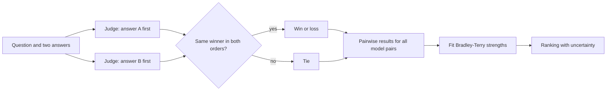

# LLM-as-judge and pairwise evaluation

LLM-as-judge is the practice of using a language model to grade or compare the outputs of other models. In pairwise evaluation, the judge picks the better of two answers, and benchmarks such as MT-Bench, AlpacaEval and Chatbot Arena turn those choices into rankings. The method is fast and scales well, but its verdicts carry systematic biases that have to be measured against human judgments.

## Overview

Open-ended tasks, such as writing an email or holding a multi-turn conversation, have no answer key, so exact-match scoring and unit tests do not apply. Human ratings work but are slow and expensive to collect at scale. Zheng et al. (2023) examined whether a strong model such as GPT-4 could stand in for the raters. They introduced MT-Bench, a set of 80 multi-turn questions, and Chatbot Arena, a platform where users compare two anonymous answers. They reported that GPT-4 agreed with human preferences more than 80 percent of the time, the same level of agreement that humans show with each other.[^agreement]

Judges are now used to compare checkpoints, filter training data and supply feedback for training. They are quick to run and can explain their verdicts, but they are models evaluating models and inherit their blind spots. The [evaluation overview](index.md) places judge-based grading among its protocol choices; fixed suites that need no judge are covered in [Benchmark Suites](benchmark-suites.md).

## Key concepts

- **Judge**: a model that receives a question, a rubric and one or more candidate answers, and returns a score, a label or a preference.
- **Single-answer grading**: the judge assigns an absolute score to one answer.
- **Pairwise comparison**: the judge chooses the better of two answers, or declares a tie.
- **Rubric**: the criteria and scale the judge applies. Changing it changes the scores.
- **Position bias**: a tendency to prefer an answer because of where it appears in the prompt.
- **Verbosity bias**: a tendency to prefer longer answers even when they are no better.
- **Self-preference**: a tendency for a judge to favour outputs from its own model or model family.
- **Bradley–Terry model**: a probability model for pairwise outcomes in which each item has one strength parameter. Fitting it to many comparisons gives a ranking.
- **Elo rating**: a rating system, first used for chess, that updates each player's rating after every game.

## How it works

### Running a pairwise comparison

Because a verdict can depend on which answer comes first, a common safeguard is to run each comparison twice with the positions swapped. Zheng et al. use a conservative rule: a model wins only if it is preferred in both orders, and inconsistent verdicts count as a tie.[^swap] The diagram shows the path from pairs to a ranking.

### From pairs to a ranking

In the Bradley–Terry model, each model *i* has a strength $\beta_i$, and the probability that it beats model *j* is

$$P(i \succ j) = \frac{e^{\beta_i}}{e^{\beta_i} + e^{\beta_j}} = \sigma(\beta_i - \beta_j),$$

where $\sigma$ is the logistic function. The strengths are estimated jointly from all the comparisons, usually by maximum likelihood. The model comes from paired-comparison work in psychology. Thurstone's law of comparative judgment assumes normally distributed noise in perceived strength, and Bradley–Terry uses logistic noise instead.[^thurstone]

Chiang et al. (2024) use Bradley–Terry coefficients as the score for Chatbot Arena, and they estimate confidence intervals with bootstrap resampling.[^arena] Elo is the older alternative. It updates ratings one game at a time, so the final rating depends on the order of the games and on the update size. Boubdir et al. (2023) found that individual Elo computations are volatile and that reliability and transitivity do not always hold, so Elo values need the same care as any other estimate.

### Known biases

**Position bias.** Wang et al. (2023) showed that the order in which candidate answers appear can change the verdict. Their abstract reports that, with the order manipulated, Vicuna-13B could beat ChatGPT on 66 of 80 queries when ChatGPT was the evaluator.[^wang] In the MT-Bench study, most judges favoured the first position. Adding few-shot judgment examples raised GPT-4's consistency under swapping from 65.0 to 77.5 percent, but the authors note that consistency does not guarantee accuracy.

**Verbosity bias.** Judges often prefer longer answers. Saito et al. (2023) found that GPT-4 favours longer answers more than human annotators do, and they proposed a metric for the effect.[^verbosity]

**Self-preference.** Panickssery et al. (2024) report that LLMs can recognise their own text, and that in fine-tuned models self-recognition correlates linearly with self-preference. **Style over substance.** Wu and Aji (2023) found that, in their flawed-answer study, answers with factual errors were often rated above answers that were too short or ungrammatical, for both human and LLM annotators.

### Agreement with humans and calibration

A judge is useful only if its verdicts track human preferences. The usual check is to collect human labels on a sample, measure agreement, and compare it with human-human agreement, as Zheng et al. did. For graded scores, rank correlation is common: G-Eval reached a Spearman correlation of 0.514 with human ratings on summarisation.[^geval]

Calibration here means that a judge's scores map onto the quality people would assign, on a scale that means the same thing across tasks and over time. It is distinct from the probability calibration in [uncertainty and calibration](../../theory/machine-learning/uncertainty-and-calibration/index.md). A judge can be perfectly consistent and still miscalibrated, and Shankar et al. (2024) describe criteria drift, where people refine their criteria while grading, so a rubric written in advance may not stay fixed.

## Key methods

The variants differ in what the judge sees and how verdicts are aggregated, so they are compared inline rather than on separate pages.

| Variant | Judge input | Aggregation | Notes and reported evidence |
|---|---|---|---|
| Single-answer grading (MT-Bench) | One answer and a rubric | Absolute scores | Simple; scores shift when the judge changes |
| Pairwise comparison (MT-Bench, Arena) | Two answers | Win rates or Bradley–Terry strengths | Separates close answers; pair count grows quadratically |
| Reference-guided grading (MT-Bench) | Answer, rubric and reference solution | Scores | Used for math, where the judge's own solving is weak |
| Human pairwise votes (Chatbot Arena) | Two anonymous answers, from users | Bradley–Terry with bootstrap intervals | About 240K votes from over 90K users by January 2024[^arena] |
| Automatic win rate (AlpacaFarm, AlpacaEval) | Model output and reference output | Win rate against the reference | Validated against human feedback (Dubois et al., 2023) |
| Length-controlled win rate (Dubois et al., 2024) | As above, with regression adjustment | Length-adjusted win rate | Correlation with Chatbot Arena rose from 0.94 to 0.98 (Spearman) |
| G-Eval (Liu et al., 2023) | Criteria, chain-of-thought steps and a form | Scores | Spearman 0.514 with humans on summarisation |
| Prometheus (Kim et al., 2023) | Answer, reference answer and rubric | Scores from an open model | Reported on par with GPT-4 when reference material is given |
| Panel of judges (Verga et al., 2024) | Same prompt sent to several smaller judges | Aggregated verdicts | Beat a single large judge in their settings, at over seven times lower cost |

Pairwise comparisons separate close answers better, but every pair must be judged, so cost grows quickly with the number of models. Single-answer scores scale linearly, but they fluctuate more when the judge changes. The remedies in the table are swapping positions, supplying a reference answer, correcting statistically for length, and combining several judges.

## Connections

- **Benchmarks.** A judge is a measuring instrument and needs the same reporting discipline as any benchmark. The fixed-answer alternative is in [Benchmark Suites](benchmark-suites.md).
- **Preference learning.** Judges and reinforcement learning from human feedback both use pairs of outputs ranked by people. [InstructGPT](../../theory/models/llm/instructgpt-rlhf/index.md) trained reward models on rankings of model outputs (Ouyang et al., 2022), and [preference optimisation](../training/preference-optimisation.md) trains directly on such pairs. A judge used as a reward is a proxy open to exploitation; see [reward hacking](../../society/safety-alignment/reward-hacking.md).
- **Psychology.** Paired comparisons were studied in psychophysics long before language models, and whether a rater's scores measure the intended construct is a psychometric question. See [Psychology & AI](../../brain-mind/psychology/index.md).

## Applications

- **Model comparison and regression testing.** Developers report MT-Bench scores and Arena rankings, and teams rerun a fixed judge and rubric after each change, checking a sample against human ratings.
- **Training signals.** AI feedback ranks candidate responses for preference training, so the judge's biases reach the trained model directly.
- **Tasks without references.** Summarisation and dialogue, where no single correct answer exists, are the main settings for G-Eval-style evaluators.

## Open questions

- Can biases be removed through prompt design alone, or do they need statistical correction (Dubois et al., 2024) or several judges (Verga et al., 2024)?
- Are Bradley–Terry rankings stable as the pool of models and voters changes (Boubdir et al., 2023)?
- How should rubrics be written when the criteria only become clear after reading outputs (Shankar et al., 2024)?

[^agreement]: Zheng et al. (2023), listed in References.
[^swap]: Zheng et al. (2023), section on swapping positions, listed in References.
[^wang]: Wang et al. (2023), listed in References.
[^verbosity]: Saito et al. (2023), listed in References.
[^thurstone]: Thurstone (1927) and Bradley and Terry (1952), listed in References.
[^arena]: Chiang et al. (2024), listed in References. Vote counts are those reported as of January 2024.
[^geval]: Liu et al. (2023), listed in References.

## References

### Seminal papers

- Thurstone, L. L. (1927). *A law of comparative judgment*. Psychological Review. https://doi.org/10.1037/h0070288 — Models paired comparisons of stimuli on a latent scale with normally distributed noise, the psychological ancestor of pairwise rating models.
- Bradley, R. A. & Terry, M. E. (1952). *Rank analysis of incomplete block designs: I. The method of paired comparisons*. Biometrika. https://doi.org/10.2307/2334029 — Introduces the model in which each item has a strength parameter that predicts the outcome of every pairwise comparison.
- Zheng, L. et al. (2023). *Judging LLM-as-a-Judge with MT-Bench and Chatbot Arena*. arXiv. https://arxiv.org/abs/2306.05685 — Introduces MT-Bench and Chatbot Arena and studies the agreement, position, verbosity and self-enhancement biases of GPT-4 judges.
- Chiang, W.-L. et al. (2024). *Chatbot Arena: An Open Platform for Evaluating LLMs by Human Preference*. arXiv. https://arxiv.org/abs/2403.04132 — Describes the crowdsourced pairwise voting platform, its data, and a Bradley–Terry ranking with bootstrap confidence intervals.
- Dubois, Y. et al. (2023). *AlpacaFarm: A Simulation Framework for Methods that Learn from Human Feedback*. arXiv. https://arxiv.org/abs/2305.14387 — Introduces an automatic pairwise evaluator for instruction-following models, validated against human feedback.
- Ouyang, L. et al. (2022). *Training language models to follow instructions with human feedback*. arXiv. https://arxiv.org/abs/2203.02155 — The InstructGPT paper, which trains reward models on human rankings of model outputs.

### Related work

- Wang, P. et al. (2023). *Large Language Models are not Fair Evaluators*. arXiv. https://arxiv.org/abs/2305.17926 — Shows that the ranking of candidate answers by an LLM judge can be changed by reordering them in the prompt.
- Saito, K. et al. (2023). *Verbosity Bias in Preference Labeling by Large Language Models*. arXiv. https://arxiv.org/abs/2310.10076 — Compares GPT-4 with human annotators on answers of similar quality and finds that GPT-4 favours longer answers more, with a metric for the bias.
- Dubois, Y. et al. (2024). *Length-Controlled AlpacaEval: A Simple Way to Debias Automatic Evaluators*. arXiv. https://arxiv.org/abs/2404.04475 — Uses regression to remove the effect of output length from automatic win rates, improving correlation with Chatbot Arena.
- Panickssery, A. et al. (2024). *LLM Evaluators Recognize and Favor Their Own Generations*. arXiv. https://arxiv.org/abs/2404.13076 — Tests whether LLM judges recognise their own outputs, and links self-recognition to self-preference in fine-tuned models.
- Wu, M. & Aji, A. F. (2023). *Style Over Substance: Evaluation Biases for Large Language Models*. arXiv. https://arxiv.org/abs/2307.03025 — Finds that factual errors can be rated above brevity or grammatical errors, and proposes a multi-dimensional Elo-based rating.
- Liu, Y. et al. (2023). *G-Eval: NLG Evaluation using GPT-4 with Better Human Alignment*. arXiv. https://arxiv.org/abs/2303.16634 — Introduces pointwise LLM evaluation with chain-of-thought reasoning and reports its correlation with human judgments on summarisation and dialogue.
- Kim, S. et al. (2023). *Prometheus: Inducing Fine-grained Evaluation Capability in Language Models*. arXiv. https://arxiv.org/abs/2310.08491 — An open-source judge that uses reference answers and score rubrics to evaluate long-form responses.
- Verga, P. et al. (2024). *Replacing Judges with Juries: Evaluating LLM Generations with a Panel of Diverse Models*. arXiv. https://arxiv.org/abs/2404.18796 — Proposes a panel of smaller judges from different model families, reducing intra-model bias and cost compared with one large judge.
- Shankar, S. et al. (2024). *Who Validates the Validators? Aligning LLM-Assisted Evaluation of LLM Outputs with Human Preferences*. arXiv. https://arxiv.org/abs/2404.12272 — Studies how users' evaluation criteria change as they grade outputs, the phenomenon called criteria drift.
- Boubdir, M. et al. (2023). *Elo Uncovered: Robustness and Best Practices in Language Model Evaluation*. arXiv. https://arxiv.org/abs/2311.17295 — Examines reliability and transitivity when Elo ratings are used to rank LLMs from pairwise comparisons.
