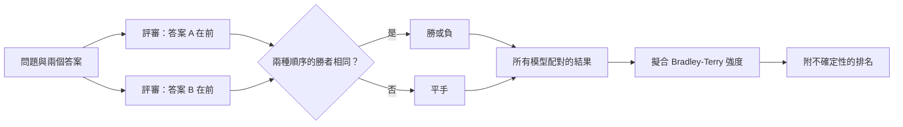

# LLM 作為評審與成對評估

LLM 作為評審（LLM-as-judge）是指以語言模型為其他模型的輸出評分或比較。在成對評估中，評審會從兩個答案中挑出較好的一個；MT-Bench、AlpacaEval 與 Chatbot Arena 等基準則把這些選擇轉換為排名。這種方法快速且容易擴展，但評審的判斷帶有系統性偏誤，必須以人類判斷來衡量。

## 概述

開放式任務，例如撰寫電子郵件或進行多輪對話，沒有標準答案，因此精確比對與單元測試都無法適用。人類評分可行，但要大規模收集，既慢又昂貴。Zheng 等人（2023）探討，能否以 GPT-4 這類強大的模型代替評分者。他們推出了 MT-Bench，一組 80 題的多輪問題；以及 Chatbot Arena，一個讓使用者比較兩個匿名答案的平台。他們回報，GPT-4 與人類偏好的一致性超過 80%，與人類彼此之間的一致程度相當。[^agreement]

如今，評審已是常規做法。研究者用它比較模型的檢查點、過濾訓練資料，並在從 AI 偏好學習的流程中提供回饋。評審的優點是執行快速，而且能附上文字解釋；但它是以一個模型評估另一個模型，因此會繼承該模型的盲點。[評估總覽](index.md)把基於評審的評分列為協定選擇之一；不需要評審的固定套件，則見[基準測試套件](benchmark-suites.md)。

## 關鍵概念

- **評審（judge）**：接收問題、評分量表與一或多個候選答案，並回傳分數、標籤或偏好的模型。
- **單一答案評分（single-answer grading）**：評審對單一答案給出絕對分數。
- **成對比較（pairwise comparison）**：評審從兩個答案中選出較好的一個，或宣告平手。
- **評分量表（rubric）**：評審所套用的標準與尺度。更改量表會改變分數。
- **位置偏誤（position bias）**：因答案在提示中的位置而偏好它的傾向。
- **冗長偏誤（verbosity bias）**：即使品質相當，仍偏好較長答案的傾向。
- **自我偏好（self-preference）**：評審偏好自己模型或同一模型家族所產生之輸出的傾向。
- **Bradley–Terry 模型**：描述成對結果的機率模型，每個項目只有一個強度參數。把它擬合到大量比較上，便能得到排名。
- **Elo 評分（Elo rating）**：一種評分制度，最初用於西洋棋，每場比賽後更新選手的分數。

## 運作方式

### 執行成對比較

由於評審的判斷可能取決於哪個答案排在前面，常見的防護做法是把兩個答案的順序對調，各比較一次。Zheng 等人採取保守的規則：只有在兩種順序下都被偏好時，模型才算獲勝；前後不一致則計為平手。[^swap] 下圖顯示從成對結果到排名的流程。

### 從配對到排名

在 Bradley–Terry 模型中，每個模型 *i* 具有強度 $\beta_i$，它勝過模型 *j* 的機率為

$$P(i \succ j) = \frac{e^{\beta_i}}{e^{\beta_i} + e^{\beta_j}} = \sigma(\beta_i - \beta_j),$$

其中 $\sigma$ 為邏輯函數。各模型的強度通常以最大概似法，同時由所有比較結果估計。這個模型源自心理學中的成對比較研究。Thurstone 的比較判斷定律假設感知強度的雜訊服從常態分布，而 Bradley–Terry 改用邏輯分布的雜訊。[^thurstone]

Chiang 等人（2024）以 Bradley–Terry 係數作為 Chatbot Arena 的分數，並以自助法（bootstrap）重抽樣估計信賴區間。[^arena] Elo 則是較早的替代方法。它每次只依一場比賽更新評分，因此最終評分取決於比賽的順序與更新幅度。Boubdir 等人（2023）發現，個別的 Elo 計算波動很大，而且信度與遞移性並非總能成立，因此 Elo 數值與其他估計一樣，需要同樣謹慎地對待。

### 已知偏誤

**位置偏誤。** Wang 等人（2023）顯示，候選答案出現的順序可以改變判定結果。他們的摘要回報，在操弄順序的情況下，當 ChatGPT 擔任評審時，Vicuna-13B 能在 80 個測試查詢中贏過 ChatGPT 的 66 個。[^wang] 在 MT-Bench 的研究中，多數評審偏好第一個位置。加入少樣本的判斷範例後，GPT-4 在對調順序下的一致性由 65.0% 提升至 77.5%，但作者指出，一致性並不保證準確。

**冗長偏誤。** 評審常偏好較長的答案。Saito 等人（2023）發現，相較於人類標註者，GPT-4 更偏好較長的答案，並提出了衡量此效應的指標。[^verbosity]

**自我偏好。** Panickssery 等人（2024）回報，LLM 能辨識自己產生的文字；在經過微調的模型中，自我辨識的能力與自我偏好呈線性相關。**風格勝過實質。** Wu 與 Aji（2023）發現，在他們的有缺陷答案研究中，含有事實錯誤的答案，常被評得高於過短或文法有誤的答案；人類標註者與 LLM 都有此傾向。

### 與人類的一致性與校準

只有當評審的判定與人類偏好相符，它才有用。常見的檢查方式是：對抽樣結果收集人類標籤、計算一致程度，並與人類彼此間的一致程度比較，如 Zheng 等人所做的那樣。對於分級分數，常用等級相關。G-Eval 在摘要任務上與人類評分的斯皮爾曼相關係數達到 0.514。[^geval]

這裡的校準指的是：評審的分數對應到人們會給予的品質，而且這把尺在不同任務與不同時間都代表同樣的意義。它不同於[不確定性量化與校準](../../theory/machine-learning/uncertainty-and-calibration/index.md)中的機率校準。評審可能完全一致，卻仍然校準不良。Shankar 等人（2024）描述了「標準漂移」（criteria drift）：人們在評分時會不斷修正標準，因此事先寫好的量表未必能保持不變。

## 關鍵方法

這些變體的差異在於評審看到的內容，以及如何彙整判定結果，因此在此逐一比較，而不另闢頁面。

| 變體 | 評審的輸入 | 彙整方式 | 說明與回報的證據 |
|---|---|---|---|
| 單一答案評分（MT-Bench） | 一個答案與評分量表 | 絕對分數 | 簡單；評審改變時分數會偏移 |
| 成對比較（MT-Bench、Arena） | 兩個答案 | 勝率或 Bradley–Terry 強度 | 能區分接近的答案；配對數量以平方速度增加 |
| 參考引導評分（MT-Bench） | 答案、評分量表與參考解答 | 分數 | 用於數學，因為評審自己的解題能力較弱 |
| 人類成對投票（Chatbot Arena） | 來自使用者的兩個匿名答案 | 附自助法區間的 Bradley–Terry | 至 2024 年 1 月，約 24 萬票，來自逾 9 萬名使用者[^arena] |
| 自動化勝率（AlpacaFarm、AlpacaEval） | 模型輸出與參考輸出 | 對參考輸出的勝率 | 經人類回饋驗證（Dubois 等人，2023） |
| 長度校正勝率（Dubois 等人，2024） | 同上，加上迴歸校正 | 校正長度後的勝率 | 與 Chatbot Arena 的斯皮爾曼相關由 0.94 提升至 0.98 |
| G-Eval（Liu 等人，2023） | 標準、思維鏈步驟與表單 | 分數 | 摘要任務上與人類的斯皮爾曼相關為 0.514 |
| Prometheus（Kim 等人，2023） | 答案、參考答案與評分量表 | 開放模型給出的分數 | 提供參考材料時，據報與 GPT-4 相當 |
| 評審團（Verga 等人，2024） | 同一提示送給數個較小的評審 | 彙整後的判定 | 在其設定中勝過單一大型評審，成本低於七分之一以上 |

成對比較能更好地區分接近的答案，但每一對都必須評審，因此成本隨模型數量迅速增加。單一答案評分可以線性擴展，但評審改變時，絕對分數的波動較大。表中的補救方法包括：對調位置、提供參考答案、以統計方式校正長度，以及結合數個評審。

## 連結

- **基準。** 評審是一種測量工具，需要與任何基準分數一樣的報告規範。固定答案的替代方法見[基準測試套件](benchmark-suites.md)。
- **偏好學習。** 評審與基於人類回饋的強化學習，都使用由人類排序的輸出配對。[InstructGPT](../../theory/models/llm/instructgpt-rlhf/index.md) 以人類對模型輸出的排序訓練獎勵模型（Ouyang 等人，2022），而[偏好最佳化](../training/preference-optimisation.md)則直接以這類配對訓練。被當作獎勵的評審只是一種代理指標，容易遭到利用；見[獎勵駭客](../../society/safety-alignment/reward-hacking.md)。
- **心理學。** 成對比較在語言模型出現之前，就已在心理物理學中被研究。評審的分數是否真的衡量了預定的構念，也是心理計量學的問題；見[心理學與 AI](../../brain-mind/psychology/index.md)。

## 應用

- **模型比較與迴歸測試。** 開發者在發表模型時會回報 MT-Bench 分數與 Arena 排名；團隊則在每次改動後重新執行固定的評審與量表，並以人類評分檢查抽樣結果。
- **訓練訊號。** AI 回饋用來為候選回應排序，以進行偏好訓練，因此評審的偏誤會直接影響訓練出的模型。
- **沒有參考答案的任務。** 摘要與對話等沒有唯一正確答案的任務，是 G-Eval 這類評估器的主要應用場景。

## 開放問題

- 偏誤能否只靠提示設計消除，還是需要統計校正（Dubois 等人，2024）或多個評審（Verga 等人，2024）？
- 當評審與受測模型屬於同一家族時，如何選擇評審，才能避免自我偏好？
- 當評審的判斷能力不如候選答案時，它還能被信任嗎？
- 當模型與投票者的組合改變時，Bradley–Terry 排名是否穩定（Boubdir 等人，2023）？
- 當標準只有在閱讀輸出後才會清楚時，應如何撰寫評分量表（Shankar 等人，2024）？

[^agreement]: 見參考文獻中的 Zheng 等人（2023）。
[^swap]: 見參考文獻中 Zheng 等人（2023）關於對調位置的章節。
[^wang]: 見參考文獻中的 Wang 等人（2023）。
[^verbosity]: 見參考文獻中的 Saito 等人（2023）。
[^thurstone]: 見參考文獻中的 Thurstone（1927）與 Bradley 和 Terry（1952）。
[^arena]: 見參考文獻中的 Chiang 等人（2024）。票數為截至 2024 年 1 月的回報數字。
[^geval]: 見參考文獻中的 Liu 等人（2023）。

## 參考文獻

### 開創性論文

- Thurstone, L. L. (1927). *A law of comparative judgment*. Psychological Review. https://doi.org/10.1037/h0070288 — 以常態分布的雜訊，在潛在尺度上為刺激物的成對比較建模，是成對評分模型在心理學上的源頭。
- Bradley, R. A. & Terry, M. E. (1952). *Rank analysis of incomplete block designs: I. The method of paired comparisons*. Biometrika. https://doi.org/10.2307/2334029 — 提出每個項目具有一個強度參數、用以預測每一組成對比較結果的模型。
- Zheng, L. et al. (2023). *Judging LLM-as-a-Judge with MT-Bench and Chatbot Arena*. arXiv. https://arxiv.org/abs/2306.05685 — 介紹 MT-Bench 與 Chatbot Arena，並研究 GPT-4 評審的一致性、位置、冗長與自我增強偏誤。
- Chiang, W.-L. et al. (2024). *Chatbot Arena: An Open Platform for Evaluating LLMs by Human Preference*. arXiv. https://arxiv.org/abs/2403.04132 — 描述眾包的成對投票平台、其資料，以及附自助法信賴區間的 Bradley–Terry 排名。
- Dubois, Y. et al. (2023). *AlpacaFarm: A Simulation Framework for Methods that Learn from Human Feedback*. arXiv. https://arxiv.org/abs/2305.14387 — 為遵循指令的模型介紹一種自動化的成對評估器，並以人類回饋加以驗證。
- Ouyang, L. et al. (2022). *Training language models to follow instructions with human feedback*. arXiv. https://arxiv.org/abs/2203.02155 — InstructGPT 論文，以人類對模型輸出的排序訓練獎勵模型。

### 相關工作

- Wang, P. et al. (2023). *Large Language Models are not Fair Evaluators*. arXiv. https://arxiv.org/abs/2305.17926 — 顯示 LLM 評審對候選答案的排名，會因為在提示中改變答案順序而改變。
- Saito, K. et al. (2023). *Verbosity Bias in Preference Labeling by Large Language Models*. arXiv. https://arxiv.org/abs/2310.10076 — 在品質相近的答案上比較 GPT-4 與人類標註者，發現 GPT-4 更偏好較長的答案，並提出衡量此偏誤的指標。
- Dubois, Y. et al. (2024). *Length-Controlled AlpacaEval: A Simple Way to Debias Automatic Evaluators*. arXiv. https://arxiv.org/abs/2404.04475 — 以迴歸移除輸出長度對自動化勝率的影響，提升與 Chatbot Arena 的相關性。
- Panickssery, A. et al. (2024). *LLM Evaluators Recognize and Favor Their Own Generations*. arXiv. https://arxiv.org/abs/2404.13076 — 檢驗 LLM 評審能否辨識自己的輸出，並把自我辨識與經微調模型中的自我偏好連結起來。
- Wu, M. & Aji, A. F. (2023). *Style Over Substance: Evaluation Biases for Large Language Models*. arXiv. https://arxiv.org/abs/2307.03025 — 發現事實錯誤的答案可能被評得高於簡短或文法錯誤的答案，並提出一種多面向、以 Elo 為基礎的評分系統。
- Liu, Y. et al. (2023). *G-Eval: NLG Evaluation using GPT-4 with Better Human Alignment*. arXiv. https://arxiv.org/abs/2303.16634 — 提出以思維鏈推理進行逐一評分的 LLM 評估方法，並回報其在摘要與對話上與人類判斷的相關性。
- Kim, S. et al. (2023). *Prometheus: Inducing Fine-grained Evaluation Capability in Language Models*. arXiv. https://arxiv.org/abs/2310.08491 — 一個開源評審，利用參考答案與評分量表來評估長篇回應。
- Verga, P. et al. (2024). *Replacing Judges with Juries: Evaluating LLM Generations with a Panel of Diverse Models*. arXiv. https://arxiv.org/abs/2404.18796 — 提出由來自不同模型家族的數個較小評審組成的評審團，與單一大型評審相比，能降低模型內偏誤與成本。
- Shankar, S. et al. (2024). *Who Validates the Validators? Aligning LLM-Assisted Evaluation of LLM Outputs with Human Preferences*. arXiv. https://arxiv.org/abs/2404.12272 — 研究使用者在評分輸出時，其評估標準如何改變，即所謂的標準漂移。
- Boubdir, M. et al. (2023). *Elo Uncovered: Robustness and Best Practices in Language Model Evaluation*. arXiv. https://arxiv.org/abs/2311.17295 — 探討以成對比較的 Elo 評分來排名 LLM 時，其信度與遞移性。
