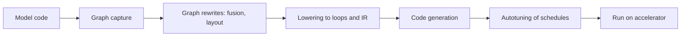

# ML Compilers and Kernel Languages

Machine-learning compilers and kernel languages turn a model's mathematical description into code that runs efficiently on a particular piece of hardware. They decide which operations are merged, how data is laid out in memory and how work is divided among processors, so they set much of the speed a model reaches on an accelerator.

## Overview

A deep-learning framework describes a model as a sequence of tensor operations. If each operation runs on its own, the accelerator reads its inputs from main memory, computes, and writes the result back. For many operations the arithmetic takes far less time than this traffic, so the program is limited by memory rather than by compute. A compiler reduces the cost by merging operations into fewer kernels for the target chip. A kernel language lets an engineer write the inner loops directly.

The need grew with the variety of hardware. One model may run on GPUs, TPUs, phone neural engines and CPUs. The TVM authors note that deploying workloads to new platforms otherwise requires significant manual effort.[^tvm] The [AI hardware](../hardware/index.md) page describes the chips involved.

## Key concepts

- **Graph capture**: recording tensor operations before they run, by tracing or by analysing Python code.
- **Intermediate representation (IR)**: a program form that the compiler rewrites. Most modern compilers use several levels, from graph operations down to loops and machine instructions.
- **Operator fusion**: merging several operations into one kernel so that intermediate results stay in registers or on-chip memory. A bias addition followed by an activation is the classic example.
- **Kernel**: a function that runs on an accelerator across many parallel threads.
- **Tiling**: splitting a computation into blocks sized to fit in fast on-chip memory, and reusing each block before moving on.
- **Schedule**: the choice of tile sizes, loop order and parallel mapping for an operation. Halide separated the algorithm from its schedule so that one computation could be tuned for different machines.[^halide]
- **Arithmetic intensity**: floating-point operations per byte moved from memory. The roofline model bounds attainable performance by the lower of peak compute and arithmetic intensity times memory bandwidth.[^roofline]

## How it works

A typical compiler captures the graph, rewrites it by fusing operations and choosing data layouts, lowers it to loops, generates code, selects a schedule by heuristics or search, and runs the result on the device.

Fusion shows why this matters. Run separately, a bias addition and an activation each write their full output to main memory and read it back. Fused, both are applied while each value is still in fast memory, so the result is written once. The mathematics is unchanged, although the rounding can differ.

Attention is the clearest case for hand-designed kernels. Standard attention materialises a score matrix whose size grows with the square of the sequence length. FlashAttention computes the same exact result tile by tile, so the large matrix never has to be stored in slow memory.[^flashattention] The gain comes from fewer reads and writes, not fewer operations.

## Key methods

| Approach | Who writes the kernels | What it optimises | Main trade-off |
|---|---|---|---|
| XLA (TensorFlow, JAX) | The compiler, from a whole-program graph | Fusion and layout across a compiled program | Compiles per input shape, so new shapes trigger recompilation |
| TorchInductor (`torch.compile`) | The compiler, from a graph captured from Python | Fusion, with Triton code on GPUs and C++ on CPUs | Uncaptured code causes graph breaks and eager fallback |
| Triton | The programmer, at the level of data blocks | Memory access and scheduling within each block | Less control than CUDA, and a new language to learn |
| TVM and Ansor | The compiler, with schedules found by search | Performance across many back ends, guided by a learned cost model | Search costs compute time for every operator |
| Hand-written CUDA | The engineer | Full control of threads, shared memory and instructions | High effort per kernel and per hardware generation |

**XLA** compiles whole programs of linear-algebra operations into code for the target device, and it sits behind much of the accelerator support in JAX and TensorFlow.

**TorchInductor** is the back end of PyTorch 2's `torch.compile`. TorchDynamo captures the graph from ordinary Python, and TorchInductor lowers it to Triton kernels on GPUs or C++ on CPUs.[^pt2] Code that cannot be captured runs in eager mode.

**Triton** lets the programmer work with blocks of data, and the compiler handles the details inside each block.[^triton]

**TVM and Ansor** optimise at graph and operator level for many back ends. TVM's authors report performance competitive with hand-tuned libraries.[^tvm] Ansor's authors report speed-ups of up to 3.8 times on an Intel CPU over the earlier state of the art.[^ansor]

**Hand-written CUDA** still provides the last factor of performance. FlashAttention was built this way. The cost is effort, repeated for each hardware generation.

## Connections

- The frameworks that call these compilers are listed in the [Frameworks & Tools](index.md) overview. Compilers must also place communication, covered in [Distributed Training](../distributed-training/index.md), alongside computation.
- Serving depends on kernels. [Inference optimization](../inference-optimization/index.md) covers algorithms such as [PagedAttention](../inference-optimization/paged-attention.md), whose speed depends on custom memory-access code.
- Attention is the main operation that compilers and kernel writers optimise; see [Transformer](../../theory/models/transformer/index.md). A compiled graph must still produce correct gradients, as described in [automatic differentiation](../../theory/math/automatic-differentiation/index.md).
- Compilers matter for new architectures. An operation can be correct in a framework and still run slowly until a fused kernel exists, which is why the state-space model [Mamba](../../theory/models/ssm/selective-state-spaces/mamba/index.md) depends on a hardware-aware scan.
- A brain-and-mind angle: neuromorphic chips, described in [Spiking Networks](../../brain-mind/snn-neuromorphic/index.md), are event-driven and use very different memory from GPUs. Mapping a network onto them is a compilation problem of the same kind.

## Applications

- **Training large models**: fusing the small operations of a transformer block reduces memory traffic in forward and backward passes.
- **Serving**: attention and sampling kernels in open serving engines are usually custom-built.
- **Portable deployment**: one model can target accelerators, phones and CPUs when a compiler supports each.

## Open questions

- **Automation versus hand design**: search-based compilers do well on common operators, yet the fastest attention kernels were designed by hand.
- **Dynamic shapes and control flow**: captured graphs assume a fixed structure, while variable-length inputs and data-dependent branches force recompilation or fallbacks.
- **Numerical behaviour**: fusion changes floating-point results, so testing must follow the compiled code, not only the original model.

[^tvm]: The TVM paper states that deploying workloads to new platforms otherwise requires significant manual effort. See Chen et al. (2018) in References.
[^halide]: The separation of algorithm and schedule is the central idea of Ragan-Kelley et al. (2013).
[^roofline]: See Williams, Waterman and Patterson (2009). The bound is the lower of peak compute and arithmetic intensity times bandwidth.
[^flashattention]: Dao et al. (2022) argue that attention must account for reads and writes between GPU high-bandwidth memory and on-chip SRAM.
[^pt2]: Ansel et al. (2024) describe the compiled path and its fallback to eager execution.
[^triton]: Tillet, Kung and Cox (2019) describe the compiler's handling of details within each tile.
[^ansor]: The figure is the one reported in the abstract of Zheng et al. (2020).

## References

### Seminal papers

- Chen, T. et al. (2018). *TVM: An Automated End-to-End Optimizing Compiler for Deep Learning*. OSDI 2018. https://arxiv.org/abs/1802.04799 — A compiler that combines graph-level and operator-level optimisation with learned cost models for diverse hardware.
- Ragan-Kelley, J. et al. (2013). *Halide: A Language and Compiler for Optimizing Parallelism, Locality, and Recomputation in Image Processing Pipelines*. PLDI 2013. https://doi.org/10.1145/2491956.2462176 — Separates the algorithm from its schedule, an idea that later tensor compilers adopted.
- Tillet, P., Kung, H. T. & Cox, D. (2019). *Triton: An Intermediate Language and Compiler for Tiled Neural Network Computations*. MAPL 2019. https://doi.org/10.1145/3315508.3329973 — A block-level language and compiler for writing GPU kernels for tiled neural-network computations.
- Ansel, J. et al. (2024). *PyTorch 2: Faster Machine Learning Through Dynamic Python Bytecode Transformation and Graph Compilation*. ASPLOS 2024. https://doi.org/10.1145/3620665.3640366 — How PyTorch 2 captures Python programs into graphs and compiles them with TorchInductor.
- Zheng, L. et al. (2020). *Ansor: Generating High-Performance Tensor Programs for Deep Learning*. OSDI 2020. https://arxiv.org/abs/2006.06762 — Generates tensor programs by sampling a hierarchical search space and refining it with evolutionary search.
- Dao, T. et al. (2022). *FlashAttention: Fast and Memory-Efficient Exact Attention with IO-Awareness*. NeurIPS 2022. https://arxiv.org/abs/2205.14135 — Exact attention computed with tiling to reduce reads and writes to slow GPU memory.
- Williams, S., Waterman, A. & Patterson, D. (2009). *Roofline*. Communications of the ACM. https://doi.org/10.1145/1498765.1498785 — The roofline model, relating performance to arithmetic intensity and memory bandwidth.

### Surveys and textbooks

- Li, M. et al. (2020). *The Deep Learning Compiler: A Comprehensive Survey*. arXiv:2002.03794. https://arxiv.org/abs/2002.03794 — A survey of deep-learning compilers, including XLA and TVM, focused on their multi-level intermediate representations.
