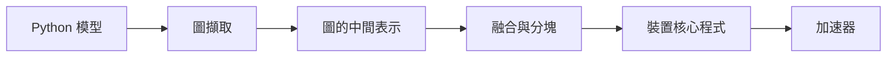

# 編譯器與核心程式

!!! info "屬於框架與工具"
    本頁位於[框架與工具](../index.zh-TW.md)之下。它比較編譯器與核心程式這一層；每個方法都有自己的頁面。

深度學習模型是一張張量運算的圖，要快速執行，就得把這張圖轉為特定晶片上的程式碼。編譯器負責這個轉換，核心程式則是在硬體上執行單一融合運算的程式碼。編譯器與核心程式語言決定資料在慢速記憶體與快速記憶體之間往返的次數，而這往往正是速度的限制。

## 概述

這一層由兩種需求驅動。第一，研究者用 Python 撰寫模型，框架必須把它擷取為圖，而不需要人工改寫。第二，新架構或新晶片不應等待專家為每個運算手寫最佳化的核心程式。編譯器透過擷取並改寫程式來滿足第一項需求；核心程式語言則讓工程師以接近硬體的方式撰寫融合運算，而不必寫底層裝置程式碼，來滿足第二項需求。

## 關鍵概念

- **圖擷取（graph capture）。** 把即時執行的 Python 轉為可供編譯器最佳化的圖。
- **運算融合（operator fusion）。** 把多個運算合併為一個核心程式，使中間結果留在快速記憶體中，而不必回到慢速記憶體。
- **分塊（tiling）。** 把大型張量運算切成能放進晶片上快速記憶體的區塊。
- **降階（lowering）。** 讓圖經過多層中間表示，最後變成裝置程式碼。
- **手寫核心程式。** 由專家為特定晶片撰寫的運算，例如 [FlashAttention](https://arxiv.org/abs/2205.14135) 中的注意力核心程式，它比未融合的版本讀寫更少的記憶體。

## 運作方式

框架擷取模型，編譯器改寫圖並選擇融合與分塊的方案，後端再為晶片產生核心程式。每個步驟可以在事前完成，也可以在第一次呼叫時完成。

## 主要方法

三個系統是主要的範例。每個系統都有自己的頁面，說明其設計、程式設計模型與限制。

- [XLA](xla.zh-TW.md)：JAX 與 TensorFlow 使用的線性代數編譯器，也已整合進 PyTorch。它透過中間表示降階計算圖，並支援多種後端。
- [torch.compile 與 TorchInductor](torch-compile.zh-TW.md)：PyTorch 的圖擷取與預設編譯器。它擷取 Python 程式並產生程式碼，對 NVIDIA、AMD 與 Intel GPU 使用 Triton 產生核心程式。
- [Triton](triton.zh-TW.md)：以 Python 撰寫分塊 GPU 核心程式的語言。工程師可以直接使用，TorchInductor 也把它當作後端。

TVM 是一個更早的系統，是能針對多種後端的深度學習工作負載的編譯器。Chen et al. (2018) 描述了它的圖層級與運算子層級最佳化。[^tvm]

## 關聯

- 晶片端的融合、數值格式與核心程式觀點，見[AI 硬體](../../hardware/index.zh-TW.md)及其[硬體與模型共同設計](../../hardware/co-design/index.zh-TW.md)頁面。
- 融合的注意力與 KV 快取處理，是[推論最佳化](../../inference-optimization/index.zh-TW.md)的核心。
- 模型端的觀點，包括改變核心程式所用數值格式的量化，見[模型壓縮](../../../theory/model-compression/index.zh-TW.md)。

## 應用

核心程式與編譯器的工作，在單一運算主導成本時最為重要，例如長上下文服務中的注意力；另外，新架構在任何手工最佳化函式庫出現之前，也需要快速的核心程式。

## 開放問題

- **手寫核心程式或編譯器。** 手寫核心程式能提供最多控制，編譯器則能以較少的努力支援更多硬體。兩者之間的平衡仍在變化。
- **可攜性。** 為某一晶片調校的核心程式，在另一晶片上可能損失大部分速度，而編譯器能縮小這個差距到什麼程度，目前尚不清楚。
- **可重現性。** 速度提升取決於編譯器版本，因此很難跨軟體環境比較。

## 參考文獻

### 開創性論文

- Dao, T. et al. (2022). *FlashAttention: Fast and Memory-Efficient Exact Attention with IO-Awareness*. arXiv. https://arxiv.org/abs/2205.14135 — 顯示把注意力分塊，以減少 GPU 記憶體層級之間的讀寫，能得到精確的注意力並降低記憶體流量。
- Chen, T. et al. (2018). *TVM: An Automated End-to-End Optimizing Compiler for Deep Learning*. arXiv. https://arxiv.org/abs/1802.04799 — 描述一個能跨多種後端進行圖層級與運算子層級最佳化的編譯器。

### 文章與文件

- OpenXLA. *XLA: Optimized compiler for machine learning*. https://openxla.org/xla — XLA 的官方說明，包括其支援的框架、後端與最佳化流程。
- PyTorch. *torch.compiler: Compiling PyTorch models*. https://docs.pytorch.org/docs/2.14/user_guide/torch_compiler/torch.compiler.html — 官方說明 torch.compile 的 TorchDynamo、AOTAutograd、TorchInductor 與預設後端，並列出可選的後端。
- Triton contributors. *Triton documentation*. https://triton-lang.org/main/index.html — Triton 的官方文件，它是以 Python 撰寫 GPU 核心程式的語言與編譯器。

[^tvm]: Chen et al. (2018)，見參考文獻。
